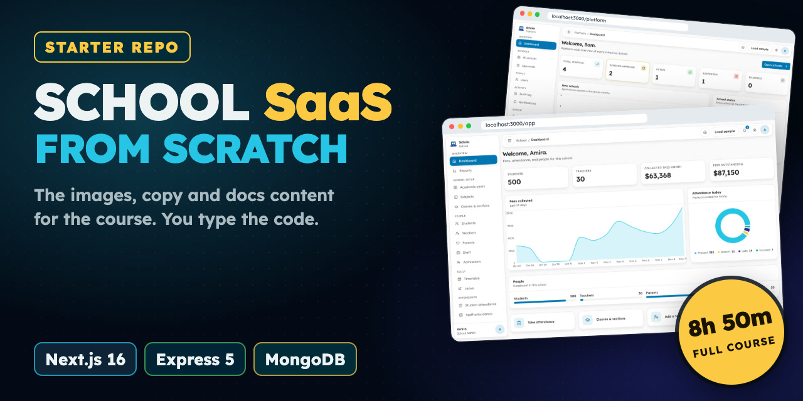
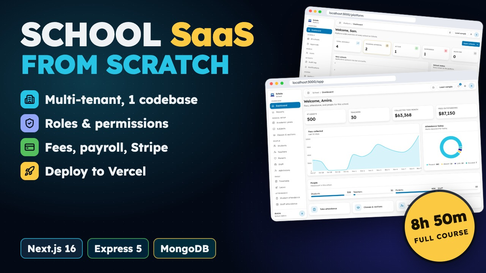

<p align="center">
  <a href="https://www.youtube.com/watch?v=LEa59WPN8A4"></a>
</p>

<h1 align="center">Schola Starter</h1>

<p align="center">
  The asset pack for <b>Build a Multi-Tenant School SaaS: Next.js 16 &amp; Express 5</b>, the full course on YouTube.<br>
  You type the code in the course. Everything you shouldn't have to type is here.
</p>

<p align="center">
  <a href="https://www.youtube.com/watch?v=LEa59WPN8A4"></a>
  <a href="https://buymeacoffee.com/reactbd/e/596629"></a>
  <a href="https://schola.reactbd.com"></a>
  <a href="https://docs.schola.reactbd.com"></a>
</p>

---

## What this repo is

In the course you build **Schola**, a multi-tenant school management SaaS, from an empty folder to a live deploy. A school applies, a super admin approves it, and from then on its classes, people, attendance, grades, fees, payroll and daily operations run in the same app as every other school.

Short files are typed live and longer ones are paged on screen, so you copy them as you watch. What you'd never learn anything from typing comes from this repo instead:

- **Images**: the marketing site's photos and the docs site's screenshots (light and dark).
- **Long copy**: the marketing text, and the privacy and terms pages.
- **Reference docs**: the `docs/` folder (architecture, design system, permissions, SEO, testing, deployment and one page per outside service).
- **The docs site's content**: every page of the Astro Starlight documentation site you build near the end.

There is **no application code** here. That's the course.

## Watch the course

<p align="center">
  <a href="https://www.youtube.com/watch?v=LEa59WPN8A4"></a>
</p>

**[Build a Multi-Tenant School SaaS: Next.js 16 & Express 5](https://www.youtube.com/watch?v=LEa59WPN8A4)**: 8 hours 50 minutes, 59 chapters, one video. Every chapter ends on a checkpoint, a command, page or test run with exactly what you should see, so you always know you're on track.

## How to use it

1. Clone this repo next to your project:

   ```sh
   git clone https://github.com/noorjsdivs/schola-starter.git
   ```

2. When a chapter says a file comes **from the starter repo**, copy that chapter's files into your project with the helper (Node 22+, no install):

   ```sh
   node schola-starter/copy.mjs 48 ./schola     # chapter 48: the marketing photos and copy
   node schola-starter/copy.mjs list            # every chapter that copies files
   ```

   Each file lands at the same path it has under `assets/`. Prefer to copy by hand? [`ASSETS.md`](ASSETS.md) lists every file by chapter.

Copy a chapter's files when you reach it, not all at once: some of them (the legal pages, the docs content) import components you build in that same chapter.

## What's inside

| Chapter | What it copies in | Files |
| ---: | --- | ---: |
| 1 | The project README and `docs/architecture.md` | 2 |
| 4 | `docs/design-system.md` | 1 |
| 6 | MongoDB Atlas and encryption service guides | 2 |
| 9 | `docs/permissions.md` | 1 |
| 34 | The Stripe service guide | 1 |
| 48 | The marketing photos, `content.ts` (the marketing copy) and the AdSense guide | 7 |
| 49 | The privacy and terms pages | 2 |
| 50 | `docs/seo.md` | 1 |
| 51 | Resend, SMTP and ImageKit service guides | 3 |
| 52 | Firebase and Neon service guides | 2 |
| 53 | `docs/demo-data.md` | 1 |
| 55 | `docs/testing.md` | 1 |
| 56 | `docs/deployment.md` | 1 |
| 57 | The documentation site: 101 content pages, 249 images and screenshots, icons, the writing guide | 358 |
| 59 | `docs/page-roadmap.md`, the ideas for what to build next | 1 |

384 files in all, about 10 MB.

## What you need for the course

- **Node.js 22** or newer, and **pnpm**
- **MongoDB**: local, or a free Atlas cluster
- **VS Code** (or any editor) and **Git**
- Free accounts for the outside services. Stripe and email run in **test mode**, so nothing costs money while you build.

## Want the finished code?

If you'd rather start from the working app, or check your code against it, the **complete Schola source code** is on Buy Me a Coffee: the web app, the API, the docs site and every package, with a one-command demo school of 500 students to load into your own database.

<p align="center">
  <a href="https://buymeacoffee.com/reactbd/e/596629"></a>
</p>

## The stack you'll build with

Next.js 16 · React 19 · TypeScript · Tailwind CSS 4 · TanStack Query · Zustand · Zod · Express 5 · MongoDB + Mongoose 9 · argon2 + JWT · Stripe · React PDF · Turborepo + pnpm · Vitest · Playwright · Astro Starlight · Vercel

## More from ReactBD

- YouTube: [@reactjsbd](https://www.youtube.com/@reactjsbd)
- Medium: [@reactbd](https://medium.com/@reactbd)
- Website: [reactbd.com](https://reactbd.com)

Found a file that doesn't match the course? [Open an issue](https://github.com/noorjsdivs/schola-starter/issues) with the chapter number.

## License

Free to use while you follow the course and in the projects you build from it, personal or commercial. Please don't resell or republish this pack on its own. See [LICENSE](LICENSE).
