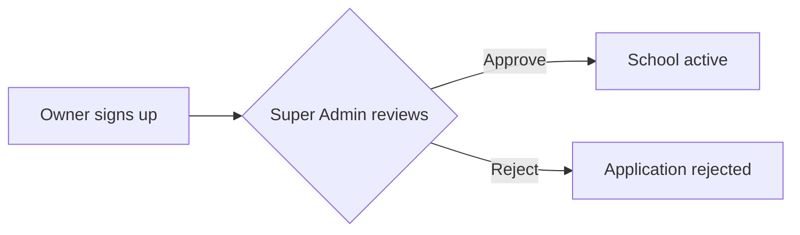

# Writing guide for the Schola docs

Every page in `src/content/docs/` follows this guide so the whole site reads
as one consistent book, start to end. Read it before adding or editing a page.

## Who we write for

Someone who has **never seen this project**: a new developer, a school
administrator evaluating Schola, a QA tester, or a viewer of the Schola
walkthrough videos. They should understand each page without reading the
code. Developers then get the code-level detail lower on the page.

So every page goes **from simple to detailed**:

1. Plain-language explanation (no jargon, or jargon explained on first use).
2. A picture: a diagram, pipeline, or screen anatomy.
3. Step-by-step behaviour — what you click, what you see.
4. Code-level detail (files, API endpoints, permissions, data shapes).
5. Edge cases and gotchas.

Pages double as **video scripts**: someone will record a screencast by
following a page top to bottom. Write steps in the exact order a person
performs them in the app, name every button and field exactly as the UI
labels it, and say which demo account to sign in with.

## Voice

- Short sentences. Active voice. "The teacher marks the register", not "The register is marked".
- Explain _why_, not just _what_.
- Define a term the first time it appears on a page and link it to the
  [Glossary](/start-here/glossary/) (e.g. `[section](/start-here/glossary/#section)`).
- Use the same names the app's UI uses (button labels in quotes: "Add student").
- **Only document what the code actually does.** Read the source before
  writing — the route file, the service, the page component, the Zod schema.
  If something is unclear, unfinished, or looks like a bug, say so in a
  `:::caution` box — never invent behaviour, fields, endpoints or env vars.
- No emoji. Icons come from the components (lucide, same set as the app).
- US English, "Schola" capitalised. Roles are written capitalised in prose
  ("School Admin", "Accountant") and as keys in code (`school_admin`).

## Page file format

- Files are `.mdx`. Frontmatter needs `title` and `description` (one sentence).
- Do not add an `# H1` — Starlight renders `title` as the H1.
- Use `##` for main sections and `###` for sub-sections (they feed the
  right-hand table of contents).
- Internal links use absolute paths with a trailing slash:
  `[Attendance](/features/daily/attendance/)`.
- Never link to a page that is not in the sidebar (`astro.config.mjs`).

## Standard page template (feature pages)

```mdx
---
title: Students
description: Admit students, enrol them in a section, and keep every record — profile, guardians, attendance, grades and fees — in one place.
---

import { Aside, Steps, Tabs, TabItem, Card, CardGrid, LinkCard, Badge } from '@astrojs/starlight/components';
{/* features/people/students.mdx is 2 folders deep under src/content/docs/,
    so components are 4 levels up. See the depth table below. */}
import Pipeline from '../../../../components/Pipeline.astro';
import ScreenAnatomy from '../../../../components/ScreenAnatomy.astro';
import SourceFile from '../../../../components/SourceFile.astro';
import Api from '../../../../components/Api.astro';
import Perm from '../../../../components/Perm.astro';
import Roles from '../../../../components/Roles.astro';
import Route from '../../../../components/Route.astro';
import DemoLogin from '../../../../components/DemoLogin.astro';

{/* 1. In one paragraph: what this is and why it exists. */}

## At a glance

<CardGrid>
  <Card title="Who uses it" icon="star">
    {" "}
    <Roles list={["school_admin", "principal"]} />{" "}
  </Card>
  <Card title="Where to find it" icon="laptop">
    {" "}
    <Route path="/app/students" />{" "}
  </Card>
  <Card title="Permissions" icon="approve-check">
    {" "}
    <Perm name="student:read" /> …{" "}
  </Card>
</CardGrid>

<DemoLogin as="School Admin" email="admin@greenfield.example" go="/app/students" />

## How it works

{/* A Pipeline or a mermaid flowchart/sequence diagram, then prose. */}

## The screen

<ScreenAnatomy title="Students" path="/app/students" regions={[ … ]} />

## Step by step

<Steps> 1. … 2. … </Steps>

## Every action on this screen

{/_ One ### per user action, in the order they appear on screen. For each:
what the user does, what the app does, which API it calls, the
permission it needs, what happens on success and on failure. _/}

### "Add student"

…

<Api method="POST" path="students" perm="student:create" />

## Who sees what

{/* Table: role → what they can see/do on this feature. */}

## Under the hood

{/* Files, models, Zod schemas, audit actions, data shapes. */}

- <SourceFile path="apps/api/src/modules/people/students.routes.ts" />

## Edge cases and gotchas

## Related pages

<CardGrid> <LinkCard … /> </CardGrid>
```

Import paths are relative to the page's folder depth:

| Page file                                       | Components import prefix   |
| ----------------------------------------------- | -------------------------- |
| `src/content/docs/index.mdx`                    | `../../components/…`       |
| `src/content/docs/start-here/introduction.mdx`  | `../../../components/…`    |
| `src/content/docs/features/people/students.mdx` | `../../../../components/…` |
| `src/content/docs/setup/services/stripe.mdx`    | `../../../../components/…` |

`pnpm --filter @schola/docs build` fails with _Could not resolve_ if the depth is wrong.

## Components available

| Component                                                                                         | Use it for                                                                                                                                                                                                                                                                                                                                        |
| ------------------------------------------------------------------------------------------------- | ------------------------------------------------------------------------------------------------------------------------------------------------------------------------------------------------------------------------------------------------------------------------------------------------------------------------------------------------- |
| `Pipeline` (`steps`, `caption`)                                                                   | Animated left→right flow (a status journey, an approval flow). 3–9 steps. `icon` is a lucide name from `src/lib/icons.ts` (e.g. `'user-plus'`, `'badge-check'`, `'wallet'`).                                                                                                                                                                      |
| `ScreenAnatomy` (`title`, `path`, `regions`)                                                      | Browser-window schematic with numbered regions + legend. Every screen page should have one. Region `area`: `'top'`, `'sidebar'` or `'main'` (default). Dashboard pages usually start with `{ label: 'Sidebar', area: 'sidebar' }` and `{ label: 'Top bar', area: 'top' }`.                                                                        |
| `FeatureGrid` (`items`)                                                                           | Linked tiles with lucide icons (`icon`, optional `tone`: `cyan`/`yellow`/`indigo`).                                                                                                                                                                                                                                                               |
| `BarChart` (`data`, `title`, `unit`)                                                              | Animated comparison of numbers.                                                                                                                                                                                                                                                                                                                   |
| `Roles` (`list`, `note?`)                                                                         | Which roles use something. Keys: `super_admin`, `school_admin`, `principal`, `vice_principal`, `teacher`, `accountant`, `student`, `parent`, `staff`, plus `user` (signed in, no school) and `public`.                                                                                                                                            |
| `Route` (`path`, `label?`)                                                                        | A page in the web app, e.g. `/app/fees`.                                                                                                                                                                                                                                                                                                          |
| `Api` (`method`, `path`, `perm?`)                                                                 | An API endpoint. `path` is relative to `/api/v1` (write `students/:id`, not `/api/v1/students/:id`).                                                                                                                                                                                                                                              |
| `Perm` (`name`)                                                                                   | A permission key, e.g. `fee:collect`.                                                                                                                                                                                                                                                                                                             |
| `SourceFile` (`path`, `symbol?`)                                                                  | A file in the repo. Paths from repo root, e.g. `apps/api/src/modules/fees/fee-payments.routes.ts`.                                                                                                                                                                                                                                                |
| `DemoLogin` (`as`, `email`, `go?`)                                                                | "Try it with the demo data" box. Password is always `Schola@2026`.                                                                                                                                                                                                                                                                                |
| Starlight: `Aside`, `Steps`, `Tabs`/`TabItem`, `Card`/`CardGrid`, `LinkCard`, `Badge`, `FileTree` | See https://starlight.astro.build/components/. `Card` icons must be Starlight built-ins: `star`, `laptop`, `approve-check`, `information`, `rocket`, `setting`, `puzzle`, `open-book`, `document`, `list-format`, `padlock`, `database`, `server`, `email`, `warning`, `pencil`, `analytics`, `clock`, `magnifier`, `random`, `comment`, `notes`. |

Asides can also be written as Markdown directives: `:::note`, `:::tip`,
`:::caution`, `:::danger` … `:::`.

`<Steps>` must wrap exactly one ordered list (`1.` items) — nothing else at
its top level, or the build fails.

### Mermaid diagrams

Use fenced code blocks:

````md

````

Use `flowchart` for decisions, `sequenceDiagram` for browser ↔ web ↔ API ↔
database conversations, `stateDiagram-v2` for status lifecycles,
`erDiagram` for data relationships. Keep labels short; quote labels that
contain punctuation. Avoid parentheses, colons and slashes in unquoted node
labels (they break Mermaid's parser).

## Naming conventions used across all pages

- "Schola" = the whole product. "the web app" = `apps/web` (Next.js 16,
  port 3000). "the API" = `apps/api` (Express 5, port 8000, base path
  `/api/v1`). "the docs" = this site (`apps/docs`, port 3002).
- "the platform console" = `/platform/*` (Super Admin). "the school app" =
  `/app/*` (tenant roles).
- A **school** is a tenant. Every tenant record carries `schoolId`.
- Roles: Super Admin, School Admin, Principal, Vice Principal,
  Teacher, Accountant, Student, Parent, Staff. A signed-in account with no
  school yet is a _visitor_ (a label, not a role) and lands on `/welcome`.
- The demo school is **Greenfield International School** (`pnpm seed`).
  Demo accounts: see `/reference/demo-accounts/`. Password `Schola@2026`.
- Field and status values keep their code names in `code` style:
  `pending_approval`, `fee_invoices.status = "paid"`.

## Facts to keep consistent

| Fact              | Value                                                                                               |
| ----------------- | --------------------------------------------------------------------------------------------------- |
| Web dev URL       | `http://localhost:3000`                                                                             |
| API dev URL       | `http://localhost:8000/api/v1` (the web app proxies `/api/*` to it)                                 |
| Docs dev URL      | `http://localhost:3002`                                                                             |
| Production        | `https://schola.reactbd.com` (API at `/api/v1` on the same host)                                    |
| Node / pnpm       | Node 22+, pnpm 9                                                                                    |
| Env files (dev)   | `test.env` (gitignored, wins) → `.env` (committed template)                                         |
| Currency / locale | USD, `en-US`                                                                                        |
| Password hashing  | argon2id                                                                                            |
| Sessions          | `schola_access` (JWT, 15 min) + `schola_refresh` (opaque, 30 days, rotated) + `schola_csrf` cookies |

## Styling: Tailwind CSS + Schola tokens

The docs use the **same design tokens as the web app**
(`apps/web/src/app/globals.css`): cyan primary, yellow accent, indigo
display headings, a navy dark mode, Lexend and Ubuntu Mono. They live in
`src/styles/global.css`; `src/styles/custom.css` maps Starlight's
`--sl-color-*` variables onto them.

- Custom components (`src/components/*.astro`) are built with Tailwind
  utilities: `bg-card`, `border-border`, `text-muted-foreground`,
  `text-brand`, `bg-brand-soft`, `bg-brand-yellow-soft`, `text-heading`.
- Add `not-content` to a component's root element so Starlight's prose
  styles don't leak into it.
- Pages themselves use Markdown + the components above, not raw Tailwind markup.

## Responsive & motion rules

Every page must work from a 360px phone up to a wide desktop:

- No sideways page scroll. Wide tables and Mermaid diagrams scroll inside
  their own box on phones — that's intended; everything else must wrap.
- Components already adapt: `Pipeline` stacks vertically, `ScreenAnatomy`
  puts the window above its legend, `FeatureGrid` drops to one column.
- Entrance animations start when the component scrolls into view and are
  switched off for readers who set "reduce motion". Give animated components
  the `doc-animate` class.

## UI stack

- **shadcn/ui components** live in `src/components/ui/`; React islands in
  `src/components/react/` (⌘K search, theme toggle, copy page, landing hero).
- Reading pages ship almost no JavaScript — keep it that way.
- Animation uses [Motion](https://motion.dev); every animation honours
  `prefers-reduced-motion`.
