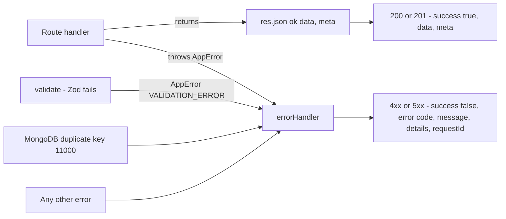

import { Aside, Steps, Card, CardGrid, LinkCard, Tabs, TabItem } from '@astrojs/starlight/components';
import SourceFile from '../../../components/SourceFile.astro';
import Api from '../../../components/Api.astro';
import Perm from '../../../components/Perm.astro';

The API is the only door into Schola's data, so every endpoint behaves the
same way: the same URL prefix, the same JSON wrapper around every answer, the
same error codes, the same way of paging through long lists. A developer (or
the web app) who has used one endpoint can predict how every other one
works. This page lists those shared rules, then shows how to add a new
endpoint that follows them.

## At a glance

<CardGrid>
  <Card title="Base URL" icon="server">
    `/api/v1` — `http://localhost:8000/api/v1` direct, or `/api/v1` through the web app.
  </Card>
  <Card title="Envelope" icon="document">
    `{ success, data, meta }` or `{ success: false, error: { code, message, details?, requestId? } }`
  </Card>
  <Card title="Validation" icon="approve-check">
    Zod schemas from `@schola/validation`, applied by `validate()`.
  </Card>
  <Card title="Limits" icon="clock">
    Auth 10/min/IP · general 120/min/user · Super Admin 60/min/user.
  </Card>
</CardGrid>

## Base URL and versioning

| Environment | Base URL |
|---|---|
| Development, direct | `http://localhost:8000/api/v1` |
| Development, through the web app | `http://localhost:3000/api/v1` (Next.js rewrite) |
| Production | `https://schola.reactbd.com/api/v1` |

The version is in the path. A breaking change would add `/api/v2` next to
`/api/v1`; there is only `v1` today. On this site, endpoints are written
relative to the base, e.g. <Api method="GET" path="students" /> means
`GET /api/v1/students`.

Routers are mounted in <SourceFile path="apps/api/src/app.ts" symbol="buildApp" />.
The groups:

| Group | Prefixes |
|---|---|
| Health and auth | `health`, `auth` |
| Platform (Super Admin) | `platform`, `platform/audit-logs` |
| School | `schools`, `schools/current`, `admin-transfer`, `members` |
| Academics | `academic-years`, `subjects`, `classes`, `sections` |
| People | `teachers`, `students`, `parents`, `staff`, `enrollments`, `student-records` |
| Attendance and assessment | `attendance`, `staff-attendance`, `exams`, `grades`, `remarks` |
| Finance | `fee-structures`, `fee-invoices`, `fee-payments`, `salary-structures`, `salary-records`, `stripe/webhook` |
| Operations | `timetable`, `leave`, `admissions`, `library`, `transport`, `hostel` |
| Insight and self-service | `dashboard`, `reports`, `audit-logs`, `notifications`, `me` |

The full list is on [API endpoints](/reference/api-endpoints/).

## The response envelope

Every handler ends in one of two ways, and both produce the same outer shape:



The shapes are TypeScript types in <SourceFile path="packages/types/src/envelope.ts" />,
built by two helpers in <SourceFile path="apps/api/src/utils/envelope.ts" />:

```ts title="apps/api/src/utils/envelope.ts"
export function ok<T>(data: T, meta?: ResponseMeta): SuccessEnvelope<T> {
  return meta ? { success: true, data, meta } : { success: true, data };
}

export function fail(code: ErrorCode, message: string, details?: unknown, requestId?: string): ErrorEnvelope {
  return { success: false, error: { code, message, ...(details !== undefined ? { details } : {}), ...(requestId ? { requestId } : {}) } };
}

export class AppError extends Error {
  constructor(code: ErrorCode, message: string, status = 400, details?: unknown) { /* … */ }
}
```

<Tabs>
  <TabItem label="Success">

```json
{
  "success": true,
  "data": [{ "_id": "6650…", "admissionNumber": "GIS-0001", "firstName": "Ava" }],
  "meta": { "pagination": { "page": 1, "pageSize": 20, "total": 500, "totalPages": 25 } }
}
```

  </TabItem>
  <TabItem label="Error">

```json
{
  "success": false,
  "error": {
    "code": "VALIDATION_ERROR",
    "message": "Invalid request body.",
    "details": {
      "formErrors": [],
      "fieldErrors": { "admissionNumber": ["Required"] }
    },
    "requestId": "b1e7c0de-…"
  }
}
```

  </TabItem>
</Tabs>

Handlers never build these objects by hand: they `res.json(ok(data, meta))`
on success and `throw new AppError(code, message, status)` on failure. The
error handler turns anything thrown into the error envelope (see
[Request lifecycle](/architecture/request-lifecycle/#9-when-something-goes-wrong)).

### Error codes

| Code | HTTP status | Typical cause |
|---|---|---|
| `UNAUTHENTICATED` | 401 | No or expired access cookie; wrong email or password; refresh token invalid |
| `INACTIVE_ACCOUNT` | 401 on requests and refresh, 403 on login | User suspended, soft-deleted or not yet approved; or the session's school is suspended, pending or rejected |
| `EMAIL_NOT_VERIFIED` | 403 | Password login before verifying the email |
| `FORBIDDEN` | 403 | Missing permission, missing or bad CSRF header, no roles in this school |
| `TENANT_MISMATCH` | 403 | A school route called without a school in the session |
| `NOT_FOUND` | 404 | Unknown ID, a record in another school, or no such route |
| `VALIDATION_ERROR` | 400 | Zod rejected the body, query or params; or a business rule (e.g. "Invalid or expired reset token.") |
| `CONFLICT` | 409 | Duplicate (unique index `11000`, "email already exists"), invalid state change ("Cannot suspend a school in status …") |
| `RATE_LIMITED` | 429 | Too many requests |
| `INTERNAL_ERROR` | 500 (503 when a service is not configured) | Unexpected error; Google sign-in without Firebase keys |

The list is fixed by `ERROR_CODES` in `@schola/types/envelope`; `AppError`
only accepts those strings.

## Pagination

List endpoints use **offset pagination** with the shared `paginationQuery`
schema from <SourceFile path="packages/validation/src/common.ts" symbol="paginationQuery" />:

| Query param | Rule | Default |
|---|---|---|
| `page` | integer ≥ 1 | 1 |
| `pageSize` | integer 1–100 | 20 |
| `sort` | string (accepted, not used by most lists) | — |

Lists extend it with their own filters (`q`, `classId`, `status` …) and
answer with `meta.pagination`:

```ts
res.json(ok(items, {
  pagination: { page, pageSize, total, totalPages: Math.max(1, Math.ceil(total / pageSize)) },
}));
```

The web app's `api.getPage()` reads `meta.pagination` into
`{ items, page, pageSize, total, totalPages }`; dropdowns that need "all" rows
ask for one page of 100.

<Aside type="caution" title="No cursor pagination yet">
The original spec asks for cursor pagination on large lists. `CursorPagination`
(`nextCursor`, `hasMore`) exists as a type, and
<SourceFile path="apps/api/src/repositories/audit.repo.ts" /> has cursor
helpers, but no route uses them — every list, including the audit logs, is
offset-paginated.
</Aside>

A few lists wrap their rows: <Api method="GET" path="notifications" /> answers
`data: { items, unread }` with the pagination in `meta`.

## Validation

Every body, query string and path parameter is checked with a Zod schema
before the handler runs. The schemas live in `@schola/validation` so the web
forms use the very same rules.

```ts title="apps/api/src/middleware/validate.ts (abridged)"
export function validate({ body, query, params }: Schemas): RequestHandler {
  return (req, _res, next) => {
    if (body) {
      const parsed = body.safeParse(req.body);
      if (!parsed.success) {
        throw new AppError("VALIDATION_ERROR", "Invalid request body.", 400, parsed.error.flatten());
      }
      req.body = parsed.data;
    }
    if (query) { /* same, "Invalid query string.", then Object.defineProperty(req, "query", { value: parsed.data }) */ }
    if (params) { /* same, "Invalid path params.", then Object.assign(req.params, parsed.data) */ }
    next();
  };
}
```

Conventions the schemas follow:

- **`.strict()` objects** — unknown keys are rejected, so a client can't sneak
  in `schoolId` or `createdBy`.
- **Shared primitives** — `objectId` (24 hex chars), `email` (trimmed,
  lower-cased), `phone`, `strongPassword`.
- **PATCH bodies use `patchSchema(createSchema)`** — every field optional,
  defaults removed, strict.
- **`details` is `error.flatten()`** — `{ formErrors: string[], fieldErrors: { field: string[] } }`,
  which the web forms map onto fields.
- **Query flags use `queryBoolean`** (`packages/validation/src/common.ts`), which
  accepts `true`, `false`, `1` and `0`. `z.coerce.boolean()` is avoided because
  it turns the string `"false"` into `true`.

<Aside type="note" title="Why validate() redefines req.query">
In Express 5, `req.query` is a getter that re-parses the URL on every access,
so changing the object it returns is lost. `validate()` therefore shadows the
getter with an own property that holds Zod's output. Handlers read the parsed
values: defaults (`page = 1`, `pageSize = 20`), coercions
(`z.coerce.number()`, `z.coerce.date()`) and trims all apply. Bodies are
replaced directly (`req.body = parsed.data`) and path params are merged in.
</Aside>

## Rate limits

`express-rate-limit` 8, in memory, defined in
<SourceFile path="apps/api/src/middleware/rate-limit.ts" />:

| Limiter | Limit | Keyed by | Applied to |
|---|---|---|---|
| `authRateLimit` | **10 / min** in production, 60 / min in development | IP | every `/auth/*` route except `logout`, `me`, `csrf` |
| `generalRateLimit` | **120 / min** | user ID (IP when signed out) | every school module router, `me`, `notifications`, tenant `audit-logs`; `admin-transfer` (by IP, mounted before auth) |
| `superAdminRateLimit` | **60 / min** | user ID | `/platform/*`, `/platform/audit-logs` |

Responses carry the draft-7 `RateLimit` and `RateLimit-Policy` headers. When
a limit is hit, the auth and general limiters answer `429` with
`{ success: false, error: { code: "RATE_LIMITED", … } }`.

- **The Super Admin limiter has no custom message**, so its `429` body is
  express-rate-limit's default text, not the envelope.
- **Public school signup has no limiter.** <Api method="POST" path="schools/signup" />
  and <Api method="GET" path="health" /> are unthrottled.
- **Counters are per process.** Several API instances or a restart each start
  fresh.

## Request IDs

Every request gets an ID, from <SourceFile path="apps/api/src/middleware/request-id.ts" />:

- an incoming `x-request-id` header is reused if it matches `^[\w-]{8,128}$`,
  otherwise a new UUID is generated;
- it is sent back in the `x-request-id` response header (exposed to browsers
  through CORS);
- it appears in every pino log line, in `error.requestId` of error
  envelopes, and in `metadata.requestId` of audit entries.

## Files: CSV and PDF

Not every response is JSON:

| Kind | Endpoints | Headers |
|---|---|---|
| CSV | <Api method="GET" path="reports/fees/export.csv" perm="report:export" />, <Api method="GET" path="reports/attendance/export.csv" perm="report:export" />, <Api method="GET" path="reports/payroll/export.csv" perm="report:export" /> | `text/csv; charset=utf-8`, `Content-Disposition: attachment` |
| PDF | receipts, payslips, report cards — see [PDFs and media](/architecture/pdfs-and-media/) | `application/pdf`, `Content-Disposition: inline` |
| Empty | every `DELETE` route | `204 No Content`, no body |

CSV is written by the dependency-free `toCsv(rows, columns)` in
<SourceFile path="apps/api/src/services/csv.service.ts" />: values containing a
comma, quote or newline are quoted, quotes doubled, dates written as ISO
strings. Exports cap rows (10 000 for fees and payroll, 50 000 for
attendance) and write a `report.*.export` audit entry.

## Adding a new route

In practice most modules keep the handlers inside `<name>.routes.ts`; the
`auth`, `schools`, `platform-users`, `system-settings` and `admin-transfer`
modules split them into a controller and a service.

<Steps>

1. **Schema first.** Add the body / query schema to
   `packages/validation/src/<area>.ts` (use `patchSchema()` for PATCH). If it
   is a new file, add it to that package's `exports`.
2. **Permission.** If the route needs a new key, add it to
   `PERMISSIONS`, the role bundles in
   `services/rbac/permissions.ts`, and [Permissions](/reference/permissions/).
3. **Router.** In `apps/api/src/modules/<area>/<name>.routes.ts`, start with
   the module chain, then add the route:

   ```ts
   export const booksRouter: Router = Router();
   booksRouter.use(requireAuth, requireTenant, generalRateLimit);

   booksRouter.post(
     "/",
     requirePermission("library:manage"),
     validate({ body: createBookSchema }),
     async (req, res, next) => {
       try {
         const ctx = req.ctx!;
         const created = await withTenant(LibraryBook, ctx).create(req.body);
         await auditLogger.log(
           { schoolId: ctx.schoolId, actorId: ctx.userId, actorRoleAtTime: ctx.role,
             action: "library.book.create", resource: "library_book", resourceId: created._id,
             after: { title: created.title } },
           { ip: req.ip ?? null, userAgent: req.get("user-agent") ?? null, requestId: req.requestId },
         );
         res.status(201).json(ok(created.toJSON()));
       } catch (err) {
         next(err);
       }
     },
   );
   ```

4. **Mount it** in `app.ts`: `app.use("/api/v1/<prefix>", booksRouter);`
   (before `notFound`).
5. **Data access.** Use `withTenant(Model, ctx)` for every read and write;
   never take `schoolId` from the request. Throw `AppError` for business
   errors; return `.toJSON()` objects, not raw documents.
6. **Tests.** Add a Supertest integration test in
   `modules/<area>/__tests__/` covering success, the permission `403`, and a
   two-school isolation check (see [Multi-tenancy](/architecture/multi-tenancy/#the-tests-that-prove-it)).
7. **Docs.** Add the endpoint to [API endpoints](/reference/api-endpoints/)
   and the feature page.

</Steps>

<Aside type="caution" title="Flatter than the textbook">
There is no strict controller → service → repository split. The code is
flatter: handlers call `withTenant` and `auditLogger.log` directly. Follow the
existing module you are extending.
</Aside>

## Related pages

<CardGrid>
  <LinkCard title="Request lifecycle" description="The middleware chain behind these conventions." href="/architecture/request-lifecycle/" />
  <LinkCard title="API endpoints" description="Every endpoint, grouped by module." href="/reference/api-endpoints/" />
  <LinkCard title="Roles & permissions" description="The permission keys routes require." href="/architecture/rbac/" />
  <LinkCard title="Testing" description="Writing the integration test for a new route." href="/operations/testing/" />
</CardGrid>
