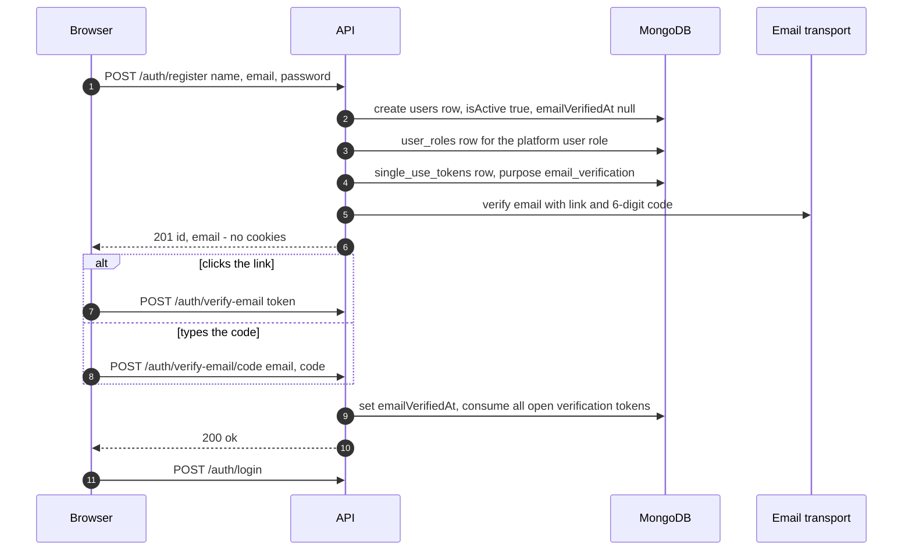
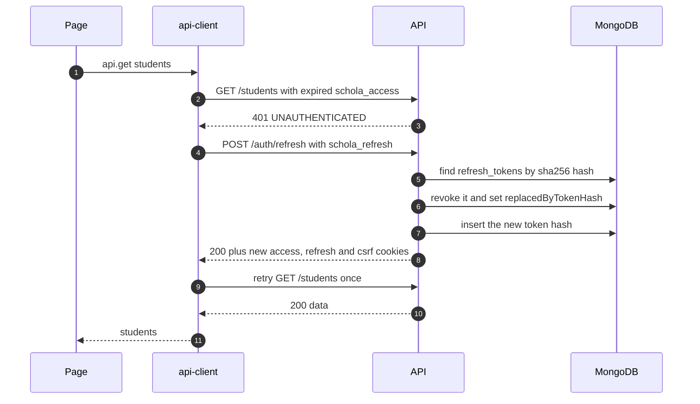
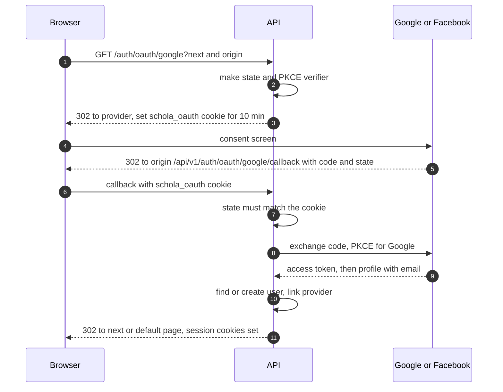

import { Aside, Steps, Card, CardGrid, LinkCard, Tabs, TabItem } from '@astrojs/starlight/components';
import Pipeline from '../../../components/Pipeline.astro';
import SourceFile from '../../../components/SourceFile.astro';
import Api from '../../../components/Api.astro';
import Route from '../../../components/Route.astro';
import Roles from '../../../components/Roles.astro';
import DemoLogin from '../../../components/DemoLogin.astro';

*Authentication* answers one question: **who is making this request?** (What
they may do is a separate question — see [Roles & permissions](/architecture/rbac/).)

Schola keeps the answer in **cookies** that the browser stores and sends back
automatically. JavaScript on the page cannot read the two important ones, so
a malicious script can't steal a session. One cookie is a short-lived
signed pass (15 minutes); the other is a long-lived ticket (30 days) that is
swapped for a fresh pair whenever the pass runs out. A third, readable cookie
protects against forged form submissions from other websites.

<DemoLogin as="School Admin" email="admin@greenfield.example" go="/app" />

## At a glance

<CardGrid>
  <Card title="Passwords" icon="padlock">
    argon2id — 19 MiB memory, 2 iterations, parallelism 1 (env-tunable).
  </Card>
  <Card title="Access token" icon="approve-check">
    JWT, HS256, 15 min, in the httpOnly `schola_access` cookie.
  </Card>
  <Card title="Refresh token" icon="random">
    Opaque 64 random bytes, 30 days, stored as a SHA-256 hash, rotated on every use.
  </Card>
  <Card title="CSRF" icon="warning">
    HMAC-signed token in the readable `schola_csrf` cookie, echoed in `x-csrf-token`.
  </Card>
</CardGrid>

## The cookies

All cookies are set by the API in <SourceFile path="apps/api/src/utils/cookies.ts" />
with `SameSite=Lax`, `Path=/`, `Secure` in production, and
`Domain=COOKIE_DOMAIN` (omitted when it is `localhost`; `.schola.reactbd.com`
in production).

| Cookie | Holds | JS can read? | Lifetime | Set by |
|---|---|---|---|---|
| `schola_access` | Signed JWT: `sub` (user ID), `sid` (school ID or `null`), `rol`, `jti`, `iss=schola`, `aud=schola.web` | no (httpOnly) | `JWT_ACCESS_TTL` (15 min) | login, refresh, OAuth, Google |
| `schola_refresh` | Opaque random token (base64url of 64 bytes) | no (httpOnly) | `JWT_REFRESH_TTL` (30 days) | login, refresh, OAuth, Google |
| `schola_csrf` | `nonce.hmac` — HMAC-SHA256 of a random nonce with `CSRF_SECRET` | **yes** | 30 days | login, refresh, OAuth, Google, <Api method="GET" path="auth/csrf" /> |
| `schola_oauth` | JSON with OAuth `state`, PKCE verifier, provider, `next`, origin | no (httpOnly) | 10 min | <Api method="GET" path="auth/oauth/:provider" /> |

The database keeps only a **hash** of each refresh token, in
`refresh_tokens` (`userId`, `tokenHash`, `replacedByTokenHash`, `revokedAt`,
`ip`, `userAgent`, `expiresAt`). A TTL index removes rows 30 days after they
expire.

## Every auth endpoint

| Endpoint | Rate limit | Auth | Purpose |
|---|---|---|---|
| <Api method="POST" path="auth/register" /> | auth | public | Create a visitor account (no cookies yet) |
| <Api method="POST" path="auth/verify-email" /> | auth | public | Verify by link token |
| <Api method="POST" path="auth/verify-email/code" /> | auth | public | Verify by email + 6-digit code |
| <Api method="POST" path="auth/verify-email/resend" /> | auth | public or session | Send a new link and code (signed out: body `{ email }`; always `202`) |
| <Api method="POST" path="auth/login" /> | auth | public | Password sign-in, sets cookies |
| <Api method="POST" path="auth/refresh" /> | auth | refresh cookie | Rotate tokens |
| <Api method="POST" path="auth/logout" /> | — | session + CSRF | Revoke this device's refresh token, clear cookies (allowed even when the school is suspended) |
| <Api method="GET" path="auth/me" /> | — | session | Current user, role, school, permissions |
| <Api method="GET" path="auth/csrf" /> | — | public | Issue a fresh CSRF cookie and return it |
| <Api method="POST" path="auth/forgot-password" /> | auth | public | Email a reset link (always `202`) |
| <Api method="POST" path="auth/reset-password" /> | auth | public | Set a new password with the link token |
| <Api method="GET" path="auth/oauth/:provider" /> | auth | public | Start Google / Facebook redirect sign-in |
| <Api method="GET" path="auth/oauth/:provider/callback" /> | auth | `schola_oauth` cookie | Finish it, set cookies, redirect |
| <Api method="POST" path="auth/google" /> | auth | public | Firebase ID-token fallback for Google |

"auth" = `authRateLimit`: **10 requests / minute / IP** in production, 60 in
development. Routes live in <SourceFile path="apps/api/src/modules/auth/auth.routes.ts" />;
logic in `auth.service.ts` and `oauth.service.ts`.

## Registration and email verification



<Steps>

1. The sign-up form (<Route path="/signup" />) posts `firstName`, `lastName`,
   `email`, `password`. The shared `strongPassword` rule needs 8–128
   characters with an uppercase letter, a lowercase letter and a digit.
2. The API refuses a duplicate email (`409 CONFLICT`), hashes the password
   with argon2id, and creates the user with `isActive: true` and
   `emailVerifiedAt: null`. It grants the platform **`user`** role
   (`schoolId: null`) — the *visitor* state. If `DATABASE_URL` is set, the
   identity is mirrored to Neon.
3. It writes an audit entry `auth.register`, then sends the verification
   email. Sending is **best effort**: a provider error is logged but the
   account stays created.
4. The email holds a link to `/verify?token=…` **and** a 6-digit code. Both
   are stored only as SHA-256 hashes (the code inside the token row's
   `payload.codeHash`) and expire after `EMAIL_VERIFICATION_TTL_HOURS` (72).
5. Using either one sets `emailVerifiedAt`, consumes every open verification
   token for that user, and writes `auth.email.verified`.
6. If the email expired or never arrived, **Send a new code** on
   <Route path="/verify" /> posts the typed address to
   <Api method="POST" path="auth/verify-email/resend" />. Signed out, the API
   answers `202` every time — it stays silent for unknown, inactive or already
   verified addresses so nobody can probe for accounts — and sends at most one
   email per address per minute (audit `auth.email.verification_resent`). A
   signed-in caller can post with no body to resend to their own address.

</Steps>

School owners who apply through <Api method="POST" path="schools/signup" />
get the same verification email, but their account is created with
`isActive: false` until a Super Admin approves the school. See
[Approvals](/features/platform/approvals/).

## Sign-in, lockout and the active school

```ts title="apps/api/src/modules/auth/auth.service.ts — login() order of checks (abridged)"
const user = await User.findOne({ email }).select("+passwordHash");
if (!user) throw new AppError("UNAUTHENTICATED", "Invalid email or password.", 401);
if (user.lockedUntil && user.lockedUntil > new Date()) {
  throw new AppError("UNAUTHENTICATED", "Account temporarily locked. Try again later.", 401);
}
if (!user.passwordHash) { /* "This account uses Google or Facebook sign-in…" 401 */ }
const ok = await verifyPassword(user.passwordHash, password);
// A lock that has run out starts a fresh count.
const priorFailures = user.lockedUntil ? 0 : user.failedLoginAttempts;
if (!ok) {
  const attempts = priorFailures + 1;
  const lock = attempts >= env.LOGIN_LOCKOUT_THRESHOLD
    ? new Date(Date.now() + env.LOGIN_LOCKOUT_MINUTES * 60_000) : null;
  await User.updateOne({ _id: user._id }, { $set: { failedLoginAttempts: attempts, lockedUntil: lock } });
  throw new AppError("UNAUTHENTICATED", "Invalid email or password.", 401);
}
// "Account is not active." — or, for a pending school's owner, "Your school's
// application is waiting for approval. You'll get an email when it's approved."
if (!user.isActive) throw await inactiveAccountError(user._id);
if (!user.emailVerifiedAt) throw new AppError("EMAIL_NOT_VERIFIED", "Verify your email before logging in…", 403);
// then: open the session in the first active school (sessionSchoolId)
```

| Check | Result |
|---|---|
| Unknown email | `401 UNAUTHENTICATED` "Invalid email or password." |
| `lockedUntil` in the future | `401` "Account temporarily locked." |
| Account has no password (Google/Facebook only) | `401` telling them to use that button |
| Wrong password | counter +1; at `LOGIN_LOCKOUT_THRESHOLD` (5) set `lockedUntil` = now + `LOGIN_LOCKOUT_MINUTES` (15). After a lock has expired the count starts again from 0, so it takes another five wrong passwords to lock again. |
| `isActive: false` | `403 INACTIVE_ACCOUNT` — "Your school's application is waiting for approval. You'll get an email when it's approved." for the owner of a `pending_approval` school, otherwise "Account is not active." |
| Email not verified | `403 EMAIL_NOT_VERIFIED` |
| Member of schools, none of them `active` | `403 INACTIVE_ACCOUNT` with a message naming the status ("This school is suspended…", "…still waiting for approval…", "…was rejected…"). A Super Admin falls back to the platform context instead. |
| No roles at all, not a platform user | self-heal: grant the `user` role and continue |
| Success | counter reset, `lastLoginAt` set, cookies issued, audit `auth.login` |

The **active school** is the first of the person's `user_roles` schools whose
status is `active` (`sessionSchoolId` in `auth.service.ts`, using
<SourceFile path="apps/api/src/services/school-status.ts" />). Its ID becomes
the `sid` claim; with no school membership at all, `sid` is `null` (Super
Admin or visitor).
The response body is the same shape as <Api method="GET" path="auth/me" />, so
the login form stores it in the session store and redirects straight away:
`super_admin` → <Route path="/platform" />, `user` → <Route path="/welcome" />,
everyone else → the `?next=` page or <Route path="/app" />.

## Staying signed in: refresh rotation



- The API client coalesces concurrent 401s into **one** refresh call and
  retries each request **once**. It skips the refresh entirely when there is
  no `schola_csrf` cookie (no sign of a session).
- `refresh()` rejects a token that is unknown, revoked or expired
  (`401`), and an inactive or deleted user (`401 INACTIVE_ACCOUNT`). It
  re-reads memberships, so a newly approved school appears in `sid` here, and
  repeats the active-school check: if none of the person's schools is `active`
  any more it answers `401 INACTIVE_ACCOUNT` and the session ends.
- `requireAuth` checks the session's school on **every** request too (status
  cached for 10 seconds per API process, cleared on suspend, reactivate,
  approve and reject), so suspending a school ends its members' sessions on
  their next request rather than at the next refresh.
- Rotation: the old row gets `revokedAt` and `replacedByTokenHash`; a new row
  is inserted with the request's IP and user agent.

## CSRF protection

Cookies are sent automatically, so a hostile site could try to submit a form
to Schola in the user's name. Two layers stop that:

1. **`SameSite=Lax`** — browsers don't attach the session cookies to
   cross-site `POST`s at all.
2. **A signed header token** — `requireAuth` requires an `x-csrf-token` header
   on every `POST`, `PUT`, `PATCH` and `DELETE`. The value is
   `nonce.HMAC-SHA256(CSRF_SECRET, nonce)`; the server recomputes the HMAC
   and compares with `timingSafeEqual`. A cross-origin page can't set custom
   headers without passing the CORS allow-list.

```ts title="apps/api/src/utils/cookies.ts"
export function verifyCsrfToken(token: string | undefined): boolean {
  if (!token) return false;
  const [nonce, mac] = token.split(".");
  if (!nonce || !mac) return false;
  const secret = env.CSRF_SECRET ?? "dev-csrf-secret-not-for-production-use-32b";
  const expected = createHmac("sha256", secret).update(nonce).digest("base64url");
  const a = Buffer.from(mac);
  const b = Buffer.from(expected);
  if (a.length !== b.length) return false;
  return timingSafeEqual(a, b);
}
```

The web app's API client reads `schola_csrf` with `document.cookie` and sends
it as `x-csrf-token` on every mutating call.

<Aside type="caution" title="Signed token, not a strict double-submit">
The original spec calls this a *double-submit* token. The server only checks that the
header carries **a** validly signed token; it does not compare the header with
the `schola_csrf` cookie, and tokens are not tied to a user or session. The
real protection is `SameSite=Lax` plus the custom-header requirement under a
strict CORS allow-list.
</Aside>

## Signing out and revoking sessions

| Action | Endpoint | Effect |
|---|---|---|
| Sign out | <Api method="POST" path="auth/logout" /> | Revokes the refresh token in the cookie, clears all three cookies, audit `auth.logout`. The web app also wipes the persisted session store. |
| List my devices | <Api method="GET" path="me/sessions" /> | Live refresh tokens with IP, user agent and which one is `current` |
| Sign out one device | <Api method="DELETE" path="me/sessions/:id" /> | Revokes that refresh token (`204`), audit `auth.session.revoke` |
| Sign out other devices | <Api method="POST" path="me/sessions/revoke-others" /> | Revokes all but the current one |
| Change password | <Api method="POST" path="me/password" /> | Checks the current password (if one exists), adds `password` to `authProviders`, revokes all **other** sessions |
| Suspend a user (Super Admin) | <Api method="POST" path="platform/users/:id/suspend" /> | Sets `isActive: false`; `requireAuth` and `refresh` then reject every request |

These live on the "My profile" screen (<Route path="/app/profile" />).

## Password reset

<Steps>

1. <Api method="POST" path="auth/forgot-password" /> always answers `202`,
   whether or not the email exists, so it can't be used to discover accounts.
2. For a known email it stores a `password_reset` single-use token (hash
   only, `PASSWORD_RESET_TTL_MIN` = 60 minutes) and emails
   `${APP_URL}/reset-password?token=…`.
3. <Api method="POST" path="auth/reset-password" /> with `{ token, password }`
   sets the new argon2id hash, clears the lockout, **marks the email
   verified**, consumes the token and **revokes every refresh token** for the
   user — every device must sign in again.

</Steps>

The same flow doubles as the **setup link** for accounts created by someone
else: an invited Super Admin, and the owner of a school the Super Admin
creates directly without setting a password, both receive a password-reset
email to choose their first password.

## Google and Facebook sign-in

The "Google" and "Facebook" buttons on <Route path="/login" /> and
<Route path="/signup" /> are plain links to the API's **OAuth redirect flow**:



<Steps>

1. `beginOAuth` checks the provider's client ID/secret
   (`GOOGLE_OAUTH_CLIENT_*` / `FACEBOOK_OAUTH_CLIENT_*`). Missing → redirect
   to `/login?error=oauth_unconfigured`.
2. It resolves the **origin** against an allow-list (`http://localhost:3000`,
   `http://127.0.0.1:3000`, `https://schola.reactbd.com`, or `APP_URL`), keeps
   `next` only if it is a same-site path, and saves state + verifier in the
   `schola_oauth` cookie. Google gets an S256 PKCE challenge; Facebook does
   not use PKCE.
3. The callback URL is `${origin}/api/v1/auth/oauth/:provider/callback` —
   through the web app's proxy, so the cookies land on the right host.
4. On return the API compares `state`, exchanges the code, and fetches the
   profile. Google must report a verified email; Facebook must return an
   email at all.
5. `signInWithOAuthProfile` finds the user by `googleId` / `facebookId`, then
   by email. A new user is created **already verified**, with no password and
   the `user` role. An existing **active** user gets the provider linked
   (never overwriting a password) and is marked verified. An inactive account
   (suspended by a Super Admin, or a school owner awaiting approval) is
   refused with `INACTIVE_ACCOUNT` and lands on `/login?error=oauth_denied` —
   a social sign-in never re-opens an account. The active-school check above
   applies as well.
6. Cookies are set exactly as for a password login, and the browser lands on
   `next`, or `/platform`, `/app` or `/onboarding/school` depending on the
   role. Failures land on `/login?error=oauth_denied | oauth_email | oauth_state`.

</Steps>

Lockout never applies to OAuth sign-ins.

### The Firebase fallback

<Api method="POST" path="auth/google" /> accepts `{ idToken }` from the
Firebase Web SDK. The API verifies it with
`firebase-admin` (`verifyIdToken(idToken, true)` — also checks revocation),
requires `sign_in_provider === "google.com"` and a verified email, then does
the same find-or-create, with the same refusal of inactive accounts and
closed schools (`403 INACTIVE_ACCOUNT`). Without the three `FIREBASE_*`
server variables it answers `503`.

<Aside type="caution" title="The fallback has no caller in the web app">
<SourceFile path="apps/web/src/lib/firebase.ts" symbol="startGoogleSignIn" />
exists, but no component imports it — the sign-in buttons use the redirect
flow. The endpoint is reachable but unused by the UI. It also answers with
code `INTERNAL_ERROR` (status 503) where the code comment mentions
`OAUTH_DISABLED`.
</Aside>

## How the web app keeps the session

| Piece | File | Job |
|---|---|---|
| Session store | <SourceFile path="apps/web/src/stores/session-store.ts" /> | Zustand store; persists **only** the `user` object to `localStorage` (`schola.session`) so reloads don't flash "signed out". Never tokens. |
| Auth provider | <SourceFile path="apps/web/src/providers/auth-provider.tsx" /> | On mount: show the persisted user and revalidate with `/auth/me`; skip the call when there is no persisted user and no `schola_csrf` cookie. Revalidates on window focus and when the network returns. A definitive `401` clears the user; network errors keep it. |
| API client | <SourceFile path="apps/web/src/lib/api-client.ts" /> | Sends cookies, adds `x-csrf-token`, silent refresh on `401`. |
| Route guard | <SourceFile path="apps/web/src/components/auth/require-role.tsx" /> | Wraps `/app` and `/platform` layouts; redirects to `/login?next=…` or `/welcome`. |
| Edge proxy | <SourceFile path="apps/web/proxy.ts" /> | Intended cookie-presence redirects (see the caution below). |

<Aside type="caution" title="proxy.ts location">
Next.js only loads the proxy file from the folder that holds `app/` — here
`apps/web/src/`. The file is at `apps/web/proxy.ts`, and the dev build's
middleware manifest is empty, so the edge redirects described in its header
likely never run. `RequireRole` still protects every route tree.
</Aside>

## Edge cases and gotchas

- **Reset adds the `password` provider.** As the original spec asks, a Google user who
  sets a password via reset ends up with `authProviders: ["google",
  "password"]` (`resetPassword()` uses `$addToSet`). `POST /me/password` does
  the same.
- **Older reset links stay valid.** Requesting a second reset doesn't
  invalidate the first link; each expires on its own after 60 minutes.
- **Revoking a session isn't instant for its access token.** A revoked
  refresh token can't be used again, but the 15-minute access JWT it was paired
  with keeps working until it expires — unless the user is also suspended.
- **No reuse detection.** Presenting an already-rotated refresh token just
  gets a `401`; it doesn't revoke the rest of that token family.
- **Logout needs a valid CSRF header.** It runs through
  `requireAuthForSignOut` — `requireAuth` without the school-status check, so
  a member of a suspended school can still sign out. The web app clears its
  local state even if the call fails.
- **`JWT_REFRESH_SECRET` is unused.** Refresh tokens are opaque, so only
  `JWT_ACCESS_SECRET` signs anything — yet production still requires both.
- **The 6-digit code has no per-account attempt limit.** Guessing is limited
  only by `authRateLimit` (10/min/IP in production).

## Related pages

<CardGrid>
  <LinkCard title="Sign up and sign in" description="The screens and messages a user sees." href="/features/accounts/sign-up-and-sign-in/" />
  <LinkCard title="Social sign-in setup" description="Getting Google, Facebook and Firebase keys." href="/setup/services/social-sign-in/" />
  <LinkCard title="Security" description="Every spec control, including cookies and CSRF." href="/architecture/security/" />
  <LinkCard title="Roles & permissions" description="What happens after the user is identified." href="/architecture/rbac/" />
</CardGrid>
