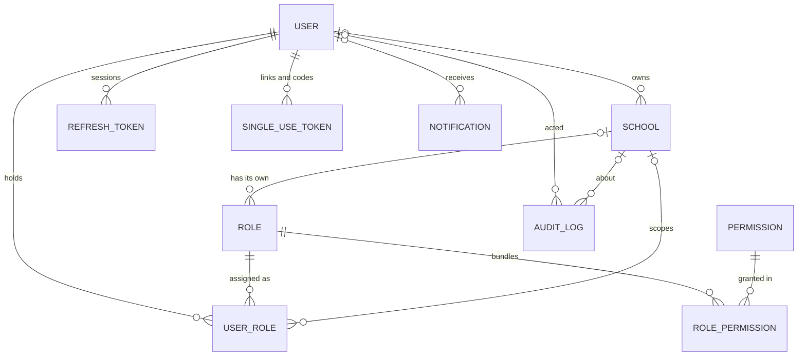
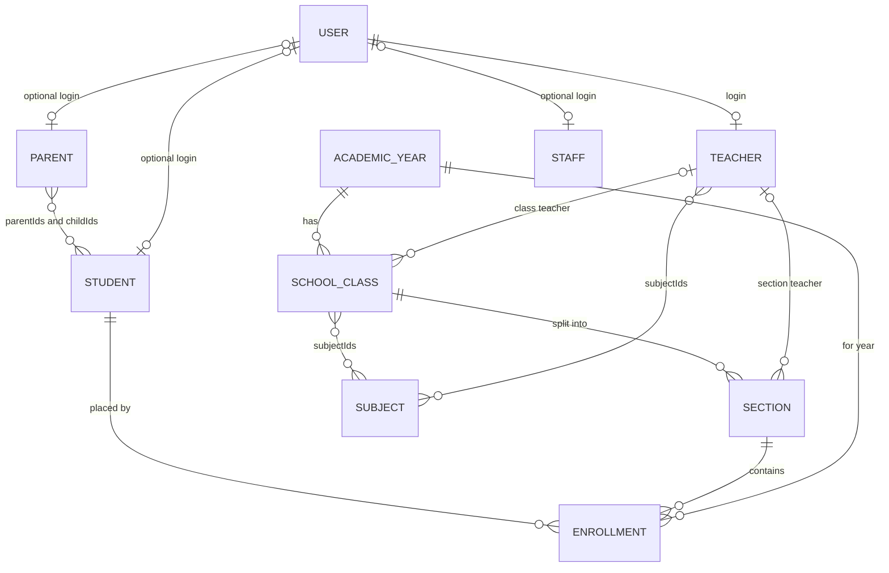
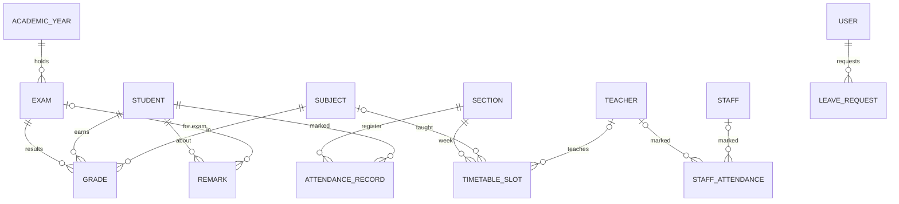
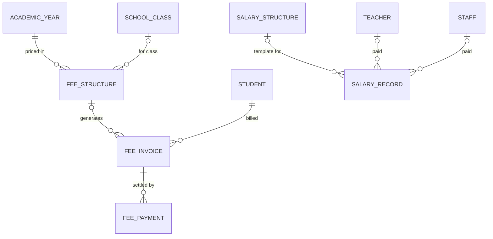
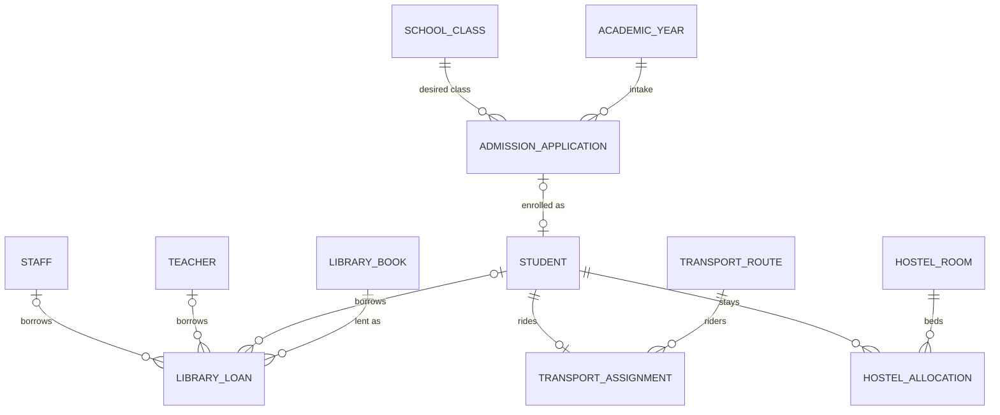

import { Aside, Steps, Card, CardGrid, LinkCard, Tabs, TabItem } from '@astrojs/starlight/components';
import SourceFile from '../../../components/SourceFile.astro';

All of Schola's data lives in **one MongoDB database**. Each kind of record —
a student, an invoice, an attendance mark — is a *collection*, described in
code by a **Mongoose model** in <SourceFile path="packages/db/src/models/index.ts" />.
There are **39 models**. Eleven are *platform* data (accounts, schools,
roles, the audit log); the other 28 belong to one school and carry a
`schoolId` (see [Multi-tenancy](/architecture/multi-tenancy/)).

The diagrams below show how records point at each other. Field tables follow
for each group.

## At a glance

<CardGrid>
  <Card title="Platform" icon="setting">
    11 models: users, schools, roles, permissions, sessions, tokens, audit, notifications, settings.
  </Card>
  <Card title="School data" icon="database">
    28 models, all with a required, indexed `schoolId`.
  </Card>
  <Card title="Soft delete" icon="warning">
    Tenant records are hidden with `deletedAt`, never removed.
  </Card>
  <Card title="Encrypted PII" icon="padlock">
    Phone, date of birth and address on 6 models, AES-256-GCM.
  </Card>
</CardGrid>

## Shared building blocks

### Base fields

Most models spread `baseSchemaFields()` from <SourceFile path="packages/db/src/base.ts" />
and turn on Mongoose `timestamps`:

| Field | Type | Notes |
|---|---|---|
| `_id` | `ObjectId` | Mongo default |
| `createdAt`, `updatedAt` | `Date` | `timestamps: true` |
| `createdBy`, `updatedBy` | `ObjectId \| null` → `User` | stamped by `withTenant` from `ctx.userId` |
| `deletedAt` | `Date \| null`, indexed | soft delete marker |

`versionKey` is off on every model (no `__v`).

### Soft delete

`applySoftDelete(schema)` adds `deletedAt: null` to every `find`, `findOne`,
`countDocuments`, `updateOne` and `updateMany` unless the filter mentions
`deletedAt` or passes `_includeDeleted`. It is applied to `User`, `School` and
every tenant model. It is **not** applied to `AuditLog`, `Notification`,
`Permission`, `Role`, `RolePermission`, `UserRole`, `RefreshToken`,
`SingleUseToken` or `SystemSetting`.

Unique indexes on soft-deletable tenant data usually add
`partialFilterExpression: { deletedAt: null }`, so a deleted record frees its
slot (for example, a student can be re-enrolled for the same year after an
enrollment is deleted).

### Encrypted fields

A PII path is declared with `encryptedPathOptions()` from
<SourceFile path="packages/db/src/models/encrypted-field.ts" />. Assigning a
plain string runs a Mongoose **setter** that encrypts it; the stored value is
an `EncryptedField` sub-document `{ v, keyId, iv, tag, ciphertext, wrappedKey }`.
Each model's `toJSON` strips those paths, and routes decrypt explicitly
(`withDecryptedPii` in `modules/people/_pii.ts`).

| Model | Encrypted paths |
|---|---|
| `User` | `phone`, `dateOfBirth`, `address` |
| `Student` | `phone`, `dateOfBirth`, `address` |
| `Parent` | `phone`, `address` |
| `Teacher` | `phone`, `dateOfBirth`, `address` |
| `Staff` | `phone`, `dateOfBirth`, `address` |
| `AdmissionApplication` | `dateOfBirth`, `address`, `guardianPhone` |

How the encryption works is on [Security](/architecture/security/).

### Collection names

No model sets an explicit collection name, so Mongoose derives it: lower-case
and pluralised. The original spec uses snake_case names; MongoDB shows these:

| spec name | Actual collection | spec name | Actual collection |
|---|---|---|---|
| `user_roles` | `userroles` | `attendance_records` | `attendancerecords` |
| `role_permissions` | `rolepermissions` | `staff_attendance` | `staffattendances` |
| `refresh_tokens` | `refreshtokens` | `fee_structures` / `fee_invoices` / `fee_payments` | `feestructures` / `feeinvoices` / `feepayments` |
| `audit_logs` | `auditlogs` | `salary_structures` / `salary_records` | `salarystructures` / `salaryrecords` |
| `academic_years` | `academicyears` | `timetable_slots` / `leave_requests` | `timetableslots` / `leaverequests` |
| (staff) | `staffs` | `admission_applications` | `admissionapplications` |
| (single-use tokens) | `singleusetokens` | `library_books` / `library_loans` | `librarybooks` / `libraryloans` |
| (system settings) | `systemsettings` | `transport_routes` / `transport_assignments` | `transportroutes` / `transportassignments` |
| | | `hostel_rooms` / `hostel_allocations` | `hostelrooms` / `hostelallocations` |

Single-word names (`users`, `schools`, `roles`, `students`, `grades` …) match.
The rest of this page uses model names.

## Platform and access

| Model | Key fields | Indexes |
|---|---|---|
| `User` | `email` (lower-case), `passwordHash` (`select: false`), `authProviders` (`password` / `google` / `facebook`), `googleId`, `facebookId`, `firstName`, `lastName`, `avatarUrl`, encrypted PII, `isActive` (default `false`), `isPlatformUser`, `failedLoginAttempts`, `lockedUntil`, `lastLoginAt`, `emailVerifiedAt`, `roleKeys[]` (display cache) | `email` unique; `googleId` and `facebookId` unique when a string (partial index) |
| `School` | `name`, `type` (`school` / `college` / `institute` / `coaching`), `address`, `contactEmail`, `contactPhone`, `expectedStudentCount`, `status` (`pending_approval` / `active` / `suspended` / `rejected`), approval / rejection / suspension dates and reasons, `ownerUserId`, `locale` (`en-US`), `currency` (`USD`) | `status`, `ownerUserId` |
| `Role` | `key`, `name`, `description`, `isSystem`, `schoolId` (`null` = platform) | `(schoolId, key)` unique |
| `Permission` | `key`, `description` | `key` unique |
| `RolePermission` | `roleId`, `permissionId` | `(roleId, permissionId)` unique |
| `UserRole` | `userId`, `roleId`, `schoolId` | `(userId, roleId, schoolId)` unique; hooks rebuild `User.roleKeys` |
| `RefreshToken` | `userId`, `tokenHash`, `replacedByTokenHash`, `revokedAt`, `ip`, `userAgent`, `expiresAt` | `tokenHash` unique; TTL: deleted 30 days after `expiresAt` |
| `SingleUseToken` | `userId`, `purpose` (`password_reset` / `email_verification` / `admin_transfer`), `tokenHash`, `payload`, `consumedAt`, `expiresAt` | `tokenHash` unique; TTL: deleted 1 day after `expiresAt` |
| `AuditLog` | see [Audit log](/architecture/audit-log/) | `(schoolId, createdAt)`, `(actorId, createdAt)`; append-only hooks |
| `Notification` | `schoolId`, `userId`, `type`, `title`, `body`, `link`, `readAt` | `schoolId`, `userId`, `readAt` |
| `SystemSetting` | `category` (`branding` / `locale` / `email_templates` / `feature_flags`), `value` (free-form, validated per category by the API) | `category` unique |

## Academic structure and people

| Model | Key fields | Unique index (all start with `schoolId`) |
|---|---|---|
| `AcademicYear` | `name` ("2026-2027"), `startDate`, `endDate`, `isCurrent` | `(schoolId, name)` |
| `Subject` | `name`, `code` (upper-case, e.g. `MATH101`), `description` | `(schoolId, code)` |
| `Class` | `academicYearId`, `name` ("Grade 9"), `description`, `classTeacherId` → Teacher, `subjectIds[]` | `(schoolId, academicYearId, name)` |
| `Section` | `classId`, `name` ("A"), `capacity` (default 40; `0` = no limit), `teacherId` → Teacher | `(schoolId, classId, name)` |
| `Enrollment` | `studentId`, `academicYearId`, `sectionId`, `rollNumber`, `status` (`active` / `transferred` / `graduated` / `withdrawn`), `enrolledAt`, `endedAt` | `(schoolId, studentId, academicYearId)` among live rows; also `(schoolId, sectionId, status)` |
| `Student` | `userId` (optional), `admissionNumber`, `firstName`, `lastName`, `gender`, encrypted PII, `parentIds[]` | `(schoolId, admissionNumber)` |
| `Parent` | `userId` (optional), `firstName`, `lastName`, `relation` (`father` / `mother` / `guardian` / `other`), `occupation`, encrypted `phone` + `address`, `childIds[]` (mirror of `Student.parentIds`) | — |
| `Teacher` | `userId` (**required**), `employeeId`, names, encrypted PII, `qualification`, `subjectIds[]`, `joinedAt` | `(schoolId, employeeId)`, `(schoolId, userId)` |
| `Staff` | `userId` (optional), `employeeId`, names, `designation`, `department`, encrypted PII, `joinedAt` | `(schoolId, employeeId)` |

A student belongs to a section **through an enrollment**, one per academic
year. "Which class is this student in?" is always answered by the active
enrollment, never by a field on the student.

## Daily work and assessment

| Model | Key fields | Indexes |
|---|---|---|
| `AttendanceRecord` | `date`, `sectionId`, `classId`, `academicYearId`, `studentId`, `status` (`present` / `absent` / `late` / `excused`), `note`, `markedById` | `(schoolId, date, sectionId)`; unique `(schoolId, date, sectionId, studentId)` among live rows |
| `StaffAttendance` | `date`, `teacherId` **or** `staffId`, `status`, `note`, `markedById` | unique `(schoolId, date, teacherId)` and `(schoolId, date, staffId)` (partial: only rows where that ID is an ObjectId and `deletedAt` is null) |
| `TimetableSlot` | `academicYearId`, `sectionId`, `dayOfWeek` (1–7), `period` (1–16), `startTime` / `endTime` ("HH:MM"), `subjectId`, `teacherId`, `room` | unique `(schoolId, sectionId, dayOfWeek, period)`; `(schoolId, teacherId, dayOfWeek, period)` for clash checks |
| `LeaveRequest` | `requesterUserId`, `subject` (`student` / `teacher` / `staff`) + the matching ID, `type` (`sick` / `casual` / `family` / `other`), `fromDate`, `toDate`, `reason`, `status` (`pending` / `approved` / `rejected` / `cancelled`), `decidedById`, `decidedAt`, `decisionNote` | `(schoolId, status, fromDate)` |
| `Exam` | `academicYearId`, `name` ("Term 1"), `startDate`, `endDate`, `maxMarks`, `subjectIds[]`, `classIds[]` | unique `(schoolId, academicYearId, name)` |
| `Grade` | `examId`, `studentId`, `subjectId`, `sectionId`, `marksObtained`, `maxMarks`, `percentage`, `letter`, `remark`, `enteredById` | unique `(schoolId, examId, studentId, subjectId)` among live rows |
| `Remark` | `studentId`, `examId`, `sectionId`, `type` (`behavior` / `academic` / `attendance` / `general`), `visibility` (`private` / `parent` / `public`), `body` (≤ 2000), `authorId`, `authorRoleAtTime` | `(schoolId, studentId, createdAt)` |

**Computed on save:** `Grade.percentage` and `Grade.letter` (A+ ≥ 90, A ≥ 80,
B ≥ 70, C ≥ 60, D ≥ 50, E ≥ 40, else F). The bulk grade-entry route computes
the same values itself because `bulkWrite` skips `pre("save")` hooks.

## Finance

| Model | Key fields | Indexes |
|---|---|---|
| `FeeStructure` | `academicYearId`, `name`, `classId` (or `null` = all classes), `frequency` (`one_time` / `monthly` / `quarterly` / `yearly`), `dueDayOfPeriod`, `items[]` `{ name, amount, description }`, `totalAmount` (sum, computed on save) | unique `(schoolId, academicYearId, name)` |
| `FeeInvoice` | `studentId`, `academicYearId`, `feeStructureId`, `periodKey`, `invoiceNumber`, `lines[]` `{ name, amount }`, `totalAmount`, `amountPaid`, `amountWaived`, `dueDate`, `status` (`pending` / `partial` / `paid` / `waived` / `cancelled`), `notes` | `(schoolId, studentId, status)`; unique `(schoolId, invoiceNumber)`; unique `(schoolId, studentId, feeStructureId, periodKey)` — one invoice per student per period |
| `FeePayment` | `invoiceId`, `studentId`, `amount`, `method` (`cash` / `bank_transfer` / `online` / `cheque` / `other`), `reference`, `receivedAt`, `receiptNumber`, `receivedById`, `isWaiver`, `notes` | unique `(schoolId, receiptNumber)`; `(schoolId, receivedAt)` |
| `SalaryStructure` | `name`, `baseAmount`, `components[]` `{ name, amount, kind: earning / deduction }`, `description` | unique `(schoolId, name)` |
| `SalaryRecord` | `teacherId` **or** `staffId`, `structureId`, `year`, `month`, `baseAmount`, `earnings`, `deductions`, `netAmount`, `components[]` (snapshot), `payslipNumber`, `status` (`pending` / `paid` / `cancelled`), `paidAt`, `paymentMethod`, `paymentReference`, `notes` | `(schoolId, year, month, status)`; unique `(schoolId, payslipNumber)`; one per person per month |

Amounts are stored as plain numbers in the school's currency (`School.currency`,
default USD). Invoice lines and salary components are **snapshots**: editing a
fee or salary structure later doesn't rewrite issued invoices or payslips.

## Campus services

| Model | Key fields | Indexes |
|---|---|---|
| `AdmissionApplication` | `applicationNumber`, `academicYearId`, `desiredClassId`, applicant names + `gender`, encrypted `dateOfBirth` / `address`, `previousSchool`, guardian names, relation, `guardianEmail`, encrypted `guardianPhone`, `status` (`submitted` / `reviewing` / `interview` / `offered` / `enrolled` / `rejected` / `withdrawn`), `interviewAt`, `decisionNote`, `studentId` | unique `(schoolId, applicationNumber)` |
| `LibraryBook` | `title`, `author`, `isbn`, `category`, `shelf`, `copies` | `(schoolId, title)` |
| `LibraryLoan` | `bookId`, `borrowerType` + `studentId` / `teacherId` / `staffId`, `issuedAt`, `dueAt`, `returnedAt` | `dueAt`, `returnedAt` |
| `TransportRoute` | `name`, `vehicleNumber`, `driverName`, `driverPhone` (plain text), `capacity`, `stops[]` `{ name, time }` | `(schoolId, name)` |
| `TransportAssignment` | `routeId`, `studentId`, `stopName` | unique `(schoolId, studentId)` — one route per student |
| `HostelRoom` | `building`, `roomNumber`, `floor`, `gender` (`boys` / `girls` / `mixed`), `capacity` | unique `(schoolId, building, roomNumber)` |
| `HostelAllocation` | `roomId`, `studentId`, `allocatedAt`, `vacatedAt` | unique `(schoolId, studentId)` while not vacated — one bed per student |

## The Neon identity mirror

When `DATABASE_URL` is set, <SourceFile path="packages/db/src/postgres/schema.ts" />
(Drizzle) mirrors accounts into three Postgres tables. MongoDB stays the
source of truth; the API only **writes** here.

| Table | Columns | Written when |
|---|---|---|
| `identity_users` | `id` (uuid), `mongo_user_id` (unique), `email` (unique), `email_verified_at`, `password_hash`, names, `avatar_url`, timestamps | register, OAuth sign-in |
| `oauth_accounts` | `user_id` → identity_users, `provider`, `provider_account_id` (unique pair) | first OAuth sign-in per provider |
| `email_verifications` | `user_id`, `token_hash`, `code_hash`, `expires_at`, `consumed_at` | each verification email |

Create the tables with `pnpm --filter @schola/db db:migrate` (runs
`001_identity.sql`).

## Edge cases and gotchas

<Aside type="note" title="How indexes are built">
`connectDb()` sets `autoIndex: process.env.NODE_ENV !== "production"`, so in
development Mongoose builds indexes as models load. In production the API
builds them itself on boot: `ensureIndexesOnBoot()`
(<SourceFile path="apps/api/src/services/db-indexes.ts" />) calls
`createAllIndexes()` from `@schola/db`, which runs `createIndexes()` for every
registered model. It only adds missing indexes and never drops one. A model
whose index fails to build is logged as an error ("index build failed for some
models") and the API keeps running.
</Aside>

<Aside type="caution" title="Existing databases: drop the old token expiry index">
`RefreshToken` and `SingleUseToken` used to declare a plain `expiresAt_1` index
as well as the TTL index on the same key. MongoDB refused the TTL index, so old
tokens never expired. The plain index is gone from the models, but a database
created before the fix still has it, and the boot index build reports an error
for those two models until you drop it once:
`db.refreshtokens.dropIndex("expiresAt_1")` and
`db.singleusetokens.dropIndex("expiresAt_1")`, then restart the API.
</Aside>

- **`aggregate` and `bulkWrite` bypass hooks.** Soft-delete filtering and
  `pre("save")` computations don't run there; the code adds `deletedAt: null`
  and computes grade letters by hand.
- **Unique indexes count deleted rows unless partial.** `(schoolId,
  admissionNumber)` and `(schoolId, employeeId)` have no `deletedAt` filter,
  so a soft-deleted student still holds their admission number.
- **Parent ↔ student links are stored twice** (`Student.parentIds` and
  `Parent.childIds`); the parents routes update both.
- **Not every phone number is encrypted.** `School.contactPhone` and
  `TransportRoute.driverPhone` are plain strings; the original spec scopes encryption to
  User, Student and Parent (the code also covers Teacher, Staff and
  admissions).
- **Field-level docs.** The original spec points to `docs/architecture.md#data-model`
  for field shapes; that section only refers back to the model files. The
  models are the source of truth.

## Related pages

<CardGrid>
  <LinkCard title="Multi-tenancy" description="How schoolId on these collections is enforced." href="/architecture/multi-tenancy/" />
  <LinkCard title="Statuses" description="Every status value and how records move between them." href="/reference/statuses/" />
  <LinkCard title="Security" description="How the encrypted fields are protected." href="/architecture/security/" />
  <LinkCard title="MongoDB setup" description="Running MongoDB locally or on Atlas." href="/setup/services/mongodb/" />
</CardGrid>
