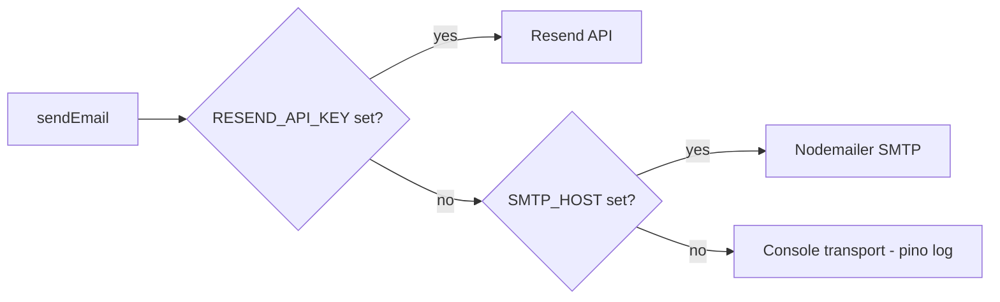
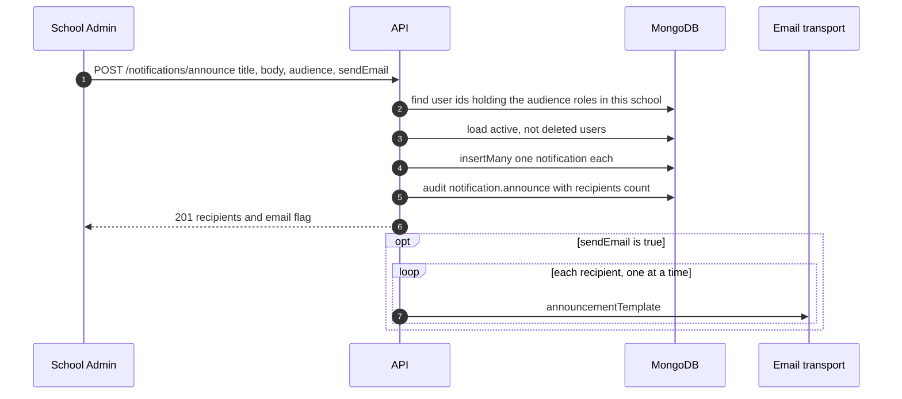

import { Aside, Steps, Card, CardGrid, LinkCard } from '@astrojs/starlight/components';
import Pipeline from '../../../components/Pipeline.astro';
import SourceFile from '../../../components/SourceFile.astro';
import Api from '../../../components/Api.astro';
import Perm from '../../../components/Perm.astro';
import Roles from '../../../components/Roles.astro';
import Route from '../../../components/Route.astro';
import DemoLogin from '../../../components/DemoLogin.astro';

Schola tells people things in two ways. **Email** reaches them outside the
app — "verify your address", "your school is approved", "reset your
password". **In-app notifications** wait inside Schola, behind the bell in the
top bar, until the person reads them. Some events do both. Neither is a chat
system: they are one-way messages from the platform or a school to its
members.

## At a glance

<CardGrid>
  <Card title="Email transports" icon="email">
    Resend first, SMTP if no Resend key, otherwise printed to the API log.
  </Card>
  <Card title="Templates" icon="document">
    Seven HTML + text templates in <SourceFile path="apps/api/src/services/email/templates.ts" />.
  </Card>
  <Card title="Notifications" icon="comment">
    One `Notification` document per recipient, marked read with `readAt`.
  </Card>
  <Card title="Announcements" icon="rocket">
    <Perm name="notification:send:tenant" /> — notify chosen roles, optionally by email.
  </Card>
</CardGrid>

## Sending email

### One interface, three transports

Every email goes through `sendEmail()` in
<SourceFile path="apps/api/src/services/email/index.ts" />. It doesn't know or
care which provider is behind it:

```ts title="apps/api/src/services/email/index.ts"
export interface EmailMessage { to: string | string[]; subject: string; html: string; text: string; }
export interface EmailTransport { name: string; send(msg: EmailMessage): Promise<{ id: string }>; }

export function getEmailTransport(): EmailTransport {
  if (cached) return cached;
  const env = loadServerEnv();
  if (env.RESEND_API_KEY) {
    cached = resendTransport(env.RESEND_API_KEY, env.EMAIL_FROM);
  } else if (env.SMTP_HOST) {
    cached = smtpTransport({ host: env.SMTP_HOST, port: env.SMTP_PORT ?? 587, /* … */ });
  } else {
    cached = consoleTransport(env.EMAIL_FROM);
  }
  logger.info({ transport: cached.name }, "email transport selected");
  return cached;
}
```



| Transport | File | Notes |
|---|---|---|
| Resend | `transport.resend.ts` | Throws `Resend send failed: …` on error and logs the full provider error (the usual one in development is an unverified `EMAIL_FROM` domain). |
| SMTP | `transport.smtp.ts` | Nodemailer with `SMTP_HOST`, `SMTP_PORT` (default 587), `SMTP_USER` / `SMTP_PASS`, `SMTP_SECURE`. |
| Console | `transport.console.ts` | Logs `from`, `to`, `subject`, `html` and `text` as "would have sent email" — the way to read verification codes and reset links locally. |

The sender is `EMAIL_FROM` (default `Schola <noreply@schola.reactbd.com>`).
Production requires `RESEND_API_KEY`. Setup is on
[Email service](/setup/services/email/).

<Aside type="note" title="Fallback means configuration, not retry">
The transport is picked **once per process**, from configuration. If Resend
is configured and a send fails, Schola does not retry through SMTP.
</Aside>

### Templates

Each template is a function returning `{ subject, html, text }`. They share a
simple inline-styled layout (Schola wordmark, a card, a footer link to
`APP_URL`) and escape user-supplied text such as names and school names.

| Template | Sent when | To |
|---|---|---|
| `verifyEmailTemplate(name, link, code)` | <Api method="POST" path="auth/register" />, <Api method="POST" path="schools/signup" />, <Api method="POST" path="auth/verify-email/resend" /> (signed in, or signed out with `{ email }`) | the new account — link to `/verify?token=…` **and** a 6-digit code |
| `passwordResetTemplate(name, link)` | <Api method="POST" path="auth/forgot-password" />; Super Admin invites; a school created directly without an owner password | the account — link to `/reset-password?token=…` |
| `schoolPendingTemplate(admin, school)` | public and quick school signup | the applicant |
| `schoolApprovedTemplate(admin, school, loginUrl)` | Super Admin approves; direct school creation with a password | the school owner |
| `schoolRejectedTemplate(admin, school, reason)` | Super Admin rejects | the applicant — `rejectSchool()` loads the owner **before** soft-deleting them, so the email has someone to go to |
| `adminTransferTemplate(target, from, school, link)` | a School Admin nominates a successor | the nominee — accept link, 24 h |
| `announcementTemplate(name, school, title, body, link)` | an announcement with "send email" ticked | every recipient |

### Platform-editable templates

Super Admins see an **Email** settings page (<Route path="/platform/settings/email" />)
with four slots — Invite, Welcome, Password reset, Verify email — each with a
subject and body. Saving calls
<Api method="PATCH" path="platform/settings/email_templates" perm="system_setting:write" />,
which validates the payload and stores it in the `system_settings` document
with `category: "email_templates"` (audit `system_setting.update`).

<Aside type="caution" title="Saved templates are not used when sending">
Nothing in `services/email/` or the auth and school services reads the
`email_templates` setting. Every email is still built by the hard-coded
functions in `templates.ts`, so edits on the Email settings page have no
effect on what is sent. There is also no "welcome" or "invite" template in
code — invites reuse the password-reset email.
</Aside>

## In-app notifications

### The model

<SourceFile path="packages/db/src/models/notification.ts" symbol="Notification" />
stores one document **per recipient**:

| Field | Meaning |
|---|---|
| `userId` | who it is for |
| `schoolId` | the school it is about, or `null` for platform notices |
| `type` | `school.signup`, `school.approved`, `school.rejected`, `school.suspended`, `admin_transfer.requested`, `admin_transfer.completed`, `announcement`, `system` |
| `title`, `body` | what the bell shows |
| `link` | where clicking it goes (e.g. `/platform/schools/<id>`, `/app`) |
| `readAt` | `null` until read |

### Which events create one

| Event | `type` | Recipient | Link |
|---|---|---|---|
| A school applies (public or quick signup) | `school.signup` | every Super Admin | `/platform/schools/<id>` |
| A Super Admin approves a school | `school.approved` | the owner | `/app` |
| A Super Admin suspends a school | `school.suspended` | the owner | `/login` |
| A school sends an announcement | `announcement` | every active member with the chosen roles | `/app/notifications` |

The enum also lists `school.rejected`, `admin_transfer.requested`,
`admin_transfer.completed` and `system`, but no code creates them today
(tests insert `system` notifications directly).

### The endpoints

All require a session and <Perm name="notification:read:own" />, which every
role holds — including Super Admin and the visitor `user` role. Everything
is filtered by `userId: ctx.userId`, so people only ever see their own.

| Endpoint | Does |
|---|---|
| <Api method="GET" path="notifications" /> | `page`, `pageSize`, `unreadOnly` → `data: { items, unread }` + `meta.pagination`, newest first |
| <Api method="GET" path="notifications/unread-count" /> | `{ unread }` — what the bell polls |
| <Api method="PATCH" path="notifications/:id/read" /> | sets `readAt` (only your own; others are `404`) |
| <Api method="POST" path="notifications/mark-all-read" /> | marks all yours read; audit `notification.mark_all_read` |
| <Api method="POST" path="notifications/announce" perm="notification:send:tenant" /> | school announcement — see below |
| <Api method="GET" path="notifications/announcements" perm="notification:send:tenant" /> | sent-announcement history, read from the audit log |

### Announcements

<Roles list={['school_admin', 'principal']} note="hold notification:send:tenant" />



<Steps>

1. On <Route path="/app/announcements" />, the sender writes a title and
   body, picks the audience roles and ticks whether to email.
2. The API resolves everyone in **this school** holding those roles
   (`tenantMemberUserIds` in `membership.repo.ts`), keeps active, non-deleted
   users, and refuses with `400` if nobody matches.
3. It inserts one `announcement` notification per person, writes the audit
   entry (which is also the history), and answers `201` straight away.
4. **After** the response, if email was requested, it sends one email per
   recipient in sequence. Failures are logged per user and not retried.

</Steps>

<DemoLogin as="School Admin" email="admin@greenfield.example" go="/app/announcements" />

## The notification bell

<SourceFile path="apps/web/src/components/layout/notification-bell.tsx" symbol="NotificationBell" />
sits in the school app's top bar:

- It polls <Api method="GET" path="notifications/unread-count" /> **every 60
  seconds** (TanStack Query `refetchInterval`) once a user is signed in, and
  shows a badge (`99+` above 99). It stops retrying on `401`.
- Clicking it opens a drawer titled "Notifications" ("The 20 most recent."), which
  loads <Api method="GET" path="notifications" /> with `pageSize: 20` only
  while open.
- The full list, with mark-as-read, is <Route path="/app/notifications" />.
  The platform console has no bell; Super Admins read theirs on
  <Route path="/platform/notifications" />.

## Edge cases and gotchas

- **School emails are best-effort.** Registration, school sign-up, approval
  and rejection save the change first, then send. A provider error is caught
  by `afterSignup()` in `schools.service.ts`, logged (`signup pending email
  failed`, `approval email failed`, `rejection email failed`) and the flow
  carries on — notifications and the `school.approve` / `school.reject` audit
  entries are still written, and the request succeeds.
- **So are invites and Forgot password.** Set-password invites (teachers,
  staff, parents, platform users, directly created school owners) go through
  `sendAccountInvite()` in `services/account-invite.ts`, and Forgot password
  and verification emails through `trySendEmail()` in
  `services/email/deliver.ts`: a provider error is logged and the request
  still succeeds (`201`, or the same `202` Forgot password gives an unknown
  address). The audit entry records `inviteEmail` / `email` as `"sent"` or
  `"failed"`.
- **Two requests say the email failed.** The signed-in verification resend
  and the admin transfer answer `503` with a plain message, because the email
  is the whole point of those requests; a transfer that can't be emailed is
  not started (its token is deleted).
- **Expiry text follows the settings.** Each email states the lifetime from
  `utils/token-ttl.ts` — `EMAIL_VERIFICATION_TTL_HOURS`,
  `PASSWORD_RESET_TTL_MIN`, `ADMIN_TRANSFER_TTL_HOURS`, and 24 ×
  `PASSWORD_RESET_TTL_MIN` for invites.
- **Announcement emails are sequential and in-process.** There is no queue; a
  restart mid-send drops the rest.
- **The console transport logs secrets on purpose.** In development the full
  email — including verification codes and reset links — is in the API log.
- **Notifications are never deleted.** There is no TTL and no delete
  endpoint; only `readAt` changes.

## Related pages

<CardGrid>
  <LinkCard title="Notifications feature" description="The bell, the list and announcements, screen by screen." href="/features/communication/notifications/" />
  <LinkCard title="Announcements" description="Sending a notice to roles in a school." href="/features/communication/announcements/" />
  <LinkCard title="Email service setup" description="Resend, SMTP and the console transport." href="/setup/services/email/" />
  <LinkCard title="Platform settings" description="Branding, locale, email templates and feature flags." href="/features/platform/settings/" />
</CardGrid>
