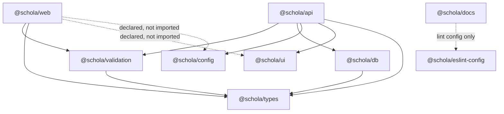

import { Aside, Steps, Card, CardGrid, LinkCard, FileTree, Tabs, TabItem } from '@astrojs/starlight/components';
import SourceFile from '../../../components/SourceFile.astro';

Schola keeps everything in **one Git repository** with several *workspaces*
(small npm packages that live side by side). Three are apps you can run —
the web app, the API and these docs — and seven are shared packages the apps
import. Sharing code this way means a permission key, a form rule or a
response type is written **once** and both the browser and the server use the
same copy.

The workspaces are managed by **pnpm** (installs and links them) and
**Turborepo** (runs `build`, `lint`, `typecheck` and `test` across all of them
in the right order).

## The layout

<FileTree>
- apps/
  - web/ Next.js 16 app — `@schola/web`
  - api/ Express 5 API — `@schola/api`
  - docs/ this site (Astro + Starlight) — `@schola/docs`
- packages/
  - types/ shared TS unions: roles, permissions, envelope — `@schola/types`
  - validation/ shared Zod schemas — `@schola/validation`
  - db/ Mongoose models, encryption, Neon identity — `@schola/db`
  - config/ typed env loaders — `@schola/config`
  - ui/ `cn()` helper and PDF brand tokens — `@schola/ui`
  - eslint-config/ shared flat ESLint configs — `@schola/eslint-config`
  - tsconfig/ shared tsconfig presets — `@schola/tsconfig`
- pnpm-workspace.yaml `apps/*` and `packages/*`
- turbo.json task graph and env inputs
- package.json root scripts (`pnpm dev`, `pnpm test`, `pnpm seed` …)
</FileTree>

## Who depends on whom

Arrows point from a package to the packages it imports at runtime. Every
workspace also has `@schola/eslint-config` and `@schola/tsconfig` as dev
dependencies; those are left out to keep the picture readable.



Two rules fall out of this graph:

- **`@schola/types` depends on nothing.** It is the bottom of the stack, so
  anything can import it without creating a cycle.
- **The web app never imports `@schola/db`.** Mongoose models, encryption and
  database code stay on the server. The browser only sees types and Zod
  schemas.

## Every package

### `@schola/types`

The vocabulary of the whole product, as plain TypeScript constants and union
types. No runtime dependencies.

| Export path | Key exports |
|---|---|
| `@schola/types/permissions` | `PERMISSIONS` (all 95 permission keys), `Permission`, `isPermission()` |
| `@schola/types/roles` | `ROLES`, `PLATFORM_ROLES` (`super_admin`, `user`), `TENANT_ROLES`, `SCHOOL_STATUSES`, `INSTITUTION_TYPES`, `isRole()` |
| `@schola/types/envelope` | `SuccessEnvelope<T>`, `ErrorEnvelope`, `ERROR_CODES`, `Pagination`, `CursorPagination`, `ApiResponse<T>` |

Source: <SourceFile path="packages/types/src/permissions.ts" />,
<SourceFile path="packages/types/src/roles.ts" />,
<SourceFile path="packages/types/src/envelope.ts" />.

### `@schola/validation`

Every request body, query string and path parameter the API accepts, written
once as a Zod 4 schema. The API's `validate()` middleware and the web app's
React Hook Form resolver both import from here, so a form shows exactly the
error the server would return.

| Export path | Covers |
|---|---|
| `./common` | `objectId`, `email`, `phone`, `paginationQuery` (page 1+, pageSize ≤ 100), `strongPassword`, `passwordRules`, `patchSchema()` |
| `./auth` | login, register, forgot/reset password, verify email (link and 6-digit code), Google ID token |
| `./schools` | public school signup and the signed-in "quick signup" |
| `./admin` | platform actions, system settings, members and roles, announcements, `objectIdParam` |
| `./academics`, `./people` | academic years, subjects, classes, sections, students, teachers, parents, staff, enrollments |
| `./attendance`, `./gradebook` | attendance marking, exams, grades, remarks |
| `./finance`, `./payroll` | fee structures, invoices, payments, salary structures and records |
| `./me`, `./operations` | self-service profile and password; timetable, leave, admissions, library, transport, hostel |

<Aside type="tip" title="Why PATCH schemas use patchSchema()">
Zod 4 applies `.default()` values inside `.partial()`, so
`createX.partial()` would turn a PATCH of `{ name }` into one that also resets
every defaulted field. `patchSchema()` in
<SourceFile path="packages/validation/src/common.ts" symbol="patchSchema" />
strips defaults, makes every field optional and rejects unknown keys.
</Aside>

### `@schola/db`

Everything that touches a database. Only the API (and its jobs and tests)
import it.

| Export path | Key exports |
|---|---|
| `@schola/db` (root) | all Mongoose models (`User`, `School`, `Student`, `FeeInvoice` …), `connectDb`, `disconnectDb`, the crypto helpers |
| `./base` | `baseSchemaFields()` (`createdBy`, `updatedBy`, `deletedAt`), `applySoftDelete()` |
| `./crypto` | `encryptField`, `decryptField`, `isEncryptedField`, `EncryptionError` |
| `./models` | the model barrel on its own |
| `./connection` | `connectDb`, `disconnectDb` |
| `./postgres` | Neon + Drizzle identity mirror: `syncIdentity`, `recordIdentityVerification`, `markIdentityVerified`, the table definitions |

The root barrel does **not** re-export `./postgres`, so code that never sets
`DATABASE_URL` never loads the Neon driver. `pnpm --filter @schola/db db:migrate`
applies `001_identity.sql` to Neon. See [Data model](/architecture/data-model/).

### `@schola/config`

Typed, validated environment loaders. Application code reads its settings
through these; only a few low-level modules touch `process.env` directly —
the env-file loader, the logger level, `NODE_ENV` checks in the rate limiter
and auth middleware, the database connection and the crypto master key.

- `@schola/config/server` — `loadServerEnv()`: one Zod schema for every API
  variable, blank strings normalised to "unset", Firebase private-key `\n`
  fixed, and a hard failure in production when required secrets are missing.
- `@schola/config/client` — `loadClientEnv()`: the `NEXT_PUBLIC_*` values.

### `@schola/ui`

Deliberately tiny. The shadcn/ui components live inside `apps/web`, not here.

- `cn()` — `clsx` + `tailwind-merge`.
- `@schola/ui/pdf-tokens` — brand colours in hex for `@react-pdf/renderer`
  (the PDF renderer cannot read OKLCH CSS variables). Used by the API's PDF
  documents.

### `@schola/eslint-config`

Three flat configs: `./base` (typescript-eslint recommended, Prettier,
`no-explicit-any: error`, `eqeqeq`), `./node` (adds Node globals; used by the
API and packages) and `./next` (adds React, hooks and Next rules; used by the
web app).

### `@schola/tsconfig`

JSON presets that every workspace `extends`:

| Preset | Used by | Notable settings |
|---|---|---|
| `base.json` | all | `strict`, `noUncheckedIndexedAccess`, `noImplicitReturns`, `isolatedModules`, `moduleResolution: Bundler`, `noEmit` |
| `node.json` | `apps/api`, packages | `module` / `moduleResolution: NodeNext`, Node types |
| `next.json` | `apps/web` | DOM libs, `jsx: preserve`, the Next TS plugin |
| `library.json` | (available) | `composite`, emits to `dist` |

### The apps

| App | Depends on | Scripts that matter |
|---|---|---|
| `@schola/web` | `types`, `validation` (plus `ui`, `config` declared) | `dev` / `build` with `--webpack`, `test` (Vitest), `test:e2e` (Playwright) |
| `@schola/api` | `types`, `validation`, `db`, `config`, `ui` | `dev` (`tsx watch` + `stripe listen`), `test`, `seed:demo`, `grant-role`, `sync-role-keys` |
| `@schola/docs` | none at runtime | `dev` on port 3002, `build` |

## How the packages are consumed

None of the shared packages has a build step. Each one points its `exports`
straight at TypeScript source, and each app compiles that source itself.

```json title="packages/types/package.json"
{
  "name": "@schola/types",
  "main": "./src/index.ts",
  "exports": {
    ".": "./src/index.ts",
    "./permissions": "./src/permissions.ts",
    "./roles": "./src/roles.ts",
    "./envelope": "./src/envelope.ts"
  }
}
```

The packages are written NodeNext-style: relative imports end in `.js` even
though the file on disk is `.ts` (`export * from "./permissions.js"`). Each
app resolves that differently.

<Tabs>
  <TabItem label="API (tsx)">

The API runs on **tsx**, which understands TypeScript and maps `.js` imports
to the matching `.ts` file. `pnpm --filter @schola/api dev` runs
`tsx watch src/index.ts`, so editing a package file restarts the API with the
change. The API's own tsconfig uses `module: NodeNext`, so its imports also
carry `.js` extensions.

  </TabItem>
  <TabItem label="Web (Next.js + webpack)">

Next.js does not compile `node_modules` by default, so the shared packages are
listed in `transpilePackages`, and an `extensionAlias` teaches webpack to try
`.ts` / `.tsx` when an import asks for `.js`:

```ts title="apps/web/next.config.ts"
transpilePackages: ["@schola/types", "@schola/validation", "@schola/ui", "@schola/config"],
typedRoutes: true,
experimental: {
  extensionAlias: {
    ".js": [".ts", ".tsx", ".js"],
    ".mjs": [".mts", ".mjs"],
    ".cjs": [".cts", ".cjs"],
  },
},
```

Turbopack does not honour `extensionAlias` yet, which is why the web scripts
are `next dev --webpack` and `next build --webpack`.

  </TabItem>
  <TabItem label="Tests (Vitest)">

Vitest uses Vite's resolver, which handles `.js` → `.ts` on its own. The
API's integration tests import `@schola/db` and friends directly and run
against an in-memory MongoDB (`mongodb-memory-server`).

  </TabItem>
</Tabs>

Imports always use the **narrowest subpath** that has what you need, so a
module pulls in as little as possible:

```ts
import type { Permission } from "@schola/types/permissions";
import { loginSchema } from "@schola/validation/auth";
import { loadServerEnv } from "@schola/config/server";
import { tokens } from "@schola/ui/pdf-tokens";
```

## The Turborepo task graph

<SourceFile path="turbo.json" /> wires the root scripts to every workspace:

| Root command | Turbo task | Notes |
|---|---|---|
| `pnpm dev` | `dev` | not cached, persistent (web, API and docs together) |
| `pnpm build` | `build` | `dependsOn: ["^build"]`; outputs `.next/**` and `dist/**` |
| `pnpm lint` | `lint` | `dependsOn: ["^build"]` |
| `pnpm typecheck` | `typecheck` | `tsc --noEmit` in each workspace |
| `pnpm test` | `test` | Vitest in each workspace |
| `pnpm test:e2e` | `test:e2e` | Playwright, not cached |
| `pnpm seed` | — | runs `seed:demo` in `@schola/api` |

`globalDependencies` lists the env files (`.env`, the per-app
`.env.production` files) and `globalEnv` lists every variable name, so a
changed env value invalidates the Turbo cache.

## Adding a new shared module

<Steps>

1. Add the file under `packages/<pkg>/src/`, using `.js` in relative imports.
2. Add a subpath to that package's `exports` map (for example
   `"./reports": "./src/reports.ts"`) and, if it belongs in the barrel, to
   `src/index.ts`.
3. If the web app imports it and the package is new, add the package to
   `transpilePackages` in `apps/web/next.config.ts`.
4. Run `pnpm typecheck` from the repo root — every workspace that imports the
   new module is checked.

</Steps>

## Edge cases and gotchas

<Aside type="caution" title="Declared but unused dependencies">
`apps/web` lists `@schola/ui` and `@schola/config` as dependencies and in
`transpilePackages`, but no file under `apps/web/src` imports either. The web
app reads its public env through its own <SourceFile path="apps/web/src/lib/env.ts" />
and has its own `cn()` in `src/lib/utils.ts`. Harmless, but don't assume a
change to `@schola/config/client` reaches the browser.
</Aside>

<Aside type="caution" title="Running the compiled API">
`@schola/api` has `build: tsc -p tsconfig.json` and `start: node dist/index.js`.
`tsc` compiles only the API's own `src/`; the shared packages still resolve to
their `.ts` sources with `.js` import specifiers, which plain `node` cannot
load. Development and tests use `tsx` / Vitest and are unaffected. Check how
your host starts the API — see [Deployment](/operations/deployment/).
</Aside>

- **No package builds.** `turbo.json` declares `dependsOn: ["^build"]`, but
  the shared packages have no `build` script, so that dependency is a no-op
  today.
- **The client env default port is stale.** `loadClientEnv()` in
  `@schola/config/client` defaults `NEXT_PUBLIC_API_BASE_URL` to
  `http://localhost:4000/api/v1`; the web app does not use that loader and
  defaults to the relative `/api/v1` instead.
- **Path alias.** Inside `apps/web`, `@/…` maps to `apps/web/src/…` (set in
  `apps/web/tsconfig.json`).

## Related pages

<CardGrid>
  <LinkCard title="Project structure" description="A folder-by-folder tour of the repository." href="/setup/project-structure/" />
  <LinkCard title="Scripts and tooling" description="Every pnpm script and what it runs." href="/setup/scripts-and-tooling/" />
  <LinkCard title="Request lifecycle" description="How the API uses these packages on every request." href="/architecture/request-lifecycle/" />
  <LinkCard title="The web app" description="Route groups, providers, data fetching and theming." href="/architecture/web-app/" />
</CardGrid>
