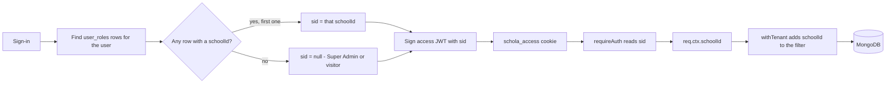
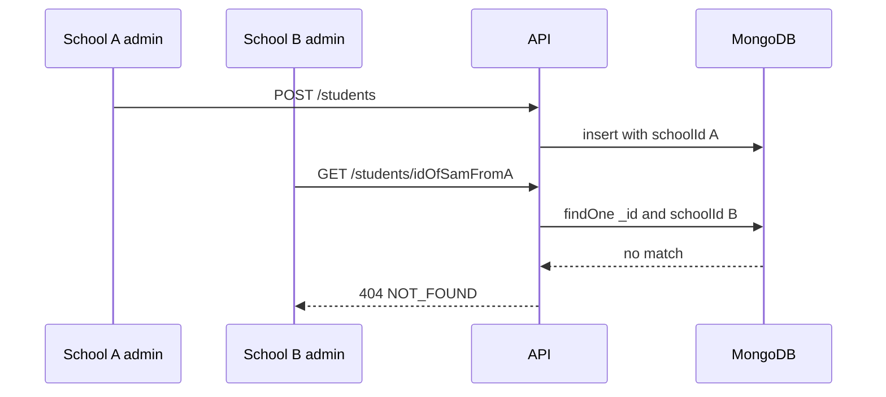

import { Aside, Steps, Card, CardGrid, LinkCard } from '@astrojs/starlight/components';
import Pipeline from '../../../components/Pipeline.astro';
import SourceFile from '../../../components/SourceFile.astro';
import Api from '../../../components/Api.astro';
import Perm from '../../../components/Perm.astro';
import Route from '../../../components/Route.astro';

Schola hosts many schools at once. Each school is a **tenant** — a customer
whose data must stay completely private from every other customer. Schola
does **not** give each school its own database. Instead, all schools share one
database and one set of collections, and every school-owned record carries a
`schoolId` field naming its owner. This is called the *shared database,
discriminator column* model.

The danger with this model is obvious: one forgotten filter and School A
sees School B's students. So Schola makes the filter automatic. Code doesn't
write `Student.find({ schoolId })` by hand — it asks a small wrapper,
`withTenant(Student, ctx)`, which adds the caller's `schoolId` to **every**
query and **every** new record.

## At a glance

<CardGrid>
  <Card title="Discriminator" icon="database">
    A required, indexed `schoolId: ObjectId` on every tenant collection.
  </Card>
  <Card title="Where it comes from" icon="padlock">
    The `sid` claim in the signed access token, copied to `req.ctx.schoolId`.
  </Card>
  <Card title="Who applies it" icon="setting">
    <SourceFile path="apps/api/src/repositories/with-tenant.ts" symbol="withTenant" />
  </Card>
  <Card title="How it fails" icon="warning">
    Another school's record looks exactly like a missing one: `404 NOT_FOUND`.
  </Card>
</CardGrid>

## How `schoolId` travels



<Steps>

1. **At sign-in** the API lists the user's `user_roles` rows and picks the
   first one that has a `schoolId`. Super Admins and visitors (accounts with
   only the platform `user` role) get `null`.
   (<SourceFile path="apps/api/src/modules/auth/auth.service.ts" symbol="login" />)
2. That ID is signed into the access token as the `sid` claim. Because the
   token is signed with `JWT_ACCESS_SECRET`, the browser cannot change it.
3. On every request `requireAuth` verifies the token and copies `sid` into
   `req.ctx.schoolId`. It also re-resolves permissions **for that school
   only** — roles held in other schools don't count.
4. Tenant routers add `requireTenant`, which rejects a `null` school with
   `403 TENANT_MISMATCH`.
5. Handlers read and write through `withTenant(Model, req.ctx)`. The school ID
   is never taken from the request body, query string or URL.

</Steps>

## The `withTenant` wrapper

This is the whole file, minus comments. It is short on purpose: every method
merges a fixed `{ schoolId }` scope into the caller's filter.

```ts title="apps/api/src/repositories/with-tenant.ts"
export function withTenant<TDoc extends TenantScopedDoc>(model: Model<TDoc>, ctx: TenantContext) {
  if (!ctx.schoolId) {
    throw new Error("withTenant called without schoolId — use withSuperAdmin for platform routes");
  }
  const scope = { schoolId: ctx.schoolId } as QueryFilter<TDoc>;

  return {
    find(filter = {})           { return model.find({ ...filter, ...scope }); },
    findOne(filter = {})        { return model.findOne({ ...filter, ...scope }); },
    findById(id: string)        { return model.findOne({ _id: id, ...scope }); },
    countDocuments(filter = {}) { return model.countDocuments({ ...filter, ...scope }); },
    create(doc) {
      return model.create({ ...doc, schoolId: ctx.schoolId, createdBy: ctx.userId, updatedBy: ctx.userId });
    },
    updateOne(filter, update) {
      return model.updateOne({ ...filter, ...scope },
        { ...update, $set: { ...(update.$set ?? {}), updatedBy: ctx.userId } });
    },
    updateMany(filter, update) { /* same as updateOne, many documents */ },
    softDelete(filter) {
      return model.updateOne({ ...filter, ...scope },
        { $set: { deletedAt: new Date(), updatedBy: ctx.userId } });
    },
  };
}
```

Three details make it safe:

- **The scope is spread last.** `{ ...filter, ...scope }` means even if a
  caller passes `{ schoolId: otherSchool }`, the context's school overwrites
  it.
- **`findById` is not `Model.findById`.** It becomes
  `findOne({ _id, schoolId })`, so a valid ID from another school simply
  matches nothing.
- **`create` stamps ownership.** `schoolId`, `createdBy` and `updatedBy` come
  from the context, not the body.

| Method | Adds `schoolId` to filter | Stamps fields |
|---|---|---|
| `find`, `findOne`, `findById`, `countDocuments` | yes | — |
| `create` | n/a | `schoolId`, `createdBy`, `updatedBy` |
| `updateOne`, `updateMany` | yes | `updatedBy` |
| `softDelete` | yes | `deletedAt`, `updatedBy` |

There is no `deleteOne` on `withTenant`: tenant data is only ever
soft-deleted.

### Soft delete works underneath

Most tenant models also call `applySoftDelete(schema)` from
<SourceFile path="packages/db/src/base.ts" symbol="applySoftDelete" />. It adds
`deletedAt: null` to every `find`, `findOne`, `countDocuments`, `updateOne`
and `updateMany`, unless the filter already mentions `deletedAt` (or passes
the escape hatch `_includeDeleted`). So `withTenant(...).find()` returns only
this school's **live** records.

## Where the rules bend, on purpose

A handful of places query a model directly instead of through `withTenant`.
Each one still filters by the caller's school explicitly:

| Where | Why not `withTenant` | How it stays scoped |
|---|---|---|
| Dashboard and report totals (`FeeInvoice.aggregate`, `FeePayment.aggregate` …) | `withTenant` has no `aggregate` | `$match: { schoolId: ctx.schoolId, deletedAt: null }` |
| Recording a fee payment, generating invoices and payslips | bulk / computed creates | `schoolId: tenantId(ctx)` set on the document |
| Marking attendance, staff attendance and grades (`bulkWrite` upserts) | `withTenant` has no `bulkWrite` | every op's filter and `$setOnInsert` carry `schoolId` |
| Linking a parent to children (`Student.updateMany`) | `$addToSet` update | `{ _id: { $in: ids }, schoolId: ctx.schoolId }` |
| Access scopes (`services/scopes/*`) | read-only lookups | every filter starts `{ schoolId: ctx.schoolId, … }` |
| Tenant audit log (`AuditLog.find`) | audit log has no soft delete | `{ schoolId: ctx.schoolId }` |
| Memberships (`membership.repo.ts`) | `user_roles` rows | `Role` and `UserRole` filtered by `ctx.schoolId` |
| `School.findById(ctx.schoolId)` | the tenant's own school document | the ID *is* the context |

The helper `tenantId(ctx)` in <SourceFile path="apps/api/src/utils/params.ts" symbol="tenantId" />
returns `ctx.schoolId` as a non-null `ObjectId` (or throws `TENANT_MISMATCH`),
so these call sites type-check without a cast.

## Platform data has no tenant

Some collections are platform-wide and have no `schoolId`, or allow it to be
`null`. (Names below are the spec names; the real MongoDB collection names
are listed on [Data model](/architecture/data-model/).)

| Collection | `schoolId` |
|---|---|
| `users`, `permissions`, `role_permissions`, `refresh_tokens`, `single_use_tokens`, `system_settings` | none — a person can belong to several schools |
| `schools` | it **is** the tenant |
| `roles`, `user_roles` | `null` for platform roles (`super_admin`, `user`), set for tenant roles |
| `audit_logs`, `notifications` | `null` for platform events, set for school events |

Each approved school gets **its own copy** of the eight tenant roles
(`school_admin` … `staff`), so a role row itself belongs to one school.

### Super Admin access

The original spec describes `withSuperAdmin(model)` as the explicit way out of tenant
scope, and the helper exists in the same file. In practice the platform
services (`schools.service.ts`, `platform-users.service.ts`,
`system-settings.service.ts`) call the Mongoose models directly, behind
`requireAuth` + `requireSuperAdmin` + a <Perm name="school:read_all" />-style
permission on every `/api/v1/platform/*` route.

<Aside type="caution" title="withSuperAdmin is never called">
`withSuperAdmin` has zero call sites. Platform routes rely on the router-level
`requireSuperAdmin` guard instead of the wrapper. The effect is the same, but
a grep for `withSuperAdmin` will not find the platform's cross-tenant queries.
</Aside>

## How isolation is enforced

| Layer | Mechanism | Status |
|---|---|---|
| Convention | `withTenant` for every tenant read/write | in place |
| Token | `sid` is signed — the browser cannot pick a school | in place |
| Permissions | resolved per `(userId, schoolId)`, so a role in School A grants nothing in School B | in place |
| Indexes | uniqueness is per school: `(schoolId, admissionNumber)`, `(schoolId, employeeId)`, `(schoolId, code)` … | in place |
| Lint rule | the original spec promises a custom ESLint rule that forbids `Model.find` outside repositories | **missing** |
| Tests | integration tests that create two schools and try to cross the line | in place |

<Aside type="caution" title="No ESLint rule guards tenant queries">
The root `eslint.config.js`, `packages/eslint-config/*` and
`apps/api/eslint.config.js` contain no tenant-isolation rule (nor a
`no-restricted-syntax` ban on `$where`). Isolation relies on code review and
the integration tests.
</Aside>

## The tests that prove it

Every isolation test follows the same shape: create **two** active schools
with `makeActiveSchool()`, act as School A's admin, then try to reach the
record as School B's admin.

```ts title="apps/api/src/modules/people/__tests__/people.integration.test.ts (abridged)"
const a = await makeActiveSchool({ name: "Alpha Academy", adminEmail: "alice@alpha.test" });
const b = await makeActiveSchool({ name: "Beta Academy", adminEmail: "bob@beta.test" });

const create = await adminA.agent.post("/api/v1/students")
  .set("x-csrf-token", adminA.csrfToken)
  .send({ admissionNumber: "S-001", firstName: "Sam", lastName: "Sterling", gender: "unspecified" });
const studentId = create.body.data._id;

// Admin B tries to fetch the same student — must look identical to "not found".
const cross = await adminB.agent.get(`/api/v1/students/${studentId}`);
expect(cross.status).toBe(404);
```



| Test file | What it proves |
|---|---|
| <SourceFile path="apps/api/src/modules/people/__tests__/people.integration.test.ts" /> | School B cannot read School A's student (404) |
| <SourceFile path="apps/api/src/modules/attendance/__tests__/attendance.integration.test.ts" /> | Attendance for another school's section answers 404 |
| <SourceFile path="apps/api/src/modules/academics/__tests__/school-setup.integration.test.ts" /> | Another school's class or section is a 404; you can't assign another school's teacher or move an enrollment into another school's section |
| <SourceFile path="apps/api/src/modules/operations/__tests__/operations.integration.test.ts" /> | "keeps each school's records to itself": School B can't list or edit School A's library book |
| <SourceFile path="apps/api/src/modules/schools/__tests__/schools.integration.test.ts" /> | A School Admin gets 403 on a Super Admin route; approving an unknown school ID gives 404 (no info leak) |

Run them with `pnpm --filter @schola/api test`. They use an in-memory MongoDB
(`mongodb-memory-server`), so they need no local database.

## Edge cases and gotchas

<Aside type="note" title="Only an active school can be used">
The school in the session must be `active`. `requireAuth` checks it on every
request (<SourceFile path="apps/api/src/services/school-status.ts" />, cached
10 seconds per API process and cleared when the Super Admin suspends,
reactivates, approves or rejects), and sign-in and refresh pick only an
`active` school. Members of a suspended school are refused at sign-in (`403
INACTIVE_ACCOUNT`) and their open sessions end with `401`. Pending schools are
also protected another way: their admin's account stays `isActive: false`
until approval.
</Aside>

- **404, never 403, across tenants.** A record in another school is
  indistinguishable from one that doesn't exist, so IDs can't be probed.
- **One school per session.** A person with roles in two schools always lands
  in the first of them that is `active`. There is no switcher yet.
- **The same admission number can exist in two schools.** All business
  uniqueness indexes start with `schoolId`.
- **`aggregate` skips soft delete.** The Mongoose soft-delete hook doesn't run
  on aggregation pipelines, so aggregations must add `deletedAt: null`
  themselves (the dashboard does).
- **`withTenant` throws without a school.** Calling it from a Super Admin
  request (`schoolId: null`) is a programming error, not a 403.

## Related pages

<CardGrid>
  <LinkCard title="Request lifecycle" description="Where requireAuth and requireTenant sit in the chain." href="/architecture/request-lifecycle/" />
  <LinkCard title="Roles & permissions" description="Why a role in one school grants nothing in another." href="/architecture/rbac/" />
  <LinkCard title="Data model" description="Which collections carry schoolId, and their indexes." href="/architecture/data-model/" />
  <LinkCard title="Testing" description="How the integration suite boots MongoDB and the app." href="/operations/testing/" />
</CardGrid>
