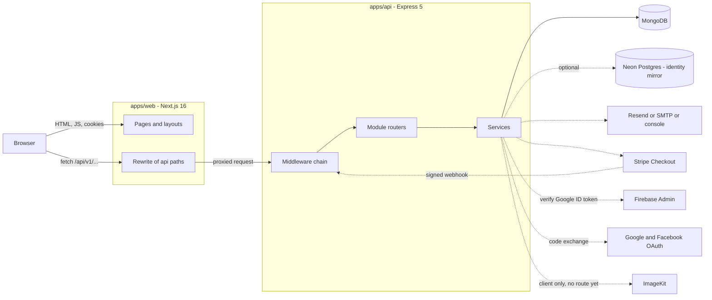

import { Aside, Steps, Card, CardGrid, LinkCard } from '@astrojs/starlight/components';
import Pipeline from '../../../components/Pipeline.astro';
import SourceFile from '../../../components/SourceFile.astro';
import Api from '../../../components/Api.astro';
import Route from '../../../components/Route.astro';

Schola is one product made of **two running programs** and a set of shared
building blocks. The **web app** (`apps/web`, Next.js) draws every screen in
the browser. The **API** (`apps/api`, Express) holds all the business rules
and is the only thing that talks to the database. Both are written in
TypeScript and live in one repository (a *monorepo*), so they share the same
list of roles, permissions and form rules instead of keeping two copies in
sync.

Every school on the platform is a *tenant*: its data sits in the same
MongoDB database as every other school's, and each record carries a
`schoolId` that says who owns it. The rest of this Architecture section
explains how that one idea — plus sign-in, permissions and an append-only
audit log — keeps every school's data private.

## At a glance

<CardGrid>
  <Card title="Web app" icon="laptop">
    `apps/web` — Next.js 16 App Router, React 19, Tailwind CSS 4, shadcn/ui.
    Runs on port **3000**.
  </Card>
  <Card title="API" icon="server">
    `apps/api` — Express 5 on Node 22, Mongoose 9. Runs on port **8000**,
    base path `/api/v1`.
  </Card>
  <Card title="Database" icon="database">
    MongoDB holds all school data. An optional Neon Postgres database keeps a
    mirror of account identities.
  </Card>
  <Card title="Shared packages" icon="puzzle">
    `@schola/types`, `validation`, `db`, `config`, `ui`, `eslint-config`,
    `tsconfig` — see [Monorepo packages](/architecture/monorepo-packages/).
  </Card>
</CardGrid>

## The components

The browser only ever talks to **one origin**: the web app. Anything under
`/api/*` is forwarded by Next.js to the Express API, so the session cookies
are first-party and there is no cross-origin traffic in production.



Solid lines are on every request. Dotted lines are outside services that are
used only for certain actions — and each one is **optional in development**:
if its keys are blank, Schola keeps working and that one feature switches off.

| Service | What Schola uses it for | When its keys are blank (dev) |
|---|---|---|
| MongoDB | Every school record, user, role, audit entry | Required. Defaults to `mongodb://localhost:27017/schola`. |
| Neon Postgres | A mirror of accounts, OAuth links and email-verification records | Mirror writes are skipped; sign-in still works from MongoDB. |
| Resend / SMTP | Verification, password reset, approval and announcement emails | Emails are printed to the API log by the console transport. |
| Stripe | Online fee payments (Checkout) and its webhook | Checkout is unavailable; the webhook answers `503`. |
| Firebase Admin | Verifying Google ID tokens posted to <Api method="POST" path="auth/google" /> | That endpoint answers `503`. |
| Google / Facebook OAuth | The "Google" and "Facebook" buttons on the sign-in page | The button returns to `/login?error=oauth_unconfigured`. |
| ImageKit | Media CDN (image and video) | Nothing breaks — no screen uploads media yet. |

<Aside type="note" title="Production is stricter">
With `NODE_ENV=production` the API refuses to start unless `MONGODB_URI`,
`APP_URL`, `COOKIE_DOMAIN`, the JWT and CSRF secrets,
`ENCRYPTION_MASTER_KEY`, `RESEND_API_KEY` and the three ImageKit keys are all
set. See <SourceFile path="packages/config/src/server.ts" symbol="loadServerEnv" />.
</Aside>

## How a click becomes data

<Pipeline
  caption="One request, end to end — the Request lifecycle page walks through each hop."
  steps={[
    { label: 'Click', icon: 'log-in', note: 'A page calls the API client' },
    { label: 'Next.js', icon: 'workflow', note: 'Rewrites /api/* to the API' },
    { label: 'Middleware', icon: 'shield', note: 'Auth, CSRF, rate limit' },
    { label: 'Permission', icon: 'key', note: 'requirePermission + Zod' },
    { label: 'withTenant', icon: 'database', note: 'Injects schoolId' },
    { label: 'Audit', icon: 'scroll', note: 'Writes audit_logs' },
    { label: 'Envelope', icon: 'send', note: '{ success, data, meta }' },
  ]}
/>

<Steps>

1. A page in the web app (for example <Route path="/app/students" />) calls
   `api.get("/students")` from <SourceFile path="apps/web/src/lib/api-client.ts" />.
   The browser sends the request to `/api/v1/students` on the **same host**,
   with the `schola_access` cookie attached automatically.

2. Next.js forwards anything under `/api/*` to the Express API. The rewrite
   lives in <SourceFile path="apps/web/next.config.ts" /> and targets
   `INTERNAL_API_URL` (default `http://localhost:8000`).

3. Express runs its global middleware (security headers, CORS, body parsing,
   cookies, a request ID, logging), then the module router runs
   `requireAuth`. That checks the access token, loads the user, works out
   their permissions for their school, and checks the CSRF header on writes.

4. The route checks the exact permission it needs (for example
   `student:read`), validates the query or body with a shared Zod schema, and
   reads or writes through `withTenant(Model, req.ctx)` — which adds the
   caller's `schoolId` to every query.

5. If the request changed data, the route writes an entry to the append-only
   audit log. The response always uses the same envelope:
   `{ success: true, data, meta }` or `{ success: false, error }`.

</Steps>

## Tech stack

Versions are the ones declared in each `package.json` today. The original spec (§4)
locks the choices; the minimum versions there are floors, not ceilings.

| Layer | Choice | Version | Lives in |
|---|---|---|---|
| Runtime | Node.js | 22+ | everywhere |
| Package manager / monorepo | pnpm workspaces + Turborepo | pnpm 9.15, turbo 2.11 | repo root |
| Language | TypeScript (`strict`, `noUncheckedIndexedAccess`) | 6.0 | everywhere |
| Web framework | Next.js App Router (built with webpack) | 16.4.3 | `apps/web` |
| UI | React, Tailwind CSS v4, shadcn/ui, lucide-react, Motion | 19.3, 4.3 | `apps/web` |
| Server state | TanStack Query | 5.105 | `apps/web` |
| Client UI state | Zustand (persisted to `localStorage`) | 5.0 | `apps/web/src/stores` |
| Forms | React Hook Form + Zod resolver | 7.91 | `apps/web` |
| Tables | TanStack Table | 9.3 | `apps/web/src/components/data` |
| Charts / toasts / theming | Recharts, sonner, next-themes | 3.10, 2.0, 0.4 | `apps/web` |
| API server | Express | 5.3 | `apps/api` |
| ODM / database | Mongoose on MongoDB | 9.11 | `packages/db` |
| Identity mirror | Drizzle ORM on Neon serverless Postgres | 0.45 | `packages/db/src/postgres` |
| Validation | Zod (shared by web and API) | 4.6 | `packages/validation` |
| Passwords / tokens | argon2 (argon2id), jose (HS256 JWT) | 0.45, 6.2 | `apps/api/src/utils` |
| Hardening | helmet, cors, express-rate-limit, cookie-parser | 8.3, 2.8, 8.7, 1.4 | `apps/api` |
| Logging | pino + pino-http (pino-pretty in dev) | 10.4 | `apps/api/src/utils/logger.ts` |
| PDF | @react-pdf/renderer | 4.9 | `apps/api/src/services/pdf` |
| Email | Resend, Nodemailer (SMTP) | 6.37, 10.3 | `apps/api/src/services/email` |
| Payments | Stripe (Checkout + webhook) | 23.1 | `apps/api/src/services/stripe` |
| Federated sign-in | Google / Facebook OAuth 2.0, firebase-admin | 14.5 | `apps/api/src/modules/auth` |
| Media | ImageKit Node SDK | 7.13 | `apps/api/src/services/imagekit.service.ts` |
| Tests | Vitest, Supertest, mongodb-memory-server, Playwright | 5.0, 7.3, 11.3, 1.64 | `apps/*` |
| Docs | Astro + Starlight (this site) | 7.4, 0.42 | `apps/docs` |

<Aside type="caution" title="Small drifts from the original spec">
- The spec names **TanStack Table v8**; the web app depends on
  `@tanstack/react-table` **^9.3.1** and uses the v9 API (`useTable`,
  `tableFeatures`) in <SourceFile path="apps/web/src/components/data/simple-table.tsx" />.
- The original spec says Turbopack is the default; the web app deliberately runs
  `next dev --webpack` / `next build --webpack` because Turbopack does not yet
  honour the `.js` → `.ts` `extensionAlias` the shared packages need.
</Aside>

## Ports and URLs

| What | Development | Production |
|---|---|---|
| Web app | `http://localhost:3000` | `https://schola.reactbd.com` |
| API (direct) | `http://localhost:8000/api/v1` | behind the web host |
| API (as the browser sees it) | `http://localhost:3000/api/v1` (rewrite) | `https://schola.reactbd.com/api/v1` |
| Health check | <Api method="GET" path="health" /> | same |
| Docs | `http://localhost:3002` | `https://docs.schola.reactbd.com` |

## What happens when the API boots

The entry point <SourceFile path="apps/api/src/index.ts" /> does the same
five things every time it starts:

```ts title="apps/api/src/index.ts"
import "./load-env.js"; // must stay first: loads env files before other modules read them
// …
const env = loadServerEnv();
await connectDb(env.MONGODB_URI);

// Idempotent: cheap to run on every boot; ensures new permissions ship instantly.
await seedPermissions();
await seedSuperAdminRole();
await seedUserRole();
const synced = await syncExistingTenantRoles();

const app = buildApp(env);
const server = app.listen(env.API_PORT, () => { /* … */ });
```

<Steps>

1. **Load env files** — `load-env.ts` reads `test.env` then `.env` in
   development, or `apps/api/.env.production.local` then
   `apps/api/.env.production` in production. The first file to define a key
   wins, and real host variables beat every file.
2. **Validate the environment** with the Zod schema in `@schola/config/server`.
3. **Connect to MongoDB** (`strictQuery` on; automatic index builds only
   outside production).
4. **Seed permissions and roles** — every permission key, the platform
   `super_admin` and `user` roles, and re-wire new permissions onto every
   approved school's roles. See [Roles & permissions](/architecture/rbac/).
5. **Build the Express app** (<SourceFile path="apps/api/src/app.ts" symbol="buildApp" />)
   and listen. `SIGINT` / `SIGTERM` close the server gracefully.

</Steps>

## Design principles

These rules show up on every page of this section. When the code and a rule
disagree, the page says so in a caution box.

| Principle | What it means in the code |
|---|---|
| **One database, `schoolId` everywhere** | Tenant records carry a required, indexed `schoolId`. Reads and writes go through `withTenant`, which injects it. [Multi-tenancy](/architecture/multi-tenancy/) |
| **Check permissions, not roles** | Routes call `requirePermission("fee:collect")`, never `if (role === "accountant")`. Roles are just bundles of permission keys. [RBAC](/architecture/rbac/) |
| **The server decides** | The web app hides links a user can't use, but every API route checks again. Hiding is for comfort, not security. |
| **Every change leaves a trace** | Mutations write an append-only `audit_logs` entry with actor, role, before/after and request ID. [Audit log](/architecture/audit-log/) |
| **Personal data encrypted at rest** | Phone, date of birth and address are envelope-encrypted with AES-256-GCM before they reach MongoDB. [Security](/architecture/security/) |
| **One response shape** | Every JSON response is `{ success, data, meta }` or `{ success: false, error }`. [API conventions](/architecture/api-conventions/) |
| **One set of rules for both sides** | Form schemas live in `@schola/validation` and are used by React Hook Form and by the API's `validate()` middleware. |
| **Same-origin cookies** | The browser never calls the API on another origin; sessions are httpOnly cookies, not tokens in JavaScript. [Authentication](/architecture/authentication/) |
| **Optional services degrade, required ones fail fast** | Missing email/OAuth/Stripe keys switch a feature off in dev; missing secrets stop the API from booting in production. |

## Edge cases and gotchas

<Aside type="caution" title="The edge guard file may not be picked up">
The redirect guard <SourceFile path="apps/web/proxy.ts" /> (bounce
logged-out visitors away from `/app`, `/platform`, `/onboarding`) sits at
`apps/web/proxy.ts`, but the app's pages live in `apps/web/src/app`. Next.js
looks for the proxy file next to the `app` folder (here, `src/`), and the dev
build's middleware manifest is empty. The pages are still protected — each
layout wraps its tree in `RequireRole`, which checks `/auth/me` and redirects —
so the visible effect is a short "Checking access" screen instead of an
instant redirect. See [The web app](/architecture/web-app/).
</Aside>

<Aside type="caution" title="ImageKit is configured but not wired">
The ImageKit client and its upload-signature helper exist in
<SourceFile path="apps/api/src/services/imagekit.service.ts" />, and production
requires the ImageKit keys, but no API route exposes upload parameters and no
screen uploads files yet. Avatars come from Google/Facebook profile pictures.
See [PDFs and media](/architecture/pdfs-and-media/).
</Aside>

- **Neon is a write-only mirror.** Registration, OAuth sign-in and email
  verification copy identity rows into Neon when `DATABASE_URL` is set, but
  sign-in always reads the `users` collection in MongoDB. Neon failures are
  logged as warnings and never block a request.
- **The original spec's `api.schola.reactbd.com` host is not used.** Per the resolved
  the original spec question, the API is served under `/api/v1` on the main host.

## Where to read next

The pages in this section are ordered so each one builds on the last.

<CardGrid>
  <LinkCard title="Monorepo packages" description="Every workspace package, what it exports and who depends on whom." href="/architecture/monorepo-packages/" />
  <LinkCard title="Request lifecycle" description="One request from click to MongoDB and back, middleware by middleware." href="/architecture/request-lifecycle/" />
  <LinkCard title="Multi-tenancy" description="How schoolId isolates every school's data, and the tests that prove it." href="/architecture/multi-tenancy/" />
  <LinkCard title="Authentication" description="Cookies, JWTs, refresh rotation, CSRF, email verification and OAuth." href="/architecture/authentication/" />
  <LinkCard title="Roles & permissions" description="Roles as permission bundles, scopes like own_classes, and the UI guards." href="/architecture/rbac/" />
  <LinkCard title="Audit log" description="What gets written, when, and who can read it." href="/architecture/audit-log/" />
  <LinkCard title="Data model" description="Every MongoDB collection, its key fields, indexes and relationships." href="/architecture/data-model/" />
  <LinkCard title="Security" description="Each spec requirement mapped to the code that meets it." href="/architecture/security/" />
</CardGrid>
