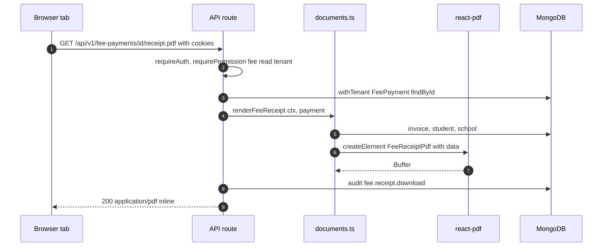
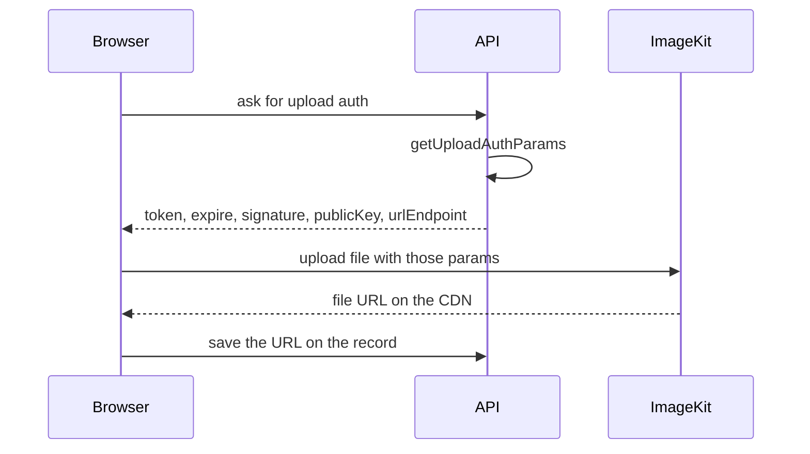

import { Aside, Steps, Card, CardGrid, LinkCard } from '@astrojs/starlight/components';
import Pipeline from '../../../components/Pipeline.astro';
import SourceFile from '../../../components/SourceFile.astro';
import Api from '../../../components/Api.astro';
import Perm from '../../../components/Perm.astro';
import Roles from '../../../components/Roles.astro';
import Route from '../../../components/Route.astro';
import DemoLogin from '../../../components/DemoLogin.astro';

Some things a school hands out must look the same on every screen and
printer: a **fee receipt** for a parent, a **payslip** for a teacher, a
**report card** at the end of term. Schola produces these as PDF files. The
API builds each PDF **on demand** from the stored records the moment someone
clicks "Download", using React components that describe the page layout. No
PDF is saved anywhere, so a reprint always reflects the current record.

## At a glance

<CardGrid>
  <Card title="Library" icon="document">
    `@react-pdf/renderer` 4 — React components become an A4 PDF buffer.
  </Card>
  <Card title="Documents" icon="list-format">
    Fee receipt, payslip, report card.
  </Card>
  <Card title="Brand" icon="setting">
    Hex tokens from `@schola/ui/pdf-tokens`.
  </Card>
  <Card title="Audited" icon="approve-check">
    Every download writes a `logRead` audit entry.
  </Card>
</CardGrid>

## How a PDF is made

<Pipeline
  caption="The same five steps for every document — nothing is stored on disk."
  steps={[
    { label: 'Click', icon: 'file-text', note: 'Download link, new tab' },
    { label: 'Authorize', icon: 'key', note: 'Permission or student access' },
    { label: 'Assemble', icon: 'database', note: 'withTenant lookups' },
    { label: 'Render', icon: 'receipt', note: 'renderToBuffer' },
    { label: 'Audit + stream', icon: 'scroll', note: 'logRead, application/pdf' },
  ]}
/>



<Steps>

1. The page renders a plain link, for example
   `<a href="/api/v1/fee-payments/<id>/receipt.pdf" target="_blank">`. The
   browser opens it in a new tab and sends the session cookies (same origin).
2. The route authorizes the caller — a permission for staff routes, or
   `studentAccess()` for the student-record routes — and loads the record
   through `withTenant`, so another school's ID is a `404`.
3. A builder gathers everything the page needs into a plain data object
   (`FeeReceiptData`, `PayslipData`, `ReportCardData`), including the school's
   `locale` and `currency` for number and date formatting.
4. `renderPdfToBuffer(element)` in <SourceFile path="apps/api/src/services/pdf/render.ts" />
   calls `renderToBuffer()`.
5. The route writes a `logRead` audit entry, then answers with
   `Content-Type: application/pdf` and
   `Content-Disposition: inline; filename="<document number>.pdf"`.

</Steps>

## The three documents

| Document | Component | Built by | Filename |
|---|---|---|---|
| Fee receipt | `FeeReceiptPdf` in <SourceFile path="apps/api/src/services/pdf/fee-receipt.tsx" /> | `renderFeeReceipt(ctx, payment)` in `documents.ts` | `<receiptNumber>.pdf` |
| Payslip | `PayslipPdf` in <SourceFile path="apps/api/src/services/pdf/payslip.tsx" /> | `renderPayslip(ctx, record)` in `documents.ts` | `<payslipNumber>.pdf` |
| Report card | `ReportCardPdf` in <SourceFile path="apps/api/src/services/pdf/report-card.tsx" /> | inline in `student-records.routes.ts` | `RC-<exam id tail>-<admissionNumber>.pdf` |

### Fee receipt

Header: school name (brand colour) and address on the left; "Receipt",
receipt number and date on the right. Body: student name and admission
number, invoice number and period, method and reference, the invoice lines
and **Invoice total**, then **This payment**, **Total paid to date** and
**Balance remaining** (plus **Waived** when non-zero). Footer: "Generated by Schola · https://schola.reactbd.com".

### Payslip

Header as above with the payslip number and month. Body: employee name,
employee ID and designation (a teacher's `qualification`, a staff member's
`designation`), the status and paid date, then two columns: **Earnings**
(base salary, earning components, gross earnings) and **Deductions** (the
deduction components and total), and finally **Net pay**.

### Report card

One exam for one student: school header, student and placement (class ·
section, roll number), the exam's dates, a row per subject (marks, max,
percentage, letter), a totals row with the overall letter, attendance for the
academic year (present / total and rate, when the caller may see attendance),
and teacher remarks. Its footer is `fixed` so it repeats on every page with
the generation date and "page / total".

<Aside type="tip" title="Report cards never print staff-only remarks">
The route asks only for remarks the caller may read **minus** `private` ones:
`visibility: { $in: access.remarks.filter((v) => v !== "private") }`. A
parent's copy and the principal's copy show the same remarks.
</Aside>

## Who can download what

| Endpoint | Guard | Who |
|---|---|---|
| <Api method="GET" path="fee-payments/:id/receipt.pdf" perm="fee:read:tenant" /> | permission | <Roles list={['school_admin', 'accountant']} /> |
| <Api method="GET" path="student-records/:id/payments/:paymentId/receipt.pdf" /> | `studentAccess(…).fees` | finance staff, the student, their parents |
| <Api method="GET" path="student-records/:id/report-card.pdf" /> `?examId=` | `studentAccess(…).grades` | School Admin, Principal, Vice Principal, the student's teachers, the student, their parents |
| <Api method="GET" path="salary-records/:id/payslip.pdf" perm="salary:read:all" /> | permission | <Roles list={['school_admin', 'accountant']} /> |
| <Api method="GET" path="me/payslips/:id/payslip.pdf" perm="salary:read:own" /> | permission + own record | the teacher or staff member the payslip belongs to |

Audit actions: `fee.receipt.download`, `grade.report_card.download`,
`payroll.payslip.download`.

<DemoLogin as="Parent" email="parent@greenfield.example" go="/app/children" />

Sign in as the parent, open a child, and use the report-card and receipt
links to see the student-record routes in action.

## Brand tokens

PDFs can't read the web app's OKLCH CSS variables, so
<SourceFile path="packages/ui/src/pdf-tokens.ts" symbol="tokens" /> holds plain
hex values:

```ts title="packages/ui/src/pdf-tokens.ts"
export const tokens = {
  brand: "#3457D5",
  brandFg: "#FAFAFA",
  foreground: "#1B1B1B",
  muted: "#737373",
  border: "#E5E5E5",
  background: "#FFFFFF",
  success: "#22A06B",
  warning: "#E6A100",
  danger: "#C8312A",
  info: "#2B92D6",
  radius: 6,
  fontFamily: "Inter",
} as const;
```

Money and dates go through `formatCurrency()` and `formatDate()` in
<SourceFile path="apps/api/src/utils/format.ts" /> (`Intl` with the school's
locale and currency, default `en-US` / `USD`).

<Aside type="caution" title="Brand and template drift">
- `brand` is `#3457D5` (blue), while the web app's primary colour is cyan.
  The token file says it mirrors the original spec, which defines the cyan primary.
- `fontFamily: "Inter"` is declared but no font is registered with
  `Font.register`, and no style uses the token, so PDFs render in
  react-pdf's default Helvetica.
- The original spec asks for a shared header (with logo and
  document title) and a footer with page numbers and a timestamp on every
  document. Each document defines its own header and footer; only the report
  card's footer has page numbers and a date, and none shows a logo.
</Aside>

## Media: ImageKit

ImageKit is the media CDN chosen for images and video.
<SourceFile path="apps/api/src/services/imagekit.service.ts" /> prepares the
standard **direct-from-browser** upload pattern, where the API never handles
the file bytes:



| Export | Does |
|---|---|
| `getImageKitClient()` | Lazily creates the client from `IMAGEKIT_PRIVATE_KEY`; `null` unless all three ImageKit variables are set |
| `isImageKitConfigured()` | Feature check |
| `getUploadAuthParams()` | Short-lived `{ token, expire, signature }` plus `publicKey` and `urlEndpoint` for the browser |

<Aside type="caution" title="No upload route or screen yet">
Nothing calls `getUploadAuthParams()`: there is no API route that hands out
upload parameters and no upload control in the web app. Today the only images
on records are `users.avatarUrl` (copied from the Google or Facebook profile
on OAuth sign-in) and the text `logoUrl` in platform branding settings.
Production still requires the three ImageKit variables to boot.
</Aside>

## Edge cases and gotchas

- **Expired session, JSON in a PDF tab.** Download links bypass the API
  client, so there is no silent refresh. If the access token has expired, the
  new tab shows the `401` JSON envelope; any action back in the app refreshes
  the session and the link works again.
- **Rendering is synchronous work on the API.** Large batches of PDFs would
  compete with normal requests; there is no queue or cache.
- **Receipts and payslips are snapshots.** Invoice lines and salary
  components are copied onto the record when it's created, so reprints don't
  change when a fee or salary structure is edited later. A receipt's
  "Balance remaining" reflects the invoice **now**, not at the time of payment.
- **The render helper's comment mentions R2.** `render.ts` notes that storage
  "lands in Phase 5"; PDFs are still streamed, never stored.

## Related pages

<CardGrid>
  <LinkCard title="Fees" description="Collecting payments and printing receipts." href="/features/finance/fees/" />
  <LinkCard title="Payroll" description="Generating and paying payslips." href="/features/finance/payroll/" />
  <LinkCard title="Gradebook" description="Marks, letter grades and report cards." href="/features/assessment/gradebook/" />
  <LinkCard title="ImageKit setup" description="Creating the ImageKit keys." href="/setup/services/imagekit/" />
</CardGrid>
