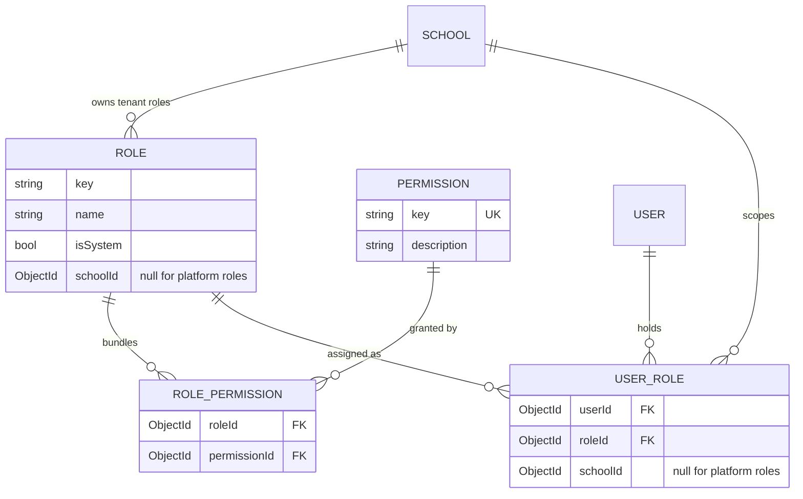

import { Aside, Steps, Card, CardGrid, LinkCard } from '@astrojs/starlight/components';
import Pipeline from '../../../components/Pipeline.astro';
import SourceFile from '../../../components/SourceFile.astro';
import Api from '../../../components/Api.astro';
import Perm from '../../../components/Perm.astro';
import Roles from '../../../components/Roles.astro';
import Route from '../../../components/Route.astro';
import DemoLogin from '../../../components/DemoLogin.astro';

Once Schola knows **who** is calling ([Authentication](/architecture/authentication/)),
it must decide **what they may do**. This is *role-based access control*
(RBAC), with one twist that keeps it simple: the code never asks "is this
person a teacher?". It asks "does this person hold the permission
<Perm name="attendance:mark" />?". A *role* — Teacher, Accountant, Principal —
is just a named **bundle of permission keys**.

That way, changing what Accountants can do means editing one list, not
hunting for every `if (role === "accountant")` in the code.

## At a glance

<CardGrid>
  <Card title="Roles" icon="star">
    10 keys: 8 tenant roles, plus `super_admin` and `user` on the platform.
  </Card>
  <Card title="Permissions" icon="approve-check">
    95 keys in <SourceFile path="packages/types/src/permissions.ts" />.
  </Card>
  <Card title="Default bundles" icon="list-format">
    <SourceFile path="apps/api/src/services/rbac/permissions.ts" symbol="ROLE_PERMISSIONS" />
  </Card>
  <Card title="Guard" icon="padlock">
    `requirePermission("student:create")` on every route.
  </Card>
</CardGrid>

## The pieces

### Roles

| Key | Scope | Typical person | Permissions in the default bundle |
|---|---|---|---|
| `super_admin` | Platform | Platform owner | 14 |
| `user` | Platform | A signed-in *visitor* with no school yet | 1 |
| `school_admin` | Tenant | Owner of one school | 77 |
| `principal` | Tenant | Academic head | 43 |
| `vice_principal` | Tenant | Read-mostly academic lead | 23 |
| `accountant` | Tenant | Fees and payroll | 27 |
| `teacher` | Tenant | Own classes and sections only | 18 |
| `staff` | Tenant | Non-teaching staff | 5 |
| `parent` | Tenant | Their linked children only | 6 |
| `student` | Tenant | Their own record only | 7 |

The role keys live in <SourceFile path="packages/types/src/roles.ts" />.
`user` is not a spec role — it is the platform role every self-registered
account gets so it can sign in and reach <Route path="/welcome" />.

### Permission keys

Keys are strings shaped `resource:action` or `resource:action:scope`:

- <Perm name="student:create" /> — a plain action.
- <Perm name="attendance:read:own_classes" /> — an action limited to a scope.
- <Perm name="school:approve" /> — a platform action (Super Admin only).

The **scope suffix** says how far the permission reaches:

| Suffix | Means | Examples |
|---|---|---|
| *(none)* | anything of that resource in the caller's school | `student:read`, `exam:create` |
| `:own` | only records that belong to the caller | `fee:read:own`, `salary:read:own`, `staff_attendance:read:own`, `notification:read:own` |
| `:own_classes` | only sections the caller teaches (or, for students and parents, their own / their children's records) | `attendance:read:own_classes`, `grade:read:own_classes`, `remark:read:own_classes` |
| `:all` | everything in the caller's school | `attendance:read:all`, `grade:read:all`, `salary:read:all`; `audit_log:read:all` is platform-wide |
| `:tenant` | everything in the caller's school (finance and admin keys) | `fee:read:tenant`, `audit_log:read:tenant`, `notification:send:tenant` |

The full list with descriptions is on [Permissions](/reference/permissions/).

### The four collections



| Collection (spec name) | Model | Unique index |
|---|---|---|
| `roles` | `Role` | `(schoolId, key)` — each school has one of each role |
| `permissions` | `Permission` | `key` |
| `role_permissions` | `RolePermission` | `(roleId, permissionId)` |
| `user_roles` | `UserRole` | `(userId, roleId, schoolId)` — a person can hold several roles in one school |

Each approved school gets **its own eight role rows**. Two schools'
`teacher` roles are different documents, which is what stops a teacher role
in one school from meaning anything in another.

## How roles get their permissions

<Pipeline
  caption="Seeding is idempotent and additive — it runs on every API boot."
  steps={[
    { label: 'Permissions', icon: 'key', note: 'Upsert all 95 keys' },
    { label: 'Platform roles', icon: 'shield', note: 'super_admin, user' },
    { label: 'Tenant roles', icon: 'building', note: 'On school approval' },
    { label: 'Sync', icon: 'workflow', note: 'Re-wire existing schools' },
  ]}
/>

<Steps>

1. **Every boot** — `seedPermissions()` upserts one `permissions` row per key
   in `PERMISSIONS`.
2. **Every boot** — `seedSuperAdminRole()` and `seedUserRole()` upsert the two
   platform roles (`schoolId: null`) and wire their bundles.
3. **On approval** — when a Super Admin approves a school,
   `seedTenantRoles(schoolId)` creates that school's eight roles and wires each
   bundle from `ROLE_PERMISSIONS`.
4. **Every boot** — `syncExistingTenantRoles()` re-runs step 3 for every
   `active` and `suspended` school, so a permission added to a bundle in code
   reaches existing schools on the next deploy.

</Steps>

All of this is in <SourceFile path="apps/api/src/services/rbac/seed.ts" />.
The bundles themselves are one typed object:

```ts title="apps/api/src/services/rbac/permissions.ts (excerpt)"
export const ROLE_PERMISSIONS: RolePermissionMap = {
  // …
  teacher: [
    "notification:read:own",
    "academic_year:read", // Classes and Exams list the school's academic years
    "class:read", "section:read", "subject:read", "student:read",
    "attendance:mark", "attendance:read:own_classes",
    "grade:enter", "grade:read:own_classes",
    "remark:create", "remark:read:own_classes",
    "exam:read", "staff_attendance:read:own", "salary:read:own",
    "timetable:read", "leave:request", "library:read",
  ],
  // …
};
// Cheap runtime check — every permission referenced above must be a known key.
```

## Checking a permission on a request

### Resolving the set

`requireAuth` calls `resolveUserPermissions(userId, schoolId)` on **every**
request:

```ts title="apps/api/src/services/rbac/resolver.ts (abridged)"
const filter = schoolId ? { userId, schoolId } : { userId, schoolId: null };
const userRoles = await UserRole.find(filter);
if (userRoles.length === 0) return null;
const roles = await Role.find({ _id: { $in: userRoles.map((ur) => ur.roleId) } });
const primaryRole = pickPrimaryRole(roles.map((r) => r.key));
const rolePerms = await RolePermission.find({ roleId: { $in: roleIds } });
const perms = await Permission.find({ _id: { $in: rolePerms.map((rp) => rp.permissionId) } });
return { primaryRole, permissions: new Set(perms.map((p) => p.key)) };
```

- Only roles **in the token's school** (or platform roles when `sid` is
  `null`) count. A Super Admin therefore holds only platform permissions.
- The token's school must still be `active`: `requireAuth` refuses the
  session (`401 INACTIVE_ACCOUNT`) before the resolver runs when the school is
  suspended, pending or rejected, and sign-in only puts an `active` school in
  `sid`.
- A person with several roles gets the **union** of their permissions.
- `primaryRole` is the highest-ranked role (`super_admin` 100,
  `school_admin` 90, `principal` 80, `vice_principal` 70, `accountant` 60,
  `teacher` 50, `staff` 40, `parent` 20, `student` 10, `user` 5). It is
  recorded in audit entries as `actorRoleAtTime` and drives which dashboard
  the web app shows.

### The guards

All in <SourceFile path="apps/api/src/middleware/permission.ts" />:

| Guard | Passes when | Used for |
|---|---|---|
| `requirePermission(a, b, …)` | the caller holds **every** listed key | almost every route |
| `requireAnyPermission(a, b, …)` | the caller holds **at least one** | routes reached at different scopes, e.g. reports: `attendance:read:all` *or* `fee:read:tenant` *or* `grade:read:all` |
| `requireSuperAdmin` | `ctx.role === "super_admin"` | every `/api/v1/platform/*` route, together with a permission |
| `requireTenant` | `ctx.schoolId` is set | every school route |

A failed check answers `403 FORBIDDEN` with `Missing permission: <key>`.

## Scopes: `own`, `own_classes`, `all`

A route guard can only say *yes or no*. Scoped permissions need a second
step inside the handler: **which records** may this caller see? Two services
answer that.

### Teachers — <SourceFile path="apps/api/src/services/scopes/teacher-scope.ts" />

`resolveOwnSectionIds(ctx)` finds the caller's `teachers` record, then
collects:

- every section where `sections.teacherId` is this teacher, **and**
- every section of every class where `classes.classTeacherId` is this teacher
  (the homeroom teacher sees the whole class).

`canActOnSection(ctx, sectionId, widePerm, ownPerm)` then returns `true` if
the caller holds the wide permission (`attendance:read:all`), or holds the
own one (`attendance:read:own_classes`) **and** the section is in their list.

### Students, parents and everyone else — <SourceFile path="apps/api/src/services/scopes/student-access.ts" />

`resolveMemberLinks(ctx)` finds the people records whose `userId` is the
caller (their own `students`, `parents`, `teachers` or `staff` row).
`studentAccess(ctx, studentId)` combines those links with the caller's
permissions, and the pure function `decideStudentAccess` makes the call:

```ts title="apps/api/src/services/scopes/student-access.ts (excerpt)"
const isLinked = isSelf || isChild;
const attendance =
  has("attendance:read:all") || (has("attendance:read:own_classes") && (teaches || isLinked));
const grades = has("grade:read:all") || (has("grade:read:own_classes") && (teaches || isLinked));
const fees = has("fee:read:tenant") || (has("fee:read:own") && isLinked);
const pay = has("fee:collect") || (has("fee:read:own") && isLinked);
const profile = has("student:read") || isLinked;
```

| Caller | Relation | Profile | Attendance / grades | Remarks they may read | Fees |
|---|---|---|---|---|---|
| School Admin, Principal | `school` | yes | yes (`:all`) | private, parent, public | Admin yes (`fee:read:tenant`) |
| Accountant | `school` | yes | no | none | yes (`fee:read:tenant`) |
| Teacher of the student's section | `teacher` | yes | yes (`:own_classes`) | private, parent, public | no |
| Parent of the student | `child` | yes | yes | parent, public | yes |
| The student | `self` | yes | yes | public | yes |
| Anyone else | `null` | — | — | — | — → **404** |

The `/student-records/:id/*` routes use this instead of a route-level guard;
a caller who may see nothing gets a `404`, so a student ID from another
family can't even be confirmed. The rules are unit-tested in
`services/scopes/__tests__/student-access.test.ts`.

## How the web app uses permissions

The browser receives the caller's `role` and `permissions` array from
<Api method="POST" path="auth/login" /> and <Api method="GET" path="auth/me" />.
It uses them **only to hide things** — the API checks again on every call.

| Tool | File | Use |
|---|---|---|
| `userCan(user, key)`, `userCanAny(user, keys)` | <SourceFile path="apps/web/src/lib/permissions.ts" /> | plain checks |
| `<Can permission="…">` / `<Can anyOf={[…]}>` with `fallback` | <SourceFile path="apps/web/src/components/permissions/can.tsx" /> | wrap a button, card or section |
| `useCan()` | same file | gate table row actions inline |
| Sidebar items with `permission`, `anyOf`, `links` | <SourceFile path="apps/web/src/components/layout/dashboard-shell.tsx" /> | hide nav links |
| `<RequireRole allow={[…]}>` | <SourceFile path="apps/web/src/components/auth/require-role.tsx" /> | keep a whole route tree to certain roles |

The school sidebar filters each item through `canSeeItem()`:

```ts title="apps/web/src/components/layout/dashboard-shell.tsx"
export function canSeeItem(user, item, links = null): boolean {
  if (item.links && !(links && item.links.some((l) => links[l]))) return false;
  if (item.anyOf) return userCanAny(user, item.anyOf);
  if (item.permission) return userCan(user, item.permission);
  return true;
}
```

`links` are the caller's own people records (from `/me`), so "My classes"
appears only for someone with a `teachers` record, "My children" only for a
parent, "My grades" and "My fees" only for a student. Super Admins always get
the platform sidebar and visitors the welcome sidebar.

<DemoLogin as="Teacher" email="teacher@greenfield.example" go="/app" />

Sign in as the teacher and compare the sidebar with the School Admin's: the
Finance, Administration and most People links are gone, and "My classes"
appears.

## Granting roles

| Who | How | Roles |
|---|---|---|
| School Admin (<Perm name="user:assign_role:tenant" />) | <Route path="/app/members" /> → <Api method="POST" path="members/:id/roles" /> | `principal`, `vice_principal`, `accountant` |
| School Admin | creating a teacher (always gets a login), or a staff member or parent with an email | `teacher`, `staff`, `parent` follow the people record; deleting the record removes the role |
| School Admin → another member | Admin transfer (emailed token, 24 h) | `school_admin` |
| Super Admin (<Perm name="user:assign_role" />) | <Api method="POST" path="platform/users/:id/roles" /> | any role, platform or tenant |
| Operator on the server | `pnpm --filter @schola/api run grant-role -- --email … --role … [--school-id …]` | any role |

### The `roleKeys` cache and `sync-role-keys`

Every `users` document carries a denormalised `roleKeys: [{ key, schoolId }]`
array so lists like the platform user directory can show roles without a
join. Post-save / post-delete hooks on `UserRole` and the helper
`syncUserRoleKeys()` keep it current. For documents created before the field
existed, run the one-off backfill:

```sh
pnpm --filter @schola/api run sync-role-keys
```

`roleKeys` is **display only**. Security decisions always go through
`resolveUserPermissions()`.

## Edge cases and gotchas

<Aside type="caution" title="Bundles are additive across deploys">
`syncExistingTenantRoles()` only **adds** grants. Removing a key from
`ROLE_PERMISSIONS` does not remove it from schools that already have it — you
would need a migration that deletes the matching `role_permissions` rows.
</Aside>

<Aside type="caution" title="Vice Principal is not configurable">
The original spec describes the Vice Principal as "a configurable subset" of the
Principal. There is no per-school permission editor; every school's
`vice_principal` gets the same fixed bundle from `ROLE_PERMISSIONS`.
</Aside>

- **A few checks do use roles.** `requireSuperAdmin`, `RequireRole` on the
  web layouts and `useNavGroups()` compare `role`, not permissions. Inside a
  school, business rules always check permissions.
- **No screen creates student logins.** Creating a student record never
  creates a user account; the demo seed and the Super Admin's role grant are
  the only ways a `student` role is assigned today.
- **Role changes apply on the next request** — permissions are re-resolved
  every time — but the *school* in the token only changes on the next refresh.
- **`docs/permissions.md` is slightly stale.** It lists `user:impersonate`,
  which is not in `PERMISSIONS`. Trust <SourceFile path="packages/types/src/permissions.ts" />.
- **Adding a permission:**
  add the key to `PERMISSIONS`, add it to the right bundles, guard the route,
  gate the UI, and update [Permissions](/reference/permissions/).

## Related pages

<CardGrid>
  <LinkCard title="Roles at a glance" description="What each role can do, in plain language." href="/start-here/roles-at-a-glance/" />
  <LinkCard title="Permissions reference" description="Every permission key and the roles that hold it." href="/reference/permissions/" />
  <LinkCard title="Members and roles" description="The screen where a School Admin grants roles." href="/features/school/members-and-roles/" />
  <LinkCard title="Multi-tenancy" description="Why a role in one school means nothing in another." href="/architecture/multi-tenancy/" />
</CardGrid>
