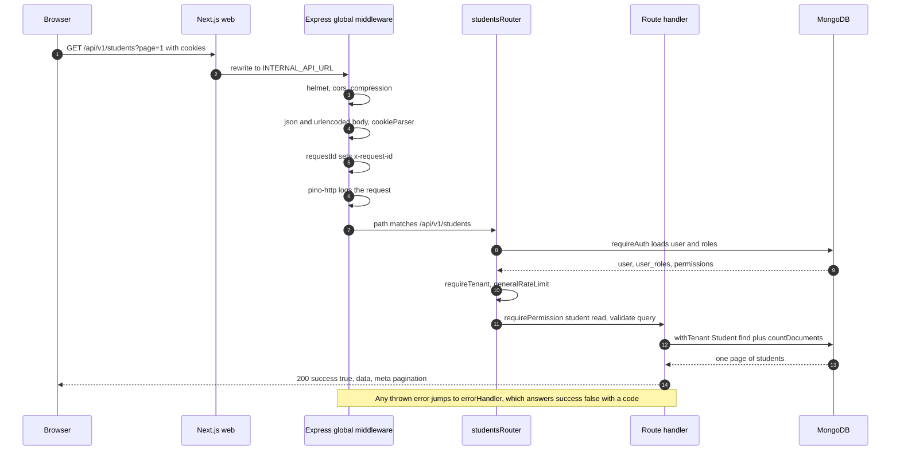

import { Aside, Steps, Card, CardGrid, LinkCard } from '@astrojs/starlight/components';
import Pipeline from '../../../components/Pipeline.astro';
import SourceFile from '../../../components/SourceFile.astro';
import Api from '../../../components/Api.astro';
import Perm from '../../../components/Perm.astro';
import Route from '../../../components/Route.astro';
import DemoLogin from '../../../components/DemoLogin.astro';

When someone opens the Students list, their browser asks the API for one page
of students. That single request passes through about a dozen small steps —
called *middleware* — before any database is touched. Each step does one job:
add security headers, read cookies, prove who the caller is, check they are
allowed, check the input is well-formed. If any step says no, the request
stops there and the caller gets a clear error in the same JSON shape every
time.

This page follows that request in the exact order the code runs it, using
<Api method="GET" path="students" perm="student:read" /> as the example.

<DemoLogin as="School Admin" email="admin@greenfield.example" go="/app/students" />

## The whole trip



The same trip as a chain:

<Pipeline
  caption="Global middleware runs for every request; router middleware runs per module."
  steps={[
    { label: 'Rewrite', icon: 'workflow', note: 'Next.js /api/* proxy' },
    { label: 'Headers', icon: 'shield', note: 'helmet, cors' },
    { label: 'Parse', icon: 'file-text', note: 'body + cookies' },
    { label: 'Request ID', icon: 'id-card', note: 'x-request-id' },
    { label: 'requireAuth', icon: 'lock', note: 'JWT, user, perms, CSRF' },
    { label: 'Tenant + limit', icon: 'building', note: 'requireTenant, 120/min' },
    { label: 'Permission', icon: 'key', note: 'requirePermission' },
    { label: 'Validate', icon: 'badge-check', note: 'Zod schema' },
    { label: 'Handler', icon: 'database', note: 'withTenant + audit' },
  ]}
/>

## Step by step

### 1. The browser calls the API client

Pages never call `fetch` directly. They use `api.get/post/patch/delete` from
<SourceFile path="apps/web/src/lib/api-client.ts" />, usually inside a
TanStack Query hook. The client:

- builds the URL from `API_BASE_URL` (default `/api/v1`, a relative path, so
  the request goes to the web app's own origin);
- sends `credentials: "include"` so the httpOnly `schola_access` and
  `schola_refresh` cookies travel with it;
- on `POST`, `PUT`, `PATCH` and `DELETE`, copies the readable `schola_csrf`
  cookie into an `x-csrf-token` header;
- on a `401`, makes **one** coalesced call to <Api method="POST" path="auth/refresh" />
  and retries the original request once.

### 2. Next.js forwards it

`apps/web/next.config.ts` rewrites `/api/:path*` to
`${INTERNAL_API_URL}/api/:path*` (default `http://localhost:8000`). Because
the browser only ever sees the web origin, cookies are first-party and no
CORS preflight happens in production.

### 3. Global middleware in `buildApp()`

These run, in this order, for **every** request. The order matters: the
Stripe webhook needs the raw body, so it is registered before the JSON
parser.

```ts title="apps/api/src/app.ts (abridged)"
app.disable("x-powered-by");
app.set("trust proxy", 1);
app.use(helmet());
app.use(cors({ origin: allowList, credentials: true, /* … */ }));
app.use(compression());
// Stripe signs the raw body. This route must run before express.json.
app.post("/api/v1/stripe/webhook", express.raw({ type: "application/json" }), /* … */);
app.use(express.json({ limit: "1mb" }));
app.use(express.urlencoded({ extended: true, limit: "1mb" }));
app.use(cookieParser());
app.use(requestId());
app.use(pinoHttp({ logger, customLogLevel /* 5xx error, 4xx warn */ }));

app.use("/api/v1/health", healthRouter);
app.use("/api/v1/auth", authRouter);
// … one app.use per module …
app.use(notFound);
app.use(errorHandler);
```

| # | Middleware | File | What it adds or checks |
|---|---|---|---|
| 1 | `x-powered-by` off, `trust proxy` 1 | `app.ts` | Hides Express; `req.ip` reads the first proxy hop |
| 2 | `helmet()` | `app.ts` | Default security headers on every API response |
| 3 | `cors()` | `app.ts` | Allows origins listed in `CORS_ORIGIN`; requests without an `Origin` (same-origin, curl) pass; exposes `x-request-id` |
| 4 | `compression()` | `app.ts` | gzip responses |
| 5 | Stripe webhook | `modules/stripe/stripe.webhook.ts` | Raw body + signature check, before JSON parsing |
| 6 | `express.json` / `urlencoded` | `app.ts` | Parses bodies up to **1 MB** |
| 7 | `cookieParser()` | `app.ts` | Fills `req.cookies` |
| 8 | `requestId()` | `middleware/request-id.ts` | Reuses an incoming `x-request-id` if it matches `^[\w-]{8,128}$`, else a new UUID; sets `req.requestId` and the response header |
| 9 | `pinoHttp` | `app.ts` | One structured log line per request; cookies and auth headers are redacted |

### 4. Router-level middleware

Each module router declares the checks that apply to **all** its routes in
one `use()` line, then each route adds its own permission and validation:

```ts title="apps/api/src/modules/people/students.routes.ts"
export const studentsRouter: Router = Router();
studentsRouter.use(requireAuth, requireTenant, generalRateLimit);

studentsRouter.get(
  "/",
  requirePermission("student:read"),
  validate({ query: listStudentsQuery }),
  async (req, res, next) => { /* handler */ },
);
```

| Middleware | File | What it does | Fails with |
|---|---|---|---|
| `requireAuth` | `middleware/auth.ts` | Verifies the `schola_access` JWT, loads the user, checks the token's school is still `active`, resolves roles + permissions for that school, builds `req.ctx`, checks CSRF on writes | `401 UNAUTHENTICATED`, `401 INACTIVE_ACCOUNT`, `403 FORBIDDEN` |
| `requireTenant` | `middleware/permission.ts` | Requires `req.ctx.schoolId` to be set | `403 TENANT_MISMATCH` |
| `generalRateLimit` | `middleware/rate-limit.ts` | 120 requests / minute, keyed by user ID (IP when signed out) | `429 RATE_LIMITED` |
| `requirePermission(...keys)` | `middleware/permission.ts` | Caller must hold **every** key | `403 FORBIDDEN` "Missing permission: …" |
| `requireAnyPermission(...keys)` | `middleware/permission.ts` | Caller must hold **at least one** key | `403 FORBIDDEN` |
| `requireSuperAdmin` | `middleware/permission.ts` | `req.ctx.role` must be `super_admin` | `403 FORBIDDEN` |
| `validate({ body, query, params })` | `middleware/validate.ts` | Parses with Zod; replaces `req.body`, redefines `req.query` with the parsed values (Express 5's getter would otherwise discard them — see [API conventions](/architecture/api-conventions/#validation)), merges parsed `params` | `400 VALIDATION_ERROR` |

### 5. Inside `requireAuth`

This is the busiest step, so here it is in full order:

<Steps>

1. Read `req.cookies.schola_access`. Missing → `401 UNAUTHENTICATED`.
2. Verify the JWT with `jose` (HS256, issuer `schola`, audience
   `schola.web`). The claims carry `sub` (user ID), `sid` (school ID or
   `null`) and `rol`.
3. Load the user from MongoDB. Missing, `isActive: false` or soft-deleted →
   `401 INACTIVE_ACCOUNT`.
4. If the token names a school, check that the school is `active`
   (`assertSchoolOpen`, status cached 10 seconds). Suspended, pending,
   rejected or deleted → `401 INACTIVE_ACCOUNT` with a message naming the
   status. `POST /auth/logout` uses a variant without this step so a member of
   a suspended school can still sign out.
5. Call `resolveUserPermissions(userId, schoolId)` — four small queries over
   `user_roles`, `roles`, `role_permissions` and `permissions`. No roles in
   that context → `403 FORBIDDEN`.
6. Build `req.ctx`.
7. If the method is `POST`, `PUT`, `PATCH` or `DELETE`, verify the
   `x-csrf-token` header (unless the full path, `req.baseUrl + req.path`, is
   in `CSRF_EXEMPT_PATHS`). Invalid → `403 FORBIDDEN`.

</Steps>

```ts title="apps/api/src/middleware/auth.ts (abridged)"
const claims = await verifyAccessToken(token);
const userId = new Types.ObjectId(claims.sub);
const schoolId = claims.sid ? new Types.ObjectId(claims.sid) : null;
const user = await User.findById(userId);
if (!user || !user.isActive || user.deletedAt) {
  throw new AppError("INACTIVE_ACCOUNT", "Account is inactive.", 401);
}
if (schoolId && requireOpenSchool) await assertSchoolOpen(schoolId, 401);
const resolved = await resolveUserPermissions(userId, schoolId);
if (!resolved) throw new AppError("FORBIDDEN", "No active roles for this context.", 403);
req.ctx = {
  userId, schoolId,
  role: resolved.primaryRole,
  permissions: resolved.permissions,
  ip: req.ip ?? null,
  userAgent: req.get("user-agent") ?? null,
  requestId: req.requestId,
};
```

The `rol` claim in the token is **not** trusted: the role and permissions are
re-read from the database on every request, so a revoked role stops working
on the very next call.

### 6. The request context, `req.ctx`

Everything downstream — repositories, services, the audit logger — reads the
caller's identity from `req.ctx`, never from the body or URL.

| Field | Type | Source |
|---|---|---|
| `userId` | `ObjectId` | JWT `sub` |
| `schoolId` | `ObjectId \| null` | JWT `sid` (`null` for Super Admin and visitors) |
| `role` | `Role` | Highest-ranked role the user holds in that school |
| `permissions` | `ReadonlySet<Permission>` | Union of all their roles' permissions |
| `ip`, `userAgent` | `string \| null` | Request |
| `requestId` | `string` | `requestId()` middleware |

Defined in <SourceFile path="apps/api/src/types/context.ts" symbol="TenantContext" />.

### 7. The handler

The handler reads validated input, queries through `withTenant(Model, ctx)`
(which adds `schoolId` to every filter — see
[Multi-tenancy](/architecture/multi-tenancy/)), writes an audit entry if it
changed anything, and answers with `ok()`:

```ts title="apps/api/src/modules/people/students.routes.ts (list handler, abridged)"
const repo = withTenant(Student, ctx);
const [items, total] = await Promise.all([
  repo.find(studentFilter).sort({ lastName: 1, firstName: 1 }).skip(skip).limit(pageSize),
  repo.countDocuments(studentFilter),
]);
res.json(ok(await listRows(ctx, items), {
  pagination: { page, pageSize, total, totalPages: Math.max(1, Math.ceil(total / pageSize)) },
}));
```

### 8. The response envelope

Every JSON answer has the same outer shape, built by the helpers in
<SourceFile path="apps/api/src/utils/envelope.ts" />:

```json
{ "success": true, "data": [ … ], "meta": { "pagination": { "page": 1, "pageSize": 20, "total": 412, "totalPages": 21 } } }
```

```json
{ "success": false, "error": { "code": "FORBIDDEN", "message": "Missing permission: student:create", "requestId": "4d0c…" } }
```

The API client unwraps `data` for the page, or throws an `ApiError` carrying
`status`, `code`, `message` and `details` that forms turn into field errors.

### 9. When something goes wrong

Handlers wrap their body in `try { … } catch (err) { next(err) }`. Anything
passed to `next(err)` lands in the error handler, the last middleware:

| Error | Status | `error.code` | Message |
|---|---|---|---|
| `AppError` thrown by code | its own | its own | its own (+ `details`) |
| `ZodError` that escaped `validate()` | 400 | `VALIDATION_ERROR` | "Request validation failed." + flattened issues |
| MongoDB duplicate key (`11000`) | 409 | `CONFLICT` | "Another record already uses this admission number." (field named from the index) |
| Anything else | 500 | `INTERNAL_ERROR` | "Something went wrong." — the real error is logged with the request ID |
| No route matched | 404 | `NOT_FOUND` | "Route not found: GET /api/v1/…" |

```ts title="apps/api/src/middleware/error-handler.ts (abridged)"
if (err instanceof AppError) {
  res.status(err.status).json(fail(err.code, err.message, err.details, requestId));
  return;
}
if (err instanceof ZodError) { /* 400 VALIDATION_ERROR */ }
const duplicate = duplicateKeyMessage(err);
if (duplicate) { res.status(409).json(fail("CONFLICT", duplicate, undefined, requestId)); return; }
logger.error({ err, requestId }, "unhandled error");
res.status(500).json(fail("INTERNAL_ERROR", "Something went wrong.", undefined, requestId));
```

Because the error envelope carries `requestId`, a user can quote it and a
developer can find the matching log line and audit entry.

## Edge cases and gotchas

<Aside type="caution" title="There is no separate tenant or audit middleware">
The original spec and `docs/architecture.md` describe `middleware/tenant.ts` and
`middleware/audit.ts`. Neither file exists. The school ID comes from the JWT
inside `requireAuth`, `requireTenant` only asserts it is present, and each
route calls `auditLogger.log()` itself after a successful change.
</Aside>

<Aside type="note" title="CSRF lives inside requireAuth">
The CSRF check runs only on routes that use `requireAuth`. Public write
routes — <Api method="POST" path="auth/login" />, <Api method="POST" path="auth/register" />,
<Api method="POST" path="schools/signup" /> — have no CSRF check (they also
have no session to abuse). `CSRF_EXEMPT_PATHS` lists full paths such as
`/api/v1/auth/login`, and `isCsrfExempt()` compares them with
`req.baseUrl + req.path`, so the list works from inside a mounted router. None
of the listed routes calls `requireAuth` today, so it is a safety net rather
than something that changes current behaviour.
</Aside>

- **Order inside `use()` matters for rate limits.** Module routers put
  `generalRateLimit` *after* `requireAuth`, so the limit is per user. On
  `/api/v1/admin-transfer` the limiter is mounted in `app.ts` *before* the
  router's auth, so it is keyed by IP instead.
- **Platform audit logs run the platform chain twice.** `/api/v1/platform` is
  mounted before `/api/v1/platform/audit-logs`, so a request to the latter
  first passes `platformRouter`'s `requireAuth` + `superAdminRateLimit`, finds
  no route, then runs them again in `platformAuditLogsRouter`. Each request
  counts twice against the 60/min limit.
- **Every authenticated request costs about five database reads** (user +
  four RBAC lookups), plus one for the school's status when it is not in the
  10-second cache. Roles and permissions are never cached between requests;
  that is the price of instant role revocation.
- **The school ID is frozen in the token.** `sid` is chosen at sign-in (the
  first of the person's schools that is `active`) and only changes on the next
  refresh. There is no school switcher.
- **Success envelopes don't include the request ID.** It is in the
  `x-request-id` response header and in error envelopes only.
- **Not everything is JSON.** `DELETE` routes answer `204 No Content`, PDF
  routes stream `application/pdf`, CSV exports stream `text/csv`. The API
  client treats `204` as success with no data.
- **Express 5 forwards rejected promises** to the error handler on its own;
  the code still uses explicit `try/catch → next(err)` everywhere for
  consistency.

## Related pages

<CardGrid>
  <LinkCard title="API conventions" description="Envelope, error codes, pagination, rate limits and how to add a route." href="/architecture/api-conventions/" />
  <LinkCard title="Authentication" description="Where the cookies and the JWT come from." href="/architecture/authentication/" />
  <LinkCard title="Roles & permissions" description="How resolveUserPermissions builds the permission set." href="/architecture/rbac/" />
  <LinkCard title="Multi-tenancy" description="What withTenant does to every query." href="/architecture/multi-tenancy/" />
</CardGrid>
