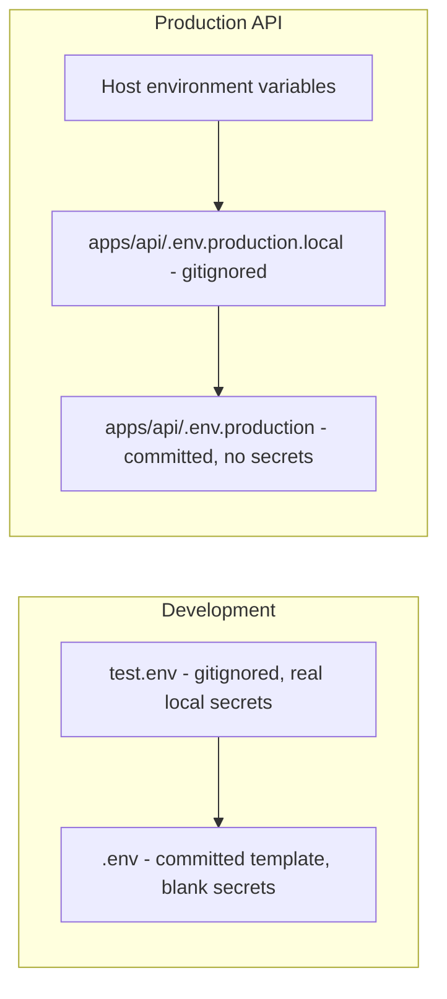
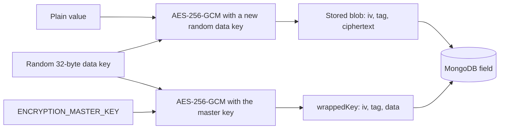

import { Aside, Steps, Card, CardGrid, LinkCard, Badge } from '@astrojs/starlight/components';
import SourceFile from '../../../components/SourceFile.astro';
import Api from '../../../components/Api.astro';
import Perm from '../../../components/Perm.astro';

A school platform stores exactly the data attackers want: children's names
and birthdays, home addresses, phone numbers, payroll and payments. Schola's
security is a set of **layers**, so a gap in one is caught by the next: strong
password storage, short-lived sessions in cookies scripts can't read,
permission checks on every request, a hard wall between schools, encryption
of personal data inside the database, and an audit trail of every change.

This page lists each layer, where it lives in the code, and how it maps to
the thirteen requirements in the original spec. Where the code falls short of the original spec,
the page says so.

## At a glance

<CardGrid>
  <Card title="Identity" icon="padlock">
    argon2id passwords, 15-min HS256 JWT, rotated opaque refresh tokens.
  </Card>
  <Card title="Transport" icon="approve-check">
    httpOnly, SameSite=Lax, Secure cookies; signed CSRF header; same-origin API.
  </Card>
  <Card title="Data" icon="database">
    `schoolId` isolation, AES-256-GCM envelope encryption, soft delete.
  </Card>
  <Card title="Accountability" icon="document">
    Append-only audit log with actor, role, IP and request ID.
  </Card>
</CardGrid>

## the original spec checklist

| # | Requirement | Status | Where |
|---|---|---|---|
| 1 | Argon2id only | <Badge text="Met" variant="success" /> | `utils/argon.ts` |
| 2 | JWT secrets ≥ 32 bytes, different for access and refresh | <Badge text="Partial" variant="caution" /> | `@schola/config/server` — length checked; refresh secret unused |
| 3 | httpOnly + Secure + SameSite cookies; CSRF on mutations | <Badge text="Met" variant="success" /> | `utils/cookies.ts`, `middleware/auth.ts` |
| 4 | Helmet on Express; CSP on the web app (allowing JSON-LD) | <Badge text="Partial" variant="caution" /> | `app.ts` has helmet; web has no CSP |
| 5 | CORS allow-list from env; production allows only the site | <Badge text="Met" variant="success" /> | `app.ts`, `CORS_ORIGIN` |
| 6 | Zod validation everywhere | <Badge text="Met" variant="success" /> | `middleware/validate.ts`, `@schola/validation` |
| 7 | No `$where`; rely on casting + Zod | <Badge text="Met" variant="success" /> | no occurrences; `strictQuery`; escaped search regex |
| 8 | Rate limiting (in-memory) | <Badge text="Partial" variant="caution" /> | `middleware/rate-limit.ts`; public school signup unthrottled |
| 9 | Audit every sensitive action | <Badge text="Met" variant="success" /> | `services/audit.service.ts` |
| 10 | Soft delete by default | <Badge text="Met" variant="success" /> | `withTenant().softDelete`, `applySoftDelete` |
| 11 | Reset / verification tokens single-use, time-bound, hashed | <Badge text="Met" variant="success" /> | `single_use_tokens`, SHA-256 |
| 12 | No secrets in client bundles | <Badge text="Met" variant="success" /> | only `NEXT_PUBLIC_*` reach the browser |
| 13 | Tenant isolation tested in integration tests | <Badge text="Met" variant="success" /> | `modules/*/__tests__/*.integration.test.ts` |

The sections below go through them in order.

## 1. Password hashing — argon2id

```ts title="apps/api/src/utils/argon.ts"
function options(): argon2.HashOptions & { raw?: false } {
  const env = loadServerEnv();
  return {
    type: argon2.argon2id,
    memoryCost: env.ARGON2_MEMORY_COST,   // default 19 456 KiB (19 MiB)
    timeCost: env.ARGON2_TIME_COST,       // default 2
    parallelism: env.ARGON2_PARALLELISM,  // default 1
  };
}
```

These are the OWASP-recommended minimums and match the original spec. `verifyPassword`
returns `false` on any error rather than throwing. Password rules
(`strongPassword`): 8–128 characters with upper-case, lower-case and a digit.
`passwordHash` has `select: false`, so it is never loaded unless a query asks
for it explicitly, and `toJSON` strips it.

## 2. Tokens

| Token | Format | Lifetime | Stored as |
|---|---|---|---|
| Access | JWT, HS256 (`jose`), `iss=schola`, `aud=schola.web`, random `jti` | `JWT_ACCESS_TTL` = 15 min | not stored |
| Refresh | 64 random bytes, base64url | `JWT_REFRESH_TTL` = 30 days, **rotated** on every use | SHA-256 hash in `refresh_tokens` |
| Password reset | 32 random bytes | `PASSWORD_RESET_TTL_MIN` = 60 min, single use | SHA-256 hash |
| Email verification | 32 random bytes + 6-digit code | `EMAIL_VERIFICATION_TTL_HOURS` = 72 h, single use | SHA-256 hashes |
| Admin transfer | 32 random bytes | `ADMIN_TRANSFER_TTL_HOURS` = 24 h, single use | SHA-256 hash |

`loadServerEnv()` rejects `JWT_ACCESS_SECRET`, `JWT_REFRESH_SECRET` and
`CSRF_SECRET` shorter than 32 characters, and production refuses to start
without them. The access token's role claim is not trusted — permissions are
re-read from the database on every request.

<Aside type="caution" title="The refresh secret signs nothing">
The original spec asks for different secrets for access and refresh tokens. Refresh
tokens are opaque random strings, not JWTs, so `JWT_REFRESH_SECRET` is
validated and required in production but never used. The "≥ 32" check
counts characters, not random bytes.
</Aside>

## 3. Cookies and CSRF

| Flag | Value | Why |
|---|---|---|
| `httpOnly` | on for `schola_access`, `schola_refresh`, `schola_oauth` | scripts (including injected ones) can't read the session |
| `Secure` | on when `NODE_ENV=production` | HTTPS only |
| `SameSite` | `Lax` | cookies aren't sent on cross-site `POST`s |
| `Domain` | `COOKIE_DOMAIN` (`.schola.reactbd.com` in production; omitted for `localhost`) | |
| `Path` | `/` | |

CSRF: `requireAuth` requires an `x-csrf-token` header on `POST`, `PUT`,
`PATCH` and `DELETE`, verified as `nonce.HMAC-SHA256(CSRF_SECRET, nonce)` with
a timing-safe compare. Full detail on
[Authentication](/architecture/authentication/#csrf-protection).

<Aside type="caution" title="CSRF token is signed, not bound">
The server checks that the header is **a** valid signed token; it doesn't
compare it with the `schola_csrf` cookie or bind it to the session. Combined
with `SameSite=Lax` and the CORS allow-list this blocks cross-site forgery,
but it is weaker than the double-submit the original spec describes. When `CSRF_SECRET`
is unset (development only) a hard-coded fallback secret is used.
</Aside>

## 4. Security headers

- **API** — `helmet()` with its defaults (HSTS, `X-Content-Type-Options`,
  frame and referrer policies, a default CSP on API responses) and
  `x-powered-by` disabled.
- **Web** — <SourceFile path="apps/web/next.config.ts" /> adds
  `Referrer-Policy: strict-origin-when-cross-origin`,
  `X-Content-Type-Options: nosniff`, `X-Frame-Options: DENY` and a
  `Permissions-Policy` that turns off camera, microphone and geolocation;
  `poweredByHeader` is off.

<Aside type="caution" title="No CSP on the web app">
The original spec and the deployment checklist require a Content-Security-Policy on
the web app (allowing the inline JSON-LD). Neither `next.config.ts` nor the
proxy file sets one.
</Aside>

## 5. CORS

```ts title="apps/api/src/app.ts (abridged)"
const allowedOrigins = env.CORS_ORIGIN.split(",").map((s) => s.trim()).filter(Boolean);
app.use(cors({
  origin: (origin, callback) => {
    if (!origin) return callback(null, true);              // same-origin, curl
    if (allowedOrigins.includes(origin)) return callback(null, true);
    return callback(new Error(`CORS: origin ${origin} is not allowed`));
  },
  credentials: true,
  allowedHeaders: ["Accept", "Authorization", "Content-Type", "Origin", "X-Requested-With", "x-csrf-token", "x-request-id"],
  exposedHeaders: ["x-request-id"],
}));
```

`apps/api/.env.production` sets `CORS_ORIGIN=https://schola.reactbd.com`.
Because the browser reaches the API through the web app's `/api/*` rewrite,
normal traffic is same-origin and never needs CORS at all. A rejected origin
surfaces as a `500 INTERNAL_ERROR` (the CORS error goes to the error handler).

## 6. Input validation

Every body, query and path parameter passes a `.strict()` Zod schema from
`@schola/validation` before the handler runs; unknown keys are rejected, so
fields like `schoolId`, `createdBy` or `role` can't be smuggled in. JSON
bodies are capped at **1 MB**. See [API conventions](/architecture/api-conventions/#validation)
— including the caution about parsed query values in Express 5.

## 7. Query safety

- No `$where` anywhere in the codebase.
- `mongoose.set("strictQuery", true)` — filter keys not in the schema are
  dropped.
- Free-text search is escaped before it becomes a regular expression:

  ```ts title="apps/api/src/utils/regex.ts"
  export function escapeRegExp(value: string): string {
    return value.replace(/[.*+?^${}()|[\]\\]/gu, "\\$&");
  }
  export function searchPattern(q: string): RegExp {
    return new RegExp(escapeRegExp(q), "iu");
  }
  ```

  so a search for `(` doesn't crash and a crafted pattern can't backtrack for
  seconds (ReDoS).
- IDs are validated as 24-hex `ObjectId`s before use.

## 8. Rate limiting and lockout

| Limiter | Limit | Key |
|---|---|---|
| Auth routes | 10 / min (production) | IP |
| School and self-service routes | 120 / min | user ID |
| Platform routes | 60 / min | user ID |

**Login lockout:** after `LOGIN_LOCKOUT_THRESHOLD` (5) wrong passwords,
`lockedUntil` is set `LOGIN_LOCKOUT_MINUTES` (15) ahead. A successful login or
a password reset clears it, and once a lock has expired the count starts again
from zero. OAuth sign-ins are not subject to lockout.

The signed-out "resend verification email" endpoint has its own limit on top
of the per-IP auth limiter: at most one email per address per minute.

<Aside type="caution" title="Gaps in throttling">
- <Api method="POST" path="schools/signup" /> (public, creates a user and a
  school, sends two emails) has **no** rate limiter.
- Counters are in memory per process, so they reset on restart and aren't
  shared between instances (the original spec accepts this for v1).
</Aside>

## 9. Audit trail

Every mutation writes an append-only entry with `actorId`,
`actorRoleAtTime`, `before` / `after` (with passwords, tokens, secrets and PII
keys redacted), IP, user agent and request ID. Downloads of receipts,
payslips and report cards and CSV exports are logged as reads. Mongoose hooks
make `AuditLog` updates and deletes throw. See [Audit log](/architecture/audit-log/).

## 10. Soft delete

Tenant records are never removed: `withTenant(...).softDelete()` sets
`deletedAt`, and `applySoftDelete()` hides those rows from normal queries.
`withTenant` has no `deleteOne`. The only hard deletes in the API remove
`user_roles` memberships (revoking a role, removing a person, admin
transfer). Rejecting a school soft-deletes the applicant's user.

## 11. Single-use tokens

`single_use_tokens` stores `tokenHash` (SHA-256), `purpose`, `expiresAt` and
`consumedAt`. Lookups require `consumedAt: null` and check expiry; using a
token sets `consumedAt` (verification consumes every open verification token
for the user). A TTL index deletes rows a day after expiry.
`forgot-password` always answers `202` so it can't reveal which emails exist.

## 12. Secrets and configuration



- <SourceFile path="apps/api/src/load-env.ts" /> loads the files in that
  order; the first one to define a key wins, and host variables beat every
  file.
- `.env` is the committed **template**: every key present, secrets blank.
  `test.env` and `.env*.local` are gitignored.
- In production `loadServerEnv()` refuses to start without `MONGODB_URI`,
  `APP_URL`, `COOKIE_DOMAIN`, `JWT_ACCESS_SECRET`, `JWT_REFRESH_SECRET`,
  `CSRF_SECRET`, `ENCRYPTION_MASTER_KEY`, `RESEND_API_KEY` and the three
  ImageKit keys.
- The browser only receives `NEXT_PUBLIC_*` values (app name and URL, API
  base path, the Firebase **web** config). Server secrets never enter the web
  bundle because the web app never imports `@schola/config/server` or
  `@schola/db`.
- pino redacts `req.headers.authorization`, `req.headers.cookie` and any
  `password`, `passwordHash`, `token`, `refreshToken`, `apiKey` or `secret`
  field.

<Aside type="danger" title="Never paste real values into committed files">
Real keys belong in `test.env` (development) or the host dashboard /
`.env.production.local` (production). The committed `.env` and
`.env.production` files must keep secrets blank. See
[Environment variables](/setup/environment-variables/).

Keep it that way: if a real value ever lands in a committed file, rotate it at
its provider — removing the line doesn't remove it from Git history.
</Aside>

## PII envelope encryption

The original spec decided personal data is encrypted in v1. Phone numbers, dates of
birth and addresses (on users, students, parents, teachers, staff and
admission applications) are encrypted **before** they reach MongoDB, by
<SourceFile path="packages/db/src/crypto.ts" />.



<Steps>

1. Assigning a string to an encrypted path runs a Mongoose setter that calls
   `encryptField(value)`.
2. A fresh **32-byte data key** and 12-byte IV encrypt the value with
   AES-256-GCM (authenticated: tampering makes decryption fail).
3. The data key is itself encrypted ("wrapped") with the **master key** —
   `ENCRYPTION_MASTER_KEY`, base64 of exactly 32 bytes.
4. The field stores `{ v: 1, keyId, iv, tag, ciphertext, wrappedKey }`.
   `keyId` records which master key was used.
5. Reads return the blob; routes call `decryptIfPresent()` only where the
   plain value is needed. `toJSON` strips the blobs, list views decrypt only
   the phone, and the audit logger redacts these keys.

</Steps>

```ts title="packages/db/src/crypto.ts (abridged)"
export function encryptField(value: string): EncryptedField {
  const { keyId, key: masterKey } = getMasterKey();
  const dataKey = randomBytes(KEY_BYTES);
  const payload = aesGcmEncrypt(dataKey, Buffer.from(value, "utf8"));
  const wrapped = aesGcmEncrypt(masterKey, dataKey);
  return {
    v: 1, keyId,
    iv: payload.iv.toString("base64"), tag: payload.tag.toString("base64"),
    ciphertext: payload.data.toString("base64"),
    wrappedKey: { iv: wrapped.iv.toString("base64"), tag: wrapped.tag.toString("base64"), data: wrapped.data.toString("base64") },
  };
}
```

Generate a master key with `openssl rand -base64 32`; setup is on
[Encryption](/setup/services/encryption/).

<Aside type="caution" title="Encryption caveats">
- **`keyId` is part of the key.** It is the first 8 bytes of the master key in
  hex, so every encrypted field stores 64 bits of the master key in the clear.
  A hash of the key would identify it without revealing any of it.
- **No rotation tooling.** `decryptField` throws "key rotation required" when
  a blob's `keyId` doesn't match the current key, and there is no re-wrap
  script yet. Losing or changing the master key makes existing PII unreadable.
- **Encrypted fields can't be searched or sorted** by the database.
</Aside>

## Account and session controls

| Control | Where |
|---|---|
| Suspend a user — `isActive: false` blocks every request, refresh and sign-in, social sign-in included | <Api method="POST" path="platform/users/:id/suspend" perm="user:suspend" /> |
| Suspend a school — its members are refused at sign-in and their sessions end on the next request | <Api method="POST" path="platform/schools/:id/suspend" perm="school:suspend" />, <SourceFile path="apps/api/src/services/school-status.ts" /> |
| Sign out one device / all other devices | <Api method="DELETE" path="me/sessions/:id" />, <Api method="POST" path="me/sessions/revoke-others" /> |
| Password change signs out other devices | <Api method="POST" path="me/password" /> |
| Password reset signs out every device | <Api method="POST" path="auth/reset-password" /> |
| Email verification required before password login | `EMAIL_NOT_VERIFIED` |
| Open-redirect protection on `next=` and OAuth `origin` | `safeNext` and the `resolveOAuthOrigin` allow-list in the API; `safeNextPath` in `apps/web/src/lib/safe-next.ts` for the login form and route guard (same-origin relative paths only) |

## Edge cases and gotchas

- **Revoked sessions keep a 15-minute tail.** Revoking a refresh token doesn't
  invalidate the access JWT already issued; suspension does (it's checked per
  request).
- **CSV exports neutralise formulas.** `escapeCell()` in
  `apps/api/src/services/csv.service.ts` prefixes a `'` to any cell that starts
  with `=`, `+`, `-`, `@`, a tab or a carriage return, so a student name like
  `=HYPERLINK(…)` shows as text in a spreadsheet. Plain numbers such as
  `-12.50` are left alone.
- **Development logs contain secrets on purpose.** The console email
  transport prints verification codes and reset links. When the access cookie
  is missing, `requireAuth` logs only the cookie **names** and whether a
  `Cookie` header was sent — never cookie values.
- **The Neon mirror holds password hashes too.** When `DATABASE_URL` is set,
  `identity_users.password_hash` copies the argon2id hash, so that database
  needs the same protection as MongoDB.
- **Indexes are built on boot in production** (`autoIndex` is off, so the API
  calls `createIndexes()` for every model), including the TTL indexes that
  clean up old tokens. A database created before that fix must drop the old
  plain `expiresAt_1` index on `refreshtokens` and `singleusetokens` once. See
  [Data model](/architecture/data-model/#edge-cases-and-gotchas).

## Related pages

<CardGrid>
  <LinkCard title="Authentication" description="Passwords, tokens, cookies, CSRF and OAuth in depth." href="/architecture/authentication/" />
  <LinkCard title="Multi-tenancy" description="How one school's data is kept from another." href="/architecture/multi-tenancy/" />
  <LinkCard title="Encryption setup" description="Creating and storing ENCRYPTION_MASTER_KEY." href="/setup/services/encryption/" />
  <LinkCard title="Deployment" description="Production env files and the pre-deploy checklist." href="/operations/deployment/" />
</CardGrid>
