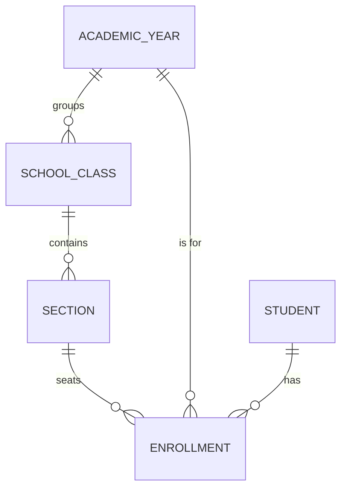

import { Aside, Steps, Card, CardGrid, LinkCard } from '@astrojs/starlight/components';
import ScreenAnatomy from '../../../../components/ScreenAnatomy.astro';
import SourceFile from '../../../../components/SourceFile.astro';
import Api from '../../../../components/Api.astro';
import Perm from '../../../../components/Perm.astro';
import Roles from '../../../../components/Roles.astro';
import Route from '../../../../components/Route.astro';
import DemoLogin from '../../../../components/DemoLogin.astro';
import Screenshot from '../../../../components/Screenshot.astro';

An **academic year** is the school year — for example "2026-2027", from 1
June to 31 May. It is the first thing a new school creates, because
everything structural hangs off it: every **class** belongs to one year,
sections live inside classes, and a student's **enrolment** places them in a
section for one year. Exactly one year can be marked **current**; Schola uses
it as the default wherever a page needs "this year".

## At a glance

<CardGrid>
  <Card title="Who uses it" icon="star">
    <Roles list={['school_admin']} note="manages" /> <Roles list={['principal', 'vice_principal', 'teacher', 'accountant']} note="view" />
  </Card>
  <Card title="Where to find it" icon="laptop">
    <Route path="/app/academic-years" /> — sidebar **School setup → Academic years**
  </Card>
  <Card title="Permissions" icon="approve-check">
    <Perm name="academic_year:read" /> <Perm name="academic_year:create" /> <Perm name="academic_year:update" /> <Perm name="academic_year:delete" />
  </Card>
</CardGrid>

<DemoLogin as="School Admin" email="admin@greenfield.example" go="/app/academic-years">
Greenfield has two years: the previous one and the current one (marked
**current**). Their names follow the date you ran the seed — for example
"2025-2026" and "2026-2027".
</DemoLogin>

## How it works

A student has at most one enrolment per academic year, so promoting a class
to next year means creating the new year, its classes and sections, and
enrolling students again. Last year's enrolments stay untouched as history.

### What "current" changes

| Where | Effect of the current year |
|---|---|
| [Classes & sections](/features/academics/classes-and-sections/) | "Add class" pre-selects the current year; year pickers mark it "(current)" |
| [Attendance](/features/daily/attendance/) | The daily summary covers only sections of classes in the current year |
| Student placement | When a student has active enrolments in several years, the one in the current year is shown as their class and section |
| Student and parent dashboards | "Attendance this year" counts from the current year's start date to today |
| [School dashboard](/features/school/dashboard/) | Checklist step 1 reads "Current: *name*" |
| Fees, exams, admissions pickers | The current year is labelled "(current)" |

With **no** current year, these fall back: the class form picks the year with
the latest start date, the attendance summary covers every class, and
"Attendance this year" on the student and parent dashboards counts the last
90 days.

## The screen

<Screenshot name="admin-academic-years" alt="The Academic years list" path="/app/academic-years" />

<ScreenAnatomy
  title="Academic years"
  path="/app/academic-years"
  regions={[
    { label: 'Sidebar', desc: '"Academic years" highlighted under School setup.', area: 'sidebar' },
    { label: 'Top bar', desc: 'Breadcrumb "School / Academic years".', area: 'top' },
    { label: 'Page header', desc: '"Academic years" — "Each academic year groups your classes, sections, and enrollments. Mark one as current." — and "Add academic year".' },
    { label: 'Years table', desc: 'Name (with a cyan "current" badge), Starts, Ends, and a "⋯" menu: Edit, Make current, Delete. Newest start date first, 20 per page, with a pager.', size: 4, tone: 'accent' },
  ]}
/>

<ScreenAnatomy
  title="New academic year drawer"
  path="/app/academic-years"
  regions={[
    { label: 'Drawer header', desc: '"New academic year" (or "Edit 2026-2027") — "Groups classes, sections, and enrollments."' },
    { label: 'Fields', desc: 'Name (placeholder 2026-2027), Start date, End date, and the checkbox "Make this the current academic year".', size: 3, tone: 'accent' },
    { label: 'Submit', desc: '"Create academic year" or "Save changes".' },
  ]}
/>

## Step by step

<Steps>

1. Sign in as the School Admin and click **School setup → Academic years**.
2. Click **Add academic year**. A drawer slides in from the side.
3. Type **Name** `2027-2028`, set **Start date** to 1 June 2027 and **End
   date** to 31 May 2028. Leave **Make this the current academic year**
   unticked for now.
4. Click **Create academic year**. A toast says "Academic year created." and
   the new year tops the list (it starts latest).
5. Open **⋯** on the new year and click **Make current**. A toast says
   "2027-2028 is now the current year." The **current** badge moves to it and
   disappears from the old year.
6. To put the demo back, open **⋯** on the previous current year and click
   **Make current** again.
7. Open **⋯ → Delete** on `2027-2028`. The dialog asks "Delete 2027-2028?" —
   "Only years without classes can be deleted. This cannot be undone from the
   app." Click **Delete**. A toast says "Academic year deleted."

</Steps>

<Aside type="caution" title="Making a new year current reshapes the demo">
While an empty year is current, the attendance summary shows no sections
(Greenfield's classes all belong to the seeded current year) and new classes
default to the empty year. Switch **Make current** back before you record the
attendance or classes pages.
</Aside>

## Every action on this screen

### Loading the list

<Api method="GET" path="academic-years" perm="academic_year:read" />

Sorted by start date, newest first; `page` and `pageSize` (the page asks
for 20).

### "Add academic year" → "Create academic year"

<Api method="POST" path="academic-years" perm="academic_year:create" />

| Field | Rule |
|---|---|
| Name | 2–40 characters; unique in the school ("Another record already uses this name.") |
| Start date, End date | dates; the end must be after the start ("endDate must be after startDate") |
| Make current | optional; when ticked, every other year is un-marked first |

Audit action `academic_year.create`.

### "Edit" → "Save changes"

<Api method="PATCH" path="academic-years/:id" perm="academic_year:update" />

Any field can change, but the year must still end after it starts: a PATCH
that sends both dates is checked by `updateAcademicYearSchema`, and one that
changes a single date is checked by the API against the stored other date
("The year must end after it starts.", `400`). Ticking **Make this the current
academic year** un-marks every other year; un-ticking it on the current year leaves the
school with **no** current year. Audit action `academic_year.update` with the
year before and after.

### "Make current"

The same endpoint with `{ "isCurrent": true }`. Shown only on years that are
not current. The list, the classes page and the dashboard refresh.

### "Delete"

<Api method="DELETE" path="academic-years/:id" perm="academic_year:delete" />

Refused while classes use the year: "3 classes use this academic year. Delete
or move them first." Otherwise the year is soft-deleted (hidden, kept in the
database) and `academic_year.delete` is written.

## Who sees what

| Role | Sidebar link | Add, edit, make current | Delete |
|---|---|---|---|
| School Admin | Yes | Yes | Yes |
| Principal | Yes | — (list only, no ⋯ menu) | — |
| Vice Principal | Yes | — (list only) | — |
| Teacher | Yes | — (list only) | — |
| Accountant | Yes | — (list only) | — |
| Student, Parent, Staff | — | — | — |

## Under the hood

- <SourceFile path="apps/web/src/app/(tenant)/app/academic-years/page.tsx" /> — the page, `AcademicYearForm` and the **Make current** mutation.
- <SourceFile path="apps/api/src/modules/academics/academic-years.routes.ts" /> — list, create, update, delete.
- <SourceFile path="packages/validation/src/academics.ts" /> — `createAcademicYearSchema` and `updateAcademicYearSchema`, both with the end-after-start rule.
- <SourceFile path="packages/db/src/models/academic-year.ts" /> — `name`, `startDate`, `endDate`, `isCurrent`; unique on school + name; soft delete.
- <SourceFile path="apps/api/src/modules/academics/_enrich.ts" symbol="currentEnrollments" /> — the "current year wins" placement rule.
- <SourceFile path="apps/web/src/lib/school-data.ts" symbol="currentYear" /> — the web app's fallback to the newest year.

## Edge cases and gotchas

- **No "close year".** There is no archive or close action. Old years stay in
  the list; you move on by marking the new one current.
- **A deleted name stays taken.** Deletion is soft and the unique index still
  sees the old row, so re-creating a year with the same name fails with
  "Another record already uses this name." Pick a slightly different name, or
  edit the existing year instead of deleting it.
- **A failed create can clear "current".** With **Make current** ticked, the
  API un-marks the other years *before* inserting the new one. If the insert
  then fails (for example a duplicate name), the school is left with no
  current year — mark one again.
- **Dates are UTC.** Start and end dates are stored as midnight UTC and shown
  in medium date style ("Jun 1, 2026").

## Related pages

<CardGrid>
  <LinkCard title="Classes and sections" description="The next step: classes inside the year." href="/features/academics/classes-and-sections/" />
  <LinkCard title="Subjects" description="Add the subjects classes will teach." href="/features/academics/subjects/" />
  <LinkCard title="Set up academics (tutorial)" description="Years, subjects and classes in one walkthrough." href="/tutorial/set-up-academics/" />
  <LinkCard title="Data model" description="How years, classes, sections and enrolments relate." href="/architecture/data-model/" />
</CardGrid>
