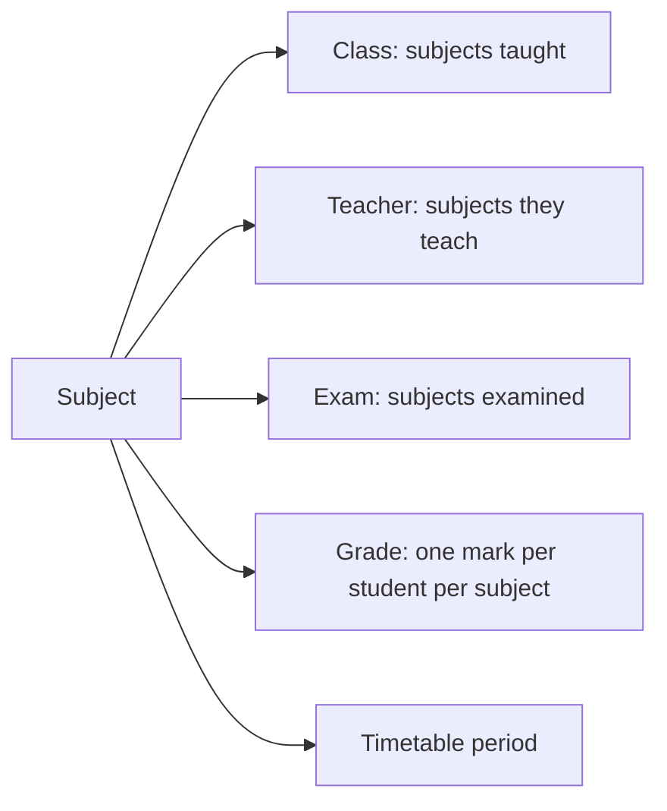

import { Aside, Steps, Card, CardGrid, LinkCard } from '@astrojs/starlight/components';
import ScreenAnatomy from '../../../../components/ScreenAnatomy.astro';
import SourceFile from '../../../../components/SourceFile.astro';
import Api from '../../../../components/Api.astro';
import Perm from '../../../../components/Perm.astro';
import Roles from '../../../../components/Roles.astro';
import Route from '../../../../components/Route.astro';
import DemoLogin from '../../../../components/DemoLogin.astro';
import Screenshot from '../../../../components/Screenshot.astro';

A **subject** is something the school teaches — Mathematics, English,
Physics. Each has a **name** and a short **code** (MATH, ENG, PHY) that
appears on report cards and in compact tables. Subjects are a school-wide
list: they are not tied to an academic year, so you add them once and reuse
them every year. Classes list the subjects taught in them, teachers list the
subjects they can teach, and exams, grades and timetable periods point at a
subject.

## At a glance

<CardGrid>
  <Card title="Who uses it" icon="star">
    <Roles list={['school_admin', 'principal']} note="manage" /> <Roles list={['vice_principal', 'teacher', 'accountant']} note="view" />
  </Card>
  <Card title="Where to find it" icon="laptop">
    <Route path="/app/subjects" /> — sidebar **School setup → Subjects**
  </Card>
  <Card title="Permissions" icon="approve-check">
    <Perm name="subject:read" /> <Perm name="subject:create" /> <Perm name="subject:update" /> <Perm name="subject:delete" />
  </Card>
</CardGrid>

<DemoLogin as="School Admin" email="admin@greenfield.example" go="/app/subjects">
Greenfield has 12 subjects: Art & Design (ART), Biology (BIO), Chemistry
(CHEM), Computer Science (CS), English (ENG), French (FRE), Mathematics
(MATH), Music (MUS), Physical Education (PE), Physics (PHY), Science (SCI) and
Social Studies (SOC).
</DemoLogin>

## How it works

Subjects are the shared vocabulary of the academic side. When you create a
class you tick the subjects taught in it; when you add a teacher you tick
what they teach; an exam lists the subjects it covers, and the gradebook
records one mark per student, exam and subject.

## The screen

<Screenshot name="admin-subjects" alt="The Subjects list" path="/app/subjects" />

<ScreenAnatomy
  title="Subjects"
  path="/app/subjects"
  regions={[
    { label: 'Sidebar', desc: '"Subjects" highlighted under School setup.', area: 'sidebar' },
    { label: 'Top bar', desc: 'Breadcrumb "School / Subjects".', area: 'top' },
    { label: 'Page header', desc: '"Subjects" — "The subjects taught at your school. Assign them to classes and teachers." — and "Add subject".' },
    { label: 'Search', desc: '"Search name or code".', tone: 'muted' },
    { label: 'Subjects table', desc: 'Subject (name with the code in mono type underneath), Description (or a dash), and a "⋯" menu: Edit, Delete. Sorted by name, 20 per page.', size: 4, tone: 'accent' },
  ]}
/>

The **New subject** drawer reads "Name and a short code used on report
cards." and holds **Name** (placeholder "Mathematics"), **Code** (placeholder
"MATH") and **Description (optional)** (placeholder "Core mathematics"),
then **Create subject** — or **Save changes** when editing.

## Step by step

<Steps>

1. Sign in as the School Admin and click **School setup → Subjects**.
2. Type `math` in **Search name or code**. Mathematics (MATH) remains. Clear
   the search.
3. Click **Add subject**. In the drawer, type **Name** `Economics`, **Code**
   `econ` and **Description** `Grades 9–10 elective`.
4. Click **Create subject**. A toast says "Subject created." The list shows
   Economics with the code **ECON** — codes are stored in capitals.
5. Open **⋯ → Edit** on Economics, change the description and click **Save
   changes**. A toast says "Subject updated."
6. Open **Classes & sections**, edit **Grade 9** and tick Economics under
   **Subjects taught** to use it.
7. To remove it, go back to Subjects and open **⋯ → Delete**. The dialog
   asks "Delete Economics?" — "It is removed from every class and teacher that
   lists it." Click **Delete**. A toast says "Subject deleted."

</Steps>

## Every action on this screen

### Loading and searching

<Api method="GET" path="subjects" perm="subject:read" />

Query `q` matches the name or the code (case-insensitive), plus `page` and
`pageSize`. The search box is kept in the page URL.

### "Add subject" → "Create subject"

<Api method="POST" path="subjects" perm="subject:create" />

| Field | Rule |
|---|---|
| Name | 1–80 characters |
| Code | 1–20 characters, stored upper-case, unique in the school ("Another record already uses this code.") |
| Description | optional, up to 500 characters |

Audit action `subject.create`.

### "Edit" → "Save changes"

<Api method="PATCH" path="subjects/:id" perm="subject:update" />

Changes name, code or description. Classes, teachers and grades keep pointing
at the same subject, so a rename shows everywhere. Audit action
`subject.update`.

### "Delete"

<Api method="DELETE" path="subjects/:id" perm="subject:delete" />

Soft-deletes the subject and removes it from the **Subjects taught** of every
class and the subject list of every teacher. Audit action `subject.delete`.

## Who sees what

| Role | Sidebar link | Add, edit | Delete |
|---|---|---|---|
| School Admin | Yes | Yes | Yes |
| Principal | Yes | Yes | — |
| Vice Principal | Yes | — (list only) | — |
| Teacher | Yes | — (list only) | — |
| Accountant | Yes | — (list only) | — |
| Student, Parent, Staff | — | — | — |

## Under the hood

- <SourceFile path="apps/web/src/app/(tenant)/app/subjects/page.tsx" /> — the page and `SubjectForm`.
- <SourceFile path="apps/api/src/modules/academics/subjects.routes.ts" /> — list, create, update and delete (with the clean-up of classes and teachers).
- <SourceFile path="packages/validation/src/academics.ts" /> — `createSubjectSchema`, `updateSubjectSchema`, `listSubjectsQuery`.
- <SourceFile path="packages/db/src/models/subject.ts" /> — `name`, `code` (upper-cased), `description`; unique on school + code.

## Edge cases and gotchas

- **Codes are upper-cased.** `econ` is saved as `ECON`, and uniqueness is
  checked on the upper-cased code.
- **A deleted code stays taken.** Deletion is soft and the unique index still
  sees the deleted row, so a new subject cannot reuse the code of a deleted
  one ("Another record already uses this code."). Edit and reuse the old
  subject instead of deleting and re-creating it.
- **Delete does not touch exams, grades or the timetable.** Only classes and
  teachers are cleaned up. Exams that listed the subject, recorded marks and
  timetable periods keep pointing at the deleted subject. Prefer renaming
  over deleting once marks exist.
- **Not per year.** The same list serves every academic year.

## Related pages

<CardGrid>
  <LinkCard title="Classes and sections" description="Tick the subjects taught in each class." href="/features/academics/classes-and-sections/" />
  <LinkCard title="Teachers" description="Record which subjects each teacher teaches." href="/features/people/teachers/" />
  <LinkCard title="Gradebook" description="Marks per student, exam and subject." href="/features/assessment/gradebook/" />
  <LinkCard title="Timetable" description="Periods that point at a subject and a teacher." href="/features/daily/timetable/" />
</CardGrid>
