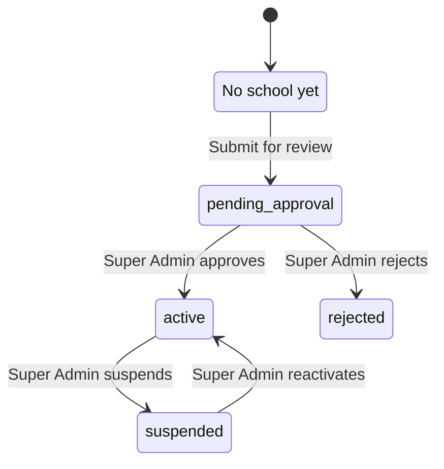

import { Aside, Steps, Card, CardGrid, LinkCard } from '@astrojs/starlight/components';
import Pipeline from '../../../../components/Pipeline.astro';
import ScreenAnatomy from '../../../../components/ScreenAnatomy.astro';
import SourceFile from '../../../../components/SourceFile.astro';
import Api from '../../../../components/Api.astro';
import Perm from '../../../../components/Perm.astro';
import Roles from '../../../../components/Roles.astro';
import Route from '../../../../components/Route.astro';
import DemoLogin from '../../../../components/DemoLogin.astro';
import Screenshot from '../../../../components/Screenshot.astro';

Not everyone who signs in belongs to a school yet. Someone who created a
**personal account** on `/signup`, or signed in with Google or Facebook for
the first time, has the platform role `user` and no school. Schola calls them
a [visitor](/start-here/glossary/#visitor) — a label, not one of the nine
roles. Visitors get their own small dashboard at `/welcome`. From there they
can **apply to register a school** in one form (`/onboarding/school`) and
follow the application until a Super Admin decides.

## At a glance

<CardGrid>
  <Card title="Who uses it" icon="star">
    <Roles list={['user']} note="accounts with no school" />
  </Card>
  <Card title="Where to find it" icon="laptop">
    <Route path="/welcome" /> <Route path="/onboarding/school" />
  </Card>
  <Card title="Permissions" icon="approve-check">
    The `user` role holds only <Perm name="notification:read:own" />. Applying needs a signed-in session, no permission.
  </Card>
</CardGrid>

<Aside type="tip" title="Getting a visitor account for the demo">
The demo seed has no visitor account. Create one on `/signup` with the
**Personal account** tab (use any address you can read — with no Resend key
or SMTP host configured, the API prints every email to its console), verify
it, and sign in. To approve the
application afterwards, switch to the Super Admin:
</Aside>

<DemoLogin as="Super Admin" email="superadmin@schola.example" go="/platform/approvals" />

## How it works

The welcome dashboard reads **the school you own** (`GET schools/mine`) and
changes its main card to match that school's status:

| Status of your school | Card title on `/welcome` | Status pill | Button |
|---|---|---|---|
| none | "Bring your institution onto Schola" | — | "Apply to register a school" |
| `pending_approval` | "Application under review" | Pending review | — |
| `active` | "Your school is live" | Active | "Open app" |
| `suspended` | "Your school is suspended" (shows the reason) | Suspended | — |
| `rejected` | "Application not approved" (shows the reason) | Rejected | — |

<Pipeline
  caption="The quick application, start to finish."
  steps={[
    { label: 'Welcome', icon: 'house', note: 'Apply to register a school' },
    { label: 'Apply', icon: 'building', note: 'One form, no password' },
    { label: 'Pending', icon: 'calendar-clock', note: 'Super Admins notified' },
    { label: 'Approved', icon: 'badge-check', note: 'You become School Admin' },
    { label: 'Open app', icon: 'dashboard', note: 'Start setting up the school' },
  ]}
/>

## The screens

<Screenshot name="applicant-pending-login" alt="The message an owner sees while the school awaits approval" path="/login" />

<ScreenAnatomy
  title="Welcome dashboard"
  path="/welcome"
  regions={[
    { label: 'Sidebar', desc: 'Account: "Dashboard" and "Register a school". Explore: "Pricing" and "Contact". The footer shows your first name and the role "User".', area: 'sidebar', size: 2 },
    { label: 'Top bar', desc: 'Breadcrumb "Account / Dashboard", Home, theme toggle and the account menu. There is no "Load sample" button or notification bell here.', area: 'top' },
    { label: 'Greeting', desc: '"Your Schola dashboard" and "Welcome, first name." — plus a yellow "Verify your email address" banner with "Resend link" when the email is not verified.' },
    { label: 'Setup and Your account', desc: 'A donut "Setup — What is finished on this account." (email verified, school applied, school active: Done vs Still open) and the "Your account" card: name, email, Email Verified or Pending verification, Role "Personal account", School name and status or "Not yet linked".', size: 2 },
    { label: 'School card', desc: '"School registration" with three numbered steps and the buttons "Apply to register a school", "See pricing", "Talk to us" — or, once you applied, "Your school" with the status pill, explanation and dates.', size: 2, tone: 'accent' },
    { label: 'What you\'ll unlock', desc: 'Nine feature tiles and a "See all features" link.', tone: 'muted' },
    { label: 'Already part of a school?', desc: 'Your email address in mono type, and "Back to home".', tone: 'muted' },
  ]}
/>

<ScreenAnatomy
  title="Register your school"
  path="/onboarding/school"
  regions={[
    { label: 'Heading', desc: '"Register your school" — "Welcome, first name. Tell us about your institution — a Schola admin will review and approve it. You\'ll become the school admin once it\'s approved."' },
    { label: 'Form', desc: 'Institution name, Institution type, Address, Contact email (pre-filled with your account email), Contact phone, Expected student count ("Approximate — we use this for capacity planning only.").', size: 4, tone: 'accent' },
    { label: 'Submit for review', desc: 'The full-width button. A red box above it shows any server error.' },
  ]}
/>

This page is a single centred card, not part of the dashboard shell — there
is no sidebar. Once you have applied it shows a status card instead of the
form.

## Step by step

<Steps>

1. Sign in with a personal account. You land on `/welcome` and see
   "Welcome, *first name*." The "Your account" card says **School: Not yet
   linked**, and the donut shows one of three steps done (your verified
   email).
2. In the "School registration" card, click **Apply to register a school**
   (or **Register a school** in the sidebar). `/onboarding/school` opens.
3. Fill in **Institution name**, choose an **Institution type** — School
   (K-12), College / University, Institute or Coaching center — and enter
   **Address**, **Contact email**, **Contact phone** and **Expected student
   count**.
4. Click **Submit for review**. The button reads "Submitting…", a toast says
   "Application received." and the form becomes a status card: "Application
   under review" with a **Pending review** pill, the school name, "A Schola
   admin is reviewing *school*. We'll email *you* when it's decided.", the
   date applied and **Back to dashboard**.
5. Click **Back to dashboard**. The welcome card is now "Your school" with
   **Pending review** and "Application under review — A Schola admin is
   reviewing your application. We'll email you the moment it's approved —
   typically within one business day." The donut now shows two of three.
6. In another browser, sign in as the Super Admin, open **Approvals** and
   approve the school (see [Approvals](/features/platform/approvals/)).
7. The applicant receives "*School* is approved on Schola". Back on
   `/welcome` (reload), the card reads "Your school is live" with an **Active**
   pill, the approval date and an **Open app** button.
8. Click **Open app**. You arrive at `/app` as School Admin and the
   [School dashboard](/features/school/dashboard/) shows the "Get your school
   running" checklist.

</Steps>

<Aside type="caution" title="Sign out and back in after approval">
Approval adds the School Admin role in the database, but your open session
still carries "no school": the access token was issued before approval.
Until it renews (at most 15 minutes) "Open app" sends you back to `/welcome`,
because the app still sees the role `user`. Logging out and in again picks up
the school immediately. Do this in a recorded walkthrough.
</Aside>

## Every action on this screen

### Loading the welcome dashboard

The page asks the API for the school you own, in any status. When you own a
rejected application and a newer open one, the open one is shown.

<Api method="GET" path="schools/mine" />

### "Resend link" (verify email banner)

Sends a new verification link and 6-digit code. A toast says "Verification
email sent to *email*." The **X** hides the banner for this page view only.

<Api method="POST" path="auth/verify-email/resend" />

### "Apply to register a school" / "Register a school"

Opens `/onboarding/school`. "See pricing" opens `/pricing`, "Talk to us" and
the sidebar "Contact" open `/contact`, "See all features" opens `/features`,
and "Back to home" opens the public home page.

### "Submit for review"

Creates a school in `pending_approval` with **you** as its owner. No password
is asked — you are already signed in. The API then emails you "Your Schola
application is being reviewed", gives every Super Admin an in-app
notification "New school application" (linking to the school's detail page)
and writes the audit action `school.signup.quick`. If you already own a
school that is pending, active or suspended, the red box shows "You're already
attached to a school. Contact support to add another."

<Api method="POST" path="schools/quick-signup" />

### "Open app"

Shown only when your school is `active`. Opens `/app`.

## What applicants see in each state

| Applicant | While pending | After approval | After rejection |
|---|---|---|---|
| Applied from `/welcome` (existing personal account) | Can sign in; `/welcome` shows "Application under review" | Becomes School Admin of the school; signs in to `/app` | Account is deactivated and soft-deleted — the open session stops working and signing in shows "Invalid email or password." |
| Applied on `/signup` → "Bring a school" | Cannot sign in: "Your school's application is waiting for approval. You'll get an email when it's approved." | Account activated and email marked verified; signs in to `/app` | Account deactivated and soft-deleted; receives "Update on your Schola application — *school*" with the reason; signing in shows "Invalid email or password." |

## Who sees what

| Who | `/welcome` | `/onboarding/school` |
|---|---|---|
| Signed out | Sent to `/login` | Sent to `/login?next=/onboarding/school` |
| Visitor (`user`, no school) | The dashboard | The form, or the status card if already applied |
| Super Admin | Sent to `/platform` | Sent to `/platform` |
| Any school role | Sent to `/app` | Sent to `/app` |

## Under the hood

- <SourceFile path="apps/web/src/app/welcome/welcome-view.tsx" symbol="WelcomeView" /> — the dashboard, its status cards and redirects.
- <SourceFile path="apps/web/src/app/onboarding/school/quick-school-form.tsx" symbol="QuickSchoolForm" /> — the form and the `ApplicationStatus` card.
- <SourceFile path="apps/web/src/components/layout/dashboard-shell.tsx" symbol="WELCOME_GROUPS" /> — the four-link sidebar.
- <SourceFile path="apps/api/src/modules/schools/schools.routes.ts" /> — `quick-signup` and `mine`.
- <SourceFile path="apps/api/src/modules/schools/schools.service.ts" symbol="quickSignup" /> and `getOwnedSchool`.
- <SourceFile path="packages/validation/src/schools.ts" symbol="quickSignupSchoolSchema" /> — institution name 2–120 characters, address 2–240, a valid phone, expected students 0–1,000,000.
- <SourceFile path="packages/db/src/models/school.ts" /> — `ownerUserId` links the school to the applicant.

## Edge cases and gotchas

- **One open application per account.** A second application is refused
  while the first is pending, active or suspended.
- **The suspended card is practically unreachable.** An approved owner holds
  the School Admin role of their school, and a suspended school refuses
  sign-in (`403 INACTIVE_ACCOUNT`) and ends open sessions. So the owner never
  reaches `/welcome` while the school is suspended; the sign-in form shows the
  API's reason ("This school is suspended, so sign-in is paused for everyone
  there…"). The "Your school is suspended" card would only show to an
  owner who has no school role.
- **No review timer.** "Typically within one business day" is copy, not a
  rule. Nothing in the code expires or escalates a pending application.

<Aside type="caution" title="Rejection locks out a personal account">
The rejection code (`rejectSchool` in
`apps/api/src/modules/schools/schools.service.ts`) deactivates and
soft-deletes the school's **owner account**. That matches the original spec for owners
created by the `/signup` application, but it also applies to a visitor who
applied from `/welcome` with their existing personal account. Their whole
account is switched off, so they never see the "Application not approved"
card on `/welcome` or the "Your application for *school* was not approved…
You can submit a new one." message on `/onboarding/school`, even though both
screens exist in the web app. This looks like a bug.
</Aside>

<Aside type="caution" title="'Ask your administrator to invite this email' does not always work">
The "Already part of a school?" card promises that an administrator can
invite this email "and we'll link your account automatically". In the code,
adding a **teacher** or **staff** member with an email that already has an
account fails with "A user with this email already exists." Adding a
**parent** with that email links the parent record to the account but does
not grant the Parent role, so the account still lands on `/welcome`. Today
only a Super Admin can give an existing account a school role, through
**Manage roles** on [Users](/features/platform/users/).
</Aside>

## Related pages

<CardGrid>
  <LinkCard title="Sign up and sign in" description="Personal accounts, the 'Bring a school' application and social sign-in." href="/features/accounts/sign-up-and-sign-in/" />
  <LinkCard title="Approvals" description="The Super Admin side of the same application." href="/features/platform/approvals/" />
  <LinkCard title="Register a school (tutorial)" description="The same flow, as part of building a school from nothing." href="/tutorial/register-a-school/" />
  <LinkCard title="School dashboard" description="Where a newly approved School Admin lands." href="/features/school/dashboard/" />
</CardGrid>
