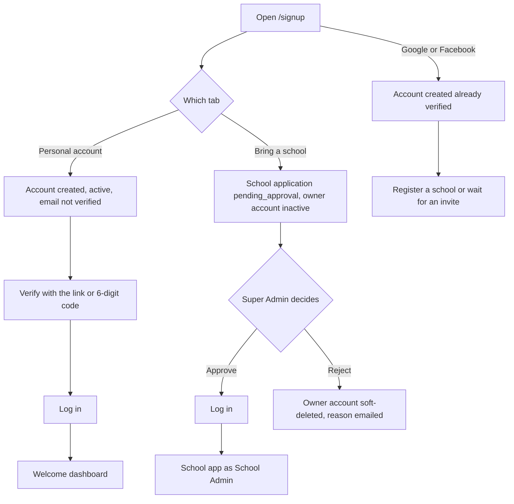

import { Aside, Steps, Tabs, TabItem, Card, CardGrid, LinkCard } from '@astrojs/starlight/components';
import Pipeline from '../../../../components/Pipeline.astro';
import ScreenAnatomy from '../../../../components/ScreenAnatomy.astro';
import SourceFile from '../../../../components/SourceFile.astro';
import Api from '../../../../components/Api.astro';
import Roles from '../../../../components/Roles.astro';
import Route from '../../../../components/Route.astro';
import DemoLogin from '../../../../components/DemoLogin.astro';
import Screenshot from '../../../../components/Screenshot.astro';
import { Tabs as ShotTabs, TabItem as ShotTab } from '@astrojs/starlight/components';

Every person who uses Schola has one **account**: an email address plus a
password, a Google login or a Facebook login. The account pages are the front
door. `/signup` creates either a **personal account** (an individual with no
school yet) or a **school application** (an institution owner asking to bring
a school onto Schola). `/login` signs you in and sends you to the right home
page for your role. `/verify`, `/forgot-password` and `/reset-password`
handle the email links Schola sends.

## At a glance

<CardGrid>
  <Card title="Who uses it" icon="star">
    <Roles list={['public', 'user', 'super_admin', 'school_admin', 'teacher', 'parent']} note="and every other role" />
  </Card>
  <Card title="Where to find it" icon="laptop">
    <Route path="/signup" /> <Route path="/login" /> <Route path="/verify" /> <Route path="/forgot-password" /> <Route path="/reset-password" />
  </Card>
  <Card title="Permissions" icon="approve-check">
    None — these pages are public. The API protects them with a rate limit
    instead (10 requests per minute per IP in production, 60 in development).
  </Card>
</CardGrid>

<DemoLogin as="School Admin" email="admin@greenfield.example" go="/app" />

<DemoLogin as="Pending applicant" email="owner@riverside.example" go="/login">
Riverside Academy is still waiting for approval, so signing in shows "Your
school's application is waiting for approval. You'll get an email when it's
approved." — useful for the video.
</DemoLogin>

## How it works

There are two ways in, and both end at the same sign-in form:

<Pipeline
  caption="A password sign-in, from the form to the right home page."
  steps={[
    { label: 'Log in', icon: 'log-in', note: 'Email + password' },
    { label: 'Checks', icon: 'lock', note: 'Lockout, password, active, verified' },
    { label: 'Cookies', icon: 'key', note: 'Access, refresh and CSRF' },
    { label: 'Home page', icon: 'house', note: '/platform, /app or /welcome' },
  ]}
/>

When the password is right, the API sets three cookies — `schola_access`
(a 15-minute JWT), `schola_refresh` (a 30-day opaque token, rotated on every
use) and `schola_csrf` — and returns your name, primary role, school and
permission list. The web app keeps that user in memory and redirects you. See
[Authentication](/architecture/authentication/) for the session design.

## The screens

Real screenshots from the seeded demo school (switch the docs theme to see dark mode):

<ShotTabs>
  <ShotTab label="Log in">
    <Screenshot name="auth-login" alt="The Log in page" path="/login" />
  </ShotTab>
  <ShotTab label="Sign up">
    <Screenshot name="auth-signup" alt="The Sign up page" path="/signup" />
  </ShotTab>
  <ShotTab label="Forgot password">
    <Screenshot name="auth-forgot-password" alt="The Reset your password page" path="/forgot-password" />
  </ShotTab>
</ShotTabs>

All five pages share one layout: the Schola logo at the top left, the form in
the left column, a preview panel on the right ("After you sign in" on
`/login`, "Before the first day" on `/signup`), and a footer line "By
continuing you agree to our Terms and Privacy Policy." On phones the preview
panel moves below the form.

<ScreenAnatomy
  title="Create your account"
  path="/signup"
  regions={[
    { label: 'Heading', desc: '"Create your account" — "A personal login, or the application that opens a school on Schola."' },
    { label: 'Google and Facebook', desc: 'Two outline buttons that start an OAuth sign-in, then an "or" divider.' },
    { label: 'Sign up type tabs', desc: '"Personal account" (default) and "Bring a school".', tone: 'accent' },
    { label: 'Form', desc: 'The fields of the chosen tab, a password strength meter and the submit button ("Create account" or "Submit application").', size: 3, tone: 'accent' },
    { label: 'Log in link', desc: '"Already have an account? Log in".', tone: 'muted' },
  ]}
/>

<ScreenAnatomy
  title="Welcome back"
  path="/login"
  regions={[
    { label: 'Heading', desc: '"Welcome back" — "Sign in to the school day. One login for classes, attendance, and fees."' },
    { label: 'Google and Facebook', desc: 'OAuth buttons. A red alert above them explains a failed OAuth attempt.' },
    { label: 'Login form', desc: 'Email, Password (with a show/hide eye and a "Forgot?" link) and the "Log in" button. Errors appear in a red box above the button.', size: 3, tone: 'accent' },
    { label: 'Sign up link', desc: '"Don\'t have an account? Sign up".', tone: 'muted' },
  ]}
/>

<ScreenAnatomy
  title="Verify your email"
  path="/verify"
  regions={[
    { label: 'Heading', desc: '"Verify your email" — "Use the link from the email, or enter the 6-digit code."' },
    { label: 'Status box', desc: '"Verifying…", then green "Your email is verified. You can log in now." or a red error.', tone: 'warn' },
    { label: 'Code form', desc: 'Email and Code (six digits, placeholder 000000) with "Verify code", and below it "No email? Send a new code". After success it is replaced by "Go to log in".', size: 2, tone: 'accent' },
  ]}
/>

## Step by step

### Create a personal account

<Steps>

1. Open `/signup` (or click **Sign up** on the login page). The **Personal
   account** tab is selected. Its note reads "For individuals".
2. Fill in **First name**, **Last name**, **Email**, **Password** and
   **Confirm password**. As you type the password, the strength meter moves
   from "Too short" through "Weak" and "Fair" to "Strong". A password needs at
   least 8 characters with an uppercase letter, a lowercase letter and a digit.
3. Click **Create account**. The button reads "Creating account…" while it
   works, then a toast says "Account created — check your inbox."
4. The form is replaced by a card: "Welcome to Schola." It says a
   verification link and a 6-digit code were sent, that password login stays
   closed until you use one of them, and offers an **Enter the code** link.
5. Open the email "Verify your Schola email". Click the link, or go to
   `/verify` and type your email and the code, then click **Verify code**.
   No email, or the code expired? Type your email on `/verify` and click
   **Send a new code** — the toast says "If that email has an unverified
   account, a new link and code are on the way."
6. You see "Your email is verified. You can log in now." Click **Go to log
   in**, sign in, and you land on the [welcome dashboard](/features/accounts/onboarding-and-welcome/).

</Steps>

### Apply to bring a school

<Steps>

1. On `/signup`, click the **Bring a school** tab. Its note reads "For
   institution owners".
2. Fill in **Institution name**, **Institution type** (School (K-12),
   College / University, Institute or Coaching center), **Address**,
   **Contact email**, **Contact phone** and **Expected student count**.
3. In the **School admin** box, enter the owner's **First name**, **Last
   name**, **Email**, **Password** and **Confirm password**. This email must
   be new to Schola — the application creates the account.
4. Click **Submit application**. A toast says "Application received." and the
   card "Thanks — your application is in." confirms that a verification email
   was sent.
5. Two emails arrive: "Verify your Schola email" and "Your Schola application
   is being reviewed". Every Super Admin gets an in-app notification "New
   school application".
6. Until a Super Admin approves the school, signing in shows "Your school's
   application is waiting for approval. You'll get an email when it's
   approved." After approval the owner signs in and lands on `/app` as School
   Admin. See
   [Approvals](/features/platform/approvals/).

</Steps>

### Sign in

<Steps>

1. Open `/login`. Type your **Email** and **Password**.
2. Click **Log in**. The button reads "Logging in…".
3. On success a toast says "Welcome back, *first name*." and you are sent to
   your home page (see the table below).
4. On failure a red box above the button explains why — wrong password,
   locked account, inactive account or unverified email. The unverified-email
   message carries an **Enter the code** link to `/verify`.

</Steps>

### Sign in with Google or Facebook

<Steps>

1. On `/login` or `/signup`, click **Google** or **Facebook**.
2. The browser leaves Schola for the provider's consent screen. Approve it.
3. The provider sends you back to the API, which finds your account by
   provider id or email — or creates a new one with the email already
   verified — and sets the same cookies as a password login.
4. You land on the page you were heading for, or on `/platform` (Super
   Admin), `/app` (school member) or `/onboarding/school` (an account with no
   school). An account a Super Admin suspended, a school owner still waiting
   for approval, or a member whose only school is suspended is refused and
   sent back to `/login` with "The sign-in was cancelled or rejected. Try
   again." — a social sign-in never re-opens a closed account.

</Steps>

### Reset a forgotten password

<Steps>

1. On `/login`, click **Forgot?** next to the Password label.
2. On "Reset your password", enter your **Email** and click **Send reset
   link**. A toast says "If that email is registered, you'll receive a reset
   link shortly." and the card reads "Check your inbox for a reset link. The
   email says how long it stays valid." (`PASSWORD_RESET_TTL_MIN`, 1 hour by
   default). The answer is the same for an unknown address, and also when the
   email could not be delivered — the failure is only logged.
3. Open the email "Reset your Schola password" and click the link. It opens
   `/reset-password?token=…`.
4. On "Set a new password", type a **New password** (the same strength rules
   apply) and click **Save new password**.
5. A toast says "Password updated. Please log in." and you are taken to
   `/login`. Every other device is signed out.

</Steps>

### Log out

<Steps>

1. Click your avatar in the top-right corner (the **Account menu**). On
   desktop it also opens on hover.
2. Click **Log out** at the bottom of the menu.
3. A dialog asks "Log out?" — "You will leave this session. Sign in again to
   open the school or the platform."
4. Click **Log out** (or **Stay signed in** to cancel). You are taken to the
   public home page.

</Steps>

## Where each role lands

| Account | After a password sign-in | After Google or Facebook |
|---|---|---|
| Super Admin | `/platform` (any `next` is ignored) | the `next` page, else `/platform` |
| School member (any school role) | the `next` page, else `/app` | the `next` page, else `/app` |
| Account with no school (`user`) | `/welcome` (any `next` is ignored) | the `next` page, else `/onboarding/school` |

`next` is the page you tried to open before signing in: opening `/app/fees`
while signed out sends you to `/login?next=/app/fees`. The query string and
`#hash` come along too, so a link such as `/admin-transfer?token=…` still works
after you sign in. Only same-origin relative paths are accepted
(`safeNextPath` in `apps/web/src/lib/safe-next.ts`); anything else, such as
`//evil.example` or a full URL, is ignored. Already signed in? Opening `/login` or `/signup` redirects you
straight to your home page.

## Every action on this screen

### "Create account" (Personal account tab)

Creates an active account with the platform role `user`, no school, and
`emailVerifiedAt` empty. It then emails a link and a 6-digit code. If the
email already exists the red box shows "An account with this email already
exists."

<Api method="POST" path="auth/register" />

### "Submit application" (Bring a school tab)

Creates an **inactive** owner account and a school in `pending_approval`,
emails the owner twice, and notifies every Super Admin in the app. Audit
action `school.signup`. If the admin email already exists the red box says:
"An account with this admin email already exists. Log in with that account
and use the in-app school setup, or enter a different admin email."

<Api method="POST" path="schools/signup" />

### "Log in"

Runs the checks in this order: is the account locked → does it have a
password at all → is the password right → is the account active → is the
email verified. Then it picks the school (the first of the account's schools
whose status is `active` — if none is, sign-in is refused), resolves the role
and permissions, resets the failed-attempt counter and writes `auth.login` to
the audit log.

<Api method="POST" path="auth/login" />

| Message in the red box | Cause |
|---|---|
| Invalid email or password. | Unknown email, or wrong password (the attempt is counted). |
| Account temporarily locked. Try again later. | 5 wrong passwords in a row lock the account for 15 minutes. |
| This account uses google sign-in. Use that button instead of a password. | The account was created with Google or Facebook and has no password. |
| Your school's application is waiting for approval. You'll get an email when it's approved. | The owner of a school that is still `pending_approval` (their account stays inactive until approval). Google and Facebook sign-in give the same message. |
| Account is not active. | Any other inactive account, for example one a Super Admin suspended. |
| This school is suspended, so sign-in is paused for everyone there. Contact the platform team to restore access. | A member whose school (every school, if more than one) is suspended. Pending and rejected schools have their own wording. |
| Verify your email before logging in… **Enter the code** | Personal account that has not used its link or code. |

### "Google" and "Facebook"

Both buttons are plain links to the API, which redirects to the provider
(Google uses PKCE). On return the API signs you in and redirects. A failure
returns you to `/login?error=…` with one of these messages:
"That sign-in method is not configured yet…", "The sign-in was cancelled or
rejected. Try again.", "Allow the provider to share your email address, then
try again." or "That sign-in expired. Start it again." Setup is covered in
[Social sign-in](/setup/services/social-sign-in/).

<Api method="GET" path="auth/oauth/:provider" /> <Api method="GET" path="auth/oauth/:provider/callback" />

### Email link and "Verify code"

Opening the emailed link (`/verify?token=…`) verifies automatically. The code
form verifies by email + code instead. Both mark the email verified, consume
every open verification token for that account and write `auth.email.verified`.
Links and codes stay valid for 72 hours. **Send a new code** on `/verify`
emails a fresh link and code to the address in the Email field — it works
signed out, always shows the same toast ("If that email has an unverified
account, a new link and code are on the way."), and sends at most one email
per address per minute. Signed-in users who have not verified see a "Verify
your email address" banner with a **Resend link** button on the welcome
dashboard. Signed out, the reply is `202` even if the email could not be
delivered; signed in, a failed send answers `503` "We couldn't send the
verification email just now. Try again in a few minutes."

<Api method="POST" path="auth/verify-email" /> <Api method="POST" path="auth/verify-email/code" /> <Api method="POST" path="auth/verify-email/resend" />

### "Send reset link" and "Save new password"

The request always answers "OK", so nobody can test which emails exist. The
reset link is single use and expires after 60 minutes. Saving the new
password also unlocks the account, marks the email verified, adds `password`
to the account's sign-in methods (so a Google-only account can now use either)
and revokes every refresh token, which signs the account out everywhere. Audit actions
`auth.password_reset.request` and `auth.password_reset.complete`.

<Api method="POST" path="auth/forgot-password" /> <Api method="POST" path="auth/reset-password" />

### "Log out"

Revokes the current refresh token, clears the cookies and writes
`auth.logout`. If the server call fails the browser still clears its session.

<Api method="POST" path="auth/logout" />

## Who sees what

| Page | Signed out | Signed in |
|---|---|---|
| `/signup`, `/login`, `/forgot-password`, `/reset-password` | Usable by anyone | Redirected to your home page |
| `/verify` | Usable by anyone | Usable (not redirected) |
| Account menu → "Log out" | — | Every role, in every shell |

## Under the hood

- <SourceFile path="apps/web/src/app/(auth)/signup/page.tsx" /> with <SourceFile path="apps/web/src/app/(auth)/signup/register-form.tsx" /> (Personal account) and <SourceFile path="apps/web/src/app/(auth)/signup/signup-form.tsx" /> (Bring a school).
- <SourceFile path="apps/web/src/app/(auth)/login/login-form.tsx" /> — the post-login redirect.
- <SourceFile path="apps/web/src/app/(auth)/google-sign-in-button.tsx" symbol="OAuthButtons" /> — Google and Facebook links and OAuth error messages.
- <SourceFile path="apps/web/src/app/(auth)/verify/verify-content.tsx" />, <SourceFile path="apps/web/src/app/(auth)/forgot-password/forgot-password-form.tsx" />, <SourceFile path="apps/web/src/app/(auth)/reset-password/reset-password-form.tsx" />.
- <SourceFile path="apps/web/src/components/auth/logout-dialog.tsx" /> and <SourceFile path="apps/web/src/components/auth/redirect-if-authenticated.tsx" />.
- <SourceFile path="apps/web/proxy.ts" /> — bounces signed-out visitors from `/app`, `/platform` and `/onboarding`, and signed-in visitors from the auth pages.
- <SourceFile path="apps/api/src/modules/auth/auth.service.ts" /> — login, lockout, register, verification, reset and OAuth find-or-create.
- <SourceFile path="apps/api/src/modules/auth/oauth.service.ts" symbol="finishOAuth" /> — provider exchange and the redirect fallback.
- <SourceFile path="apps/api/src/modules/schools/schools.service.ts" symbol="signup" /> — the school application.
- <SourceFile path="packages/validation/src/auth.ts" /> and `strongPassword` in <SourceFile path="packages/validation/src/common.ts" />.

| Setting | Default | Env var |
|---|---|---|
| Lock after wrong passwords | 5 | `LOGIN_LOCKOUT_THRESHOLD` |
| Lock duration | 15 minutes | `LOGIN_LOCKOUT_MINUTES` |
| Reset link lifetime | 60 minutes | `PASSWORD_RESET_TTL_MIN` |
| Verification link and code lifetime | 72 hours | `EMAIL_VERIFICATION_TTL_HOURS` |
| Access / refresh token lifetime | 15 minutes / 30 days | `JWT_ACCESS_TTL` / `JWT_REFRESH_TTL` |

Audit actions written here: `auth.register`, `auth.login`, `auth.logout`,
`auth.email.verified`, `auth.email.verification_resent`, `auth.password_reset.request`,
`auth.password_reset.complete`, `auth.google.register`, `auth.google.login`,
`auth.facebook.register`, `auth.facebook.login` and `school.signup`.

## Edge cases and gotchas

- **An expired lock starts a fresh count.** After the 15 minutes are up the
  failed-attempt counter starts from 0 again, so it takes another five wrong
  passwords to lock the account. A successful sign-in or a password reset also
  resets it.
- **Locked means locked.** While the lock is active even the right password
  gets "Account temporarily locked". A password reset clears the lock.
- **Order of checks.** The "not active" and "verify your email" messages only
  appear after the right password, so a stranger cannot learn an account's
  status by guessing.
- **Approval verifies the email.** A school owner who never clicked the
  verification link can still sign in once the school is approved — approval
  marks the email verified.
- **The email can fail without losing the account.** If the verification
  email cannot be sent, the personal account is still created. Use **Send a
  new code** on `/verify`.
- **School applications are not rate limited.** `POST schools/signup` and
  `POST schools/quick-signup` sit outside the auth rate limiter.

<Aside type="caution" title="Two different fallbacks for accounts without a school">
After a **password** sign-in an account with no school goes to `/welcome`.
After a **Google or Facebook** sign-in it goes to `/onboarding/school`
(`finishOAuth`). Both pages work, but a video that shows both paths should
expect different landing pages.
</Aside>

<Aside type="note" title="The Firebase endpoint has no button">
The original spec keeps `POST auth/google` (a Firebase ID token) as a fallback, and the
API still serves it. The web app's `startGoogleSignIn` helper in
`apps/web/src/lib/firebase.ts` is not called anywhere — the **Google** button
always uses the redirect flow (`GET auth/oauth/google`). The Firebase path is
reachable only by calling the API directly.
</Aside>

## Related pages

<CardGrid>
  <LinkCard title="Onboarding and welcome" description="What an account without a school sees, and the quick school application." href="/features/accounts/onboarding-and-welcome/" />
  <LinkCard title="Approvals" description="How a Super Admin approves or rejects a school application." href="/features/platform/approvals/" />
  <LinkCard title="Authentication" description="Cookies, token rotation, CSRF and OAuth in depth." href="/architecture/authentication/" />
  <LinkCard title="Settings and profile" description="Change your password and sign out other devices." href="/features/school/settings-and-profile/" />
</CardGrid>
