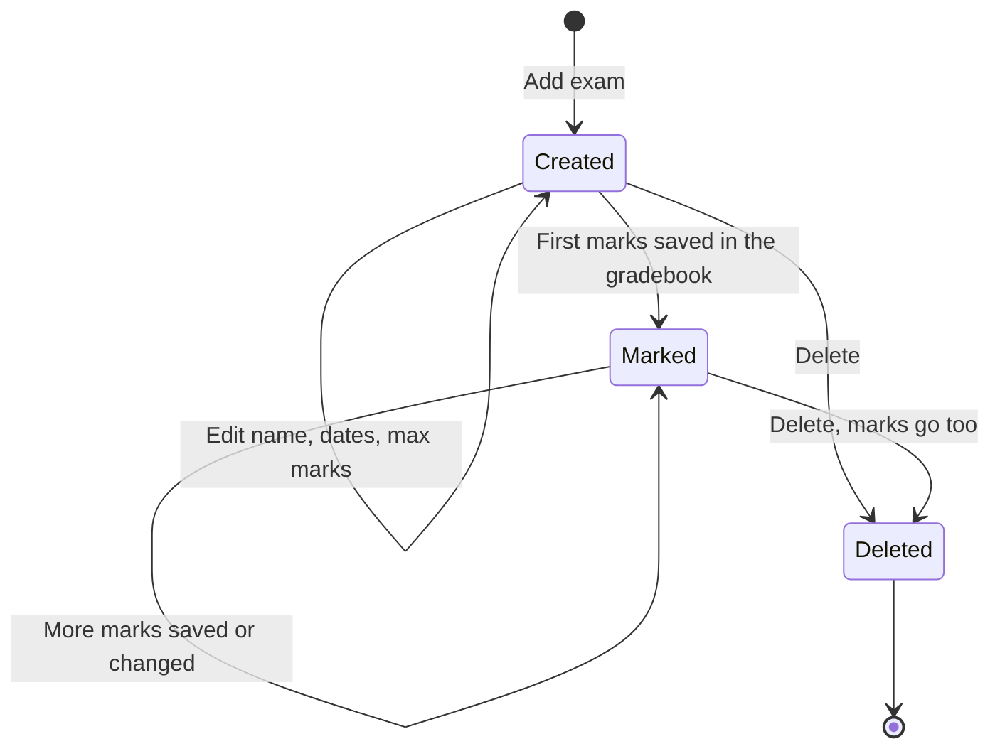

import { Aside, Steps, Card, CardGrid, LinkCard } from '@astrojs/starlight/components';
import Pipeline from '../../../../components/Pipeline.astro';
import ScreenAnatomy from '../../../../components/ScreenAnatomy.astro';
import SourceFile from '../../../../components/SourceFile.astro';
import Api from '../../../../components/Api.astro';
import Perm from '../../../../components/Perm.astro';
import Roles from '../../../../components/Roles.astro';
import Route from '../../../../components/Route.astro';
import DemoLogin from '../../../../components/DemoLogin.astro';
import Screenshot from '../../../../components/Screenshot.astro';

An **exam** in Schola is an *exam event*: "Term 1 — Midterm", "Mid-year",
"Finals". It belongs to one academic year, runs between a start and an end date,
and has one **maximum mark** that every paper in it is scored out of. Creating an
exam is the first step of assessment: once it exists, teachers can pick it in the
[Gradebook](/features/assessment/gradebook/) and enter marks for each section and
subject, and students and parents can download a report card for it.

## At a glance

<CardGrid>
  <Card title="Who uses it" icon="star">
    <Roles list={['school_admin', 'principal']} note="create, edit, delete" />
    <Roles list={['vice_principal', 'teacher']} note="read" />
  </Card>
  <Card title="Where to find it" icon="laptop">
    <Route path="/app/exams" />
    Sidebar: **Academics › Exams**
  </Card>
  <Card title="Permissions" icon="approve-check">
    <Perm name="exam:read" /> <Perm name="exam:create" />
    <Perm name="exam:update" /> <Perm name="exam:delete" />
  </Card>
</CardGrid>

<DemoLogin as="School Admin" email="admin@greenfield.example" go="/app/exams">
  Two exams are seeded for the current year: "Term 1 — Midterm", already sat and
  marked for every student, and the upcoming "Term 1 — Final". Both are out of 100.
</DemoLogin>

## How it works

<Pipeline
  caption="Where an exam sits in the assessment flow."
  steps={[
    { label: 'Academic year', icon: 'calendar-range', note: 'Must exist first' },
    { label: 'Create exam', icon: 'file-text', note: 'Name, dates, max marks' },
    { label: 'Enter marks', icon: 'clipboard-list', note: 'Gradebook, per section and subject' },
    { label: 'Report card', icon: 'award', note: 'One PDF per student per exam' },
  ]}
/>

### The life of an exam record

Exams have **no status field** — Schola does not store "scheduled", "ongoing" or
"published". An exam simply exists, gathers marks, and can be deleted. Marks are
visible to students and parents as soon as they are saved (see
[Gradebook](/features/assessment/gradebook/)).

### What an exam holds

| Field | Notes |
|---|---|
| Academic year | Chosen once; cannot be changed after creation |
| Name | 2–120 characters, unique within the academic year |
| Start date, End date | The end must be on or after the start |
| Max marks | Whole number from 1 to 1000, default 100 — every subject in this exam is marked out of it |
| Description | Optional, up to 500 characters |

The model also has `subjectIds` and `classIds` lists. The seed fills them, but
the Exams form does not offer them and the gradebook does not check them — any
subject can be marked for any section under any exam.

## The screen

<Screenshot name="admin-exams" alt="The Exams list" path="/app/exams" />

<ScreenAnatomy
  title="Exams"
  path="/app/exams"
  regions={[
    { label: 'Sidebar', desc: 'Academics › Exams', area: 'sidebar' },
    { label: 'Top bar', desc: 'Search, notifications, account menu', area: 'top' },
    { label: 'Page header', desc: 'Title "Exams" — "Set up exam events (Term 1, Mid-year, Finals…) per academic year." — and "Add exam"' },
    { label: 'No-year warning', desc: '"Create an academic year first." with a link — only when the school has no academic year (teachers hold academic_year:read, so they see it only when that is really true)', tone: 'warn' },
    { label: 'Exams table', desc: 'Name, Starts, Ends, Max marks and a row menu (Edit, Delete); newest start date first', size: 4, tone: 'accent' },
    { label: 'Pager', desc: 'Page count and total', tone: 'muted' },
  ]}
/>

<ScreenAnatomy
  title="New exam"
  path="/app/exams"
  regions={[
    { label: 'Drawer header', desc: '"New exam" — "An exam event for one academic year." When editing: "Edit exam" — "Changing max marks doesn\'t rescale marks already entered."' },
    { label: 'Academic year', desc: '"— pick one —" and each year, the current one marked "(current)"; locked when editing' },
    { label: 'Name', desc: 'Placeholder "Term 1"', tone: 'accent' },
    { label: 'Dates and marks', desc: '"Start date", "End date" and "Max marks" side by side' },
    { label: 'Description', desc: 'Placeholder "End of term written exam"' },
    { label: 'Submit', desc: '"Save" ("Saving…" while busy)', tone: 'warn' },
  ]}
/>

## Step by step

### Create an exam

<Steps>

1. Sign in as `admin@greenfield.example` and open **Academics › Exams**. The table lists "Term 1 — Final" and "Term 1 — Midterm".
2. Click **Add exam**. The "New exam" drawer opens.
3. In **Academic year**, choose the year marked "(current)".
4. Type **Name** `Unit test 1`.
5. Pick a **Start date** and an **End date** on or after it, and leave **Max marks** at `100` (or set, say, `50` for a short test).
6. Optionally add a **Description** such as `Short written test in core subjects.`
7. Click **Save**. The toast says "Exam created." and the exam appears at the top of the list if it starts latest.

</Steps>

### Edit or delete an exam

<Steps>

1. Open the row menu (the three dots) on "Unit test 1" and choose **Edit**. The drawer title is "Edit exam"; **Academic year** is greyed out.
2. Change the **Name** or dates and click **Save**. The toast says "Exam saved."
3. To remove it, open the row menu and choose **Delete**. The dialog asks "Delete Unit test 1?" — "Every mark entered for this exam is deleted with it. Remarks stay, without the exam link."
4. Click **Delete**. The toast says "Exam deleted."

</Steps>

## Every action on this screen

### List exams

<Api method="GET" path="exams?page=" perm="exam:read" />

20 per page, newest start date first. The API also accepts `academicYearId` to
show one year's exams; the Exams page does not use it and shows every year.

### "Add exam"

Visible with <Perm name="exam:create" />, and disabled until the school has at
least one academic year.

<Api method="POST" path="exams" perm="exam:create" />

- Validation runs in the browser and again on the API with the shared
  `createExamSchema`: an end date before the start date is refused with "endDate
  must be >= startDate".
- A second exam with the same name in the same academic year is refused with
  `409` "Another record already uses this name."
- Audit entry: `exam.create`, with the whole exam.

### "Edit"

Visible with <Perm name="exam:update" />.

<Api method="PATCH" path="exams/:id" perm="exam:update" />

The form sends only the name, dates, max marks and description; the academic
year is fixed. The end may not be before the start: `updateExamSchema` checks a
PATCH that carries both dates ("endDate must be >= startDate"), and the API
checks a single changed date against the stored other one ("The exam can't end
before it starts.", `400`). Audit entry: `exam.update`, with the record before
and after.

### "Delete"

Visible with <Perm name="exam:delete" />.

<Api method="DELETE" path="exams/:id" perm="exam:delete" />

The API soft-deletes the exam **and every mark entered for it**, and unlinks any
remarks that pointed at it (the remarks themselves stay). The audit entry
`exam.delete` keeps the exam and the number of marks removed (`gradesDeleted`).

## Who sees what

| Role | See exams | Create | Edit | Delete |
|---|---|---|---|---|
| School Admin | Yes | Yes | Yes | Yes |
| Principal | Yes | Yes | Yes | Yes |
| Vice Principal | Yes | No | No | No |
| Teacher | Yes | No | No | No |
| Accountant, Staff, Student, Parent | No — students and parents meet exams as cards on their grades page | — | — | — |

## Under the hood

- <SourceFile path="apps/web/src/app/(tenant)/app/exams/page.tsx" />
- <SourceFile path="apps/api/src/modules/gradebook/exams.routes.ts" />
- <SourceFile path="packages/validation/src/gradebook.ts" symbol="createExamSchema" />
- <SourceFile path="packages/db/src/models/exam.ts" />

**Data shape** — `Exam`: `academicYearId`, `name`, `startDate`, `endDate`,
`maxMarks`, `subjectIds`, `classIds`, `description`, plus `schoolId`, timestamps
and soft delete. Unique index `(schoolId, academicYearId, name)`.

**Max marks and existing marks.** Each saved mark stores its own `maxMarks` and
`percentage`. Changing an exam's max marks does not touch marks already saved;
the next time a section's grid is saved in the gradebook, those rows are
recalculated against the new maximum.

## Edge cases and gotchas

- **A deleted exam's name cannot be reused** in the same year — the unique index
  also covers deleted exams.
- **The list does not say which year an exam belongs to.** With several academic
  years, two "Term 1" exams look alike; the name is the only clue.
- **Dates use the browser's format.** Starts and Ends are shown in the viewer's
  own date format, not the school's locale.

:::note[The seeded exams]
The seed's "Term 1 — Midterm" is already sat and marked. "Term 1 — Final" is
upcoming: it starts 15 days after the seed day and ends 9 days later (day 24),
and has no marks yet.
:::

## Related pages

<CardGrid>
  <LinkCard title="Gradebook" description="Enter marks for an exam, section and subject." href="/features/assessment/gradebook/" />
  <LinkCard title="Academic years" description="Every exam belongs to one academic year." href="/features/academics/academic-years/" />
  <LinkCard title="Exams and report cards tutorial" description="Create an exam, enter marks and download a report card, end to end." href="/tutorial/exams-and-report-cards/" />
  <LinkCard title="Remarks" description="Remarks can be linked to an exam and printed on its report card." href="/features/daily/remarks/" />
</CardGrid>
