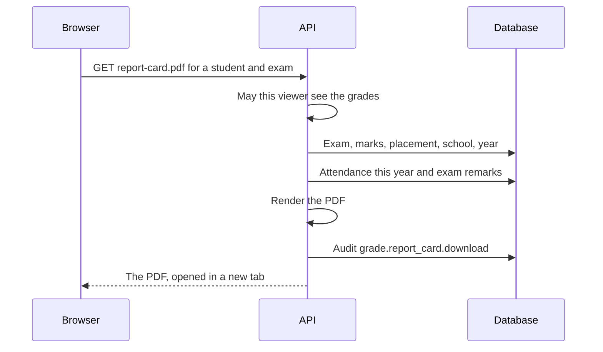

import { Aside, Steps, Card, CardGrid, LinkCard } from '@astrojs/starlight/components';
import Pipeline from '../../../../components/Pipeline.astro';
import ScreenAnatomy from '../../../../components/ScreenAnatomy.astro';
import SourceFile from '../../../../components/SourceFile.astro';
import Api from '../../../../components/Api.astro';
import Perm from '../../../../components/Perm.astro';
import Roles from '../../../../components/Roles.astro';
import Route from '../../../../components/Route.astro';
import DemoLogin from '../../../../components/DemoLogin.astro';
import BarChart from '../../../../components/BarChart.astro';
import Screenshot from '../../../../components/Screenshot.astro';
import { Tabs as ShotTabs, TabItem as ShotTab } from '@astrojs/starlight/components';

The **Gradebook** is where marks go in. A teacher picks an exam, one of their
sections and a subject, and gets a grid with one row per student. They type each
student's marks — and, if they like, a short remark — and click **Save grades**.
Schola works out the percentage and the letter grade for every row. The moment
marks are saved, they appear on the student's grades page, the parent's view of
the child and the downloadable **report card** PDF.

## At a glance

<CardGrid>
  <Card title="Who uses it" icon="star">
    <Roles list={['teacher']} note="own sections" />
    <Roles list={['school_admin']} note="every section" />
    <Roles list={['principal', 'vice_principal']} note="read" />
    <Roles list={['student', 'parent']} note="results and report card" />
  </Card>
  <Card title="Where to find it" icon="laptop">
    <Route path="/app/gradebook" />
    Sidebar: **Academics › Gradebook**
  </Card>
  <Card title="Permissions" icon="approve-check">
    <Perm name="grade:enter" /> <Perm name="grade:read:all" />
    <Perm name="grade:read:own_classes" />
  </Card>
</CardGrid>

<DemoLogin as="Teacher" email="teacher@greenfield.example" go="/app/gradebook">
  Grace Mensah can open Grade 3 · A and Grade 3 · B. "Term 1 — Midterm" already
  has marks in English, Mathematics, Science and Social Studies for every
  student; "Term 1 — Final" is empty and ready to fill.
</DemoLogin>

## How it works

<Pipeline
  caption="From a blank grid to a report card in a family's hands."
  steps={[
    { label: 'Exam', icon: 'file-text', note: 'Created on the Exams page' },
    { label: 'Pick the grid', icon: 'layers', note: 'Exam, section, subject' },
    { label: 'Type marks', icon: 'clipboard-list', note: 'And an optional remark' },
    { label: 'Save', icon: 'send', note: 'Percentage and letter computed' },
    { label: 'Results', icon: 'chart', note: 'Student, parent, profile' },
    { label: 'Report card', icon: 'award', note: 'PDF per exam' },
  ]}
/>

A **grid** is one exam × one section × one subject. Its rows are the students
with an **active** enrollment in that section **for the exam's academic year**.
Every saved row becomes one `Grade` record — one per exam, student and subject —
holding the marks, the exam's maximum, the percentage, the letter and the
remark. Saving the same grid again updates those records.

### The grading scale

Percentage is `marks ÷ max marks × 100`, rounded to two decimals and kept between
0 and 100. The letter comes from a fixed scale in the code (the same function the
seed uses), for every school:

<BarChart
  title="Lowest percentage for each letter grade"
  unit="%"
  data={[
    { label: 'A+', value: 90 },
    { label: 'A', value: 80 },
    { label: 'B', value: 70 },
    { label: 'C', value: 60 },
    { label: 'D', value: 50 },
    { label: 'E', value: 40 },
    { label: 'F', value: 0, note: 'below 40' },
  ]}
/>

| Percentage | Letter |
|---|---|
| 90 and above | A+ |
| 80 – 89.99 | A |
| 70 – 79.99 | B |
| 60 – 69.99 | C |
| 50 – 59.99 | D |
| 40 – 49.99 | E |
| Below 40 | F |

For example, 73 out of 100 is 73% — a **B**; 59 is a **D**. An exam's
**total** adds up every subject's marks and maximums for that student (say 275
out of 400 = 68.75%) and gives the total its own letter on the same scale (C).

:::note[One scale for everyone]
The grading scale is not configurable yet: there is no per-school or per-class
grading scheme. A comment in `grade.ts` notes that a tenant-level scheme is
planned for later.
:::

## The screens

Real screenshots from the seeded demo school (switch the docs theme to see dark mode):

<ShotTabs>
  <ShotTab label="School Admin">
    <Screenshot name="admin-gradebook" alt="The gradebook grid" path="/app/gradebook" />
  </ShotTab>
  <ShotTab label="Teacher">
    <Screenshot name="teacher-gradebook" alt="The gradebook for a teacher’s own sections" path="/app/gradebook" />
  </ShotTab>
  <ShotTab label="Student">
    <Screenshot name="student-my-grades" alt="A student’s grades and report card" path="/app/my/grades" />
  </ShotTab>
</ShotTabs>

### Gradebook grid

<ScreenAnatomy
  title="Gradebook"
  path="/app/gradebook"
  regions={[
    { label: 'Sidebar', desc: 'Academics › Gradebook', area: 'sidebar' },
    { label: 'Top bar', desc: 'Search, notifications, account menu', area: 'top' },
    { label: 'Page header', desc: 'Title "Gradebook" — "Enter marks per student for an exam, section, and subject. Percentage and letter grade are computed automatically."' },
    { label: 'Pick exam, section & subject', desc: '"Exam" ("Term 1 — Midterm (/100)"), "Section" ("Grade 3 · A", grouped by class), "Subject" ("MATH · Mathematics")' },
    { label: 'Grid', desc: '"Grades — 25 students", "Max marks: 100". Columns Student (name, admission number), Marks (number box), % (live), Grade (saved letter), Remark (text box)', size: 4, tone: 'accent' },
    { label: 'Save bar', desc: '"Save grades" ("Saving…" while busy)', tone: 'warn' },
  ]}
/>

### Results, as a student or parent sees them

<ScreenAnatomy
  title="My grades"
  path="/app/my/grades"
  regions={[
    { label: 'Page header', desc: '"My grades" — "Marks for every exam, with a report card to download."' },
    { label: 'Exam card header', desc: '"Term 1 — Midterm", its dates, the total percentage, "Grade C · 275/400" and the "Report card" button', tone: 'accent' },
    { label: 'Subject table', desc: 'Subject (with the teacher\'s remark under it), Marks ("73/100"), % (hidden on phones), Grade', size: 3 },
    { label: 'Remarks', desc: 'Public remarks about the student (students only; parents use the Remarks tab)', tone: 'muted' },
  ]}
/>

The same exam cards appear on the **Grades** tab of a student's profile
(<Route path="/app/students/[id]" />) and of a parent's child
(<Route path="/app/children/[id]" />).

## Step by step

### Enter marks as a teacher

<Steps>

1. Sign in as `teacher@greenfield.example` (Grace Mensah) and open **Academics › Gradebook**. The page says "Pick exam, section, and subject to load the grade grid."
2. In **Exam**, choose **Term 1 — Final (/100)**.
3. In **Section**, choose **Grade 3 · A**. Only Grace's own sections are listed.
4. In **Subject**, choose **MATH · Mathematics**. The grid loads: "Grades — 25 students", "Max marks: 100", every Marks box empty.
5. Type marks in the **Marks** boxes. The **%** column fills in as you type; the **Grade** column still shows "—".
6. Optionally type a **Remark** for a student, for example `Excellent problem solving`.
7. Click **Save grades**. The toast says "Grades saved." The grid reloads and the **Grade** column now shows each letter.

</Steps>

### Change an existing mark

<Steps>

1. Switch **Exam** to **Term 1 — Midterm (/100)**. The grid loads with the seeded marks.
2. Change one student's marks — the % updates at once.
3. Click **Save grades**. The letter is recalculated on the server.

</Steps>

### Download a report card

<Steps>

1. Sign in as `student@greenfield.example` (Adam Singh, Grade 8 · A) and open **My grades**.
2. The **Term 1 — Midterm** card shows English, Mathematics, Science and Social Studies with marks, percentage and letter, and the total at the top right.
3. Click **Report card**. A PDF opens in a new browser tab.
4. The same button is on a child's **Grades** tab for `parent@greenfield.example`, and on any student's profile for the School Admin.

</Steps>

## Every action on this screen

### Pick exam, section and subject

- **Exam** lists the school's exams (first page of 20, all academic years) as
  "Name (/max marks)".
- **Section** lists every section for holders of <Perm name="grade:read:all" />,
  and only the teacher's own sections otherwise. A link from **My classes**
  opens the page with the section chosen (`?section=`).
- **Subject** lists the school's subjects as "CODE · Name".

When all three are set, the grid loads:

<Api method="GET" path="grades?examId=&sectionId=&subjectId=" perm="grade:read:own_classes" />

Allowed with <Perm name="grade:read:all" /> for any section, or with
<Perm name="grade:read:own_classes" /> for your own sections (`403` "Cannot read
grades for this section." otherwise). The response lists each enrolled student
with their saved marks, percentage, letter and remark, plus the exam's
`maxMarks`.

### Type marks and remarks

The **Marks** box is a number field from 0 to the exam's maximum (the API
refuses anything higher when you save). The **%** column
is calculated in the browser as you type. The **Grade** column shows the letter
**saved on the server**, so it updates after you save. The **Remark** box (up to
500 characters) is a per-subject comment shown under the subject on results
pages — separate from the [Remarks](/features/daily/remarks/) module.

### Read-only view (no `grade:enter`)

The Principal and Vice Principal can open every grid (they hold
<Perm name="grade:read:all" />) but cannot change marks. For them the page
description drops "Enter", the grid's subtitle adds **Read only** after the max
marks, the Marks and Remark columns show the saved values (or "—") as plain
text, the **%** column shows the saved percentage, and the **Save grades** bar
is replaced by "Teachers enter these marks; you can view them here."

### "Save grades"

<Api method="POST" path="grades" perm="grade:enter" />

The body holds the exam, section, subject and one entry per student **with a
mark** (`studentId`, `marksObtained`, `remark`), 1 to 500 entries. The API:

1. Checks you may act on the section — school-wide with `grade:read:all`, or as
   one of your own sections (`403` "Cannot enter grades for this section.").
2. Checks the exam, section and subject exist in your school (`404`).
3. Checks every student is actively enrolled in the section for the exam's year
   (`400` "Student … is not in this section for the exam's academic year.").
4. Refuses marks above the exam's maximum (`400` "marksObtained > maxMarks for student …").
5. Upserts one `Grade` per student, computing percentage and letter, stamping
   `enteredById`.
6. Writes one audit entry, `grade.enter`, with the exam, section, subject and
   how many rows were created or changed.

Toast: "Grades saved." On failure, the toast shows the API's message.

### "Report card"

<Api method="GET" path="student-records/:id/report-card.pdf?examId=" />

Allowed for anyone who may see the student's grades: school staff with
<Perm name="grade:read:all" />, a teacher of the student's section, the student
and their parents. The API gathers the data, renders an A4 PDF with
`@react-pdf/renderer`, logs the download as `grade.report_card.download` and
sends it inline, so it opens in the browser.

**What the report card contains**

| Part | Content |
|---|---|
| Header | School name and address; "Report card" and the document number `RC-` + the last six characters of the exam id + the admission number |
| Student | Name · admission number, then "Grade 8 · A · Roll 1" (or "Not placed in a class") |
| Exam | Exam name and its start – end dates |
| Marks table | Subject, Marks, Out of, %, Grade — or "No marks entered for this exam yet." |
| Totals | "Total 275 / 400" and "68.8% · C" |
| Attendance | "Attendance this academic year: X of Y days (Z%)" — from the start of the exam's academic year up to today, which is where the attendance tab stops too (days dated later, such as approved leave written ahead, don't count yet); present and late count as attended; shown only if the viewer may see attendance |
| Teacher remarks | Remarks linked to this exam, never `private`, limited to what the viewer may read |
| Footer | "Generated by Schola — https://schola.reactbd.com", the date, and page numbers |

## Who sees what

| Role | Gradebook page | Save marks | Results and report cards |
|---|---|---|---|
| School Admin | Every section | Yes | Every student |
| Principal | Every section, read only | No | Every student |
| Vice Principal | Every section, read only | No | Every student |
| Teacher | Own sections | Own sections | Students in own sections |
| Student | No | No | Own, on **My grades** |
| Parent | No | No | Own children, on **My children** |
| Accountant, Staff | No | No | No |

## Under the hood

- <SourceFile path="apps/web/src/app/(tenant)/app/gradebook/page.tsx" />
- <SourceFile path="apps/web/src/components/records/student-grades.tsx" symbol="StudentGrades" />
- <SourceFile path="apps/api/src/modules/gradebook/grades.routes.ts" />
- <SourceFile path="apps/api/src/modules/student-records/_queries.ts" symbol="gradesFor" />
- <SourceFile path="apps/api/src/modules/student-records/student-records.routes.ts" />
- <SourceFile path="apps/api/src/services/pdf/report-card.tsx" symbol="ReportCardPdf" />
- <SourceFile path="packages/db/src/models/grade.ts" symbol="gradeLetterFor" />
- <SourceFile path="packages/validation/src/gradebook.ts" symbol="bulkEnterGradesSchema" />

**Data shape** — `Grade`: `examId`, `studentId`, `subjectId`, `sectionId`,
`marksObtained`, `maxMarks`, `percentage`, `letter`, `remark`, `enteredById`. A
unique index on `(schoolId, examId, studentId, subjectId)` keeps one mark per
student per subject per exam. Percentage and letter are computed in the route
for bulk saves (Mongoose's save hook does not run for `bulkWrite`) and by a
`pre("save")` hook for single saves.

**Results queries** — the student's grades page, the profile's Grades tab and
the report card all use `gradesFor()`, which groups a student's marks by exam,
sorts subjects by name and exams by start date (newest first), and computes each
exam's totals. See [PDFs and media](/architecture/pdfs-and-media/) for how PDFs
are rendered.

## Edge cases and gotchas

- **A mark cannot be removed.** Emptying a Marks box leaves the saved mark in
  place (empty rows are not sent). Saving with every box empty fails validation.
- **Exams from another year.** Picking an exam whose academic year is not the
  section's shows "No students enrolled in this section for the exam's academic
  year".
- **Any subject, any exam.** The subject list is not filtered by the class's
  subjects or the exam's subjects.
- **Decimals are allowed.** `72.5` is a valid mark.
- **Changing an exam's max marks** does not rescale saved marks until the grid is
  saved again.

:::caution[No publishing step]
There is no "publish results" switch. As soon as a teacher clicks **Save grades**,
the marks appear on the student's **My grades** page, the parent's view and the
report card — even half-finished grids, and even before the exam has ended.
:::

:::caution[Moving a student hides their marks from the grid]
A mark remembers the section it was first saved in (`sectionId` is set only on
insert), and the grid only shows marks saved for the current section. After a
student moves to another section, their marks for that exam and subject show as
empty in the new section's grid. Typing them again updates the existing mark,
but its section is not updated, so the grid still shows the row empty. The marks
are still correct on the student's grades page and report card.
:::

## Related pages

<CardGrid>
  <LinkCard title="Exams" description="Create the exam events the gradebook is keyed on." href="/features/assessment/exams/" />
  <LinkCard title="Remarks" description="Longer notes, with visibility, that can appear on the report card." href="/features/daily/remarks/" />
  <LinkCard title="Student portal" description="My grades, report cards and attendance from the student's side." href="/features/portals/student/" />
  <LinkCard title="Exams and report cards tutorial" description="The whole flow, step by step." href="/tutorial/exams-and-report-cards/" />
</CardGrid>
