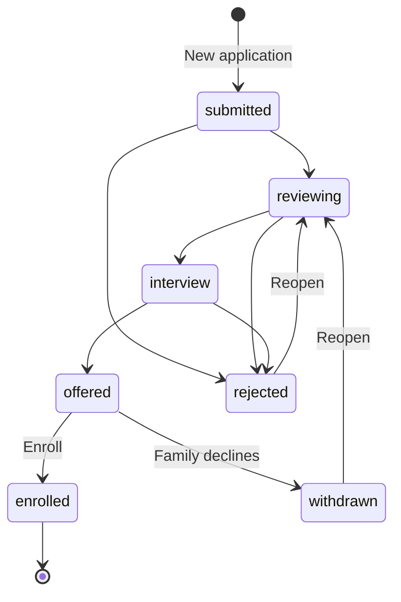
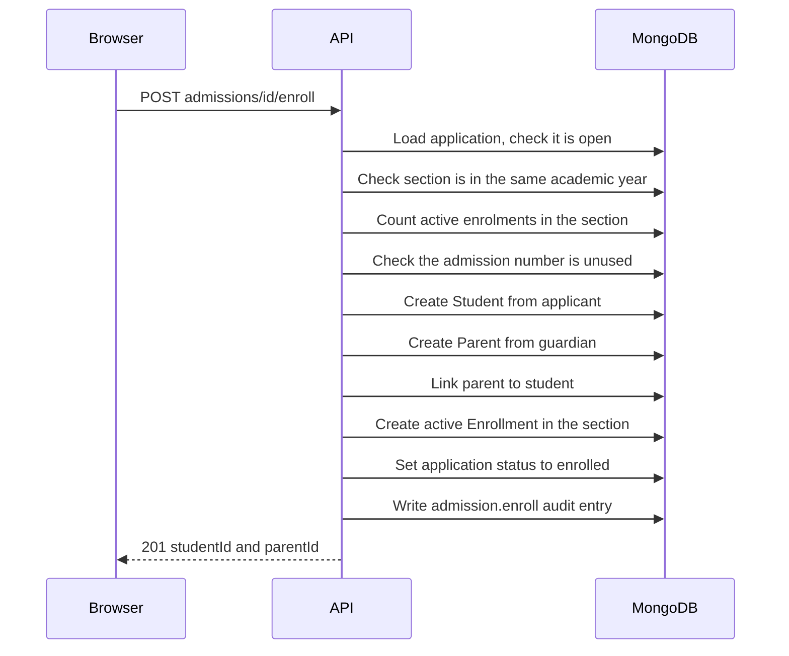

import { Aside, Steps, Card, CardGrid, LinkCard } from '@astrojs/starlight/components';
import Pipeline from '../../../../components/Pipeline.astro';
import ScreenAnatomy from '../../../../components/ScreenAnatomy.astro';
import SourceFile from '../../../../components/SourceFile.astro';
import Api from '../../../../components/Api.astro';
import Perm from '../../../../components/Perm.astro';
import Roles from '../../../../components/Roles.astro';
import Route from '../../../../components/Route.astro';
import DemoLogin from '../../../../components/DemoLogin.astro';
import Screenshot from '../../../../components/Screenshot.astro';

Before a child becomes a student, the school talks to the family, looks at the
paperwork, maybe interviews the child, and finally offers a place. **Admissions**
is where the school office keeps that conversation. Each family's request is an
**application**: it holds the child's details, the class they want to join and
the guardian's contact details. Staff move the application along a pipeline of
stages, and when the family accepts, one click on **"Enroll"** turns it into a
real student record, a parent record for the guardian, and a seat in a
[section](/start-here/glossary/#section) — without typing anything twice.

This is the original spec module, added after Phase 5.

## At a glance

<CardGrid>
  <Card title="Who uses it" icon="star">
    <Roles list={['school_admin', 'principal', 'vice_principal']} note="Vice Principal can only look." />
  </Card>
  <Card title="Where to find it" icon="laptop">
    <Route path="/app/admissions" /> — sidebar group **People → Admissions**.
  </Card>
  <Card title="Permissions" icon="approve-check">
    <Perm name="admission:read" /> to view, <Perm name="admission:manage" /> to add, edit, move and delete, plus <Perm name="student:create" /> to enrol.
  </Card>
  <Card title="Statuses" icon="list-format">
    `submitted` → `reviewing` → `interview` → `offered` → `enrolled`, or `rejected` / `withdrawn`.
  </Card>
</CardGrid>

<DemoLogin as="School Admin (Amira Hossain)" email="admin@greenfield.example" go="/app/admissions" />

The seed fills the pipeline with **14 applications** for the current academic
year (`2026-2027` on a seed run in late 2026), mostly for Grade 1: 4 Submitted,
3 Reviewing, 2 Interview, 3 Offered, 1 Rejected and 1 Withdrawn. The Principal
(`principal@greenfield.example`, Richard Okafor) can do everything the admin can
here; the Vice Principal (`viceprincipal@greenfield.example`, Helen Marsh) sees
the same list without any buttons.

## How it works

<Pipeline
  caption="The usual journey of one application. Every stage is a status on the same record."
  steps={[
    { label: 'Submitted', icon: 'file-text', note: 'Staff key in the family’s request' },
    { label: 'Reviewing', icon: 'search', note: 'Papers and seats checked' },
    { label: 'Interview', icon: 'calendar-clock', note: 'Date and time recorded' },
    { label: 'Offered', icon: 'send', note: 'A place is offered' },
    { label: 'Enrolled', icon: 'graduation-cap', note: 'Student, parent and seat created' },
  ]}
/>

The stages are a **convention, not a locked sequence**. The "Move to…" drawer
lists every stage except Enrolled, so staff can jump from Submitted straight to
Offered, step back, or reopen a rejected application. Only two rules are hard:

- **Enrolled is final.** An enrolled application can't be edited, moved or deleted.
- **Rejected and withdrawn applications can't be enrolled** until someone moves them back to an open stage.

The diagram shows the common paths. Any open stage can move to any other open
stage, and "Enroll" works from any open stage — not only from Offered.

When staff press **"Enroll"**, the API does all of this in one request:

## The screen

<Screenshot name="admin-admissions" alt="The admissions pipeline" path="/app/admissions" />

<ScreenAnatomy
  title="Admissions"
  path="/app/admissions"
  regions={[
    { label: 'Sidebar', desc: 'People → Admissions. Shown to anyone with admission:read.', area: 'sidebar' },
    { label: 'Top bar', desc: 'Breadcrumb "School / Admissions", Load sample, notification bell, theme toggle, profile menu.', area: 'top' },
    { label: 'Page header', desc: 'Title "Admissions", the line "Applications from first contact to enrolment." and the "New application" button (managers only).' },
    { label: 'Status filter', desc: '"All" plus one button per status — Submitted, Reviewing, Interview, Offered, Enrolled, Rejected, Withdrawn — each with a live count.', tone: 'accent' },
    { label: 'Search box', desc: '"Search applicant, guardian or number".' },
    { label: 'Applications table', desc: 'Applicant (name + APP number), Class, Guardian (name + relation), Status pill, Applied date, and a row menu.', size: 4, tone: 'accent' },
    { label: 'Pager', desc: '25 applications per page.' },
  ]}
/>

The **Status** column uses coloured pills: Submitted and Reviewing are grey,
Interview is amber (with the interview date underneath), Offered is blue,
Enrolled is green, Rejected is red, and Withdrawn is grey with a line through
it. The Guardian and Applied columns hide on phones.

Every change opens a **drawer** — a panel that slides in from the right edge.
The enrol drawer looks like this:

<ScreenAnatomy
  title="Enroll drawer"
  path="/app/admissions"
  regions={[
    { label: 'Drawer title', desc: '"Enroll Fiifi Amoah" and "Creates the student and their guardian, and places them in Grade 1."' },
    { label: 'Section', desc: 'Only the sections of the class applied for, each with seats taken, e.g. "A · 25/30" (or "A · 12 · no limit" for capacity 0). Full sections are greyed out and marked "(full)".', tone: 'accent' },
    { label: 'Admission number', desc: 'Required. Must be unused in the school.' },
    { label: 'Roll number (optional)', desc: 'Free text, up to 20 characters.' },
    { label: 'Enroll button', desc: 'Shows "Enrolling…" while the request runs.', tone: 'warn' },
  ]}
/>

## Step by step

This is the full walkthrough: add an application, move it through the
pipeline, and enrol it. Sign in as the School Admin.

<Steps>

1. Open **Admissions** from the **People** group in the sidebar. The status
   buttons show the seeded pipeline: **All 14**, **Submitted 4**, **Reviewing 3**,
   **Interview 2**, **Offered 3**, **Enrolled 0**, **Rejected 1**, **Withdrawn 1**.

2. Click **"New application"** in the page header. The **New application**
   drawer opens with the subtitle "Applicant and guardian details."

3. Leave **Academic year** on the one marked "(current)". In **Class applied for**
   pick **Grade 1** (the list only shows classes of the chosen year).

4. Fill in the applicant: **First name**, **Last name**, **Gender** (Prefer not to
   say, Female, Male, Other) and, if you have it, **Date of birth** — it can
   be left blank and filled in later. Add **Address** and **Previous school**
   if you have them.

5. Under **Guardian**, fill in **First name**, **Last name**, **Relation**
   (Mother, Father, Guardian, Other), **Phone** and **Email**. Add any **Notes**.

6. Click **"Save application"**. The toast says "Application added." and the new
   row appears at the top of the table with status **Submitted** and the next
   number — `APP-2026-0015` on a fresh seed.

7. Open the row menu (the three dots at the end of the row) and choose
   **"Move to…"**. In the **Move application** drawer set **Stage** to
   **Reviewing**, optionally type a **Note**, and click **"Save"**. The toast says
   "Moved to Reviewing." and the counts in the status buttons update.

8. Move it again and pick **Interview**. An **Interview** date-and-time field
   appears; pick a slot and save. The Status column now shows the amber
   **Interview** pill with the date underneath.

9. Move it to **Offered** with the note "Offer sent; awaiting acceptance."

10. When the family accepts, open the row menu and choose **"Enroll"**. In the
    **Enroll** drawer pick **Section** "A · 25/30", type an **Admission number**
    that isn't used yet (for example `GIS-2026-0501`), optionally a
    **Roll number**, and click **"Enroll"**.

11. The toast reads "*First name* is now a student, with *guardian first name*
    linked as guardian." The row turns to a green **Enrolled** pill and its row
    menu disappears.

12. Open **Students** and search for the child: the new student is in Grade 1 · A
    with the guardian listed under parents. Open **Audit log** to see the
    `admission.create`, `admission.status` and `admission.enroll` entries.

</Steps>

<Aside type="tip" title="Faster demo">
To skip straight to the last step, use a seeded offer: **Fiifi Amoah**
(`APP-2026-0008`, Grade 1, guardian Grace Amoah) is already **Offered**.
</Aside>

## Every action on this screen

### Status filter buttons

Click a status to show only those applications; click **"All"** to clear it.
The counts come from one summary call, the rows from the list call. The chosen
status and search text live in the URL (`?status=interview&q=…`), so a filtered
view can be bookmarked or shared.

<Api method="GET" path="admissions/summary" perm="admission:read" />
<Api method="GET" path="admissions?status=&q=&page=" perm="admission:read" />

### Search

Type in **"Search applicant, guardian or number"**. The API matches the
applicant's first name, last name, the application number, and the
**guardian's last name** (case-insensitive). Results are newest first, 25 per page.

### "New application"

Opens the **New application** drawer. The fields, all from
`createAdmissionSchema`:

| Field (UI label) | Code name | Rules |
|---|---|---|
| Academic year | `academicYearId` | Required. Defaults to the current year. |
| Class applied for | `desiredClassId` | Required. Must belong to the chosen academic year. |
| First name / Last name | `firstName` / `lastName` | Required, up to 80 characters. |
| Gender | `gender` | `unspecified` (Prefer not to say), `female`, `male`, `other`. |
| Date of birth | `dateOfBirth` | Optional — a blank field is sent as no value; **encrypted**. |
| Address | `address` | Optional, up to 240 characters; **encrypted**. |
| Previous school | `previousSchool` | Optional, up to 120 characters. |
| Guardian First name / Last name | `guardianFirstName` / `guardianLastName` | Required. |
| Relation | `guardianRelation` | `mother`, `father`, `guardian` (default), `other`. |
| Phone | `guardianPhone` | Optional, phone format; **encrypted**. |
| Email | `guardianEmail` | Optional, email format. |
| Notes | `notes` | Optional, up to 2,000 characters. |

The API checks the year and the class exist in this school and that the class
belongs to the year ("That class belongs to a different academic year." if not),
gives the application its number, and sets the status to `submitted`.

<Api method="POST" path="admissions" perm="admission:manage" />

On success: toast "Application added.", the drawer closes and the list
refreshes. Field errors appear under the field; anything else shows as a toast
("The application could not be saved.").

### Row menu: "Move to…"

Opens **Move application** with the applicant's name and number as the subtitle.

- **Stage** — Submitted, Reviewing, Interview, Offered, Rejected, Withdrawn.
  (Enrolled is not in the list: only "Enroll" can set it.)
- **Interview** — a date-and-time picker, shown only when Stage is Interview.
- **Note** — hint "Shown on the application." Saved as `decisionNote`.

Click **"Save"** → toast "Moved to *Stage*."

<Api method="POST" path="admissions/:id/status" perm="admission:manage" />

The audit entry `admission.status` records the old and new status and the note.

### Row menu: "Enroll"

Shown only when you hold both <Perm name="admission:manage" /> and
<Perm name="student:create" />, and hidden while the application is Rejected or
Withdrawn. The API then checks, in order:

1. The application isn't already enrolled (409 "This applicant is already enrolled.").
2. It isn't rejected or withdrawn (409 "Reopen the application before enrolling.").
3. The section exists and its class is in the **same academic year** the applicant applied for (400 "Pick a section in the academic year the applicant applied for.").
4. The section has a free seat — active enrolments are fewer than its capacity, and capacity `0` means no limit (409 "Section A is full (30/30). Raise its capacity or pick another section."). This is the same check `POST /enrollments` uses.
5. No student already has the admission number (409 "Another student already has that admission number.").

Then it creates the **Student** (name, gender, date of birth, address copied
over), a **Parent** for the guardian (name, relation, phone, address), links
them both ways, creates an **active Enrollment** in the section, and marks the
application `enrolled` with a pointer to the new student.

<Api method="POST" path="admissions/:id/enroll" perm="admission:manage" />

Success toast: "*First name* is now a student, with *guardian* linked as guardian."

### Row menu: "Edit"

Opens **Edit application** with every field filled in. Because the form needs
the decrypted date of birth, address and phone, opening it calls the detail
endpoint — which writes an `admission.read` **sensitive-read** entry to the
audit log every time. **"Save application"** sends only what the form holds.

<Api method="GET" path="admissions/:id" perm="admission:read" />
<Api method="PATCH" path="admissions/:id" perm="admission:manage" />

The `admission.update` audit entry lists **which fields changed, never their
values**, so no personal data ends up in the log.

### Row menu: "Delete"

A confirmation asks "Delete *name*'s application?" with the note "It's kept in
the audit log." **"Delete"** soft-deletes the application (it disappears from
the list but stays in the database with `deletedAt` set). Toast: "Application deleted."

<Api method="DELETE" path="admissions/:id" perm="admission:manage" />

Enrolled applications have no row menu, so they can't be deleted.

## Who sees what

| Role | Sidebar link | What they can do |
|---|---|---|
| School Admin | Yes | Everything: add, edit, move, enrol, delete. |
| Principal | Yes | Everything — the role holds both <Perm name="admission:manage" /> and <Perm name="student:create" />. |
| Vice Principal | Yes | Filters, search and the table only. No "New application" button and no row menu, so no way to open an application's full details. |
| Teacher, Accountant, Staff | No | Nothing. Opening the URL directly shows an empty table with an error, because the API answers 403. |
| Student, Parent | No | Nothing. Families never see applications. |

## Under the hood

- <SourceFile path="apps/api/src/modules/operations/admissions.routes.ts" /> — every endpoint; mounted at `/api/v1/admissions`.
- <SourceFile path="apps/web/src/app/(tenant)/app/admissions/page.tsx" /> — the list and the four drawers (`ApplicationDrawer`, `MoveDrawer`, `EnrollDrawer`, plus the delete dialog).
- <SourceFile path="packages/validation/src/operations.ts" symbol="createAdmissionSchema" /> — shared by the form and the API; also `admissionStatusSchema`, `enrollAdmissionSchema`, `listAdmissionsQuery`.
- <SourceFile path="packages/db/src/models/admission.ts" symbol="AdmissionApplication" /> — the `admission_applications` collection.
- <SourceFile path="apps/api/src/seed/demo-operations.ts" /> — the 14 demo applications.
- <SourceFile path="apps/api/src/modules/operations/__tests__/operations.integration.test.ts" /> — "enrolling an applicant creates the student, guardian and enrollment".

**The record.** Besides the form fields, each application stores
`applicationNumber`, `status`, `interviewAt`, `decisionNote` (the "Note" from
"Move to…") and `studentId` (set on enrol). `dateOfBirth`, `address` and
`guardianPhone` use the same envelope encryption as Student and Parent; the list endpoint never returns them — the model's JSON transform
strips them — and only the detail endpoint decrypts them.

**Application numbers** look like `APP-2026-0015`: the current calendar year
plus a four-digit sequence that counts every application the school has ever
had, deleted ones included. The pair (`schoolId`, `applicationNumber`) is unique.

**Audit actions:** `admission.create`, `admission.update` (field names only),
`admission.status`, `admission.enroll` (with the new student, parent,
enrolment and section ids), `admission.delete`, and the sensitive read
`admission.read`.

## Edge cases and gotchas

:::caution[The guardian gets a record, not a login]
Enrolling creates a **Parent** record for the guardian but **no sign-in account
and no invitation**. The guardian's **Email** stays on the application only —
the Parent model has no email field — so it is not carried over. To let the
family into the parent portal, connect a parent account to the new parent
record afterwards (see [Parents](/features/people/parents/)). The public
Admissions page says "The school sends an invite to the parent email"; that
does not happen from this screen.
:::

:::caution[Enrolment is several writes, not one transaction]
The enrol call creates the student, then the parent, then the enrolment, then
updates the application, without a database transaction. If a later write
failed, the earlier records would remain. In normal use every check runs
before the first write, so this only matters for unexpected database errors.
:::

- **Enroll is not tied to Offered.** You can enrol straight from Submitted. The stages are for the office's own tracking.
- **Seat counts are live at enrol time.** The drawer disables full sections, but the API re-counts active enrolments, so two people enrolling into the last seat at once get one success and one "Section … is full" refusal.
- **Only the class applied for.** The Section list shows sections of the desired class only. To place the child in another class, edit the application's **Class applied for** first.
- **The Note is not shown in the list.** "Move to…" says the note is "Shown on the application", but the table doesn't display it; reopen "Move to…" to read it.
- **Search skips the guardian's first name.** Searching "Grace" won't find Fiifi Amoah's application; searching "Amoah" will.
- **Changing year or class re-validates.** Editing an application with a new academic year or class runs the same "class belongs to the year" check as creating one.
- **Sample mode does not apply here.** Admissions always shows real data: the **Load sample** button is disabled on this page, and if sample mode is already on, a "Real data on this page." notice explains why.
- **No public form.** The marketing page at `/admissions` has no application form — it explains how families join and links to **"Write to the school"** (`/contact`). Every application in this pipeline is typed in by staff. See [Public website](/features/public-website/).

## Related pages

<CardGrid>
  <LinkCard title="Students" description="Where an enrolled applicant ends up." href="/features/people/students/" />
  <LinkCard title="Parents" description="The guardian record enrolment creates, and how to give it a login." href="/features/people/parents/" />
  <LinkCard title="Classes & sections" description="Section capacity is what enrolment respects." href="/features/academics/classes-and-sections/" />
  <LinkCard title="Public website" description="The marketing Admissions page and the contact form." href="/features/public-website/" />
  <LinkCard title="Audit log" description="Find every admission.* entry, including sensitive reads." href="/features/insight/audit-log/" />
  <LinkCard title="Encryption" description="How date of birth, address and phone are encrypted." href="/setup/services/encryption/" />
</CardGrid>
