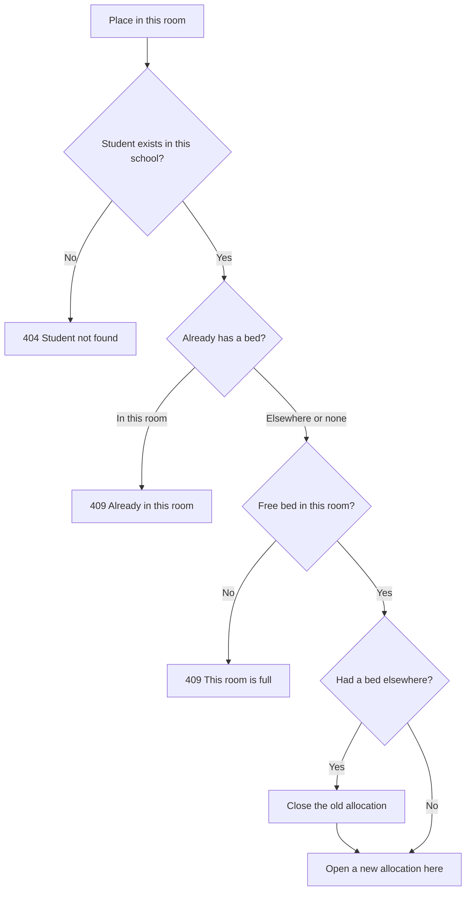
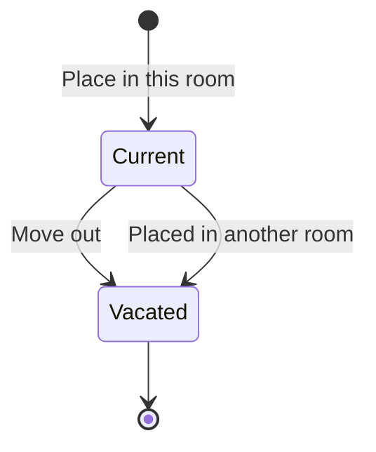

import { Aside, Steps, Card, CardGrid, LinkCard } from '@astrojs/starlight/components';
import Pipeline from '../../../../components/Pipeline.astro';
import ScreenAnatomy from '../../../../components/ScreenAnatomy.astro';
import SourceFile from '../../../../components/SourceFile.astro';
import Api from '../../../../components/Api.astro';
import Perm from '../../../../components/Perm.astro';
import Roles from '../../../../components/Roles.astro';
import Route from '../../../../components/Route.astro';
import DemoLogin from '../../../../components/DemoLogin.astro';
import Screenshot from '../../../../components/Screenshot.astro';

Boarding schools need to know who sleeps where. The **Hostel** module keeps
every **room** — its building, room number, floor, whether it is for boys,
girls or mixed, and how many **beds** it has — and every **allocation**: which
student holds a bed in which room, and since when. A student holds **one bed at
a time**, and a room never takes more students than it has beds. When a
boarder moves or leaves, the old allocation is closed rather than deleted, so
the history stays. This is the original spec module.

## At a glance

<CardGrid>
  <Card title="Who uses it" icon="star">
    <Roles list={['school_admin', 'principal', 'vice_principal', 'accountant']} note="Only the School Admin edits." />
  </Card>
  <Card title="Where to find it" icon="laptop">
    <Route path="/app/hostel" /> — sidebar group **Facilities → Hostel**.
  </Card>
  <Card title="Permissions" icon="approve-check">
    <Perm name="hostel:read" /> to view rooms and occupants; <Perm name="hostel:manage" /> to allocate, move and vacate.
  </Card>
  <Card title="Families" icon="information">
    Parents see their child's room on the child's page, through the parent link.
  </Card>
</CardGrid>

<DemoLogin as="School Admin" email="admin@greenfield.example" go="/app/hostel" />

The seed builds two houses — **Adinkra House** (girls) and **Kente House**
(boys) — each with rooms 101–105 on the Ground floor and 201–205 on the First
floor, four beds per room: **80 beds**. About **50 senior students** (Grades
8–10) board; on a fresh seed that is 49, so the header reads "49 of 80 beds
taken across 2 buildings". The demo student **Adam Singh** (Grade 8 · A) is in
**Kente House, room 101**.

## How it works

<Pipeline
  caption="A boarder's year."
  steps={[
    { label: 'Add rooms', icon: 'building', note: 'Building, number, beds, boys or girls' },
    { label: 'Place student', icon: 'user-plus', note: 'One bed, within capacity' },
    { label: 'Move', icon: 'workflow', note: 'Old bed closed, new one opened' },
    { label: 'Move out', icon: 'house', note: 'Bed freed, history kept' },
  ]}
/>

Placing a student who already has a bed elsewhere **moves** them: the API
closes the old allocation and opens a new one in the same request.

An allocation is **current** while its `vacatedAt` is empty. "Occupied" for a
room is the number of current allocations in it.

## The screen

<Screenshot name="admin-hostel" alt="Hostel rooms and occupancy" path="/app/hostel" />

<ScreenAnatomy
  title="Hostel"
  path="/app/hostel"
  regions={[
    { label: 'Sidebar', desc: 'Facilities → Hostel. Shown to anyone with hostel:read.', area: 'sidebar' },
    { label: 'Top bar', desc: 'Breadcrumb "School / Hostel", notification bell, theme toggle, profile menu.', area: 'top' },
    { label: 'Page header', desc: 'Title "Hostel", the summary "49 of 80 beds taken across 2 buildings", and "Add room" (School Admin only).' },
    { label: 'Building card', desc: 'One card per building, titled with its name and "N boarders".', tone: 'accent' },
    { label: 'Room tiles', desc: '"Room 101", "Ground · Boys", edit and remove icons (School Admin only), and one bed icon per bed — tinted when taken, grey when free.', size: 4, tone: 'accent' },
  ]}
/>

Room tiles sit up to five in a row on a wide screen and one per row on a
phone. Clicking the room name **or** the row of beds opens the occupants
drawer. With no rooms yet, the page says "No rooms yet" and, for the School
Admin, "Add the boarding rooms, then place students."

<ScreenAnatomy
  title="Occupants drawer"
  path="/app/hostel"
  regions={[
    { label: 'Drawer title', desc: '"Kente House · room 202" and "1 of 4 beds taken".' },
    { label: 'Place a student', desc: 'School Admin only, and only while a bed is free: student search, "Place in this room", and "A student already in another room is moved here."', size: 2, tone: 'accent' },
    { label: 'Occupants list', desc: 'Each boarder with "Grade 9 · A · since Jun 1, 2026", and a "Move out" button for the School Admin. "This room is empty." when nobody is there.', size: 3 },
  ]}
/>

## Step by step

### Place a boarder

Sign in as the School Admin.

<Steps>

1. Open **Hostel** from the **Facilities** group. Two building cards appear:
   **Adinkra House** and **Kente House**. Rooms 101–105 and 201 are full (four
   tinted beds); the rest have free beds.

2. In **Kente House**, click **Room 203** (four grey beds). The drawer
   **Kente House · room 203** opens with "0 of 4 beds taken" and
   "This room is empty."

3. In **Place a student**, type at least two letters of a student's name or
   admission number into "Search students by name or number", then click the
   student. A highlighted line confirms the pick; **"Change"** clears it.

4. Click **"Place in this room"**. Toast: "*name* placed in room 203." The
   student appears in the list with "since" today's date, one bed on the tile
   turns tinted, and the header count goes up by one.

5. To move a boarder, open the **destination** room and place them there. If
   they already had a bed, the toast says "*name* moved here." and their old
   bed is freed.

6. To free a bed, click **"Move out"** next to the boarder. Toast: "Bed freed."
   There is no confirmation.

</Steps>

### Add or change a room

<Steps>

1. Click **"Add room"**. The **Add room** drawer opens.

2. Fill **Building** (placeholder "Kente House"), **Room** (placeholder "101"),
   **Floor** (placeholder "Ground") and **Beds** (defaults to 4). Set **For** to
   **Boys**, **Girls** or **Mixed** (the default).

3. Click **"Save room"**. Toast: "Room added." A new building name starts a new
   building card.

4. To change a room, click its pencil icon; the **Edit room** drawer has the
   same fields. To delete it, click the bin icon and confirm **"Remove"**.

</Steps>

### Check a boarder's room from their record

<Steps>

1. Still as the School Admin, open **Students** and search for **Adam Singh**.

2. Open his profile. The **"Bus, room & library"** card shows
   **Kente House · room 101** with "Since" the start of the academic year. A
   student without a bed shows "Day student".

</Steps>

## Every action on this screen

### Load the rooms

Returns every room sorted by building then room number, each with an
`occupied` count. The header totals and the per-building "boarders" counts are
added up in the browser.

<Api method="GET" path="hostel/rooms" perm="hostel:read" />

### "Add room" and the pencil icon (Edit room)

Both use the same form (`createRoomSchema` / `updateRoomSchema`):

| Field | Code name | Rules |
|---|---|---|
| Building | `building` | Required, up to 60 characters. |
| Room | `roomNumber` | Required, up to 20 characters. Unique within its building. |
| Floor | `floor` | Optional, up to 20 characters. |
| Beds | `capacity` | Whole number 1–50. Default 4. |
| For | `gender` | `boys`, `girls` or `mixed` (default). |

<Api method="POST" path="hostel/rooms" perm="hostel:manage" />
<Api method="PATCH" path="hostel/rooms/:id" perm="hostel:manage" />

Creating a room that already exists in the building gives 409 "That room
already exists in this building." Lowering **Beds** below the current
occupants gives 409 "*N* students live here; capacity can't go below that."

### The bin icon (Remove room)

The dialog asks "Remove room *number*?" and warns "Rooms with students in them
can't be removed." **"Remove"** soft-deletes the room; with anyone still in it
the API answers 409 "Move the students in this room first." Toast: "Room removed."

<Api method="DELETE" path="hostel/rooms/:id" perm="hostel:manage" />

### Open a room (occupants)

Lists the current occupants with name, admission number, class placement and
the date they were placed.

<Api method="GET" path="hostel/rooms/:id/occupants" perm="hostel:read" />

### "Place in this room"

Sends the `studentId`. See the decision flow above.

<Api method="POST" path="hostel/rooms/:id/occupants" perm="hostel:manage" />

### "Move out"

Sets `vacatedAt` on the allocation; the bed is free at once.

<Api method="POST" path="hostel/rooms/:id/occupants/:subId/vacate" perm="hostel:manage" />

`:subId` is the allocation's id, not the student's.

### The family view

The child's record shows the room through the same endpoint Transport uses,
authorized by the link check (the student, a linked parent, or staff with
<Perm name="student:read" />), not by <Perm name="hostel:read" />.

<Api method="GET" path="student-records/:id/services" />

## Who sees what

| Role | Hostel page | Edit | Child or student record |
|---|---|---|---|
| School Admin | Yes | Rooms, placing, moving, moving out | "Bus, room & library" card on `/app/students/:id` |
| Principal | Yes, read-only | No | Same card |
| Vice Principal | Yes, read-only | No | Same card |
| Accountant | Yes, read-only | No | Same card |
| Teacher | No | No | Same card on student profiles |
| Parent | No | No | The card on each child at `/app/children/:id` |
| Student | No | No | The API allows it, but no student screen shows the card yet |
| Staff | No | No | No |

Read-only roles see the building cards and can open every room, but without
"Add room", the edit and remove icons, the "Place a student" box or the
"Move out" buttons.

## Under the hood

- <SourceFile path="apps/api/src/modules/operations/hostel.routes.ts" /> — every endpoint; mounted at `/api/v1/hostel`.
- <SourceFile path="apps/api/src/modules/operations/facilities.ts" symbol="studentRows" /> — occupant names and "Grade · Section" placements (shared with Transport).
- <SourceFile path="apps/web/src/app/(tenant)/app/hostel/page.tsx" /> — building cards, room tiles, `RoomDrawer`, `OccupantsDrawer`.
- <SourceFile path="apps/web/src/components/records/services-card.tsx" symbol="ServicesCard" /> — the "Bus, room & library" card.
- <SourceFile path="packages/validation/src/operations.ts" symbol="createRoomSchema" /> — plus `updateRoomSchema` and `allocateBedSchema`.
- <SourceFile path="packages/db/src/models/hostel.ts" /> — `HostelRoom` (`hostel_rooms`) and `HostelAllocation` (`hostel_allocations`).

**Two unique indexes** back the rules: one room number per building per school
(for rooms that aren't deleted), and one **current** allocation per student
(`vacatedAt` empty). Vacated allocations stay in the collection as history,
though no screen lists them yet.

**Audit actions:** `hostel.room.create`, `hostel.room.update` (before and
after), `hostel.room.delete`, `hostel.allocate` (with the previous room when
moving), `hostel.vacate`.

**Tests:** "caps riders at the bus capacity and beds at the room capacity" in
<SourceFile path="apps/api/src/modules/operations/__tests__/operations.integration.test.ts" />,
and "transport and hostel show capacity" in <SourceFile path="apps/web/e2e/05-operations.spec.ts" />.

## Edge cases and gotchas

:::caution[Boys / Girls is a label, not a rule]
A room's **For** setting is only displayed. Neither the page nor the API
compares it with the student's gender, so a boy can be placed in a girls' room.
The seed places boarders correctly, but the desk must check this by eye.
:::

- **The "Place a student" box disappears when the room is full.** Free a bed first, or place the student in another room.
- **Moving needs a free bed in the destination.** Two boarders can't swap full rooms in one step — move one out first.
- **Renaming a building** on one room moves only that room to a new building card. Rename every room of the building to rename the house.
- **Changing a room to a number already used** in its building is refused with "This record already exists."
- **No history screen.** Each move closes the old allocation, so the data shows who slept where and when, but the page only lists current occupants.
- **No notifications.** Families aren't told about a placement or move; they see it on the child's page.
- **Sample mode does not apply here.** The hostel page always shows real data — the **Load sample** button is disabled on this page, and if sample mode is already on, a "Real data on this page." notice says so.
- **Opening the URL without permission.** Teachers, students, parents and staff have no sidebar link; typing `/app/hostel` shows "Rooms could not be loaded." because the API answers 403.

## Related pages

<CardGrid>
  <LinkCard title="Transport" description="The bus desk — same capacity rules and family card." href="/features/campus/transport/" />
  <LinkCard title="Students" description="The student profile shows the room in 'Bus, room & library'." href="/features/people/students/" />
  <LinkCard title="Parent portal" description="Where families see their child's room." href="/features/portals/parent/" />
  <LinkCard title="Student portal" description="What a boarder sees when they sign in." href="/features/portals/student/" />
  <LinkCard title="Audit log" description="Every hostel.* change, with before and after." href="/features/insight/audit-log/" />
  <LinkCard title="Permissions reference" description="hostel:read and hostel:manage by role." href="/reference/permissions/" />
</CardGrid>
