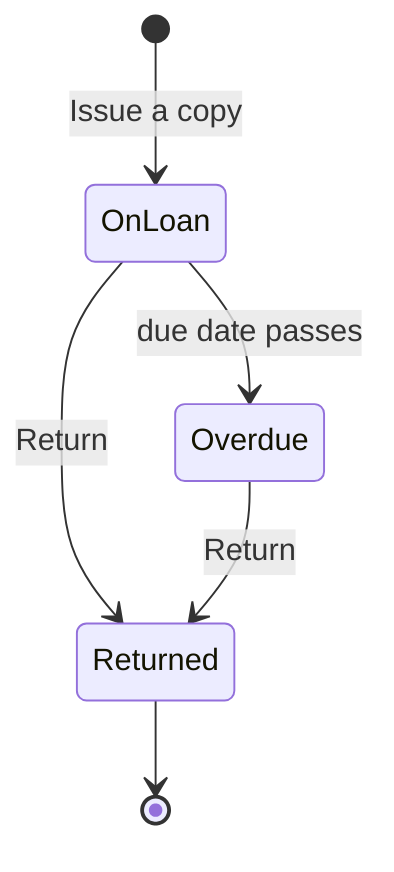

import { Aside, Steps, Card, CardGrid, LinkCard } from '@astrojs/starlight/components';
import Pipeline from '../../../../components/Pipeline.astro';
import ScreenAnatomy from '../../../../components/ScreenAnatomy.astro';
import SourceFile from '../../../../components/SourceFile.astro';
import Api from '../../../../components/Api.astro';
import Perm from '../../../../components/Perm.astro';
import Roles from '../../../../components/Roles.astro';
import Route from '../../../../components/Route.astro';
import DemoLogin from '../../../../components/DemoLogin.astro';
import Screenshot from '../../../../components/Screenshot.astro';
import { Tabs as ShotTabs, TabItem as ShotTab } from '@astrojs/starlight/components';

The **Library** module is the school library's front desk. It keeps a
**catalogue** — every title with its author, category, shelf and how many
physical **copies** the school owns — and a list of **loans**: who borrowed
which copy, when, and when it is due back. Schola never stores "copies
available"; it works it out every time as *copies owned minus copies not yet
returned*, so the number can never drift, and the desk can never lend a copy
that isn't on the shelf.

Two kinds of people use the page. The **desk** (School Admin and Principal)
adds books, issues copies and records returns. **Members** — teachers,
students, staff, the accountant and the vice principal — browse the catalogue
and see their own loans. This is the original spec module.

## At a glance

<CardGrid>
  <Card title="Who uses it" icon="star">
    <Roles list={['school_admin', 'principal', 'vice_principal', 'teacher', 'accountant', 'student', 'staff']} note="Only School Admin and Principal run the desk." />
  </Card>
  <Card title="Where to find it" icon="laptop">
    <Route path="/app/library" /> — sidebar group **Facilities → Library**.
  </Card>
  <Card title="Permissions" icon="approve-check">
    <Perm name="library:read" /> to browse and see your own loans; <Perm name="library:manage" /> for books, issue and return.
  </Card>
  <Card title="Loan states" icon="list-format">
    On loan, Overdue (worked out from the due date) and Returned.
  </Card>
</CardGrid>

<DemoLogin as="School Admin — the desk" email="admin@greenfield.example" go="/app/library" />

<DemoLogin as="Student (Adam Singh) — a member" email="student@greenfield.example" go="/app/library" />

The seed stocks **30 books** (73 copies) across Fiction, Science, Mathematics,
Reference, History, Computing, Arts and Poetry, and about **30 loans**: on a
fresh seed 24 are still out — 17 of them overdue — and 7 have been returned.
The demo student Adam Singh has **Matilda** out and overdue; the demo teacher
Grace Mensah has **A Brief History of Time**, due about two weeks after the
seed date.

## How it works

<Pipeline
  caption="The life of one copy. Overdue is never saved — it is the due date compared with today."
  steps={[
    { label: 'Add book', icon: 'book-open', note: 'Title, author, shelf, copies' },
    { label: 'Issue a copy', icon: 'send', note: 'Borrower and due date' },
    { label: 'On loan', icon: 'clipboard-list', note: 'Counts against available' },
    { label: 'Overdue', icon: 'calendar-clock', note: 'Due date has passed' },
    { label: 'Return', icon: 'book-open-check', note: 'Copy back on the shelf' },
  ]}
/>

A loan has only two stored facts that matter: `dueAt` and `returnedAt`. A loan
with no `returnedAt` is **on loan**; if its `dueAt` is in the past it is also
**overdue**. "Available" for a book is `copies − loans with no returnedAt`,
never below zero.

## The screen

Real screenshots from the seeded demo school (switch the docs theme to see dark mode):

<ShotTabs>
  <ShotTab label="Library desk">
    <Screenshot name="admin-library" alt="The library catalogue and loans" path="/app/library" />
  </ShotTab>
  <ShotTab label="Student">
    <Screenshot name="student-library" alt="A student’s view of the library" path="/app/library" />
  </ShotTab>
</ShotTabs>

The page has two tabs. What the second tab is depends on who you are.

<ScreenAnatomy
  title="Library — desk view"
  path="/app/library"
  regions={[
    { label: 'Sidebar', desc: 'Facilities → Library. Shown to anyone with library:read.', area: 'sidebar' },
    { label: 'Top bar', desc: 'Breadcrumb "School / Library", notification bell, theme toggle, profile menu.', area: 'top' },
    { label: 'Page header', desc: 'Title "Library" and "Catalogue, loans and returns."' },
    { label: 'Tabs', desc: '"Catalogue" and "Loans".', tone: 'accent' },
    { label: 'Search and Add book', desc: '"Search title, author, ISBN or category" and the "Add book" button.' },
    { label: 'Catalogue table', desc: 'Title (author underneath), Category, Shelf, Available pill, and a row menu.', size: 4, tone: 'accent' },
    { label: 'Pager', desc: '25 books per page, sorted by title.' },
  ]}
/>

The **Available** pill is green with "2 of 3" while copies remain, and red with
"All 1 out" when none do. The Shelf column hides on phones.

<ScreenAnatomy
  title="Library — Loans tab"
  path="/app/library?loans=overdue"
  regions={[
    { label: 'Loan filter', desc: '"On loan" (default), "Overdue" and "Returned".', tone: 'accent' },
    { label: 'Loans table', desc: 'Book (author underneath), Borrower (and student, teacher or staff), Issued, Due, and a "Return" button on open loans.', size: 4, tone: 'accent' },
    { label: 'Pager', desc: '25 loans per page; open loans first, soonest due first.' },
  ]}
/>

The **Due** column says it all: a plain date for a loan that is fine, a red
**"Overdue · Oct 27, 2026"** pill when it is late, and a green
**"Returned Nov 1, 2026"** pill once it is back.

<ScreenAnatomy
  title="Library — member view"
  path="/app/library"
  regions={[
    { label: 'Page header', desc: 'Title "Library" and "Browse the catalogue and see what you have out."' },
    { label: 'Tabs', desc: '"Catalogue" and "My loans".', tone: 'accent' },
    { label: 'Catalogue', desc: 'Same search and table, without "Add book" and without row menus.', size: 2 },
    { label: 'My loans card', desc: '"Books you\'ve borrowed from the library." — Book, Borrower, Issued, Due. "Nothing borrowed" when empty.', size: 2, tone: 'accent' },
  ]}
/>

## Step by step

### Run the desk: issue and return a copy

Sign in as the School Admin.

<Steps>

1. Open **Library** from the **Facilities** group. The **Catalogue** tab opens.

2. Type `Hobbit` in **"Search title, author, ISBN or category"**. The row shows
   **The Hobbit** by J. R. R. Tolkien, Fiction, shelf F-03, and a green
   **"2 of 3"** pill on a fresh seed.

3. Open the row menu (the three dots) and choose **"Issue a copy"**. The
   **Issue a copy** drawer opens with the subtitle "The Hobbit · 2 available".

4. Leave **Borrower** on **Student** (or pick **Teacher** or **Staff**). In the
   search box under it — "Search students by name or number" — type at least two
   letters of a name or admission number, then click the person in the results.
   A highlighted line confirms the pick, with a **"Change"** link to undo it.

5. **Due back** is filled with today plus 14 days. Change it if you need to.

6. Click **"Issue"**. The toast reads "The Hobbit issued to *name*." and the pill
   drops to **"1 of 3"**.

7. Switch to the **Loans** tab. **On loan** is selected; find the new loan and
   click **"Return"**. The toast says "Returned." and the copy counts as
   available again.

8. Click **"Overdue"** to see the late loans — Matilda, borrowed by Adam Singh,
   is one of them — and **"Returned"** for the history.

</Steps>

### Add a book

<Steps>

1. On the **Catalogue** tab click **"Add book"**. The **Add book** drawer opens.

2. Fill **Title** (required), **Author**, **Category** (placeholder "Fiction"),
   **Shelf** (placeholder "F-12"), **ISBN** and **Copies** (defaults to 1).

3. Click **"Save"**. Toast: "Book added." The book appears in title order.

</Steps>

### See it as a member

<Steps>

1. Sign in as `student@greenfield.example` and open **Library**. The header now
   reads "Browse the catalogue and see what you have out."

2. The **Catalogue** tab has the same search and table, but no "Add book" button
   and no row menus.

3. Click **"My loans"**. Adam's card lists **Matilda** with a red
   **Overdue** pill. Sign in as `teacher@greenfield.example` to see Grace
   Mensah's **A Brief History of Time** with its due date instead.

</Steps>

## Every action on this screen

### Search the catalogue

Matches the title, author, ISBN or category, case-insensitive. The text is kept
in the URL as `?q=`. Each book in the response carries `onLoan` and
`available`, computed from the open loans.

<Api method="GET" path="library/books?q=&page=" perm="library:read" />

### "Add book" and row menu "Edit"

Both open the same form (`createBookSchema` / `updateBookSchema`):

| Field | Code name | Rules |
|---|---|---|
| Title | `title` | Required, up to 200 characters. |
| Author | `author` | Optional. Blank shows "Unknown author" in the table. |
| Category | `category` | Optional, free text (the seed uses Fiction, Science, …). |
| Shelf | `shelf` | Optional, up to 20 characters. |
| ISBN | `isbn` | Optional, up to 20 characters. Not checked for format. |
| Copies | `copies` | Whole number, 0 to 10,000. Default 1. |

<Api method="POST" path="library/books" perm="library:manage" />
<Api method="PATCH" path="library/books/:id" perm="library:manage" />

Lowering **Copies** below the number currently on loan is refused with
409 "*N* copies are on loan; copies can't go below that."

### Row menu "Issue a copy"

Only shown while the book has a copy available. The drawer sends the book, the
borrower type, the picked person and the due date. The API re-checks
availability ("No copies of this book are available." if someone else took the
last one) and that the borrower exists in this school ("Borrower not found.").

<Api method="POST" path="library/loans" perm="library:manage" />

The person search calls the people lists — `GET students`, `GET teachers` or
`GET staff` with `q=` and `pageSize=8` — so the desk also needs
<Perm name="student:read" />, <Perm name="teacher:read" /> and
<Perm name="staff:read" />. School Admin and Principal both hold them.

### Row menu "Remove"

A confirmation asks "Remove *title*?" with the note "Books with copies on loan
can't be removed." **"Remove"** soft-deletes the book. If any copy is still out
the API answers 409 "Copies of this book are still on loan." Toast on success:
"Book removed."

<Api method="DELETE" path="library/books/:id" perm="library:manage" />

### Loans tab filter

**On loan** (`status=out`, includes overdue loans), **Overdue** (`status=overdue`:
not returned and due before now) and **Returned** (`status=returned`). The
choice is kept in the URL as `?loans=overdue`.

<Api method="GET" path="library/loans?status=&page=" perm="library:manage" />

### "Return"

One click, no confirmation. Sets the loan's `returnedAt` to now. Returning the
same loan twice gives 409 "This copy was already returned."

<Api method="POST" path="library/loans/:id/return" perm="library:manage" />

### "My loans"

Lists the signed-in member's own loans — returned ones too — newest first, up
to 100. Schola finds "you" through your people record: the student, teacher or
staff record linked to your account.

<Api method="GET" path="library/loans/mine" perm="library:read" />

## Who sees what

| Role | Sidebar link | Catalogue | Second tab | Desk actions |
|---|---|---|---|---|
| School Admin | Yes | Browse + manage | **Loans** (every loan) | Add, edit, remove, issue, return |
| Principal | Yes | Browse + manage | **Loans** | Add, edit, remove, issue, return |
| Vice Principal | Yes | Browse | **My loans** (usually empty — no people record) | None |
| Teacher | Yes | Browse | **My loans** | None |
| Accountant | Yes | Browse | **My loans** (from their staff record) | None |
| Staff | Yes | Browse | **My loans** | None |
| Student | Yes | Browse | **My loans** | None |
| Parent | No | — | — | — |

Parents have no <Perm name="library:read" />. They see each child's open loans
on the child's page instead, in the **"Bus, room & library"** card — see
[Parent portal](/features/portals/parent/). The same card is on the student
profile at `/app/students/:id` for school staff.

<Aside type="note" title="The librarian can't run the desk">
The seeded **Staff** account `staff@greenfield.example` is **Ruby Novak,
Librarian** — but the Staff role only holds <Perm name="library:read" />. Ruby
sees the read-only **Catalogue** and an empty **My loans** tab; she has no
"Add book" button, no row menus and no **Loans** tab, and the API answers 403
if she calls the desk endpoints. Only School Admin and Principal hold
<Perm name="library:manage" />, and there is no screen to give one staff member
an extra permission. In the demo, run the desk as the School Admin.
</Aside>

## Under the hood

- <SourceFile path="apps/api/src/modules/operations/library.routes.ts" /> — every endpoint; mounted at `/api/v1/library`.
- <SourceFile path="apps/web/src/app/(tenant)/app/library/page.tsx" /> — tabs, catalogue, loans, `BookDrawer`, `IssueDrawer`, `MyLoans`.
- <SourceFile path="apps/web/src/components/operations/person-search.tsx" symbol="PersonSearch" /> — the borrower picker (also used by Transport and Hostel).
- <SourceFile path="packages/validation/src/operations.ts" symbol="issueLoanSchema" /> — plus `createBookSchema`, `updateBookSchema`, `listBooksQuery`, `listLoansQuery`.
- <SourceFile path="packages/db/src/models/library.ts" /> — `LibraryBook` (`library_books`) and `LibraryLoan` (`library_loans`).
- <SourceFile path="apps/api/src/seed/demo-operations.ts" /> — the 30 books and the demo loans.

**A loan** stores `bookId`, `borrowerType` (`student`, `teacher` or `staff`),
exactly one of `studentId` / `teacherId` / `staffId`, `issuedAt` (set by the
server), `dueAt` and `returnedAt`. The API adds `title`, `author`, the
borrower's name and the computed `overdue` flag when it returns loans. A loan
whose book was later removed shows "Removed book".

**Audit actions:** `library.book.create`, `library.book.update` (before and
after), `library.book.delete`, `library.loan.issue` (book, borrower type and
id), `library.loan.return`.

**End-to-end test:** "the library issues a copy and takes it back" in
<SourceFile path="apps/web/e2e/05-operations.spec.ts" />. It searches for
**Holes**, which has four copies in the seed with at most one on loan, so
"Issue a copy" is always offered. (Matilda has a single copy, held by the demo
student's overdue loan, so its menu hides "Issue a copy".)

## Edge cases and gotchas

- **No due-date check.** The API accepts any due date, even one in the past — such a loan is overdue the moment it is issued.
- **Overdue is not a notification.** Nothing emails or alerts the borrower; overdue loans only show up in the **Overdue** filter, in "My loans" and on the student's record.
- **Removing is blocked, editing is not.** A book with copies out can't be removed, but its title and details can be edited; existing loans then show the new title.
- **Return has no undo.** "Return" acts immediately. To reverse a mistaken return, issue the copy again.
- **Shared page number.** The Catalogue and Loans tabs share the `?page=` value in the URL, so going to page 3 of the catalogue and then switching tabs opens page 3 of the loans.
- **Managers don't see "My loans".** The desk view replaces "My loans" with "Loans". A principal who borrows a book finds it in the **Loans** list instead.
- **Sample mode does not apply here.** The library always shows real data — the **Load sample** button is disabled on this page, and if sample mode is already on, a "Real data on this page." notice says so.
- **No fines, reservations or renewals.** The module covers the catalogue, issue and return only.

## Related pages

<CardGrid>
  <LinkCard title="Student portal" description="Where a student finds the Library and their loans." href="/features/portals/student/" />
  <LinkCard title="Parent portal" description="The 'Bus, room & library' card on each child." href="/features/portals/parent/" />
  <LinkCard title="Staff portal" description="What Ruby Novak and other staff see." href="/features/portals/staff/" />
  <LinkCard title="Staff" description="The people records loans attach to." href="/features/people/staff/" />
  <LinkCard title="Transport" description="The other campus desk using the same person search." href="/features/campus/transport/" />
  <LinkCard title="Permissions reference" description="library:read and library:manage by role." href="/reference/permissions/" />
</CardGrid>
