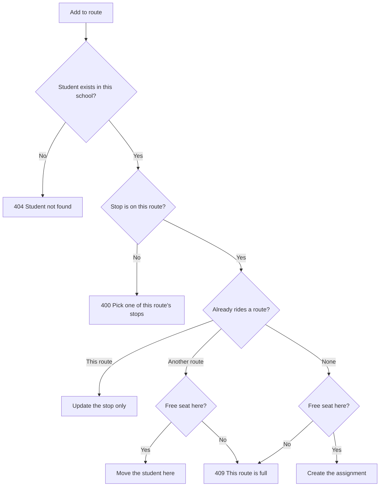

import { Aside, Steps, Card, CardGrid, LinkCard } from '@astrojs/starlight/components';
import Pipeline from '../../../../components/Pipeline.astro';
import ScreenAnatomy from '../../../../components/ScreenAnatomy.astro';
import SourceFile from '../../../../components/SourceFile.astro';
import Api from '../../../../components/Api.astro';
import Perm from '../../../../components/Perm.astro';
import Roles from '../../../../components/Roles.astro';
import Route from '../../../../components/Route.astro';
import DemoLogin from '../../../../components/DemoLogin.astro';
import Screenshot from '../../../../components/Screenshot.astro';

Many schools run buses. The **Transport** module records each **route** — its
name, the vehicle, the driver and the driver's phone, how many seats it has,
and its **stops** in order with a morning pickup time — and which students
**ride** it, each with the stop they get on at. A student rides **one route at
a time**, and a route never takes more riders than it has seats. Parents don't
open this page; they see their child's bus, stop, pickup time and driver on the
child's record. This is the original spec module.

## At a glance

<CardGrid>
  <Card title="Who uses it" icon="star">
    <Roles list={['school_admin', 'principal', 'vice_principal', 'accountant']} note="Only the School Admin edits." />
  </Card>
  <Card title="Where to find it" icon="laptop">
    <Route path="/app/transport" /> — sidebar group **Facilities → Transport**.
  </Card>
  <Card title="Permissions" icon="approve-check">
    <Perm name="transport:read" /> to view routes and riders; <Perm name="transport:manage" /> to edit them.
  </Card>
  <Card title="Families" icon="information">
    Parents see the route on each child's page — no permission needed, only the parent link.
  </Card>
</CardGrid>

<DemoLogin as="School Admin" email="admin@greenfield.example" go="/app/transport" />

The seed creates **four routes** of 45 seats each — **North loop** (BUS-01,
Peter Owusu), **East line** (BUS-02, Mary Adjei), **South loop** (BUS-03,
Samuel Boakye) and **West line** (BUS-04, Agnes Tetteh) — with four or five
stops each and 30 riders per route: **120 students** from Grades 1–6. The demo
parent's two children are among them.

## How it works

<Pipeline
  caption="Setting up transport for a new term."
  steps={[
    { label: 'Add route', icon: 'bus', note: 'Vehicle, driver, seats' },
    { label: 'Add stops', icon: 'flag', note: 'In order, with pickup times' },
    { label: 'Add riders', icon: 'user-plus', note: 'Student and their stop' },
    { label: 'Families see it', icon: 'users-round', note: 'On the child’s record' },
  ]}
/>

Adding a student who already rides **another** route moves them — there is no
need to remove them first. The API decides like this:

## The screen

<Screenshot name="admin-transport" alt="Bus routes, stops and riders" path="/app/transport" />

<ScreenAnatomy
  title="Transport"
  path="/app/transport"
  regions={[
    { label: 'Sidebar', desc: 'Facilities → Transport. Shown to anyone with transport:read.', area: 'sidebar' },
    { label: 'Top bar', desc: 'Breadcrumb "School / Transport", notification bell, theme toggle, profile menu.', area: 'top' },
    { label: 'Page header', desc: 'Title "Transport", a live summary such as "4 routes · 120 students ride", and the "Add route" button (School Admin only).' },
    { label: 'Route cards', desc: 'One card per route, two per row on wider screens: bus icon, name, "BUS-01 · Peter Owusu", edit and remove icons (School Admin only).', size: 2, tone: 'accent' },
    { label: 'Seats bar', desc: '"Seats 30/45" with a bar that fills as the bus fills.' },
    { label: 'Stops', desc: 'Every stop in order with its pickup time, e.g. "06:55 Market Square".' },
    { label: 'Riders button', desc: 'Opens the riders drawer for that route.', tone: 'warn' },
  ]}
/>

A route with no vehicle or driver says "No vehicle set". With no routes at all
the page shows "No routes yet" and, for the School Admin, "Add a route with its
stops, then assign students."

<ScreenAnatomy
  title="Riders drawer"
  path="/app/transport"
  regions={[
    { label: 'Drawer title', desc: '"West line riders" and "30 of 45 seats taken".' },
    { label: 'Add a student', desc: 'School Admin only: student search, Stop picker, "Add to route", and the hint "A student already on another route is moved here."', size: 2, tone: 'accent' },
    { label: 'Riders list', desc: 'Each rider by name with "Grade 1 · A · West Gate" underneath, and a "Remove" button for the School Admin.', size: 3 },
  ]}
/>

## Step by step

### Add a route

Sign in as the School Admin.

<Steps>

1. Open **Transport** from the **Facilities** group. Four route cards appear,
   each at **Seats 30/45**.

2. Click **"Add route"**. The **Add route** drawer opens with one empty stop row.

3. Fill **Name** (placeholder "North loop"), **Vehicle** (placeholder "BUS-01"),
   **Seats** (defaults to 40), **Driver** and **Driver phone**.

4. Under **Stops, in order**, type the first stop's name (placeholder "Market
   Square") and its pickup time. Click **"Add stop"** for each further stop;
   the **X** button at the end of a row removes it. Rows left completely blank
   are ignored when you save (the hint under the heading says "Blank rows are
   ignored."). A row with a time but no name shows "Stop 2: add a stop name,
   or clear the row." under it.

5. Click **"Save route"**. Toast: "Route added." The new card shows
   **Seats 0/40** and its stops.

</Steps>

### Seat a student on a bus

<Steps>

1. On the **West line** card click **"Riders"**. The drawer is titled
   **West line riders** with "30 of 45 seats taken".

2. In **Add a student**, type at least two letters of a student's name or
   admission number into "Search students by name or number" and click the
   student. A highlighted line confirms the pick; **"Change"** clears it.

3. Choose the **Stop** — each option shows its time, e.g. "07:14 · Palm Avenue".
   It starts on the route's first stop.

4. Click **"Add to route"**. Toast: "*name* added." — or, if they rode another
   bus, "*name* moved to West line." The list and the seat count update.

5. To take a student off the bus, click **"Remove"** on their line. Toast:
   "Removed from the route." There is no confirmation.

</Steps>

### See it as a parent

<Steps>

1. Sign in as `parent@greenfield.example` (Sofia Singh) and open **My children**.

2. Open **Mateo Singh** (Grade 1 · A). Below the tabs, the **"Bus, room &
   library"** card shows **West line** with "07:26 at West Gate · BUS-04 ·
   Agnes Tetteh (+1 555 070 1003)".

3. Go back and open **Ryan Singh** (Grade 1 · B): he rides the **East line**
   from **Mill Lane** at 07:30. A child with no route shows "Doesn't take the
   school bus".

</Steps>

## Every action on this screen

### Load the routes

Returns every route sorted by name, each with a `riders` count. The header
total adds those counts up in the browser.

<Api method="GET" path="transport/routes" perm="transport:read" />

### "Add route" and the pencil icon (Edit route)

Both use the same form (`createRouteSchema` / `updateRouteSchema`):

| Field | Code name | Rules |
|---|---|---|
| Name | `name` | Required, up to 80 characters. |
| Vehicle | `vehicleNumber` | Optional, up to 30 characters. |
| Seats | `capacity` | Whole number 0–200. Default 40. |
| Driver | `driverName` | Optional. |
| Driver phone | `driverPhone` | Optional; must be a valid phone number if given. |
| Stops, in order | `stops[]` | Up to 50. Each needs a `name`; `time` is optional 24-hour `HH:MM`. Rows with neither are dropped before validation (`ignoreBlankRows` in `apps/web/src/lib/blank-rows.ts`). |

Saving an edit replaces the whole stop list with what is in the form.

<Api method="POST" path="transport/routes" perm="transport:manage" />
<Api method="PATCH" path="transport/routes/:id" perm="transport:manage" />

Toasts: "Route added." / "Route saved."; errors land under **Name**,
**Driver phone**, **Seats** or the stop row ("Stop N: add a stop name, or
clear the row."), or as "The route could not be saved."

### The bin icon (Remove route)

The dialog asks "Remove *route*?" and warns "Routes with riders can't be
removed." **"Remove"** soft-deletes the route; if anyone still rides it the
API answers 409 "Move or remove this route's riders first."

<Api method="DELETE" path="transport/routes/:id" perm="transport:manage" />

### "Riders"

Lists the riders sorted by name, each with admission number, class placement
and stop. Everyone with <Perm name="transport:read" /> can open it.

<Api method="GET" path="transport/routes/:id/riders" perm="transport:read" />

### "Add to route"

Sends `studentId` and `stopName`. See the decision flow above. The response
says whether the student was moved from another route.

<Api method="POST" path="transport/routes/:id/riders" perm="transport:manage" />

### "Remove" (a rider)

Soft-deletes the assignment; the seat frees up immediately.

<Api method="DELETE" path="transport/routes/:id/riders/:subId" perm="transport:manage" />

`:subId` is the assignment's id, not the student's.

### The family view

The child's record calls one endpoint that returns the bus, the hostel bed and
the open library loans together. It is authorized by the **link check** — the
caller must be the student, a linked parent, or staff with
<Perm name="student:read" /> — not by <Perm name="transport:read" />.

<Api method="GET" path="student-records/:id/services" />

## Who sees what

| Role | Transport page | Edit | Child or student record |
|---|---|---|---|
| School Admin | Yes | Routes and riders | "Bus, room & library" card on `/app/students/:id` |
| Principal | Yes, read-only | No | Same card |
| Vice Principal | Yes, read-only | No | Same card |
| Accountant | Yes, read-only | No | Same card |
| Teacher | No | No | Same card on student profiles (the teacher holds <Perm name="student:read" />) |
| Parent | No | No | The card on each child at `/app/children/:id` |
| Student | No | No | The API allows it, but no student screen shows the card yet |
| Staff | No | No | No |

Read-only roles see the same cards and drawers without "Add route", the edit
and remove icons, the "Add a student" box or the "Remove" buttons.

## Under the hood

- <SourceFile path="apps/api/src/modules/operations/transport.routes.ts" /> — every endpoint; mounted at `/api/v1/transport`.
- <SourceFile path="apps/api/src/modules/operations/facilities.ts" symbol="studentRows" /> — names, admission numbers and "Grade · Section" placements for riders (shared with Hostel).
- <SourceFile path="apps/web/src/app/(tenant)/app/transport/page.tsx" /> — route cards, `RouteDrawer`, `RidersDrawer`.
- <SourceFile path="apps/web/src/components/records/services-card.tsx" symbol="ServicesCard" /> — the "Bus, room & library" card.
- <SourceFile path="apps/api/src/modules/student-records/student-records.routes.ts" /> — `GET /student-records/:id/services`.
- <SourceFile path="packages/validation/src/operations.ts" symbol="createRouteSchema" /> — plus `updateRouteSchema` and `assignRiderSchema`.
- <SourceFile path="packages/db/src/models/transport.ts" /> — `TransportRoute` (`transport_routes`) and `TransportAssignment` (`transport_assignments`).

**One route per student** is enforced by a unique index on
(`schoolId`, `studentId`) for assignments that aren't deleted. Stop `time` is
the **morning pickup** time; there is no separate drop-off time.

**Audit actions:** `transport.route.create`, `transport.route.update` (before
and after), `transport.route.delete`, `transport.rider.assign` (previous route
and stop when moving), `transport.rider.remove`.

**Tests:** "caps riders at the bus capacity and beds at the room capacity" in
<SourceFile path="apps/api/src/modules/operations/__tests__/operations.integration.test.ts" />,
and "transport and hostel show capacity" in <SourceFile path="apps/web/e2e/05-operations.spec.ts" />.

## Edge cases and gotchas

:::caution[Editing a route doesn't re-check riders]
Editing never looks at the current riders. Lowering **Seats** below the number
of riders is accepted (a card can read "30/20"; the bar just stays full, and new
riders are refused with "This route is full."). Renaming or removing a stop
leaves riders on the old stop name: the riders list still shows it, and the
family card shows the stop without a pickup time.
:::

- **Re-adding to the same route** only changes the stop, and works even when the bus is full — the student already holds a seat.
- **A route with no stops** has no **Stop** picker; riders are saved with an empty stop.
- **Seats 0** is allowed and means nobody can be added.
- **No notifications.** Families are not told when their child is added, moved or removed; they see the change next time they open the child's page.
- **Removed students** still listed on a route show as "Removed student".
- **Sample mode does not apply here.** Transport always shows real data — the **Load sample** button is disabled on this page, and if sample mode is already on, a "Real data on this page." notice says so.
- **Opening the URL without permission.** Teachers, students, parents and staff have no sidebar link; typing `/app/transport` shows "Routes could not be loaded." because the API answers 403.

## Related pages

<CardGrid>
  <LinkCard title="Parent portal" description="Where families see the bus, stop and driver." href="/features/portals/parent/" />
  <LinkCard title="Students" description="The student profile carries the same 'Bus, room & library' card." href="/features/people/students/" />
  <LinkCard title="Hostel" description="The other per-student facility with capacity rules." href="/features/campus/hostel/" />
  <LinkCard title="Library" description="Open loans also appear on the family card." href="/features/campus/library/" />
  <LinkCard title="Audit log" description="Every transport.* change, with before and after." href="/features/insight/audit-log/" />
  <LinkCard title="Permissions reference" description="transport:read and transport:manage by role." href="/reference/permissions/" />
</CardGrid>
