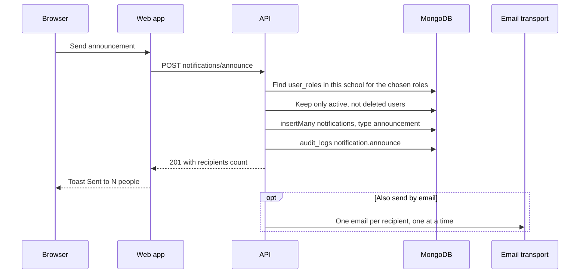

import { Steps, Card, CardGrid, LinkCard } from '@astrojs/starlight/components';
import Pipeline from '../../../../components/Pipeline.astro';
import ScreenAnatomy from '../../../../components/ScreenAnatomy.astro';
import SourceFile from '../../../../components/SourceFile.astro';
import Api from '../../../../components/Api.astro';
import Perm from '../../../../components/Perm.astro';
import Roles from '../../../../components/Roles.astro';
import Route from '../../../../components/Route.astro';
import DemoLogin from '../../../../components/DemoLogin.astro';
import Screenshot from '../../../../components/Screenshot.astro';

An **announcement** is a short notice from the school office to many people at once — "School closed on Friday", "Sports day moved to Tuesday". The School Admin or the Principal writes a title and a message, ticks the groups that should get it (teachers, parents, students, staff, …), and presses one button. Every member of the school who holds one of those roles gets the notice in their [notifications](/features/communication/notifications/) inbox straight away, and — if the sender asks for it — an email copy too.

Announcements exist so the school never has to copy a notice into eight different places. One form, one audit entry, one history list.

## At a glance

<CardGrid>
  <Card title="Who uses it" icon="star">
    <Roles list={['school_admin', 'principal']} note="Everyone else only receives announcements." />
  </Card>
  <Card title="Where to find it" icon="laptop">
    <Route path="/app/announcements" /> — sidebar group **Administration**, item **Announcements**.
  </Card>
  <Card title="Permissions" icon="approve-check">
    <Perm name="notification:send:tenant" /> to send and to see the sent list. Recipients read with <Perm name="notification:read:own" />.
  </Card>
</CardGrid>

<DemoLogin as="School Admin (Amira Hossain)" email="admin@greenfield.example" go="/app/announcements" />

## How it works

<Pipeline
  caption="One form submission fans out to every member in the chosen roles."
  steps={[
    { label: 'Write', icon: 'megaphone', note: 'Title, message, audience' },
    { label: 'Resolve', icon: 'users', note: 'Members holding those roles' },
    { label: 'Notify', icon: 'bell', note: 'One in-app notice each' },
    { label: 'Audit', icon: 'scroll', note: 'notification.announce entry' },
    { label: 'Email', icon: 'mail', note: 'Optional, after the reply' },
  ]}
/>



In plain words:

1. The API looks up every account in **your school only** that holds one of the ticked roles (the role memberships, not the people records). A user who is both a Teacher and a Parent is counted once.
2. Deactivated and deleted accounts are skipped. If nobody is left, the API refuses with *"Nobody in the school has the chosen roles yet."*
3. Each recipient gets one notification with `type: "announcement"`, the title and message you wrote, and a link to <Route path="/app/notifications" />.
4. The send is written to the [audit log](/features/insight/audit-log/) as `notification.announce`, with the title, message, audience, recipient count and the email flag. **That audit entry is the sent history** — the "Sent" list on the right of the screen is read back from it.
5. Only after the browser already has its answer does the API start emailing (when "Also send by email" is ticked), so a large school does not keep the sender waiting.

## The screen

<Screenshot name="admin-announcements" alt="The Announcements page" path="/app/announcements" />


<ScreenAnatomy
  title="Announcements"
  path="/app/announcements"
  regions={[
    { label: 'Sidebar', desc: 'Administration → Announcements is highlighted', area: 'sidebar' },
    { label: 'Top bar', desc: 'Breadcrumb "School / Announcements", notification bell, theme toggle, profile menu', area: 'top' },
    { label: 'Page header', desc: 'Title "Announcements" and the line "Send a notice to everyone in the roles you choose."' },
    { label: 'New announcement card', desc: 'Title, Message, the "Send to" checkboxes, "Also send by email" and the "Send announcement" button', size: 3, tone: 'accent' },
    { label: 'Sent card', desc: 'The last 20 announcements, most recent first, with date, sender, message preview, recipient count and audience', size: 3 },
  ]}
/>

On a wide screen (1280px and up) the two cards sit side by side — the form takes two fifths, the "Sent" list three fifths. Below that width the "Sent" card drops under the form.

### The "Send to" checkboxes

The eight audience boxes appear in this order, two per row on tablets and up:

| Checkbox label | Role key | Ticked by default |
|---|---|---|
| School admin | `school_admin` | No |
| Principal | `principal` | No |
| Vice principal | `vice_principal` | No |
| Teachers | `teacher` | Yes |
| Accountants | `accountant` | No |
| Staff | `staff` | Yes |
| Parents | `parent` | Yes |
| Students | `student` | Yes |

## Step by step

<Steps>

1. Sign in as `admin@greenfield.example` (password `Schola@2026`). You land on the school dashboard.

2. In the sidebar, scroll to the **Administration** group and click **Announcements**. The page opens with an empty form on the left and the **Sent** list on the right. On a freshly seeded school the list shows *"Nothing sent yet — Announcements you send appear here."*

3. Click the **Title** field (the placeholder reads *School closed on Friday*) and type a title, for example `Sports day moved to Tuesday`.

4. Click **Message** and type the notice. Line breaks show in the **Sent** list and in the email copy (a blank line starts a new paragraph there); the recipients' notification inbox shows the message as one block of text.

5. Under **Send to**, leave the four default groups ticked — **Teachers**, **Staff**, **Parents** and **Students** — or change them. In the demo school this audience is 33 accounts: 30 teachers, Ruby Novak (staff), Sofia Singh (parent) and Adam Singh (student).

6. Optionally tick **Also send by email**. The hint underneath reminds you: *"Everyone always gets it in their Schola notifications."*

7. Click **Send announcement**. The button shows **Sending…** while the request runs.

8. A toast confirms *"Sent to 33 people."* The form clears back to its defaults, and the new announcement appears at the top of the **Sent** list: the title, the date and **Amira Hossain**, a three-line preview of the message, and a footer such as *"33 recipients · Teachers, Staff, Parents, Students · email"*.

9. To see the result from the other side, sign out and sign in as `teacher@greenfield.example` (Grace Mensah). The bell in the top bar shows a new unread count; open **Notifications** in the sidebar's **Account** group to read the notice, labelled **Announcement**.

</Steps>

:::tip[Recording tip]
Send the announcement to **Teachers** only and tick nothing else — the toast then reads *"Sent to 30 people."*, which is easy to explain on camera. Then sign in as Grace Mensah to show it arriving.
:::

## Every action on this screen

### Fill in "Title" and "Message"

Both fields are validated in the browser and again by the API with the same Zod schema (`announceSchema`):

| Field | Rule |
|---|---|
| Title | Trimmed, 3–120 characters |
| Message | Trimmed, 3–2,000 characters |

A rule broken shows a red message under the field and nothing is sent.

### Tick the "Send to" groups

At least one group is required. With every box unticked the form shows *"Choose at least one group."* under the checkboxes. A group with nobody in it is fine as long as at least one ticked group has someone — the API only fails when the whole audience is empty.

The sender is not excluded. If a School Admin ticks **School admin**, they also get a copy in their own inbox.

### "Also send by email"

Adds an email copy for every recipient. The subject is `<School name>: <Title>` (for example *Greenfield International School: Sports day moved to Tuesday*); the body greets the person by first name, says *"A notice from Greenfield International School"*, repeats the message and ends with an **Open Schola** button that links to `/app/notifications`.

Emails go through whichever transport the API is configured for — Resend, then SMTP, then the console transport in development, which just prints the email to the API log. See [Email](/setup/services/email/).

### "Send announcement"

<Api method="POST" path="notifications/announce" perm="notification:send:tenant" />

Request body:

```json
{
  "title": "Sports day moved to Tuesday",
  "body": "Because of the weather forecast, sports day moves to Tuesday.",
  "audience": ["teacher", "staff", "parent", "student"],
  "sendEmail": true
}
```

- **On success** — `201` with `{ "recipients": 33, "email": true }`. The toast reads *"Sent to N people."* (or *"Sent to 1 person."*), the form resets, and both the Sent list and the sender's own notification list refresh.
- **Nobody to send to** — `400 VALIDATION_ERROR` *"Nobody in the school has the chosen roles yet."*, shown as an error toast.
- **Validation error** — the API's field errors are put back under **Title**, **Message** or the checkboxes.
- **Any other failure** — the toast *"The announcement could not be sent."*

### Read the "Sent" list

<Api method="GET" path="notifications/announcements" perm="notification:send:tenant" />

The list loads the 20 most recent announcements (`pageSize=20`) for this school. Each row shows:

- the **title**, then the **date** (for example *Nov 7, 2026*) and the sender's full name;
- up to three lines of the **message**;
- the **recipient count**, the **audience** labels, and **· email** when an email copy was requested.

While loading you see three grey placeholder rows. If the request fails the card shows *"Sent announcements could not be loaded."* with a **Try again** button.

## Who sees what

| Role | Sees the Announcements page | Can send | Receives announcements |
|---|---|---|---|
| School Admin | Yes | Yes | When "School admin" is ticked |
| Principal | Yes | Yes | When "Principal" is ticked |
| Vice Principal | No | No | When "Vice principal" is ticked |
| Teacher | No | No | When "Teachers" is ticked |
| Accountant | No | No | When "Accountants" is ticked |
| Staff | No | No | When "Staff" is ticked |
| Parent | No | No | When "Parents" is ticked |
| Student | No | No | When "Students" is ticked |
| Super Admin | No (platform console) | No | Never — announcements stay inside one school |

Only members with a **sign-in** receive anything. In the demo school most of the 500 students and 600 parents are records without an account, so they are not counted.

## Under the hood

- <SourceFile path="apps/web/src/app/(tenant)/app/announcements/page.tsx" /> — the whole screen: React Hook Form with `schemaResolver(announceSchema)`, TanStack Query for the Sent list (`["announcements"]`).
- <SourceFile path="apps/api/src/modules/notifications/notifications.routes.ts" symbol="POST /announce" /> — sending, and `GET /announcements` for the history.
- <SourceFile path="packages/validation/src/admin.ts" symbol="announceSchema" /> — `ANNOUNCEMENT_AUDIENCES` and the request schema (strict: unknown keys are rejected).
- <SourceFile path="apps/api/src/repositories/membership.repo.ts" symbol="tenantMemberUserIds" /> — turns role keys into user ids, filtered by the caller's `schoolId`.
- <SourceFile path="apps/api/src/services/email/templates.ts" symbol="announcementTemplate" /> — the email subject, HTML and text.
- <SourceFile path="packages/db/src/models/notification.ts" /> — the `notifications` collection (`type: "announcement"`).

The audit entry that doubles as history:

```json
{
  "action": "notification.announce",
  "resource": "notification",
  "resourceId": null,
  "after": {
    "title": "Sports day moved to Tuesday",
    "body": "Because of the weather forecast, …",
    "audience": ["teacher", "staff", "parent", "student"],
    "recipients": 33,
    "email": true
  }
}
```

## Edge cases and gotchas

- **No page guard in the web app.** The sidebar hides **Announcements** from roles without <Perm name="notification:send:tenant" />, but the page itself is not blocked. A Teacher who types `/app/announcements` sees the form; the Sent list shows *"Sent announcements could not be loaded."* and pressing **Send announcement** fails with a permission error toast. The API is the real gate.
- **Emails are fire-and-forget.** They are sent one by one after the API has already answered. A failed email is logged on the API (`announcement email failed`) and never retried. The in-app notice is always delivered, whatever happens to email.
- **No editing, no deleting, no scheduling.** An announcement cannot be changed or recalled once sent, and it goes out immediately.
- **Only the latest 20.** The Sent card has no paging; older announcements are still in the audit log (filter by the action `notification.announce`).
- **Audience is by role, not by class.** There is no "only Grade 3 parents" option.

:::caution[Sent history depends on the audit log]
The Sent list is rebuilt from `audit_logs` entries, not from a dedicated collection. If an audit write ever fails (the audit logger logs the error and carries on), the notifications are still delivered but the announcement will be missing from the Sent list.
:::

## Related pages

<CardGrid>
  <LinkCard title="Notifications" description="The bell, the inbox and mark-as-read — where announcements land." href="/features/communication/notifications/" />
  <LinkCard title="Audit log" description="Every announcement is recorded as notification.announce." href="/features/insight/audit-log/" />
  <LinkCard title="Email and notifications (architecture)" description="Transports, templates and how in-app notices are stored." href="/architecture/email-and-notifications/" />
  <LinkCard title="Members and roles" description="Who holds which role decides who receives an announcement." href="/features/school/members-and-roles/" />
</CardGrid>
