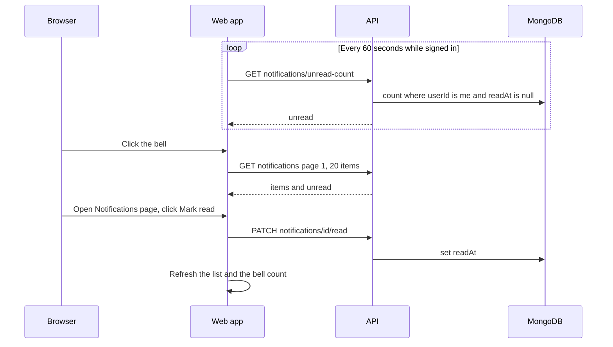

import { Steps, Card, CardGrid, LinkCard } from '@astrojs/starlight/components';
import Pipeline from '../../../../components/Pipeline.astro';
import ScreenAnatomy from '../../../../components/ScreenAnatomy.astro';
import SourceFile from '../../../../components/SourceFile.astro';
import Api from '../../../../components/Api.astro';
import Perm from '../../../../components/Perm.astro';
import Roles from '../../../../components/Roles.astro';
import Route from '../../../../components/Route.astro';
import DemoLogin from '../../../../components/DemoLogin.astro';
import Screenshot from '../../../../components/Screenshot.astro';

A **notification** is a short message addressed to one signed-in person: "Your school is live", "Term 1 final exams start soon", or an announcement from the school office. Every member of a school has a personal inbox. The **bell** in the top bar shows how many messages are still unread, and the **Notifications** page lists them so you can open the linked screen or mark them read.

Notifications are *in-app* messages stored in Schola's database. Some events also send an **email**, but email and in-app notifications are separate: an email never appears in the inbox on its own, and most notifications have no email twin. The table under [Which events notify whom](#which-events-notify-whom) lists exactly what the code does today.

## At a glance

<CardGrid>
  <Card title="Who uses it" icon="star">
    <Roles list={['school_admin', 'principal', 'vice_principal', 'teacher', 'accountant', 'student', 'parent', 'staff']} note="Every school member. The Super Admin has a separate inbox in the platform console." />
  </Card>
  <Card title="Where to find it" icon="laptop">
    <Route path="/app/notifications" /> — sidebar group **Account**, item **Notifications**, or the bell in the top bar.
  </Card>
  <Card title="Permissions" icon="approve-check">
    <Perm name="notification:read:own" /> — every tenant role has it. Sending announcements needs <Perm name="notification:send:tenant" />.
  </Card>
</CardGrid>

<DemoLogin as="School Admin (Amira Hossain)" email="admin@greenfield.example" go="/app/notifications" />

The demo School Admin starts with three notifications: two unread system notices — **Fee collection this month** (today, links to Fees) and **Term 1 final exams start soon** (two days ago, links to Exams) — and one read notice, **Greenfield International School is approved**. So the bell shows **2**.

## How it works

<Pipeline
  caption="An event on the API writes one notification row per recipient; the web app polls for the unread count."
  steps={[
    { label: 'Event', icon: 'flag', note: 'Approval, announcement…' },
    { label: 'Store', icon: 'database', note: 'One row per recipient' },
    { label: 'Bell', icon: 'bell', note: 'Unread count, every 60 s' },
    { label: 'Inbox', icon: 'clipboard-list', note: 'Read, open, mark read' },
  ]}
/>



Each notification row holds: who it is for (`userId`), which school (`schoolId`, or `null` for platform notices), a `type`, a `title`, an optional `body`, an optional `link` inside the app, and `readAt` — empty until the person reads it.

### Which events notify whom

| Event | Notification `type` | Who receives it in-app | Email copy | "Open" goes to |
|---|---|---|---|---|
| A school applies to join (sign-up or the onboarding form) | `school.signup` | Every Super Admin — title *New school application* | The applicant gets *"Your Schola application is being reviewed"* (email only) | `/platform/schools/:id` |
| The Super Admin approves a school | `school.approved` | The school's owner — *Your school is live* | Yes: *"&lt;School&gt; is approved on Schola"* | `/app` |
| The Super Admin suspends a school | `school.suspended` | The school's owner — *Your school has been suspended*, the reason as the message | No | `/login` |
| A School Admin or Principal sends an announcement | `announcement` | Every member holding the chosen roles | Only when "Also send by email" is ticked | `/app/notifications` |
| Seeded demo notices | `system` | The demo School Admin | No | `/app/exams`, `/app/fees` |

Events that send **email only**, with no in-app notification: an application being **rejected**, an **admin transfer** nomination, a school created directly by the Super Admin, email verification, password reset and teacher sign-in invitations.

:::caution[Types defined but never created]
The notification model also allows `school.rejected`, `admin_transfer.requested` and `admin_transfer.completed`, but no code path creates them today (rejection and admin transfer send emails only), and nothing creates `system` notices outside the demo seed. Day-to-day events such as a fee payment, an approved leave request or a new grade **do not notify anyone** yet.
:::

## The screens

<Screenshot name="admin-notifications" alt="The Notifications page" path="/app/notifications" />


### The bell

<ScreenAnatomy
  title="Notification bell"
  path="/app"
  regions={[
    { label: 'Sidebar', desc: 'Your modules; Account → Notifications at the bottom', area: 'sidebar' },
    { label: 'Top bar', desc: 'Bell with a cyan unread badge (1–99, then 99+), next to the theme toggle', area: 'top', tone: 'accent' },
    { label: 'Notifications drawer', desc: 'Slides in from the right: title "Notifications", "The 20 most recent."', size: 3, tone: 'accent' },
    { label: 'View all', desc: 'Full-width button at the bottom of the drawer, goes to /app/notifications' },
  ]}
/>

The bell only appears on screens **1024px and wider**. On phones and tablets, open the menu (the round button at the top left) — the navigation drawer has a **Notifications** button at the top, and the sidebar's **Account → Notifications** link is always there too.

### The Notifications page

<ScreenAnatomy
  title="Notifications"
  path="/app/notifications"
  regions={[
    { label: 'Sidebar', desc: 'Account → Notifications is highlighted', area: 'sidebar' },
    { label: 'Top bar', desc: 'Breadcrumb "School / Notifications" and the bell', area: 'top' },
    { label: 'Page header', desc: 'Title, the unread line ("2 unread" or "All caught up.") and the "Mark all read" button' },
    { label: 'Inbox list', desc: 'Newest first. Unread rows are tinted with a cyan dot. Each row: title, time, message, Open, Mark read, type label', size: 4, tone: 'accent' },
  ]}
/>

## Step by step

<Steps>

1. Sign in as `admin@greenfield.example` (password `Schola@2026`) on a desktop-width window. The bell in the top bar shows a cyan badge **2**.

2. Click the bell. A drawer slides in from the right, titled **Notifications** with the line *"The 20 most recent."* Each item shows its title, message, date and time, and an **Open** link. Opening the drawer does **not** mark anything read.

3. Click **View all** at the bottom of the drawer. You are on <Route path="/app/notifications" />. The header reads **2 unread**.

4. Look at the first row, **Fee collection this month**. It has a cyan dot and a faint tint because it is unread. Under the message are **Open**, **Mark read** and the type label **System**.

5. Click **Mark read** on that row. The dot disappears, the header changes to **1 unread**, and the bell badge drops to **1** at the same moment.

6. Click **Open** on **Term 1 final exams start soon**. Schola marks it read and takes you to <Route path="/app/exams" />.

7. Go back to **Notifications** (sidebar, **Account** group). The header now reads **All caught up.** and **Mark all read** is greyed out.

8. To see an announcement arrive, send one from [Announcements](/features/communication/announcements/) to **School admin**, then reload: a new unread row appears with the type label **Announcement**. Click **Mark all read** — the toast says *"Marked 1 as read."*

</Steps>

## Every action on this screen

### The bell badge

<Api method="GET" path="notifications/unread-count" perm="notification:read:own" />

Asked for when the page loads and then every 60 seconds while you are signed in. The badge is hidden at zero and shows **99+** above 99. Screen readers hear *"2 unread notifications"* (or just *"Notifications"* at zero).

### Click the bell

<Api method="GET" path="notifications" perm="notification:read:own" />

Loads page 1 with 20 items (`?page=1&pageSize=20`) — only when the drawer opens. While loading it says *"Loading…"*; an empty inbox says *"No notifications yet."* Each item's **Open** link follows the notification's `link` and closes the drawer, without marking the item read.

### "View all"

Goes to <Route path="/app/notifications" /> and closes the drawer.

### The inbox list

<Api method="GET" path="notifications" perm="notification:read:own" />

The page asks for the default page — the newest 20 notifications. Each row shows:

- **Title** and the **time** it was created, in your browser's date format;
- the **message**, when there is one;
- **Open** — only when the notification has a link;
- **Mark read** — only while unread;
- the **type label**, built from the `type` with the dot turned into " · " (`school.approved` shows as *School · Approved*, `announcement` as *Announcement*).

Empty inbox: *"No notifications yet — We'll let you know when something needs your attention."*

### "Mark read"

<Api method="PATCH" path="notifications/:id/read" perm="notification:read:own" />

Sets `readAt` to now (only the first time — marking twice keeps the original time). The list and the bell count refresh. A notification that belongs to someone else returns `404 Notification not found.` — you can never read or mark another person's inbox.

### "Open"

Marks the row read (if unread) and follows its link, for example `/app/fees`.

### "Mark all read"

<Api method="POST" path="notifications/mark-all-read" perm="notification:read:own" />

Sets `readAt` on every unread notification you own, in one update. The toast reads *"Marked N as read."* or *"Already up to date."*; on failure *"Could not mark all read."* The button shows **Marking…** while it runs and is disabled when nothing is unread. This action is written to the [audit log](/features/insight/audit-log/) as `notification.mark_all_read` with the number of rows changed; single **Mark read** clicks are not audited.

## Who sees what

| Role | Bell and inbox | What usually arrives |
|---|---|---|
| School Admin | Yes | School approved, school suspended (as owner), announcements addressed to "School admin", demo system notices |
| Principal, Vice Principal, Teacher, Accountant, Staff, Student, Parent | Yes | Announcements addressed to their role |
| Super Admin | Separate inbox at `/platform/notifications` (no bell in the platform console) | New school applications |
| Signed-in visitor (no school) | No school app; only the welcome page | — |

Everyone sees **only their own** notifications. There is no way, in the UI or the API, to read another person's inbox.

## Under the hood

- <SourceFile path="apps/web/src/components/layout/notification-bell.tsx" symbol="NotificationBell" /> — the bell, the 60-second poll and the drawer.
- <SourceFile path="apps/web/src/components/layout/dashboard-shell.tsx" /> — places the bell in the school app's top bar (`lg` and up) and the **Notifications** button in the mobile drawer.
- <SourceFile path="apps/web/src/app/(tenant)/app/notifications/page.tsx" /> — the inbox, **Mark read** and **Mark all read**.
- <SourceFile path="apps/api/src/modules/notifications/notifications.routes.ts" /> — list, unread count, mark read, mark all read, and announcements.
- <SourceFile path="apps/api/src/modules/schools/schools.service.ts" /> — creates `school.signup`, `school.approved` and `school.suspended` notifications.
- <SourceFile path="packages/db/src/models/notification.ts" /> — the `notifications` collection.
- <SourceFile path="apps/api/src/services/email/index.ts" symbol="sendEmail" /> — Resend, then SMTP, then a console transport in development.
- <SourceFile path="apps/api/src/services/email/templates.ts" /> — every email template.

The notification document:

```ts
{
  schoolId: ObjectId | null,  // null for platform notices
  userId: ObjectId | null,    // the one recipient
  type: "school.signup" | "school.approved" | "school.rejected" | "school.suspended"
      | "admin_transfer.requested" | "admin_transfer.completed"
      | "announcement" | "system",
  title: string,
  body: string,               // "" when there is no message
  link: string | null,        // an in-app path such as "/app/fees"
  readAt: Date | null,        // null = unread
  createdAt: Date,
  updatedAt: Date
}
```

`GET /notifications` also accepts `unreadOnly` (`true`, `false`, `1` or `0`; `false` returns everything, like leaving it out) and returns `{ items, unread }` with the standard pagination meta. The web app's TanStack Query keys all start with `["notifications"]`, so marking one read refreshes the bell, the drawer and the page together.

## Edge cases and gotchas

- **Only the newest 20.** Neither the drawer nor the Notifications page has paging. Older notifications stay in the database but cannot be reached from the UI.
- **Line breaks are flattened.** The inbox shows a message as one block of text, even if the announcement had several paragraphs. The email copy keeps them.
- **The bell is desktop-only.** Below 1024px use the navigation drawer's **Notifications** button or the sidebar link.
- **Inbox is per person, not per school.** The list filters by your user id only. Someone who belongs to two schools sees notices from both in one inbox.
- **Up to a minute of delay.** The badge refreshes on a 60-second timer; a new notification can take that long to show up unless you reload or act on the page.

## Related pages

<CardGrid>
  <LinkCard title="Announcements" description="Send a notice to whole roles at once." href="/features/communication/announcements/" />
  <LinkCard title="Email and notifications (architecture)" description="Transports, templates and the notifications collection." href="/architecture/email-and-notifications/" />
  <LinkCard title="Platform notifications and audit" description="The Super Admin's inbox and platform-wide audit log." href="/features/platform/notifications-and-audit/" />
  <LinkCard title="Email service setup" description="Configure Resend or SMTP, or read emails from the console in development." href="/setup/services/email/" />
</CardGrid>
