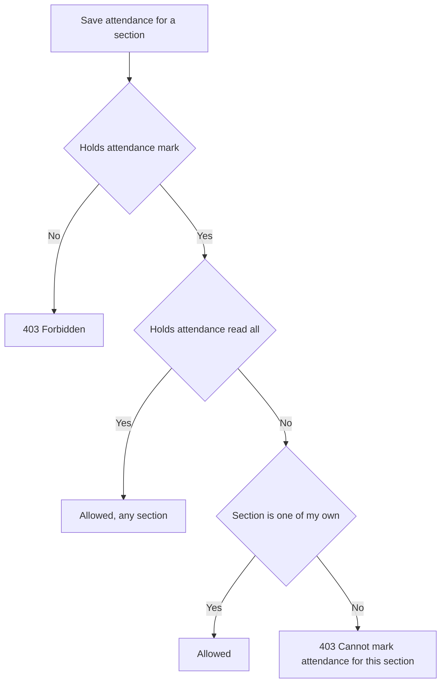

import { Aside, Steps, Card, CardGrid, LinkCard } from '@astrojs/starlight/components';
import Pipeline from '../../../../components/Pipeline.astro';
import ScreenAnatomy from '../../../../components/ScreenAnatomy.astro';
import SourceFile from '../../../../components/SourceFile.astro';
import Api from '../../../../components/Api.astro';
import Perm from '../../../../components/Perm.astro';
import Roles from '../../../../components/Roles.astro';
import Route from '../../../../components/Route.astro';
import DemoLogin from '../../../../components/DemoLogin.astro';
import Screenshot from '../../../../components/Screenshot.astro';
import { Tabs as ShotTabs, TabItem as ShotTab } from '@astrojs/starlight/components';

**Student attendance** is the school's daily register. For each day and each
[section](/start-here/glossary/#section), a teacher marks every enrolled student
**present**, **absent**, **late** or **excused**, with an optional note. The
overview shows at a glance which sections have been taken today and how many
students are in. Everything else in Schola that talks about attendance — the
dashboard, reports, a student's profile, the report card — reads these records.

## At a glance

<CardGrid>
  <Card title="Who uses it" icon="star">
    <Roles list={['teacher']} note="own sections" />
    <Roles list={['school_admin']} note="every section" />
    <Roles list={['principal', 'vice_principal']} note="read" />
  </Card>
  <Card title="Where to find it" icon="laptop">
    <Route path="/app/attendance" />
    Sidebar: **Attendance › Student attendance**
  </Card>
  <Card title="Permissions" icon="approve-check">
    <Perm name="attendance:mark" /> <Perm name="attendance:read:all" />
    <Perm name="attendance:read:own_classes" /> <Perm name="report:export" />
  </Card>
</CardGrid>

<DemoLogin as="Teacher" email="teacher@greenfield.example" go="/app/attendance">
  Grace Mensah sees her two sections, Grade 3 · A and Grade 3 · B. Sign in as
  `admin@greenfield.example` to see all 20 sections: on the seed day, 16 are
  done, Grade 9 · A is half done and three are still to take.
</DemoLogin>

## How it works

<Pipeline
  caption="One register, start to finish. Saving again later simply updates the same records."
  steps={[
    { label: 'Pick a day', icon: 'calendar-days', note: 'Today by default' },
    { label: 'Pick a section', icon: 'layers', note: 'From the overview cards' },
    { label: 'Mark', icon: 'clipboard-check', note: 'P, A, L or E per student' },
    { label: 'Save', icon: 'send', note: 'One request for the section' },
    { label: 'Everywhere', icon: 'chart', note: 'Dashboard, reports, profiles' },
  ]}
/>

The register is built from **active enrollments**: every student currently
placed in the section appears, sorted by roll number, then by name. There is one
attendance record per student, section and day. Saving a register is an
*upsert* — the first save creates the records, later saves overwrite their
status and note — so a register can be corrected as often as needed.

**Who may mark which section** comes from two permissions working together:

A teacher's *own* sections are the sections they lead plus every section of a
class they are class teacher of. Grace Mensah leads Grade 3 · A and is class
teacher of Grade 3, so she can take both Grade 3 registers.

### The four statuses

| Status | Meaning | Counts as attended |
|---|---|---|
| `present` | In school | Yes |
| `late` | Arrived late | Yes — rates count late as attended |
| `absent` | Not in school | No |
| `excused` | Away with permission — also written automatically when [leave](/features/daily/leave/) is approved | No |

## The screens

Real screenshots from the seeded demo school (switch the docs theme to see dark mode):

<ShotTabs>
  <ShotTab label="School Admin">
    <Screenshot name="admin-attendance" alt="Student attendance registers" path="/app/attendance" />
  </ShotTab>
  <ShotTab label="Teacher">
    <Screenshot name="teacher-attendance" alt="A teacher taking the register for their section" path="/app/attendance" />
  </ShotTab>
</ShotTabs>

### Overview (no section open)

<ScreenAnatomy
  title="Student attendance"
  path="/app/attendance"
  regions={[
    { label: 'Sidebar', desc: 'Attendance › Student attendance', area: 'sidebar' },
    { label: 'Top bar', desc: 'Search, notifications, account menu', area: 'top' },
    { label: 'Page header', desc: 'Title "Student attendance" — "Take the register for each section, every school day."' },
    { label: 'Date bar', desc: '"Previous day" and "Next day" arrows, the date picker, "Today" (when on another day) and the formatted date' },
    { label: 'Totals tiles', desc: 'Sections done (16/20), Present, Absent, Late, Not marked', tone: 'accent' },
    { label: 'Section cards', desc: 'One card per section: "Grade 9 · A", student count, a badge (Done, 13/25 marked, Not taken, No students), a coloured status bar and the counts line', size: 3 },
  ]}
/>

### Register (a section open)

<ScreenAnatomy
  title="Grade 3 · A — 25 students"
  path="/app/attendance?section=…"
  regions={[
    { label: 'Header', desc: 'Card title "Grade 3 · A — 25 students" and "Not taken yet." or "Already taken today — changes update the saved register."; "Month to date (CSV)" in the page header for report exporters' },
    { label: 'Toolbar', desc: '"All sections" back button, "All present", "Rest present (n)", and the live counts "23 P · 1 A · 1 L · 0 E"' },
    { label: 'Roster', desc: 'Roll number, name and admission number, four buttons — Present, Absent, Late, Excused (P, A, L, E on phones) — and a Note box', size: 4, tone: 'accent' },
    { label: 'Save bar', desc: 'Sticky at the bottom: "3 students are not marked and won\'t be saved." or "Unsaved changes." and the "Save attendance" button', tone: 'warn' },
  ]}
/>

## Step by step

### Take today's register as a teacher

<Steps>

1. Sign in as `teacher@greenfield.example` (Grace Mensah).
2. Open **Attendance › Student attendance**. The overview shows two cards, Grade 3 · A and Grade 3 · B, each with a badge.
3. Click the **Grade 3 · A** card. The register opens and the address gains `?section=…`.
4. Click **All present**. Every row's **Present** button lights up green and the counts read "25 P · 0 A · 0 L · 0 E".
5. Find one student and click **Absent**; type `Unwell` in their **Note** box. For another, click **Late** and type `Bus delayed`.
6. Click **Save attendance**. The toast says "Attendance saved for Grade 3 · A." and the description changes to "Already taken today — changes update the saved register."
7. Click **All sections**. The Grade 3 · A card now shows **Done** and its bar shows the new mix.

</Steps>

:::tip[Recording the demo]
On the day you run `pnpm seed`, both Grade 3 registers are already taken, so
the teacher's cards read **Done**. To show a register being taken from scratch, sign in as the School
Admin and open **Grade 10 · B** ("Not taken"), or **Grade 9 · A** ("13/25
marked") and use **Rest present (12)**.
:::

### Correct an earlier day

<Steps>

1. Click the **Previous day** arrow (or pick a date in the date picker). The overview reloads for that day.
2. Open a section. Its saved statuses are already selected.
3. Change a status — for example **Absent** to **Excused** — and click **Save attendance**.
4. Click **Today** to come back to the current day.

</Steps>

### Export a month to date

<Steps>

1. Sign in as the School Admin or the Principal (both hold `report:export`).
2. Open a section's register.
3. Click **Month to date (CSV)** in the page header. A CSV opens with Date, Admission, Student, Status and Note for that section, from the first of the month to the selected day.

</Steps>

## Every action on this screen

### Pick a day

The **Previous day** / **Next day** arrows move one day; the date picker jumps
anywhere up to today. **Next day** is disabled on today, and the picker will not
offer a future date. The date lives in the address (`?date=2026-11-06`); without
one, the page shows today.

<Api method="GET" path="attendance/summary?date=" perm="attendance:read:all" />

Holders of <Perm name="attendance:read:all" /> get every section of the
**current academic year**; holders of <Perm name="attendance:read:own_classes" />
only get their own sections. The response has one row per section (enrolled,
marked, present, absent, late, excused) and the school-wide totals behind the
tiles. A section counts as **Done** when every enrolled student has a record.

### Open a section

Click a section card.

<Api method="GET" path="attendance?date=&sectionId=" perm="attendance:read:own_classes" />

The API first checks the section belongs to your school (`404` otherwise), then
that you may read it: school-wide with <Perm name="attendance:read:all" />, or as
one of your own sections with <Perm name="attendance:read:own_classes" />
(`403` "Cannot read attendance for this section."). The roster comes back with
each student's saved status and note for that day.

### "All present" and "Rest present (n)"

**All present** sets every student to Present, overwriting any choice already
made on screen. **Rest present (n)** appears only when some, but not all,
students are marked, and fills in just the unmarked ones. Both change the screen
only; nothing is saved until you click **Save attendance**. Both buttons need
<Perm name="attendance:mark" />.

### Mark one student and add a note

Click **Present**, **Absent**, **Late** or **Excused** on the row. The note box
takes up to 280 characters. The counts in the toolbar update as you click.

### "Save attendance"

Needs <Perm name="attendance:mark" />.

<Api method="POST" path="attendance" perm="attendance:mark" />

The body holds the date, the section and one entry per **marked** student
(`studentId`, `status`, `note`) — at most 500. The API:

1. Checks you may act on the section (see the flowchart above).
2. Checks every student is actively enrolled in it (`400` "Student … is not enrolled in this section.").
3. Upserts one record per student for that day (dates are stored as midnight UTC).
4. Writes one audit entry, `attendance.mark`, with the date, section and how many rows were created or changed.

The button is disabled while nothing has changed on an already-saved register,
and when no student is marked at all. Students left unmarked are not sent — the
save bar warns "3 students are not marked and won't be saved."

### "Month to date (CSV)"

Shown to holders of <Perm name="report:export" /> while a section is open.

<Api method="GET" path="reports/attendance/export.csv?from=&to=&sectionId=" perm="report:export" />

The export also needs <Perm name="attendance:read:all" />, which every role that sees this button holds. It is logged as `report.attendance.export`.

## Who sees what

| Role | Sections listed | Can mark and save | CSV export |
|---|---|---|---|
| School Admin | Every section | Yes | Yes |
| Principal | Every section | No — read only | Yes |
| Vice Principal | Every section | No — read only | No |
| Teacher | Own sections only | Yes, own sections | No |
| Student, Parent | No register — their records are on [My attendance](/features/portals/student/) and [My children](/features/portals/parent/) | — | — |
| Accountant, Staff | No | — | — |

## Under the hood

- <SourceFile path="apps/web/src/app/(tenant)/app/attendance/page.tsx" />
- <SourceFile path="apps/api/src/modules/attendance/attendance.routes.ts" />
- <SourceFile path="apps/api/src/services/scopes/teacher-scope.ts" symbol="canActOnSection" />
- <SourceFile path="packages/validation/src/attendance.ts" symbol="bulkMarkAttendanceSchema" />
- <SourceFile path="packages/db/src/models/attendance.ts" symbol="AttendanceRecord" />

**Data shape** — model `AttendanceRecord`: `date` (UTC midnight), `sectionId`,
`classId`, `academicYearId`, `studentId`, `status`, `note`, `markedById`. A unique
index on `(schoolId, date, sectionId, studentId)` makes "one record per student
per day per section" a database rule, and makes re-saving an update.

**Also in this router** — <Api method="GET" path="attendance/history" perm="attendance:read:own_classes" />
returns paged records for a student or section over a date range. Without
`attendance:read:all` it is limited to your own sections, yourself and your
linked children.

**Where the records are read** — the [school dashboard](/features/school/dashboard/),
[Reports](/features/insight/reports/), the Attendance tab of a
[student's profile](/features/people/students/), the report card PDF
(present + late over the academic year), and the student and parent portals.

## Edge cases and gotchas

- **Any past day can be changed.** There is no lock on old registers: anyone who
  may mark a section can re-save any earlier day. Each save is audited, and the
  record keeps who saved it last (`markedById`).
- **A mark cannot be removed.** Clicking a selected status again does not clear
  it, so a saved status can be changed but not deleted.
- **"Today" is the UTC date.** The page and the API both use the UTC calendar
  day. Shortly after local midnight in time zones ahead of UTC, "today" is still
  the previous day.
- **Approved leave writes `excused` records** for the days it covers (unless the
  student was already marked present or late), with the note "Approved leave
  (sick)" and so on.
- **The overview only covers the current academic year.** Sections of classes
  in other years do not appear.
- **"Already taken today"** is the description for any saved register, even when
  you are looking at a past day.

:::caution[Principals see buttons they cannot use]
The Principal and Vice Principal can open any register, and the Present /
Absent / Late / Excused buttons still respond to clicks, but "All present" and
"Save attendance" are hidden because they lack `attendance:mark`. Their clicks
are never saved.
:::

## Related pages

<CardGrid>
  <LinkCard title="Staff attendance" description="The same idea for teachers and non-teaching staff." href="/features/daily/staff-attendance/" />
  <LinkCard title="Leave" description="Approved leave marks the days excused." href="/features/daily/leave/" />
  <LinkCard title="Classes & sections" description="Sections, section teachers and class teachers decide who marks what." href="/features/academics/classes-and-sections/" />
  <LinkCard title="Teacher portal" description="My classes links straight to each section's register." href="/features/portals/teacher/" />
  <LinkCard title="Reports" description="Attendance trends and CSV exports." href="/features/insight/reports/" />
</CardGrid>
