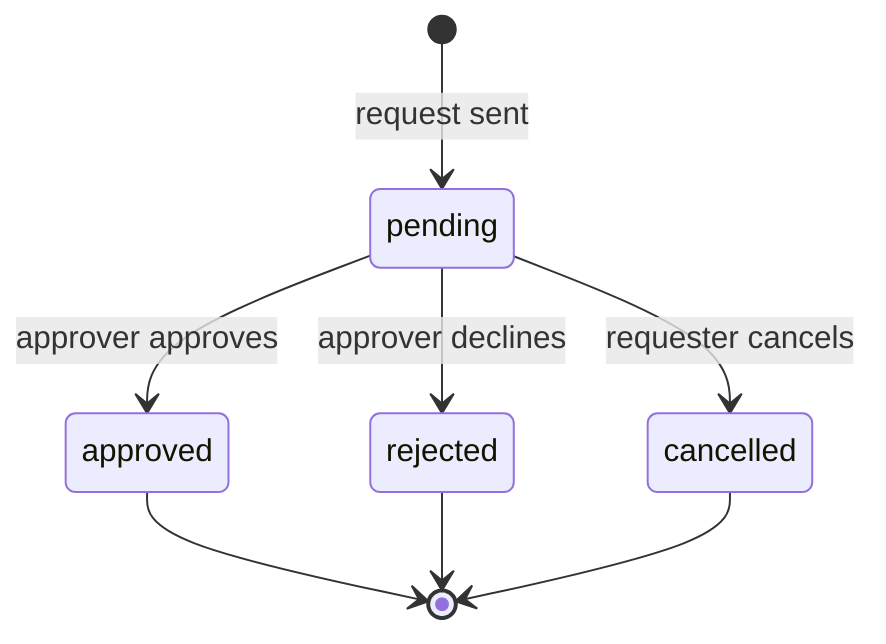
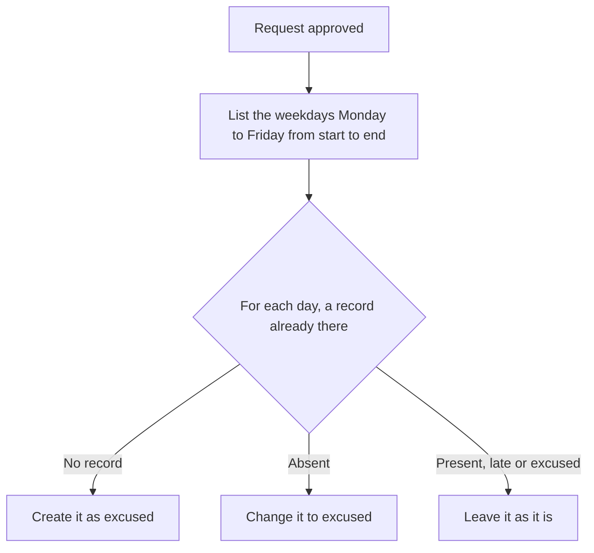

import { Aside, Steps, Card, CardGrid, LinkCard } from '@astrojs/starlight/components';
import Pipeline from '../../../../components/Pipeline.astro';
import ScreenAnatomy from '../../../../components/ScreenAnatomy.astro';
import SourceFile from '../../../../components/SourceFile.astro';
import Api from '../../../../components/Api.astro';
import Perm from '../../../../components/Perm.astro';
import Roles from '../../../../components/Roles.astro';
import Route from '../../../../components/Route.astro';
import DemoLogin from '../../../../components/DemoLogin.astro';
import Screenshot from '../../../../components/Screenshot.astro';
import { Tabs as ShotTabs, TabItem as ShotTab } from '@astrojs/starlight/components';

**Leave** replaces the note to the office. A teacher asks for a training day, a
staff member for a dentist appointment, a parent for a family wedding on their
child's behalf. The request waits as **pending** until someone with approval
rights decides. Approving it does more than change a label: every school day it
covers is written into attendance as **excused**, so registers and reports
already know why the person is away.

## At a glance

<CardGrid>
  <Card title="Who uses it" icon="star">
    <Roles list={['teacher', 'staff', 'student', 'parent', 'accountant']} note="ask" />
    <Roles list={['school_admin', 'principal', 'vice_principal']} note="decide" />
  </Card>
  <Card title="Where to find it" icon="laptop">
    <Route path="/app/leave" />
    Sidebar: **Daily › Leave**
  </Card>
  <Card title="Permissions" icon="approve-check">
    <Perm name="leave:request" /> <Perm name="leave:approve" />
    <Perm name="leave:read:all" />
  </Card>
</CardGrid>

<DemoLogin as="School Admin" email="admin@greenfield.example" go="/app/leave">
  Two requests are waiting: the demo parent's "Family wedding out of town." for
  Mateo Singh, and Grace Mensah's "Teacher training workshop." The history holds
  approved and declined requests.
</DemoLogin>

## How it works

<Pipeline
  caption="The life of one request."
  steps={[
    { label: 'Request', icon: 'send', note: 'Type, dates and reason' },
    { label: 'Pending', icon: 'clock', note: 'Requester may cancel' },
    { label: 'Decide', icon: 'badge-check', note: 'Someone else approves or declines' },
    { label: 'Excused', icon: 'calendar-check', note: 'Approved weekdays in attendance' },
  ]}
/>

### Status lifecycle

Only a **pending** request can change. Once approved, rejected or cancelled it
is final — there is no "undo" and no edit.

### Who the leave is for

The request is always for a person record, worked out from the requester's
sign-in:

| Requester | The leave is for |
|---|---|
| Student | Themself |
| Parent | The child they pick in **For** (must be one of their linked children) |
| Teacher | Their own teacher record |
| Staff member | Their own staff record |
| Anyone else | Refused — "Your account isn't linked to a student, teacher or staff record." |

### What approval writes into attendance

For a student, new records go into the student's **current** section. For a
teacher or staff member, they go into [staff attendance](/features/daily/staff-attendance/).
The note reads "Approved leave (sick)", "Approved leave (family)" and so on.
Days already marked present or late are left alone — the person came in after
all. The approver's toast reports how many days were written.

## The screens

Real screenshots from the seeded demo school (switch the docs theme to see dark mode):

<ShotTabs>
  <ShotTab label="Approver">
    <Screenshot name="admin-leave" alt="Leave requests waiting for a decision" path="/app/leave" />
  </ShotTab>
  <ShotTab label="Teacher">
    <Screenshot name="teacher-leave" alt="A teacher’s own leave requests" path="/app/leave" />
  </ShotTab>
  <ShotTab label="Parent">
    <Screenshot name="parent-leave" alt="A parent requesting leave for a child" path="/app/leave" />
  </ShotTab>
</ShotTabs>

### My requests

<ScreenAnatomy
  title="Leave"
  path="/app/leave"
  regions={[
    { label: 'Sidebar', desc: 'Daily › Leave', area: 'sidebar' },
    { label: 'Top bar', desc: 'Search, notifications, account menu', area: 'top' },
    { label: 'Page header', desc: 'Title "Leave" — "Ask for time off, and see what\'s been decided."' },
    { label: 'Card header', desc: '"My requests" — "Approved days show as excused in attendance." — and the "Request leave" button' },
    { label: 'Requests table', desc: 'Dates (and "2 school days · Mateo Singh"), Type, Reason, Status pill with the decision note, and "Cancel" on pending rows', size: 4, tone: 'accent' },
  ]}
/>

### Request leave drawer

<ScreenAnatomy
  title="Request leave"
  path="/app/leave"
  regions={[
    { label: 'Drawer header', desc: '"Request leave" — "The school\'s approvers see it on their Leave page and decide. The outcome shows here under My requests."' },
    { label: 'For', desc: 'Parents: "— pick a child —" and each child. Shown only to parents or people with children' },
    { label: 'Type', desc: 'Sick, Casual, Family, Other' },
    { label: 'Dates', desc: '"From" and "To", both today by default', tone: 'accent' },
    { label: 'Reason', desc: 'At least 3 characters, up to 1000' },
    { label: 'Submit', desc: '"Send request" ("Sending…" while busy)', tone: 'warn' },
  ]}
/>

### Approvals

<ScreenAnatomy
  title="Leave — Approvals"
  path="/app/leave?status=…"
  regions={[
    { label: 'Tabs', desc: '"Approvals" and "My requests" (for approvers who can also ask)' },
    { label: 'Status filter', desc: 'Pending (default), Approved, Rejected, All' },
    { label: 'Requests table', desc: 'Person (and "Student · asked by Sofia Singh"), Dates with school days and type, Reason, Status with "by Amira Hossain", and "Approve" / "Decline" on pending rows', size: 4, tone: 'accent' },
    { label: 'Pager', desc: '25 requests per page', tone: 'muted' },
    { label: 'Decision drawer', desc: '"Approve leave" or "Decline leave", the person and dates, "Note (optional)" — "The person who asked sees this." — and the "Approve" or "Decline" button', size: 2, tone: 'warn' },
  ]}
/>

## Step by step

### Ask for leave as a parent

<Steps>

1. Sign in as `parent@greenfield.example` (Sofia Singh) and open **Daily › Leave**.
2. The **My requests** card already lists a pending "Family wedding out of town." and an approved "Fever and a doctor's visit." with the note "Get well soon."
3. Click **Request leave**.
4. In **For**, pick **Ryan Singh**. Choose **Type** "Sick", set **From** and **To** to the same weekday, and type a **Reason** such as `Stomach bug, staying home.`
5. Click **Send request**. The toast says "Request sent." The new row shows "1 school day · Ryan Singh" and a **Pending** pill.

</Steps>

### Approve it as the school

<Steps>

1. Sign in as `admin@greenfield.example` and open **Daily › Leave**. The **Approvals** tab opens on **Pending**.
2. Find Ryan Singh's row — "Student · asked by Sofia Singh".
3. Click **Approve**. The "Approve leave" drawer shows "Ryan Singh · " and the date.
4. Optionally type a **Note** such as `Get well soon.`, then click **Approve**.
5. The toast says "Approved. 1 day marked excused." The row leaves the Pending list; click **Approved** to see it with "by Amira Hossain".
6. Open **Attendance › Student attendance**, go to that day and open **Grade 1 · B**. Ryan is marked **Excused** with the note "Approved leave (sick)".

</Steps>

### Decline, or cancel

- To decline, click **Decline** on a pending row, add a note (the person sees it)
  and click **Decline**. The toast says "Request declined."
- The requester can withdraw a pending request with **Cancel** on its row in
  **My requests**. It happens at once; the toast says "Request cancelled."

## Every action on this screen

### List requests

<Api method="GET" path="leave?scope=mine&status=" perm="leave:request" />
<Api method="GET" path="leave?scope=all&status=" perm="leave:read:all" />

`scope=mine` (the default) returns only requests you sent. `scope=all` returns
every request in the school and needs <Perm name="leave:read:all" />. Each row
includes the person's name, the number of school days (Monday to Friday) in the
range, who asked, and who decided. **My requests** shows up to 50 rows without
paging; **Approvals** pages 25 at a time and keeps the status filter in the
address (`?status=approved`).

### "Request leave"

<Api method="POST" path="leave" perm="leave:request" />

| Field | Rule |
|---|---|
| For (`studentId`) | Optional; required in practice for parents. Must be the requester or one of their linked children — otherwise `403` "You can only ask leave for your own children." |
| Type | `sick`, `casual`, `family` or `other` |
| From, To | Dates; To must be on or after From ("The leave must end on or after the day it starts.") |
| Reason | 3–1000 characters |

A parent who sends no child gets `400` "Choose which child the leave is for."
The new request is `pending`. Audit entry: `leave.request`.

### "Cancel"

<Api method="POST" path="leave/:id/cancel" perm="leave:request" />

Only the person who asked can cancel (`403` "Only the person who asked can
cancel this request."), and only while it is pending (`409` "Only pending
requests can be cancelled."). Audit entry: `leave.cancel`.

### "Approve" and "Decline"

<Api method="POST" path="leave/:id/decide" perm="leave:approve" />

The body is `decision` (`approved` or `rejected`) and an optional `note` (up to
500 characters).

- **Nobody decides their own request.** If you asked, the buttons are hidden on
  your row, and the API refuses with `403` "Someone else has to decide your own
  leave request."
- A request that is no longer pending returns `409` "This request has already
  been decided."
- On approval, the excused days are written (see the flowchart above) and the
  response includes `excusedDays`.
- Audit entry: `leave.approve` or `leave.reject`, with the note and the number
  of excused days.

## Who sees what

| Role | Ask for leave | See every request | Decide |
|---|---|---|---|
| School Admin | Only if linked to a teacher or staff record | Yes | Yes, except their own |
| Principal | Only if linked to a teacher or staff record | Yes | Yes, except their own |
| Vice Principal | Only if linked to a teacher or staff record | Yes | Yes, except their own |
| Teacher | For themself | No | No |
| Staff | For themself | No | No |
| Accountant | For themself if linked to a staff record (the demo Accountant is) | No | No |
| Student | For themself | No | No |
| Parent | For a linked child | No | No |

Approvers see two tabs, **Approvals** and **My requests**. Everyone else sees
**My requests** only.

## Under the hood

- <SourceFile path="apps/web/src/app/(tenant)/app/leave/page.tsx" />
- <SourceFile path="apps/api/src/modules/operations/leave.routes.ts" symbol="applyExcused" />
- <SourceFile path="apps/api/src/modules/operations/_shared.ts" symbol="schoolDays" />
- <SourceFile path="packages/validation/src/operations.ts" symbol="createLeaveSchema" />
- <SourceFile path="packages/db/src/models/leave.ts" symbol="LeaveRequest" />

**Data shape** — `LeaveRequest`: `requesterUserId`, `subject`
(`student`, `teacher` or `staff`), one of `studentId` / `teacherId` / `staffId`,
`type`, `fromDate`, `toDate`, `reason`, `status`, `decidedById`, `decidedAt`,
`decisionNote`.

**School days** are Monday to Friday, counted in UTC, capped at 90 school days
per request. School holidays are not modelled, so a weekday holiday inside the range
still counts.

## Edge cases and gotchas

- **Weekend-only leave writes nothing.** A Saturday–Sunday request shows "0
  school days", and approving it reports "0 days marked excused."
- **Leave for a student with no class** is approved without any attendance
  record being written.
- **School leaders without a people record cannot ask.** The demo School Admin,
  Principal and Vice Principal have no teacher or staff record, so **Send
  request** returns "Your account isn't linked to a student, teacher or staff record."
- **"All" includes cancelled requests**; there is no separate Cancelled filter.
- **Sort order.** Requests are sorted by status name, then newest start date —
  so in **All**, approved requests come before pending ones.

:::note[No notifications for leave]
`POST /leave` sends no notification or email, and neither does a decision —
the drawer says as much ("The school's approvers see it on their Leave page and
decide. The outcome shows here under My requests."). Approvers open the
**Approvals** tab to find new requests; requesters check **My requests** for
the outcome.
:::

## Related pages

<CardGrid>
  <LinkCard title="Attendance" description="Where approved student leave shows as excused." href="/features/daily/attendance/" />
  <LinkCard title="Staff attendance" description="Where approved teacher and staff leave shows as excused." href="/features/daily/staff-attendance/" />
  <LinkCard title="Parent portal" description="Parents ask for leave for their children." href="/features/portals/parent/" />
  <LinkCard title="Statuses" description="Every status value in Schola, including leave." href="/reference/statuses/" />
</CardGrid>
