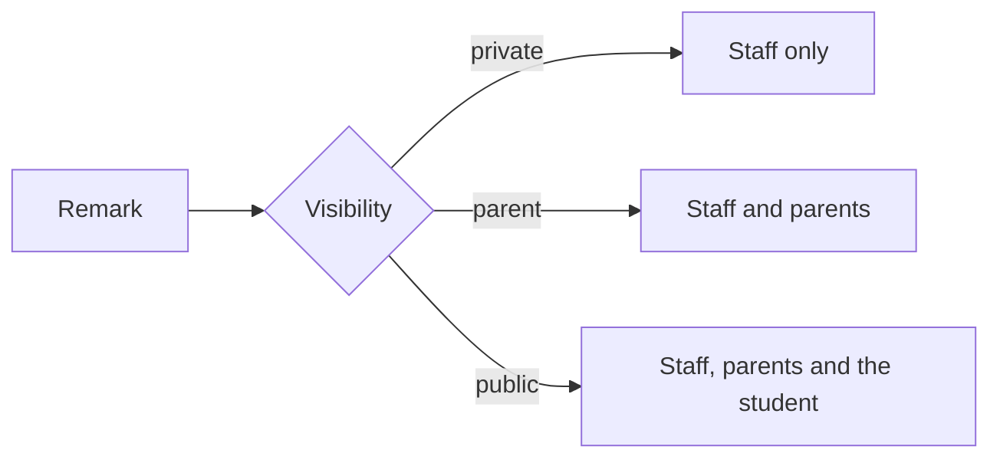

import { Aside, Steps, Card, CardGrid, LinkCard } from '@astrojs/starlight/components';
import Pipeline from '../../../../components/Pipeline.astro';
import ScreenAnatomy from '../../../../components/ScreenAnatomy.astro';
import SourceFile from '../../../../components/SourceFile.astro';
import Api from '../../../../components/Api.astro';
import Perm from '../../../../components/Perm.astro';
import Roles from '../../../../components/Roles.astro';
import Route from '../../../../components/Route.astro';
import DemoLogin from '../../../../components/DemoLogin.astro';
import Screenshot from '../../../../components/Screenshot.astro';
import { Tabs as ShotTabs, TabItem as ShotTab } from '@astrojs/starlight/components';

A **remark** is a short written note about one student: "Reading fluency has
improved a lot since the start of term", "Arrived late several times this
month". Each remark has a **type** — academic, behavior, attendance or general —
and a **visibility** that decides who can read it: staff only, staff and
parents, or everyone including the student. Remarks appear on the student's
profile, in the parent and student portals and, when linked to an exam, on the
report card.

## At a glance

<CardGrid>
  <Card title="Who uses it" icon="star">
    <Roles list={['teacher']} note="own sections" />
    <Roles list={['school_admin', 'principal', 'vice_principal']} note="any student" />
    <Roles list={['parent', 'student']} note="read" />
  </Card>
  <Card title="Where to find it" icon="laptop">
    <Route path="/app/remarks" />
    Sidebar: **Academics › Remarks**
  </Card>
  <Card title="Permissions" icon="approve-check">
    <Perm name="remark:create" /> <Perm name="remark:read:all" />
    <Perm name="remark:read:own_classes" />
  </Card>
</CardGrid>

<DemoLogin as="Teacher" email="teacher@greenfield.example" go="/app/remarks">
  Grace Mensah can write about students in Grade 3 · A and Grade 3 · B. The
  seed holds 90 remarks across the school.
</DemoLogin>

## How it works

<Pipeline
  caption="From a teacher's note to the family's screen."
  steps={[
    { label: 'Pick a section', icon: 'layers', note: 'Your own, or any for leaders' },
    { label: 'Pick a student', icon: 'user', note: 'Admission number and name' },
    { label: 'Write', icon: 'message', note: 'Type, visibility, note' },
    { label: 'Readers', icon: 'users', note: 'Staff, parents, the student' },
  ]}
/>

### Visibility decides the readers

| Visibility | Shown in the form as | Staff | Parents | The student | On the report card |
|---|---|---|---|---|---|
| `private` | "Private — only staff" | Yes | No | No | Never |
| `parent` (default) | "Parent — also visible to the parent" | Yes | Yes | No | Yes, if linked to that exam |
| `public` | "Public — visible to the student too" | Yes | Yes | Yes | Yes, if linked to that exam |

"Staff" here means holders of <Perm name="remark:read:all" /> (School Admin,
Principal, Vice Principal) and teachers of the student's section.

### Who may write about whom

Writing needs <Perm name="remark:create" />. Holders of
<Perm name="remark:read:all" /> may write about any student in the school. A
teacher may write only about students actively enrolled in one of their own
sections (the sections they lead, plus every section of a class they are class
teacher of) — anyone else is refused with `403` "This student is not in one of
your sections."

## The screen

Real screenshots from the seeded demo school (switch the docs theme to see dark mode):

<ShotTabs>
  <ShotTab label="School Admin">
    <Screenshot name="admin-remarks" alt="All remarks in the school" path="/app/remarks" />
  </ShotTab>
  <ShotTab label="Teacher">
    <Screenshot name="teacher-remarks" alt="A teacher’s remarks" path="/app/remarks" />
  </ShotTab>
</ShotTabs>

<ScreenAnatomy
  title="Remarks"
  path="/app/remarks"
  regions={[
    { label: 'Sidebar', desc: 'Academics › Remarks', area: 'sidebar' },
    { label: 'Top bar', desc: 'Search, notifications, account menu', area: 'top' },
    { label: 'Page header', desc: 'Title "Remarks" — "Per-student notes from teachers and admins. Visibility controls who sees what." — and "Add remark" (disabled until a student is picked)' },
    { label: 'Pick a student', desc: '"Section" (your sections, grouped by class) and "Student" ("GIS-… · Kian Mendes")' },
    { label: 'Remarks list', desc: 'Newest first: type chip (coloured), visibility chip, date and time, the note, and "Delete" when allowed', size: 4, tone: 'accent' },
  ]}
/>

<ScreenAnatomy
  title="New remark"
  path="/app/remarks"
  regions={[
    { label: 'Drawer header', desc: '"New remark" — "A note on the selected student."' },
    { label: 'Type', desc: 'General, Academic, Behavior, Attendance' },
    { label: 'Visibility', desc: '"Private — only staff", "Parent — also visible to the parent", "Public — visible to the student too"', tone: 'accent' },
    { label: 'Note', desc: 'Placeholder "What should the family know about this student?" — 2 to 2000 characters', size: 2 },
    { label: 'Submit', desc: '"Save remark"', tone: 'warn' },
  ]}
/>

## Step by step

### Write a remark as a teacher

<Steps>

1. Sign in as `teacher@greenfield.example` and open **Academics › Remarks**. The page says "Pick a section and student to view or add remarks."
2. In **Section**, choose **Grade 3 · A**. Only Grace's own sections are offered.
3. In **Student**, choose a student, for example **Kian Mendes**. Their earlier remarks appear below, or "No remarks for this student yet".
4. Click **Add remark**. The "New remark" drawer opens.
5. Set **Type** to "Academic" and **Visibility** to "Parent — also visible to the parent".
6. In **Note**, type `Times tables much more confident this week.`
7. Click **Save remark**. The toast says "Remark recorded." and the remark is at the top of the list with the chips "Academic" and "Parent".

</Steps>

### See it as the family

<Steps>

1. Sign in as `admin@greenfield.example`, open **Academics › Remarks**, pick **Grade 1 · A** and **Mateo Singh**, and add a remark with visibility "Parent — also visible to the parent".
2. Sign in as `parent@greenfield.example` (Sofia Singh), open **My children → Mateo Singh** and click the **Remarks** tab. The remark is there with the author and date.
3. A `private` remark would not appear. A `public` remark would also appear to the student on **My grades**.

</Steps>

### Delete a remark

<Steps>

1. On a remark you wrote, click **Delete**.
2. The dialog asks "Delete this remark?" — "The family will no longer see it. The deletion is kept in the audit log." Click **Delete**.
3. The toast says "Remark deleted."

</Steps>

## Every action on this screen

### Pick a section and a student

The **Section** picker lists every section for holders of
<Perm name="remark:read:all" />, and only your own sections for teachers. The
**Student** picker loads the section's students (up to 100):

<Api method="GET" path="students?sectionId=&pageSize=100" perm="student:read" />

A link from **My classes** can open the page with the section already chosen
(`/app/remarks?section=…`).

### Read a student's remarks

<Api method="GET" path="remarks?studentId=" perm="remark:read:own_classes" />

Needs <Perm name="remark:read:all" /> or <Perm name="remark:read:own_classes" />.
Without the school-wide permission, the API returns only remarks about students
in your own sections **plus** any remark you wrote yourself. The list can also be
filtered by `examId` or `sectionId`.

### "Add remark" / "Save remark"

<Api method="POST" path="remarks" perm="remark:create" />

| Field | Rule |
|---|---|
| Type | `general` (default in the form), `academic`, `behavior` or `attendance` |
| Visibility | `private`, `parent` (default) or `public` |
| Note | 2–2000 characters |
| Exam, Section | Optional links (`examId`, `sectionId`) — the API accepts them, the form does not send them |

The remark stores its author and the author's role at the time. Audit entry:
`remark.create`, with the student, type and visibility.

### "Delete"

<Api method="DELETE" path="remarks/:id" perm="remark:create" />

The **Delete** button appears on remarks you wrote, and on every remark for the
School Admin. The API enforces the same rule: the author, or a holder of
`school:update:tenant` (the School Admin), otherwise `403` "Only the author or a
school admin can delete this remark." The remark is soft-deleted and the audit
entry `remark.delete` keeps its full text.

## Where remarks are read

| Place | Who | What they get |
|---|---|---|
| **Remarks** tab on <Route path="/app/students/[id]" /> | School staff | All three visibilities, each labelled "Staff only", "Parents" or "Everyone" |
| **Remarks** tab on **My children** | Parents | `parent` and `public` remarks about their child |
| **My grades** | The student | `public` remarks about themself |
| Report card PDF | Anyone who may see the student's grades | Non-private remarks **linked to that exam** that the downloader may read, under "Teacher remarks" — a student's own copy shows `public` ones only |

These views come from <Api method="GET" path="student-records/:id/remarks" />,
which shows the author's name and filters by what the viewer may read.

## Who sees what

| Role | Remarks page | Write | Delete | Reads |
|---|---|---|---|---|
| School Admin | Any section | Any student | Any remark | Everything |
| Principal | Any section | Any student | Own remarks | Everything |
| Vice Principal | Any section | Any student | Own remarks | Everything |
| Teacher | Own sections | Own sections' students | Own remarks | Remarks on own sections' students, and their own |
| Parent | No | No | No | `parent` and `public`, own children |
| Student | No | No | No | `public`, about themself |
| Accountant, Staff | No | No | No | — |

## Under the hood

- <SourceFile path="apps/web/src/app/(tenant)/app/remarks/page.tsx" />
- <SourceFile path="apps/web/src/components/records/student-remarks.tsx" symbol="StudentRemarks" />
- <SourceFile path="apps/api/src/modules/gradebook/remarks.routes.ts" />
- <SourceFile path="apps/api/src/services/scopes/student-access.ts" symbol="decideStudentAccess" />
- <SourceFile path="packages/validation/src/gradebook.ts" symbol="createRemarkSchema" />
- <SourceFile path="packages/db/src/models/remark.ts" />

**Data shape** — `Remark`: `studentId`, `examId` (optional), `sectionId`
(optional), `type`, `visibility`, `body`, `authorId`, `authorRoleAtTime`, plus
`schoolId`, timestamps and soft delete.

**Deleting an exam** keeps its remarks but clears their `examId`, so they stop
appearing on that exam's report card.

## Edge cases and gotchas

- **No editing.** A remark cannot be changed once saved — delete it and write a
  new one.
- **The list on this page shows no author.** The author's name appears on the
  student profile's Remarks tab and in the portals.
- **A teacher keeps seeing what they wrote**, even after the student moves to a
  section they do not teach.
- **Big sections.** The Student picker loads the first 100 students of the section.

:::caution[Remarks written here never reach the report card]
The report card prints only remarks linked to the exam (`examId`). The Remarks
page has no exam field and never sends one, so a remark written in the app
does not appear on any report card. Only the seeded "academic" remarks linked
to the Term 1 midterm do.
:::

## Related pages

<CardGrid>
  <LinkCard title="Students" description="The Remarks tab on a student's profile." href="/features/people/students/" />
  <LinkCard title="Gradebook" description="Marks, a per-subject remark field and the report card." href="/features/assessment/gradebook/" />
  <LinkCard title="Parent portal" description="What parents read about their children." href="/features/portals/parent/" />
  <LinkCard title="Audit log" description="Every remark created and deleted is logged." href="/features/insight/audit-log/" />
</CardGrid>
