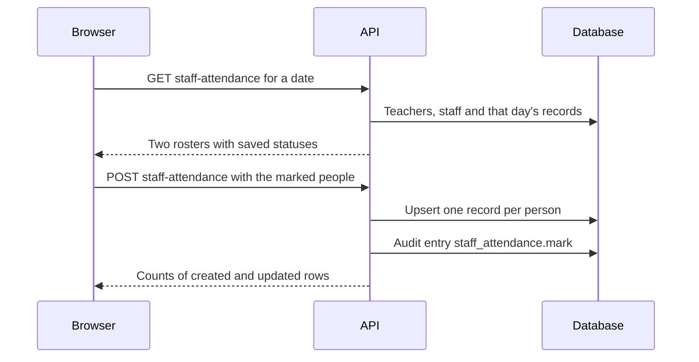

import { Aside, Steps, Card, CardGrid, LinkCard } from '@astrojs/starlight/components';
import Pipeline from '../../../../components/Pipeline.astro';
import ScreenAnatomy from '../../../../components/ScreenAnatomy.astro';
import SourceFile from '../../../../components/SourceFile.astro';
import Api from '../../../../components/Api.astro';
import Perm from '../../../../components/Perm.astro';
import Roles from '../../../../components/Roles.astro';
import Route from '../../../../components/Route.astro';
import DemoLogin from '../../../../components/DemoLogin.astro';
import Screenshot from '../../../../components/Screenshot.astro';

**Staff attendance** is the register for the adults. One screen lists every
teacher and every non-teaching staff member of the school, and the School Admin
marks each one **present**, **absent**, **late** or **excused** for a day. These
records feed the Attendance card on teacher and staff profiles, the teachers' and
staff's own **My attendance** page, and approved [leave](/features/daily/leave/)
writes `excused` days into them automatically.

## At a glance

<CardGrid>
  <Card title="Who uses it" icon="star">
    <Roles list={['school_admin']} note="marks and reads" />
    <Roles list={['teacher', 'staff']} note="read their own" />
  </Card>
  <Card title="Where to find it" icon="laptop">
    <Route path="/app/staff-attendance" />
    Sidebar: **Attendance › Staff attendance**
  </Card>
  <Card title="Permissions" icon="approve-check">
    <Perm name="staff_attendance:mark" /> <Perm name="staff_attendance:read:all" />
    <Perm name="staff_attendance:read:own" />
  </Card>
</CardGrid>

<DemoLogin as="School Admin" email="admin@greenfield.example" go="/app/staff-attendance">
  On the seed day, 24 of the 30 teachers are already marked; the last six
  teachers and all ten staff are still to do.
</DemoLogin>

## How it works

<Pipeline
  caption="One screen, one save, for the whole staff."
  steps={[
    { label: 'Pick the date', icon: 'calendar-days', note: 'Today by default' },
    { label: 'Teachers', icon: 'user-check', note: 'Every teacher record' },
    { label: 'Other staff', icon: 'users', note: 'Every staff record' },
    { label: 'Save', icon: 'send', note: 'Marked people only' },
    { label: 'Profiles', icon: 'id-card', note: 'Attendance cards and My attendance' },
  ]}
/>

Unlike the student register, there are no sections here: the roster is simply
**all teachers** followed by **all non-teaching staff** of the school. Each
record points at exactly one person — a `teacherId` *or* a `staffId`, never
both — so a person has at most one record per day. Saving is an upsert, so
re-saving a day updates it.

## The screen

<Screenshot name="admin-staff-attendance" alt="The staff attendance register" path="/app/staff-attendance" />

<ScreenAnatomy
  title="Staff attendance"
  path="/app/staff-attendance"
  regions={[
    { label: 'Sidebar', desc: 'Attendance › Staff attendance', area: 'sidebar' },
    { label: 'Top bar', desc: 'Search, notifications, account menu', area: 'top' },
    { label: 'Page header', desc: 'Title "Staff attendance" — "Mark teachers and non-teaching staff present, absent, late, or excused."' },
    { label: 'Day card', desc: 'The "Date" picker (up to today) and the "Mark everyone present" button' },
    { label: 'Teachers card', desc: '"Teachers — 30": name, employee ID and four buttons — present, absent, late, excused', size: 3, tone: 'accent' },
    { label: 'Other staff card', desc: '"Other staff — 10": name, "STF-003 · Library" and the same four buttons', size: 2 },
    { label: 'Save row', desc: '"16 not marked — they won\'t be saved." and "Save staff attendance"', tone: 'warn' },
  ]}
/>

## Step by step

<Steps>

1. Sign in as `admin@greenfield.example` and open **Attendance › Staff attendance**.
2. The **Date** field shows today. The **Teachers — 30** card lists every teacher; the ones already marked have a coloured button selected.
3. Scroll to the unmarked teachers (Maya Ortiz to Owen Ibrahim on the seed day) and click **present** for each, or click **Mark everyone present** at the top to mark the whole roster.
4. In **Other staff — 10**, click **late** for Musa Okoye (Driver) and **absent** for Jonah Mendes (Security Officer).
5. The line above the save button disappears once everyone is marked.
6. Click **Save staff attendance**. The toast says "Staff attendance saved."
7. Open **People › Staff → Ruby Novak**. Her profile's **Attendance** card includes today.

</Steps>

To look at or correct another day, change the **Date** field — the rosters
reload with that day's saved statuses.

## Every action on this screen

### Change the date

The **Date** picker goes back as far as you like and up to today. Changing it
reloads both rosters.

<Api method="GET" path="staff-attendance?date=" perm="staff_attendance:read:all" />

The response has two lists: `teachers` (teacher id, employee ID, name, status,
note) and `staff` (the same plus department), each with that day's saved status
or `null`.

### Mark one person

Click **present**, **absent**, **late** or **excused** on their row. Nothing is
saved yet. There is no note box on this screen; a saved note — for example
"Approved leave (sick)" — is kept when you re-save.

### "Mark everyone present"

Sets every teacher and staff member to present, replacing any choice already
made on screen for that day. You can then change the exceptions one by one.

### "Save staff attendance"

<Api method="POST" path="staff-attendance" perm="staff_attendance:mark" />

The body is the date plus one entry per marked person — `teacherId` or
`staffId`, `status` and `note`, at most 500 entries. Each entry must name
exactly one of the two ids, or validation fails. People with no status selected
are not sent. The button is disabled only while saving or when nobody at all is
marked. One audit entry, `staff_attendance.mark`, records the date and counts.

## Who sees what

| Role | This screen | Their own record |
|---|---|---|
| School Admin | Yes — reads and marks | **My attendance**, only if their account is linked to a teacher or staff record |
| Teacher | No | **My attendance** — "Staff attendance" calendar (`staff_attendance:read:own`) |
| Staff | No | **My attendance** — "Staff attendance" calendar |
| Principal, Vice Principal | No | **My attendance**, only if linked to a teacher or staff record |
| Accountant | No | **My attendance** when linked — the demo Accountant (Ibrahim Ahmed, `STF-002`) sees his own days |

A teacher's or staff member's attendance also appears on their profile
([Teachers](/features/people/teachers/), [Staff](/features/people/staff/)) for
the School Admin — the last 90 days with rate, present, absent and late.

## Under the hood

- <SourceFile path="apps/web/src/app/(tenant)/app/staff-attendance/page.tsx" />
- <SourceFile path="apps/api/src/modules/attendance/staff-attendance.routes.ts" />
- <SourceFile path="packages/validation/src/attendance.ts" symbol="bulkMarkStaffAttendanceSchema" />
- <SourceFile path="packages/db/src/models/attendance.ts" symbol="StaffAttendance" />
- <SourceFile path="apps/api/src/modules/people/_overview.ts" symbol="employeeRecords" />

**Data shape** — model `StaffAttendance`: `date` (UTC midnight), `teacherId` or
`staffId`, `status`, `note`, `markedById`. Two partial unique indexes enforce one
record per teacher per day and one per staff member per day.

**Rate** on profiles is `(present + late) ÷ days recorded`, over the last 90 days.

**Leave.** When a teacher's or staff member's leave is approved, each covered
weekday becomes `excused` unless it was already marked present or late. See
[Leave](/features/daily/leave/).

## Edge cases and gotchas

- **Only the School Admin can use it.** Both `staff_attendance:read:all` and
  `staff_attendance:mark` belong to the School Admin role alone; the sidebar hides
  the page from everyone else.
- **The date is not in the address.** Reloading the page returns to today, and a
  link cannot point at a particular day.
- **"Today" is the UTC date**, as on the student register.
- **Order follows the database**, not the alphabet or employee ID.
- **No marks can be removed** — a saved status can be changed but not cleared.
- **The API trusts the ids.** `POST /staff-attendance` does not check that each
  `teacherId` / `staffId` belongs to an existing person; the page only ever sends
  ids from its own roster.

:::note[Management roles can read their own days]
Every school bundle except Student and Parent includes
`staff_attendance:read:own`. So when a School Admin, Principal, Vice Principal
or Accountant account is linked to a teacher or staff record — like the demo
Accountant, Ibrahim Ahmed, tied to `STF-002` — **My attendance** shows the days
marked for them here.
:::

## Related pages

<CardGrid>
  <LinkCard title="Attendance" description="The student register, per section and day." href="/features/daily/attendance/" />
  <LinkCard title="Leave" description="Approved leave marks staff days excused." href="/features/daily/leave/" />
  <LinkCard title="Teachers" description="Teacher profiles show the last 90 days." href="/features/people/teachers/" />
  <LinkCard title="Staff portal" description="My attendance and My payslips for staff." href="/features/portals/staff/" />
</CardGrid>
