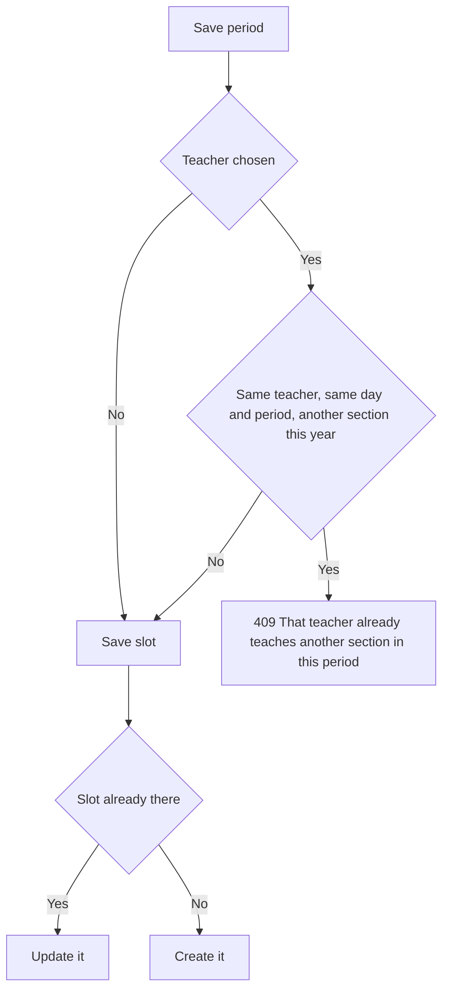

import { Aside, Steps, Card, CardGrid, LinkCard, Tabs, TabItem } from '@astrojs/starlight/components';
import Pipeline from '../../../../components/Pipeline.astro';
import ScreenAnatomy from '../../../../components/ScreenAnatomy.astro';
import SourceFile from '../../../../components/SourceFile.astro';
import Api from '../../../../components/Api.astro';
import Perm from '../../../../components/Perm.astro';
import Roles from '../../../../components/Roles.astro';
import Route from '../../../../components/Route.astro';
import DemoLogin from '../../../../components/DemoLogin.astro';
import Screenshot from '../../../../components/Screenshot.astro';
import { Tabs as ShotTabs, TabItem as ShotTab } from '@astrojs/starlight/components';

The **Timetable** is each section's week: which subject is taught in each
period of each day, by which teacher, in which room. Admins build it one period
at a time on a grid. Schola refuses to put the same teacher in two sections in
the same period. Everyone else reads the result in the shape that suits them —
teachers see **their own week** across all the sections they teach, and
students and parents see the week of the student's section.

## At a glance

<CardGrid>
  <Card title="Who uses it" icon="star">
    <Roles list={['school_admin', 'principal']} note="build and edit" />
    <Roles list={['vice_principal', 'teacher']} note="read any section" />
    <Roles list={['student', 'parent']} note="the student's week" />
  </Card>
  <Card title="Where to find it" icon="laptop">
    <Route path="/app/timetable" />
    Sidebar: **Daily › Timetable**
  </Card>
  <Card title="Permissions" icon="approve-check">
    <Perm name="timetable:read" /> <Perm name="timetable:manage" />
    <Perm name="section:read" />
  </Card>
</CardGrid>

<DemoLogin as="School Admin" email="admin@greenfield.example" go="/app/timetable">
  Every section has a full week: Monday to Friday, six periods from 08:00 to
  13:55, each with a subject, a teacher and a room such as `R3A`.
</DemoLogin>

## How it works

<Pipeline
  caption="One period at a time. Each save is checked against every other section's week."
  steps={[
    { label: 'Pick a section', icon: 'layers', note: 'Grade 3 · A' },
    { label: 'Click a period', icon: 'calendar-range', note: 'Day and period number' },
    { label: 'Set it', icon: 'clipboard-list', note: 'Times, subject, teacher, room' },
    { label: 'Clash check', icon: 'shield', note: 'Teacher free that period' },
    { label: 'Everyone sees it', icon: 'users-round', note: 'Teacher, student, parent views' },
  ]}
/>

A timetable is made of **slots**. A slot is one period on one day for one
section: day of the week (1 = Monday … 7 = Sunday), period number (1–16), start
and end time, and optionally a subject, a teacher and a room. Saving a slot
for a day and period that already has one **replaces** it — there is never more
than one slot per section, day and period.

The clash check looks only at the **same academic year** (the year of the
section's class). A period with no teacher — a "Free period" or a study hall —
never clashes.

## The screens

Real screenshots from the seeded demo school (switch the docs theme to see dark mode):

<ShotTabs>
  <ShotTab label="School Admin">
    <Screenshot name="admin-timetable" alt="A section’s weekly timetable" path="/app/timetable" />
  </ShotTab>
  <ShotTab label="Teacher">
    <Screenshot name="teacher-timetable" alt="A teacher’s week" path="/app/timetable" />
  </ShotTab>
  <ShotTab label="Student">
    <Screenshot name="student-timetable" alt="A student’s week" path="/app/timetable" />
  </ShotTab>
</ShotTabs>

The page shows a different view depending on who you are:

<Tabs>
  <TabItem label="Admins and staff">
    Holders of `section:read` who are not teachers get the **section view**: a
    **Section** picker, then that section's grid. With `timetable:manage` the
    cells are clickable.
  </TabItem>
  <TabItem label="Teachers">
    Teachers get two tabs: **My week** (every period they teach, across
    sections) and **Sections** (any section's grid, read only).
  </TabItem>
  <TabItem label="Students and parents">
    The student's own section week. A parent with more than one child gets a
    **Child** picker above the grid.
  </TabItem>
</Tabs>

### Section view

<ScreenAnatomy
  title="Timetable"
  path="/app/timetable?section=…"
  regions={[
    { label: 'Sidebar', desc: 'Daily › Timetable', area: 'sidebar' },
    { label: 'Top bar', desc: 'Search, notifications, account menu', area: 'top' },
    { label: 'Page header', desc: 'Title "Timetable" — "Weekly periods for each section. Click a period to set the subject, teacher and room." (or "The week at a glance.")' },
    { label: 'Section picker', desc: '"Section", grouped by class: "Grade 3 · A". Empty state "Pick a section to see its week"' },
    { label: 'Week grid', desc: 'Rows P1–P6 with their times, columns Monday–Friday (today\'s day in colour). Each cell: subject (or "Free period"), teacher · room. Empty cells show "+ Add" when you can edit', size: 4, tone: 'accent' },
  ]}
/>

On phones the grid becomes one card per day, periods listed down the card.

### Period drawer

<ScreenAnatomy
  title="Monday · period 5"
  path="/app/timetable?section=…"
  regions={[
    { label: 'Drawer header', desc: '"Monday · period 5" — "Subject, teacher and room for this period."' },
    { label: 'Times', desc: '"Starts" and "Ends" time pickers' },
    { label: 'Subject', desc: '"Free period" or any school subject' },
    { label: 'Teacher', desc: '"No teacher" or any teacher. Hint: "A teacher can\'t be in two sections in the same period."', tone: 'accent' },
    { label: 'Room', desc: 'Free text, placeholder "R3A"' },
    { label: 'Buttons', desc: '"Save period" and, for an existing period, "Clear period"', tone: 'warn' },
  ]}
/>

### My week (teachers)

<ScreenAnatomy
  title="My week"
  path="/app/timetable"
  regions={[
    { label: 'Tabs', desc: '"My week" (selected) and "Sections"' },
    { label: 'Card header', desc: '"My week" — "Every period you teach, across your sections."' },
    { label: 'Week grid', desc: 'Only the periods this teacher teaches; each cell shows the subject and the section ("Grade 3 · A · R3A")', size: 4, tone: 'accent' },
  ]}
/>

## Step by step

### Set a period

<Steps>

1. Sign in as `admin@greenfield.example` and open **Daily › Timetable**.
2. In **Section**, choose **Grade 3 · A**. Its week appears.
3. Click the **Monday, P1** cell (Art & Design). The drawer "Monday · period 1" opens with the times, subject, teacher and room filled in.
4. Change **Room** to `Art studio` and click **Save period**. The toast says "Period saved." and the cell now reads "Elena Mendes · Art studio".

</Steps>

### See the clash check refuse a double booking

<Steps>

1. Still as the School Admin, switch **Section** to **Grade 3 · B**.
2. Click **Monday, P5** (Science with Samuel Adeyemi).
3. Change **Teacher** to **Grace Mensah** and click **Save period**.
4. A toast says "That teacher already teaches Grade 3 · A in this period." Nothing is saved — Grace already teaches Mathematics in Grade 3 · A in Monday's period 5.

</Steps>

### Read your own week as a teacher

<Steps>

1. Sign in as `teacher@greenfield.example` (Grace Mensah).
2. Open **Daily › Timetable**. The **My week** tab shows every period Grace teaches — on Monday, Mathematics in Grade 2 · B, Science in Grade 1 · B and Grade 2 · A, and Mathematics and Science in Grade 3 · A.
3. Click the **Sections** tab and pick any section to read its week. Cells are not clickable for teachers.

</Steps>

### Read a child's week as a parent

<Steps>

1. Sign in as `parent@greenfield.example` (Sofia Singh).
2. Open **Daily › Timetable**. A **Child** picker shows Mateo Singh and Ryan Singh.
3. The card title reads "Mateo's week", with "Grade 1 · Section A" underneath. Pick Ryan to switch to Grade 1 · B.

</Steps>

## Every action on this screen

### Pick a section

<Api method="GET" path="timetable?sectionId=" perm="section:read" />

Needs <Perm name="section:read" /> together with either
<Perm name="timetable:read" /> or <Perm name="timetable:manage" />. The section
lives in the address (`?section=`), so a link can open a given section's week.

### Click a period (editors)

Only with <Perm name="timetable:manage" />. A **new** period starts with the
times other days already use for that period number, or with the default bell
times (P1 08:00–08:45, P2 08:50–09:35, P3 09:40–10:25, P4 10:45–11:30, P5
11:35–12:20, P6 13:10–13:55, P7 14:00–14:45, P8 14:50–15:35).

### "Save period"

<Api method="PUT" path="timetable/slots" perm="timetable:manage" />

| Field | Rule |
|---|---|
| Starts, Ends | 24-hour `HH:MM` ("Use 24-hour time like 08:30."); the end must be after the start ("The period must end after it starts.") |
| Subject | A subject of this school, or empty for "Free period" |
| Teacher | A teacher of this school, or empty for "No teacher" |
| Room | Up to 40 characters |

The API answers `201` for a new period and `200` for a replaced one. The audit
log records `timetable.create` or `timetable.update` with the before and after
values. A clash returns `409 CONFLICT` with the name of the section the teacher
is already in.

### "Clear period"

<Api method="DELETE" path="timetable/slots/:id" perm="timetable:manage" />

Removes the period at once (no confirmation) — it is soft-deleted and logged as
`timetable.delete`. Toast: "Period cleared."

### My week

<Api method="GET" path="timetable/mine" perm="timetable:read" />

Returns the slots whose teacher is the signed-in user's teacher record. A
signed-in user with no teacher record gets an empty week.

### A student's week

<Api method="GET" path="timetable/student/:id" perm="timetable:read" />

Allowed when you may see that student's profile — the student themself, a
linked parent, or school staff. The week is the one of the student's **current**
section; a student with no placement shows "Not placed in a class yet — The
timetable appears once the school places the student in a section."

## Who sees what

| Role | View | Edit |
|---|---|---|
| School Admin | Any section | Yes |
| Principal | Any section | Yes |
| Vice Principal | Any section | No |
| Teacher | My week + any section | No |
| Student | Own section's week ("My week") | No |
| Parent | Each linked child's week | No |
| Accountant, Staff | No — the sidebar hides Timetable | — |

## Under the hood

- <SourceFile path="apps/web/src/app/(tenant)/app/timetable/page.tsx" />
- <SourceFile path="apps/web/src/components/operations/timetable-grid.tsx" symbol="TimetableGrid" />
- <SourceFile path="apps/api/src/modules/operations/timetable.routes.ts" />
- <SourceFile path="packages/validation/src/operations.ts" symbol="upsertTimetableSlotSchema" />
- <SourceFile path="packages/db/src/models/timetable.ts" symbol="TimetableSlot" />

**Data shape** — `TimetableSlot`: `academicYearId` (copied from the
section's class), `sectionId`, `dayOfWeek`, `period`, `startTime`, `endTime`,
`subjectId`, `teacherId`, `room`. A unique index on `(schoolId, sectionId,
dayOfWeek, period)` keeps one slot per cell; a second index on the teacher, day
and period makes the clash check fast.

## Edge cases and gotchas

- **Period times are per slot.** Changing the times of Monday P1 does not change
  Tuesday P1. The time label on the left of the grid comes from the first slot
  found for that period.
- **Teachers and subjects are not filtered.** The drawer offers every teacher
  and every subject, whatever the teacher's subjects or the class's subjects.
- **A deleted teacher** stays on their old slots, which then show "No teacher".
- **Saturday** appears in the grid only when the section already has a Saturday
  slot.

:::caution[The grid cannot add a Saturday, a Sunday or a 7th period]
The API accepts days 1–7 and periods 1–16, but the grid only draws Monday to
Friday (plus Saturday if a Saturday slot exists) and at least six periods (more
only if a slot already uses them). So from the screen you cannot create the
first Saturday period, any Sunday period or a seventh period — those can only
be made through the API.
:::

## Related pages

<CardGrid>
  <LinkCard title="Classes & sections" description="The sections a timetable belongs to." href="/features/academics/classes-and-sections/" />
  <LinkCard title="Subjects" description="The subjects you can put in a period." href="/features/academics/subjects/" />
  <LinkCard title="Teacher portal" description="My classes and My week from the teacher's side." href="/features/portals/teacher/" />
  <LinkCard title="Parent portal" description="Each child's week, attendance and grades." href="/features/portals/parent/" />
</CardGrid>
