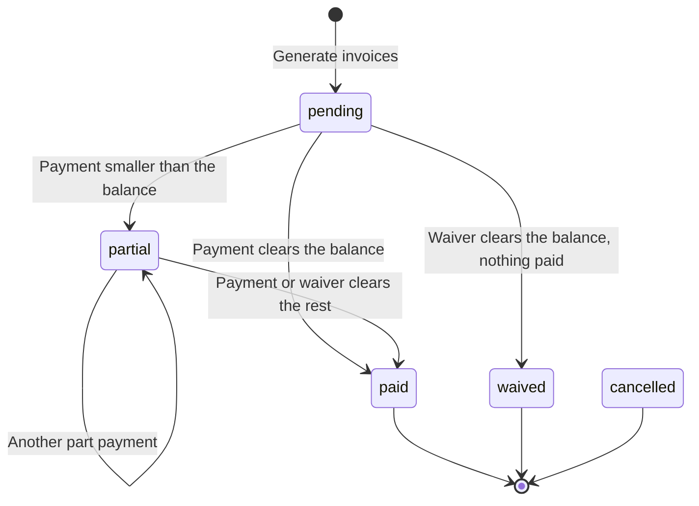

import { Aside, Steps, Card, CardGrid, LinkCard, Badge } from '@astrojs/starlight/components';
import Pipeline from '../../../../components/Pipeline.astro';
import ScreenAnatomy from '../../../../components/ScreenAnatomy.astro';
import SourceFile from '../../../../components/SourceFile.astro';
import Api from '../../../../components/Api.astro';
import Perm from '../../../../components/Perm.astro';
import Roles from '../../../../components/Roles.astro';
import Route from '../../../../components/Route.astro';
import DemoLogin from '../../../../components/DemoLogin.astro';
import Screenshot from '../../../../components/Screenshot.astro';
import { Tabs as ShotTabs, TabItem as ShotTab } from '@astrojs/starlight/components';

The Fees screen is where a school's money comes in. The Accountant (or the School Admin) first writes down **what** the school charges — a [fee structure](/start-here/glossary/#fee-structure) such as "Primary monthly fees: Tuition $180, Lab & technology $25, Activities & clubs $15". Then they turn that structure into one [invoice](/start-here/glossary/#invoice) per student for a whole [section](/start-here/glossary/#section) at once. When a family pays at the front desk, the Accountant records the payment, the invoice moves to `partial` or `paid`, and a numbered PDF receipt is ready to print. Families can also pay online with a card — that path is covered in [Online payments](/features/finance/online-payments/).

## At a glance

<CardGrid>
  <Card title="Who uses it" icon="star">
    <Roles list={['school_admin', 'accountant']} note="Parents and students see their own invoices elsewhere." />
  </Card>
  <Card title="Where to find it" icon="laptop">
    <Route path="/app/fees" /> — sidebar group **Finance → Fees**
  </Card>
  <Card title="Permissions" icon="approve-check">
    <Perm name="fee:read:tenant" /> <Perm name="fee_structure:create" /> <Perm name="fee_structure:update" /> <Perm name="fee:collect" /> <Perm name="fee:waive" /> <Perm name="report:export" />
  </Card>
  <Card title="Money format" icon="information">
    Every amount is shown in the school's currency and locale — **USD, `en-US`** by default, so `220` renders as **$220.00**.
  </Card>
</CardGrid>

<DemoLogin as="Accountant (Ibrahim Ahmed)" email="accountant@greenfield.example" go="/app/fees" />

The demo school already has three monthly fee structures, one invoice per student for each month of the current term (most paid, some `partial`, some `pending`), and receipts paid by cash, bank transfer, cheque and online. The School Admin account (`admin@greenfield.example`, Amira Hossain) sees exactly the same screen.

## How it works

<Pipeline
  caption="The life of a fee, from the price list to the receipt."
  steps={[
    { label: 'Structure', icon: 'layers', note: 'What the school charges' },
    { label: 'Generate', icon: 'file-text', note: 'One invoice per student in a section' },
    { label: 'Collect', icon: 'hand-coins', note: 'Cash, bank, cheque or card' },
    { label: 'Update', icon: 'badge-check', note: 'Invoice becomes partial or paid' },
    { label: 'Receipt', icon: 'receipt', note: 'Numbered PDF for the family' },
  ]}
/>

Three kinds of record work together:

| Record | What it is | Example from the demo |
|---|---|---|
| **Fee structure** | A named price list for one academic year: a frequency label plus one or more line items. Its total is the sum of the items. | "Middle school monthly fees (Grades 6–8)" — Tuition $230, Lab & technology $35, Activities & clubs $20 → **$285.00** |
| **Fee invoice** | What one student owes for one period. It **copies** the structure's line items at the moment it is generated. | `INV-202611-…` for Mateo Singh (Grade 1 · A), period `2026-11`, $220.00, `pending` |
| **Fee payment** | Money received against one invoice, with a method, a reference and a receipt number. | `RCT-…`, $220.00, method `cheque` |

The invoice keeps three running numbers — `totalAmount`, `amountPaid` and `amountWaived` — and its **remaining balance** is always `totalAmount − amountPaid − amountWaived`. Every payment and every waiver is checked against that balance, so a student can never be charged more than the invoice is worth.

### The invoice status lifecycle



| Status | Meaning | Can still be paid? |
|---|---|---|
| `pending` | Generated, nothing received yet. | Yes |
| `partial` | Something received, a balance remains. | Yes |
| `paid` | Balance is zero and at least part of it was paid. | No |
| `waived` | Balance is zero and it was all waived — nothing paid. | No |
| `cancelled` | Exists in the data model and is respected everywhere (no payments, hidden from family views), but **no screen or endpoint sets it yet**. | No |

<Aside type="note" title="Overdue is not a stored status">
On the family-facing fee views an open invoice whose due date has passed shows a red **Overdue** pill. That is worked out in the browser from `dueDate`; in the database the invoice is still `pending` or `partial`. The staff Fees screen does not show an overdue marker.
</Aside>

## The screen

Real screenshots from the seeded demo school (switch the docs theme to see dark mode):

<ShotTabs>
  <ShotTab label="School Admin">
    <Screenshot name="admin-fees" alt="The Fees page" path="/app/fees" />
  </ShotTab>
  <ShotTab label="Accountant">
    <Screenshot name="accountant-fees" alt="The Fees page for the accountant" path="/app/fees" />
  </ShotTab>
</ShotTabs>


<ScreenAnatomy
  title="Fees"
  path="/app/fees"
  regions={[
    { label: 'Sidebar', desc: 'Finance → Fees (needs fee:read:tenant)', area: 'sidebar' },
    { label: 'Top bar', desc: 'Breadcrumb "School / Fees", theme toggle, notifications, profile', area: 'top' },
    { label: 'Page header', desc: 'Title "Fees", the line "Fee structures, invoices, and collected payments." and the "Export CSV" button' },
    { label: 'Tabs', desc: '"Structures", "Invoices", "Payments" — Structures opens first' },
    { label: 'Tab toolbar', desc: '"Add structure" on Structures; "Record payment" and "Generate invoices" on Invoices', tone: 'accent' },
    { label: 'Table', desc: 'Paginated list, 20 rows per page, with the pager underneath', size: 3 },
    { label: 'Record payment drawer', desc: 'Slides in from the toolbar button or a row\'s "Record": Student search, Invoice, Amount, Method, Reference', tone: 'warn' },
  ]}
/>

Each tab shows a different table:

| Tab | Columns | Row action |
|---|---|---|
| **Structures** | Name · Frequency · Total | "Edit" (with <Perm name="fee_structure:update" />) |
| **Invoices** | Student (name and admission number) · Invoice · Period · Total · Paid · Status · Due | "Record" (opens the Record payment drawer for that invoice) and "Pay" (opens Stripe Checkout) on `pending` and `partial` rows, with <Perm name="fee:collect" /> |
| **Payments** | Receipt · Received · Amount · Method | "Download PDF" |

Invoices are listed oldest due date first; payments newest first; structures newest first.

## Step by step

This is the order to record a walkthrough video in. Sign in as the Accountant.

<Steps>
1. **Open Fees.** In the sidebar, under **Finance**, click **Fees**. The **Structures** tab opens and lists the three seeded structures — "Primary monthly fees (Grades 1–5)" ($220.00), "Middle school monthly fees (Grades 6–8)" ($285.00) and "Senior school monthly fees (Grades 9–10)" ($350.00) — all with Frequency **Monthly**.

2. **Create a structure.** Click **Add structure**. A drawer titled **New fee structure** slides in. Pick the **Academic year** (the current one is marked "(current)"), set **Frequency** to **One-time**, and type the **Name** "Annual sports fee". Under **Line items**, change the first row to "Sports kit" and `40`, click **Add line item**, and add "Tournament entry" with `15`. Click **Save**. The toast says "Fee structure created." and the new row shows a Total of **$55.00**.

3. **Bill a section.** Switch to the **Invoices** tab and click **Generate invoices**. A card titled **Generate invoices for a section** opens. Choose **Fee structure** "Annual sports fee ($55.00)", type the **Period key** `2026-sports`, pick **Class** "Grade 3", then **Section** "A", and set a **Due date**. Click **Generate**. The toast reads "Generated 25 invoice(s) (0 already existed)." — one per student actively enrolled in Grade 3 · A.

4. **Show that generating is safe to repeat.** Click **Generate invoices** again with exactly the same choices and click **Generate**. This time the toast reads "Generated 0 invoice(s) (25 already existed)." Nobody is billed twice.

5. **Record a part payment.** On the **Invoices** tab, click **Record payment**. A drawer titled **Record payment** opens ("Cash, bank transfer or cheque received at the office. A receipt is issued."). In **Student**, type at least two letters of a name or an admission number — for example "Mateo" — and click the student in the results. The **Invoice** list now offers every open invoice of that student, current month included, each reading like `INV-… · 2026-11 · remaining $220.00`. Pick one: **Amount** fills in with its remaining balance. Change it to something smaller (for example `100`), choose **Method** "Cash", optionally type a **Reference (optional)** such as a till slip number, and click **Record payment**. The toast says "Payment recorded.", the drawer closes, and that invoice's Status becomes **partial** with $100.00 in the Paid column.

6. **Finish the payment.** Find the invoice in the table — the **Student** column shows whose it is — and click **Record** on its row (or use **Record payment** and search the student again). The drawer opens with that invoice chosen and **Amount** set to what is left. Choose "Bank transfer" and click **Record payment**. The status turns green: **paid**.

7. **Hand over the receipt.** Open the **Payments** tab. Your two payments are at the top. Click **Download PDF** on one — the receipt opens in a new browser tab, ready to print.

8. **Export for the books.** Click **Export CSV** in the page header. The browser downloads `fees-YYYY-MM-DD.csv` (today's date) with every invoice in the school.
</Steps>

## Every action on this screen

### "Add structure" and "Edit"

Opens the **New fee structure** drawer ("A fee the school can invoice.") or the **Edit fee structure** drawer ("Changes apply to invoices generated from now on; existing invoices keep their amounts.").

| Field | Rules |
|---|---|
| **Academic year** | Required. Locked when editing. The button is disabled until the school has at least one academic year. |
| **Frequency** | One-time, Monthly, Quarterly or Yearly. A label for people — nothing is scheduled automatically. |
| **Name** | 2–120 characters, unique within the academic year. |
| **Line items** | At least one. Each has a name (1–80 characters) and an amount of zero or more. "Remove" is disabled while only one row is left; "Add line item" appends a blank row. |

The API recalculates the structure's `totalAmount` from the items every time it is saved.

<Api method="POST" path="fee-structures" perm="fee_structure:create" />
<Api method="PATCH" path="fee-structures/:id" perm="fee_structure:update" />

On success: toast "Fee structure created." / "Fee structure saved." and the drawer closes. On failure the API's message appears as a toast — a duplicate name gives "Another record already uses this name." (HTTP 409). Each save writes a `fee_structure.create` or `fee_structure.update` entry to the [audit log](/features/insight/audit-log/), with before and after values.

### "Generate invoices"

Shown to holders of <Perm name="fee_structure:create" />. Toggles the **Generate invoices for a section** card (the button changes to "Cancel" while it is open). All five fields are required before **Generate** becomes clickable: **Fee structure**, **Period key** (hint: "e.g. 2026-06 or 2026-Q1"), **Class**, **Section** (enabled after a class is picked) and **Due date**.

What the API does:

1. Loads the structure (inside your school only).
2. Finds every **active** enrollment in that section **for the structure's academic year**.
3. Creates one `pending` invoice per student, copying the structure's line items and total, with a fresh number `INV-YYYYMM-XXXXXX` (the month the invoice was created plus six random hexadecimal characters).
4. Skips any student who already has an invoice for the same structure and the same period key — a unique database index makes this safe even if two people click at once.

<Api method="POST" path="fee-invoices/generate" perm="fee_structure:create" />

The response is `{ created, skipped, total }`, shown as "Generated N invoice(s) (M already existed)." One `fee_invoice.generate` audit entry records the structure, period key and counts.

<Aside type="tip" title="Choose period keys carefully">
The period key is free text (1–20 characters) and it is the only thing that tells two runs apart. `2026-11` and `2026-Nov` are different periods, so using both would bill the same month twice. The demo data uses `YYYY-MM` for monthly fees.
</Aside>

### "Pay" (on an invoice row)

Shown on `pending` and `partial` rows to holders of <Perm name="fee:collect" />. It starts a Stripe Checkout for the invoice's remaining balance — useful when a parent is at the counter with a card. The button reads "Opening…" while the API creates the session, then the browser leaves for Stripe's payment page.

<Api method="POST" path="fee-invoices/:id/checkout" perm="fee:collect" />

When Stripe sends the payer back, the page opens the **Payments** tab with the toast "Stripe accepted the payment. It appears here once the webhook records it." (or the **Invoices** tab with "Payment cancelled."). The full flow, including test cards and what happens when Stripe is not configured, is on [Online payments](/features/finance/online-payments/).

### "Record payment" and "Record"

For money received outside Schola — cash, a bank transfer, a cheque. Both
buttons need <Perm name="fee:collect" /> and open the same **Record payment**
drawer: the toolbar button starts empty, a row's **Record** starts with that
invoice and its student already chosen.

| Field | Rules |
|---|---|
| **Student** | Search by name or admission number (at least two characters; up to 8 matches, each with admission number and class · section). **Change** picks someone else and clears the invoice. |
| **Invoice** | The student's `pending` and `partial` invoices — loaded with <Api method="GET" path="fee-invoices?studentId=" perm="fee:read:tenant" /> (up to 100) — shown as number · period · remaining balance. "No open invoices for this student." when there are none. |
| **Amount** | Pre-filled with the chosen invoice's remaining balance. Greater than zero and no more than that balance. |
| **Method** | Cash, Bank transfer, Online, Cheque or Other (stored as `cash`, `bank_transfer`, `online`, `cheque`, `other`). |
| **Reference (optional)** | Up to 120 characters — a cheque number, bank reference or till slip. |

The API also accepts `receivedAt` (defaults to now) and `notes`, which the form does not show.

<Api method="POST" path="fee-payments" perm="fee:collect" />

What happens on save:

1. The API re-reads the invoice and refuses a `cancelled` one ("Invoice is cancelled.", 409) or an amount above the balance ("Payment exceeds remaining balance (220).", 400).
2. It creates the payment with a new receipt number `RCT-YYYYMM-XXXXXX` and stores who received it (`receivedById`).
3. It adds the amount to the invoice's `amountPaid`: if nothing remains the invoice becomes `paid`, otherwise `partial`.
4. It writes one `fee.collect` audit entry holding the invoice before and after, plus the new payment.

On success: toast "Payment recorded.", both tables refresh and the drawer closes. **Record payment** stays disabled until a student with at least one open invoice is chosen.

### Waive part of an invoice (API only)

A waiver forgives some or all of the balance — a scholarship, a sibling discount, a hardship case. It needs <Perm name="fee:waive" /> (School Admin and Accountant) and a reason.

<Api method="POST" path="fee-invoices/:id/waive" perm="fee:waive" />

Body: `amount` (greater than zero, no more than the balance) and `reason` (2–500 characters). The API adds the amount to `amountWaived`, appends "Waived 50: reason" to the invoice notes, and sets the status:

- balance now zero and nothing was ever paid → `waived`;
- balance now zero after earlier payments → `paid`;
- balance left and something was paid → `partial`;
- balance left and nothing paid → stays `pending`.

It writes a `fee.waive` audit entry with the reason in `metadata`.

<Aside type="caution" title="There is no waiver button yet">
The endpoint, the permission and the audit trail all exist, but the web app has **no screen that calls it** — `apps/web/src/app/(tenant)/app/fees/page.tsx` never posts to `/waive`. Until a button is added, waivers can only be made through the API. Waived amounts do show up afterwards: on receipts ("Waived" line), in the CSV export ("Waived" column) and in the remaining balance everywhere.
</Aside>

### "Download PDF" (Payments tab)

Opens the receipt in a new tab. The A4 receipt shows the school name and address, the receipt number and date, "Payment received from *student name* (*admission number*)", the invoice number, period and method in words — "Bank transfer", "Cash", "Online", "Cheque" or "Other" (`paymentMethodLabel` in `apps/api/src/utils/format.ts`) — with the reference, each line item, then **Invoice total**, **Waived** (only if something was waived), **This payment**, **Total paid to date** and **Balance remaining**. The file is named after the receipt number.

<Api method="GET" path="fee-payments/:id/receipt.pdf" perm="fee:read:tenant" />

Every download is logged as a sensitive read (`fee.receipt.download`). Parents and students download the same receipt through their own route — see [Who sees what](#who-sees-what).

### "Export CSV"

Downloads every invoice in the school (up to 10,000) as `fees-YYYY-MM-DD.csv` with the columns Invoice, Admission, Student, Period, Total, Paid, Waived, Remaining, Status, Due. The endpoint also accepts `academicYearId` and `status` filters, which the button does not send. It needs <Perm name="report:export" /> **and** <Perm name="fee:read:tenant" />. Cells that start with `=`, `+`, `-` or `@` are prefixed with `'` so a spreadsheet shows them as text. Each export is logged as `report.fees.export`.

<Api method="GET" path="reports/fees/export.csv" perm="report:export" />

## Who sees what

| Role | On `/app/fees` | Elsewhere |
|---|---|---|
| **School Admin** | Everything: structures, generate, record payment, Pay, receipts, export. Can waive through the API. | Fees tab on every student profile (<Route path="/app/students/:id" />), with "Pay online". Dashboard fee tiles. |
| **Accountant** | Same as School Admin — holds every fee permission plus <Perm name="report:export" />. | Same as School Admin. |
| **Principal, Vice Principal** | No access. The page is not in their sidebar; opening the URL directly shows empty tables because every API call returns 403. | — |
| **Teacher, Staff** | No access. | — |
| **Parent** | No access. | Each child's **Fees** tab at <Route path="/app/children/:id" />: invoices, balance, **Pay online**, receipt PDFs. |
| **Student** | No access. | <Route path="/app/my/fees" />: own invoices, balance, **Pay online**, receipt PDFs. |

Family access is decided per student by the link between the signed-in account and the student record: a parent holds <Perm name="fee:read:own" /> and must be linked to the child through `Student.parentIds`; a student must be the record's own `userId`. See [Parent portal](/features/portals/parent/) and [Student portal](/features/portals/student/).

## Under the hood

**API routes** (all behind sign-in, a school context and the general rate limit):

- <SourceFile path="apps/api/src/modules/fees/fee-structures.routes.ts" /> — list, create, update. There is no delete.
- <SourceFile path="apps/api/src/modules/fees/fee-invoices.routes.ts" /> — list (filters `studentId`, `academicYearId`, `status`; each item carries `student: { name, admissionNumber }`), generate, waive, staff checkout.
- <SourceFile path="apps/api/src/modules/fees/fee-payments.routes.ts" /> — list (filters `studentId`, `invoiceId`, `from`, `to`), record, receipt PDF.
- <SourceFile path="apps/api/src/modules/fees/_number.ts" /> — invoice, receipt and payslip numbers.
- <SourceFile path="apps/api/src/modules/student-records/student-records.routes.ts" /> — the family-side fees view, checkout and receipt.
- <SourceFile path="apps/api/src/modules/reports/reports.routes.ts" /> — the CSV export.
- <SourceFile path="apps/api/src/services/pdf/documents.ts" symbol="renderFeeReceipt" /> and <SourceFile path="apps/api/src/services/pdf/fee-receipt.tsx" /> — the receipt PDF.

**Web:**

- <SourceFile path="apps/web/src/app/(tenant)/app/fees/page.tsx" /> — the three tabs, the generate card and the **Record payment** drawer (`RecordPaymentDrawer`).
- <SourceFile path="apps/web/src/components/operations/person-search.tsx" symbol="PersonSearch" /> — the student search in that drawer.
- <SourceFile path="apps/web/src/components/records/student-fees.tsx" /> — the per-student fees view used by parents, students and the student profile.
- <SourceFile path="apps/web/src/lib/format.ts" symbol="formatCurrency" /> — `Intl.NumberFormat` with the school's locale and currency, two decimals.

**Data** (<SourceFile path="packages/db/src/models/fee.ts" />, collections `fee_structures`, `fee_invoices`, `fee_payments`):

```ts
FeeStructure { schoolId, academicYearId, name, classId|null, frequency,
               dueDayOfPeriod, items: [{ name, amount, description }],
               totalAmount /* sum of items, set on save */, description }
FeeInvoice   { schoolId, studentId, academicYearId, feeStructureId|null, periodKey,
               invoiceNumber, lines: [{ name, amount }], totalAmount,
               amountPaid, amountWaived, dueDate, status, notes }
FeePayment   { schoolId, invoiceId, studentId, amount, method, reference,
               receivedAt, receiptNumber, receivedById|null, isWaiver, notes }
```

Indexes that matter: one invoice per `(schoolId, studentId, feeStructureId, periodKey)`; unique `invoiceNumber` and `receiptNumber` per school; unique structure `name` per academic year; `(schoolId, studentId, status)` for collection dashboards. All three models are soft-deleted (`deletedAt`) and every query goes through `withTenant`, which adds `schoolId`.

**Validation** — <SourceFile path="packages/validation/src/finance.ts" />: `createFeeStructureSchema`, `generateInvoicesSchema` (needs `sectionId` or `studentIds`), `waiveInvoiceSchema`, `createPaymentSchema`. The same schemas power the web forms.

**Audit actions:** `fee_structure.create`, `fee_structure.update`, `fee_invoice.generate`, `fee.collect`, `fee.waive`; sensitive reads `fee.receipt.download` and `report.fees.export`.

## Edge cases and gotchas

- **Idempotent billing.** Generating the same structure and period key for a section again only creates invoices for students who were missing (for example a student enrolled since the last run).
- **Only active enrollments in the structure's year are billed.** Students who left the section, or who are enrolled in a different academic year, are skipped silently — if the toast says "Generated 0 invoice(s) (0 already existed)", check the structure's academic year.
- **Editing a structure never changes existing invoices.** Invoices store their own copy of the line items. To re-bill at a new price, generate with a new period key.
- **Overpayment is impossible.** Payments and waivers are capped at the remaining balance. To take a deposit for a future month, generate that month's invoice first.
- **A $0 invoice cannot be paid online.** Line items may be zero; an invoice whose total is zero stays `pending` and Checkout refuses it with "Invoice has no balance."
- **No email or notification is sent** when an invoice is generated or a payment is recorded. Families see new invoices the next time they open their fees view.
- **"Total paid to date" on a receipt is live.** The receipt prints the invoice's totals as they are when you download it, so re-downloading an old receipt after later payments shows the newer totals.
- **Seeded numbers look sequential.** Real invoice and receipt numbers end in six random hexadecimal characters (`INV-202611-3FA9C2`). The demo seed fills that slot with a hexadecimal counter instead (`INV-202609-00015F`), so the format matches but the demo numbers count upwards.
- **Sample mode does not apply here.** Fees always shows real data: the **Load sample** button is disabled on this page, and if sample mode is already on, a "Real data on this page." notice explains why.

:::caution[Known limitations in the current code]
- **The structure's class and grade band are not enforced.** `FeeStructure.classId` exists in the schema and API but is not on the form, and generation never checks it — nothing stops you billing a Grade 9 section with the primary-school structure.
- **Frequency and "due day" do nothing yet.** `frequency` and `dueDayOfPeriod` are stored, but invoices are only ever created by **Generate**, with the due date you type.
- **The invoice table has no filters or search.** Rows are sorted oldest due date first, 20 to a page. To find one student's invoices, use **Record payment** (search the student) or open their profile (**People → Students → student → Fees** tab).
- **Dates may display one day early.** Due dates are stored at UTC midnight and shown with the browser's local time zone, so in time zones west of UTC a due date of 10 November can appear as 9 November.
- **Cancelling an invoice has no endpoint.** The `cancelled` status is honoured everywhere but nothing sets it.
- **Staff checkout is not audited when opened.** The family route logs `fee.checkout.open`; `POST /fee-invoices/:id/checkout` does not (the payment itself is still audited when Stripe confirms it).
:::

## Related pages

<CardGrid>
  <LinkCard title="Online payments" description="Stripe Checkout for invoices, the webhook, and test cards." href="/features/finance/online-payments/" />
  <LinkCard title="Payroll" description="The other half of school finance: salaries and payslips." href="/features/finance/payroll/" />
  <LinkCard title="Tutorial: fees and payments" description="Bill a section and collect a payment, step by step." href="/tutorial/fees-and-payments/" />
  <LinkCard title="Parent portal" description="How families see invoices, pay and download receipts." href="/features/portals/parent/" />
  <LinkCard title="Reports" description="Fee collection charts and exports." href="/features/insight/reports/" />
  <LinkCard title="Statuses reference" description="Every invoice and payment status in one table." href="/reference/statuses/" />
</CardGrid>
