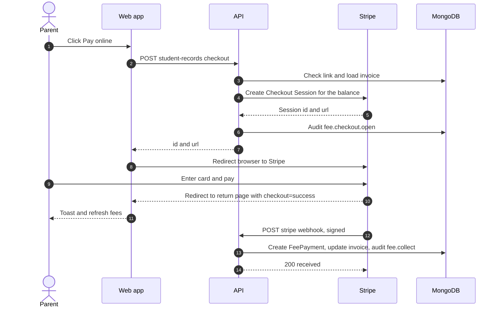

import { Aside, Steps, Card, CardGrid, LinkCard, Badge } from '@astrojs/starlight/components';
import Pipeline from '../../../../components/Pipeline.astro';
import ScreenAnatomy from '../../../../components/ScreenAnatomy.astro';
import SourceFile from '../../../../components/SourceFile.astro';
import Api from '../../../../components/Api.astro';
import Perm from '../../../../components/Perm.astro';
import Roles from '../../../../components/Roles.astro';
import Route from '../../../../components/Route.astro';
import DemoLogin from '../../../../components/DemoLogin.astro';
import Screenshot from '../../../../components/Screenshot.astro';

A parent should not have to queue at the school office to pay a $220 invoice. With online payments, every open invoice in the family's fees view has a **Pay online** button. It sends the payer to **Stripe Checkout** — a payment page hosted by Stripe — for exactly the invoice's remaining balance. Card details are typed on Stripe's page and never touch Schola. When Stripe has the money it calls Schola back through a signed **webhook**, and only then does Schola record the payment, update the [invoice](/start-here/glossary/#invoice) and issue a numbered receipt.

## At a glance

<CardGrid>
  <Card title="Who uses it" icon="star">
    <Roles list={['parent', 'student', 'school_admin', 'accountant']} note="Families pay their own invoices; school staff can open Checkout for any invoice." />
  </Card>
  <Card title="Where to find it" icon="laptop">
    <Route path="/app/children/:id" label="/app/children/:id → Fees tab" />
    <Route path="/app/my/fees" />
    <Route path="/app/fees" label="/app/fees → Invoices tab" />
  </Card>
  <Card title="Permissions" icon="approve-check">
    <Perm name="fee:read:own" /> (family, plus a link to the student) or <Perm name="fee:collect" /> (school staff)
  </Card>
  <Card title="Needs configuration" icon="setting">
    `STRIPE_SECRET_KEY` to open Checkout, `STRIPE_WEBHOOK_SECRET` to record the result. See [Stripe setup](/setup/services/stripe/).
  </Card>
</CardGrid>

<DemoLogin as="Parent (Sofia Singh)" email="parent@greenfield.example" go="/app/children" />

Sofia Singh has two children in Grade 1: **Mateo Singh** (Grade 1 · A) and **Ryan Singh** (Grade 1 · B). In the demo data Mateo's invoice for the current month ($220.00) is still `pending`, which makes it the one to pay in a video. Exact statuses depend on the day you ran `pnpm seed`.

## How it works

<Pipeline
  caption="The money moves on Stripe; the ledger moves only when Stripe's signed webhook arrives."
  steps={[
    { label: 'Pay online', icon: 'credit-card', note: 'Parent clicks on an open invoice' },
    { label: 'Session', icon: 'server', note: 'API prices the remaining balance' },
    { label: 'Checkout', icon: 'lock', note: 'Card entered on Stripe' },
    { label: 'Webhook', icon: 'send', note: 'Stripe calls the API, signed' },
    { label: 'Paid', icon: 'badge-check', note: 'Payment, receipt, invoice updated' },
  ]}
/>

Two things happen in parallel after the payer clicks **Pay** on Stripe: the **browser** is sent back to Schola, and **Stripe's servers** call the webhook. Schola never treats the browser's return as proof of payment — anybody can type `?checkout=success` into an address bar. The invoice changes only when the webhook arrives with a valid `Stripe-Signature` header.

## The screen

<Screenshot name="student-my-fees" alt="A student’s fees with the pay online option" path="/app/my/fees" />

The button lives in the shared per-student fees view. A parent reaches it from **My children → child → Fees**; a student from **My fees**.

<ScreenAnatomy
  title="Child record — Fees tab"
  path="/app/children/:id?tab=fees"
  regions={[
    { label: 'Sidebar', desc: 'My school → My children', area: 'sidebar' },
    { label: 'Top bar', desc: 'Breadcrumb "School / My children"', area: 'top' },
    { label: 'Child header', desc: '"My children" back link, initials, name, class · section · roll, admission number' },
    { label: 'Tabs', desc: 'Attendance · Grades · Remarks · Fees' },
    { label: 'Stat tiles', desc: '"Balance due" (red with "N overdue" when late), "Next due", "Paid so far"' },
    { label: 'Invoices card', desc: 'Invoice · Due · Total · Balance · Status, and "Pay online" on open rows', size: 2, tone: 'accent' },
    { label: 'Payments card', desc: 'Receipt · Paid on · Method · Amount, and a "PDF" button per receipt', size: 2 },
  ]}
/>

`/app/my/fees` shows the same stat tiles and cards under the header **My fees** ("Invoices, payments and receipts."). The **Status** column shows `paid`, `partial`, `pending` or `waived`, and a red **Overdue** pill for an open invoice whose due date has passed.

## Step by step

Before recording, make sure the API runs with Stripe test keys and the webhook listener (see [Make it work locally](#make-it-work-locally)).

<Steps>
1. **Sign in as the parent.** Use `parent@greenfield.example`. The dashboard shows a card for each child with a **Fees due** tile ("Next due …" or, in red, "Overdue since …").

2. **Open the child's fees.** Click **Fees** on Mateo's dashboard card — or go to **My children** in the sidebar, click **Mateo Singh**, then the **Fees** tab. The URL ends in `?tab=fees`.

3. **Read the summary.** **Balance due** shows what is still owed, **Next due** shows the date and amount of the earliest open invoice, **Paid so far** adds up every receipt.

4. **Start the payment.** In the **Invoices** card, find the open invoice (Status **pending**) and click **Pay online**. The button reads "Opening…" for a moment and every other Pay button is disabled.

5. **Pay on Stripe.** The browser opens `checkout.stripe.com`. The page lists one item, **Invoice INV-…**, priced at the invoice's balance — $220.00. Enter the email, the test card **4242 4242 4242 4242**, any future expiry date (for example 12/34), any three-digit CVC and any name, then click **Pay**.

6. **Come back to Schola.** Stripe returns you to `/app/children/<id>?checkout=success`. A green toast says "Payment received. The receipt appears here once Stripe confirms it." and the `checkout` parameter disappears from the address bar.

7. **See the result.** The return lands on the first tab (**Attendance**), so click **Fees** again. The invoice now shows **paid** with a balance of $0.00, **Balance due** has dropped by $220.00, and a new row in **Payments** shows Method **Online**. If the invoice still says pending, the webhook has not arrived yet — wait a second and reload.

8. **Download the receipt.** Click **PDF** on the new payment row. The receipt opens in a new tab with Method `online` and the Stripe session id (`cs_test_…`) as the reference.

9. **Optional — see it from the school side.** Sign in as `accountant@greenfield.example`, open **Fees → Payments**: the payment is at the top. In **Audit log** the entry `fee.collect` has the actor role `stripe`.
</Steps>

<Aside type="tip" title="A student pays the same way">
Sign in as `student@greenfield.example` (Adam Singh, Grade 8 · A) and open **My fees**. **Pay online** appears on any `pending` or `partial` invoice and returns to `/app/my/fees`. In the demo data Adam's invoices may all be paid already; generate a new one for Grade 8 · A from [Fees](/features/finance/fees/) to show it.
</Aside>

## Every action on this screen

### "Pay online" (parent or student)

<Api method="POST" path="student-records/:id/invoices/:invoiceId/checkout" />

No single permission key guards this route; the API works out **who may pay for this student** (`access.pay`) from the people records:

- <Perm name="fee:collect" /> — school staff, for any student; or
- <Perm name="fee:read:own" /> **and** a link to the student — the student's own record (`Student.userId`) or a parent whose `Parent` record is in the student's `parentIds`.

Anyone else gets a 404 ("Student not found.") so they cannot probe for students in other families. The button itself only renders when the fees response says `canPay: true` and the invoice is `pending` or `partial` with a balance above zero.

The request body is `{ returnTo }`, one of `my-fees`, `child` or `fees`. The API — not the browser — turns that into the return address, so a payer can never be redirected to an arbitrary site:

| `returnTo` | Success and cancel URLs |
|---|---|
| `my-fees` | `/app/my/fees?checkout=success` / `?checkout=cancel` |
| `child` | `/app/children/<studentId>?checkout=success` / `?checkout=cancel` |
| `fees` | `/app/fees?checkout=success` / `?checkout=cancel` (used by the staff student profile) |

Then the API:

1. Loads the invoice **for that student, inside the caller's school**. A `paid`, `waived` or `cancelled` invoice is refused with "This invoice cannot be paid." (409); a zero balance with "Invoice has no balance." (409).
2. Creates a Stripe Checkout Session in `payment` mode with one line item named "Invoice *number*", priced at the **remaining balance** in the school's currency (USD by default), converted to cents.
3. Stores `metadata.kind = "fee"`, `invoiceId` and `schoolId` on the session, and the invoice id as `client_reference_id`.
4. Writes a `fee.checkout.open` audit entry with the amount and session id.
5. Returns `{ id, url }`; the browser goes to `url`.

On failure the toast shows the API's message, or "Online payment is not available right now." if there is none, and the button becomes clickable again.

### "Pay" (school staff, on /app/fees)

The Accountant or School Admin can take a card payment at the counter: **Fees → Invoices → Pay** on a `pending` or `partial` row.

<Api method="POST" path="fee-invoices/:id/checkout" perm="fee:collect" />

It creates the same kind of session and returns to `/app/fees`. On success the page opens the **Payments** tab with "Stripe accepted the payment. It appears here once the webhook records it."; on cancel it opens **Invoices** with "Payment cancelled.". Staff can also use **Pay online** on a student's profile (**People → Students → student → Fees**), which returns to `/app/fees` as well.

### Cancelling on Stripe

Clicking the back arrow on Stripe's page returns to the same Schola page with `?checkout=cancel`. Families see "Payment cancelled. Nothing was charged."; nothing is written to the database and the invoice is unchanged.

### The webhook

<Api method="POST" path="stripe/webhook" />

Called by Stripe only — no session cookie, no CSRF token. It is mounted **before** the JSON body parser because Stripe signs the raw request body.

1. If `STRIPE_WEBHOOK_SECRET` is empty, it answers **503** and does nothing.
2. It verifies the `Stripe-Signature` header against the raw body. A missing or wrong signature gets **400**.
3. For `checkout.session.completed` and `checkout.session.async_payment_succeeded` it fulfils the session — `metadata.kind = "salary"` goes to payroll, everything else to fees. `checkout.session.async_payment_failed` is only logged.
4. It always answers **200** `{ received: true }` once the signature is valid.

Fee fulfilment (<SourceFile path="apps/api/src/services/stripe/fulfill.ts" symbol="fulfillCheckoutSession" />):

1. Skip unless `payment_status` is no longer `unpaid` (so `paid` or `no_payment_required`). Delayed methods such as bank debits are recorded when `async_payment_succeeded` arrives.
2. Skip if a payment with `reference` equal to this session id already exists — **Stripe may deliver the same event twice; Schola records it once.**
3. Load the invoice by the ids in the metadata. Stop if it is missing or `cancelled`.
4. Record `min(amount Stripe charged, remaining balance)` as a `FeePayment` with method `online`, reference = session id, a new `RCT-…` receipt number, note "Paid with Stripe Checkout.", and no staff member as receiver.
5. Add it to `amountPaid`; set the invoice to `paid` if nothing remains, otherwise `partial`.
6. Write a `fee.collect` audit entry with `actorRoleAtTime: "stripe"`, no actor id, user agent `stripe-webhook` and the session id as request id.

## Test cards

Stripe test mode accepts these card numbers (any future expiry, any CVC, any name):

| Card number | What happens |
|---|---|
| `4242 4242 4242 4242` | Payment succeeds. The webhook marks the invoice paid. |
| `4000 0025 0000 3155` | Stripe asks for 3D Secure authentication first, then succeeds. |
| `4000 0000 0000 0002` | Declined on Stripe's page. Nothing reaches Schola; the invoice stays open. |

Test mode never moves real money. Use the keys from a Stripe sandbox, not live keys, for demos.

## Make it work locally

<Steps>
1. Put a Stripe **test** secret key in `test.env` as `STRIPE_SECRET_KEY` (a restricted `rk_test_…` key or `sk_test_…`). Without it, Checkout stays off.

2. Start the API with `pnpm --filter @schola/api dev`. The script starts the Stripe CLI next to the API: `stripe listen` forwards `checkout.session.completed`, `checkout.session.async_payment_succeeded` and `checkout.session.async_payment_failed` to `http://127.0.0.1:8000/api/v1/stripe/webhook`. If the API is already running, use `pnpm --filter @schola/api stripe:listen` instead.

3. Copy the signing secret that `stripe listen` prints (`whsec_…`) into `test.env` as `STRIPE_WEBHOOK_SECRET` and restart the API.

4. Check `APP_URL` (default `http://localhost:3000`) — Stripe sends the payer back to `APP_URL` plus the return path.
</Steps>

In production, add a webhook endpoint in the Stripe Dashboard pointing at `https://schola.reactbd.com/api/v1/stripe/webhook` for the same three events and put its signing secret in `STRIPE_WEBHOOK_SECRET`. Full details: [Stripe setup](/setup/services/stripe/) and [Environment variables](/reference/environment-variables/).

### When Stripe is not configured

| Missing | What the user sees | What the server does |
|---|---|---|
| `STRIPE_SECRET_KEY` | **Pay online** is still shown (the browser cannot know). Clicking it shows the toast "Stripe is not configured. Set STRIPE_SECRET_KEY." and the button resets. | The checkout route returns 503. Nothing is written. |
| `STRIPE_WEBHOOK_SECRET` | Checkout works and Stripe takes the test payment, the return toast says success — but the invoice **stays open**. | The webhook answers 503, so no payment is recorded. After setting the secret, resend the event (`stripe events resend <event id>`, or **Resend** on the event in the Stripe Dashboard). Fulfilment is idempotent, so a resend is safe. |
| Both | As for `STRIPE_SECRET_KEY`. | — |

Manual payments on [Fees](/features/finance/fees/) (cash, bank transfer, cheque) work with or without Stripe.

## Who sees what

| Role | Can pay online | From where |
|---|---|---|
| **Parent** | Yes, for each linked child | <Route path="/app/children/:id" /> → **Fees** tab; dashboard **Fees** button |
| **Student** | Yes, own invoices | <Route path="/app/my/fees" /> |
| **School Admin, Accountant** | Yes, for any student (<Perm name="fee:collect" />) | <Route path="/app/fees" /> → **Invoices** → **Pay**; student profile → **Fees** → **Pay online** |
| **Principal, Vice Principal, Teacher, Staff** | No | They hold neither `fee:collect` nor `fee:read:own` |

A parent who opens a child id that is not linked to them sees "This child isn't linked to your account".

## Under the hood

- <SourceFile path="apps/web/src/components/records/student-fees.tsx" symbol="StudentFees" /> — stat tiles, tables and the **Pay online** call.
- <SourceFile path="apps/web/src/components/records/checkout-notice.tsx" symbol="CheckoutNotice" /> — the return toast on `/app/my/fees` and `/app/children/:id`.
- <SourceFile path="apps/web/src/lib/stripe-checkout.ts" symbol="startStripeCheckout" /> — the staff **Pay** buttons on Fees and Payroll.
- <SourceFile path="apps/api/src/modules/student-records/student-records.routes.ts" /> — family fees view, checkout and receipt routes.
- <SourceFile path="apps/api/src/services/scopes/student-access.ts" symbol="decideStudentAccess" /> — who may see and pay for a student.
- <SourceFile path="apps/api/src/services/stripe/checkout.ts" symbol="openCheckout" /> — creates the Checkout Session.
- <SourceFile path="apps/api/src/services/stripe/client.ts" symbol="stripeClient" /> — refuses with 503 when `STRIPE_SECRET_KEY` is empty.
- <SourceFile path="apps/api/src/services/stripe/money.ts" /> — dollars to cents and back; `shouldFulfillCheckout`.
- <SourceFile path="apps/api/src/modules/stripe/stripe.webhook.ts" symbol="stripeWebhook" /> and <SourceFile path="apps/api/src/app.ts" /> — the raw-body webhook route.
- <SourceFile path="packages/validation/src/me.ts" symbol="studentCheckoutSchema" /> — `returnTo`.

Other family-side endpoints on this screen:

<Api method="GET" path="student-records/:id/fees" />
<Api method="GET" path="student-records/:id/payments/:paymentId/receipt.pdf" />

The fees response is `{ invoices (each with remaining), payments, totals: { due }, currency, locale, canPay }`. Cancelled invoices are left out. Receipt downloads are logged as `fee.receipt.download`.

## Edge cases and gotchas

- **The amount is fixed by the server.** Checkout always charges the full remaining balance; a family cannot choose a smaller amount online. Part payments are recorded at the office on [Fees](/features/finance/fees/).
- **Partially paid invoices.** If the office has already taken $100 of a $220 invoice, **Pay online** charges the remaining $120.00 and the invoice becomes `paid`.
- **The return page can be ahead of the webhook.** The toast appears as soon as the browser returns; the list refreshes once at that moment. If the webhook lands a moment later, reload the page.
- **The Fees tab is not reopened after returning.** The return URL carries only `?checkout=…`, so a parent lands on the child's first tab and has to click **Fees** again.
- **No confirmation email.** Schola sends no email or in-app notification for a successful payment; Stripe's own receipt email depends on your Stripe settings.
- **Opening Checkout twice.** Each click creates a new session for the balance at that moment. Paying both sessions charges twice — see the caution below.

:::caution[Money Stripe collected but Schola could not apply]
The webhook records `min(charged, remaining balance)` and stops if the balance is already zero. If the invoice was paid in the meantime (a second Checkout tab, or cash recorded at the office while the parent was on Stripe), the extra money stays in the school's Stripe account with **no Schola record and no automatic refund**. Find the session in the Stripe Dashboard and refund it there. The same applies to an invoice that was cancelled or deleted while Checkout was open.
:::

:::caution[Small inconsistencies in the current code]
- The staff route `POST /fee-invoices/:id/checkout` does not write the `fee.checkout.open` audit entry that the family route writes.
- A staff member paying from a student's profile is returned to `/app/fees`, not to that student's profile.
:::

## Related pages

<CardGrid>
  <LinkCard title="Fees" description="Structures, invoices, manual payments and receipts." href="/features/finance/fees/" />
  <LinkCard title="Stripe setup" description="Keys, the webhook listener and troubleshooting." href="/setup/services/stripe/" />
  <LinkCard title="Parent portal" description="Everything a parent sees for each child." href="/features/portals/parent/" />
  <LinkCard title="Student portal" description="My attendance, grades, fees and more." href="/features/portals/student/" />
  <LinkCard title="Payroll" description="The same Checkout flow used to pay payslips." href="/features/finance/payroll/" />
  <LinkCard title="Security" description="How Schola protects sessions, cookies and webhooks." href="/architecture/security/" />
</CardGrid>
