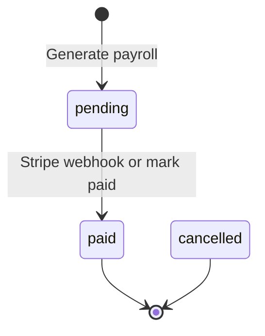

import { Aside, Steps, Card, CardGrid, LinkCard, Badge } from '@astrojs/starlight/components';
import Pipeline from '../../../../components/Pipeline.astro';
import ScreenAnatomy from '../../../../components/ScreenAnatomy.astro';
import SourceFile from '../../../../components/SourceFile.astro';
import Api from '../../../../components/Api.astro';
import Perm from '../../../../components/Perm.astro';
import Roles from '../../../../components/Roles.astro';
import Route from '../../../../components/Route.astro';
import DemoLogin from '../../../../components/DemoLogin.astro';
import BarChart from '../../../../components/BarChart.astro';
import Screenshot from '../../../../components/Screenshot.astro';
import { Tabs as ShotTabs, TabItem as ShotTab } from '@astrojs/starlight/components';

Payroll is the outgoing side of school finance. The Accountant describes each kind of pay once as a **salary structure** — a base salary plus earnings (allowances) and deductions (tax, pension). At the end of the month they pick a structure and the teachers and staff it applies to, and Schola creates one **payslip** (a salary record) per person for that month, with the net pay worked out. Each payslip can then be paid and downloaded as a PDF, and every teacher and staff member sees their own payslips under **My payslips**. Salaries are sensitive, so only people with <Perm name="salary:read:all" /> see the whole payroll, and payslip downloads are written to the audit log.

## At a glance

<CardGrid>
  <Card title="Who uses it" icon="star">
    <Roles list={['school_admin', 'accountant']} note="Teachers and staff see only their own payslips." />
  </Card>
  <Card title="Where to find it" icon="laptop">
    <Route path="/app/payroll" /> — sidebar **Finance → Payroll**
    <Route path="/app/my/payslips" /> — sidebar **My school → My payslips**
  </Card>
  <Card title="Permissions" icon="approve-check">
    <Perm name="salary_structure:read" /> <Perm name="salary_structure:create" /> <Perm name="salary_structure:update" /> <Perm name="salary:read:all" /> <Perm name="salary:pay" /> <Perm name="salary:read:own" /> <Perm name="report:export" />
  </Card>
  <Card title="Money format" icon="information">
    Amounts use the school's currency and locale — **USD, `en-US`** by default ($4,220.00).
  </Card>
</CardGrid>

<DemoLogin as="Accountant (Ibrahim Ahmed)" email="accountant@greenfield.example" go="/app/payroll" />

The demo school has three salary structures and a payslip for every teacher (30) and staff member (10) for each month of the current term: earlier months are `paid` by bank transfer, the current month is `pending`.

<BarChart
  title="Seeded salary structures — monthly net pay"
  unit="USD"
  data={[
    { label: 'Teacher — Senior', value: 4220, note: '$4,200 base + $750 allowances − $730 deductions' },
    { label: 'Teacher — Standard', value: 3440, note: '$3,400 base + $600 − $560' },
    { label: 'Support staff', value: 2095, note: '$2,300 base + $120 − $325' },
  ]}
/>

## How it works

<Pipeline
  caption="One payroll month, from the pay scale to the employee's PDF."
  steps={[
    { label: 'Structure', icon: 'layers', note: 'Base pay, earnings, deductions' },
    { label: 'Generate', icon: 'users', note: 'One payslip per person for a month' },
    { label: 'Pending', icon: 'clipboard-list', note: 'Ready to check and pay' },
    { label: 'Pay', icon: 'banknote', note: 'Mark paid or Stripe Checkout' },
    { label: 'Payslip PDF', icon: 'file-text', note: 'Employee downloads it' },
  ]}
/>

The sums are simple and are done once, when the payslip is generated:

```text
earnings   = sum of components where kind = "earning"
deductions = sum of components where kind = "deduction"
net pay    = base amount + earnings − deductions
```

Example — Grace Mensah (teacher, "Teacher — Senior"): $4,200.00 base + Housing allowance $600.00 + Transport allowance $150.00 − Income tax $520.00 − Pension $210.00 = **$4,220.00** net.

A payslip **copies** the structure's base amount and components. Changing the structure later never changes payslips that already exist.

### Payslip statuses



| Status | Meaning |
|---|---|
| `pending` | Generated, not paid yet. Shows **Mark paid** and **Pay** buttons (to holders of <Perm name="salary:pay" />). |
| `paid` | Paid. `paidAt`, `paymentMethod` and `paymentReference` are filled in. |
| `cancelled` | Allowed by the data model and hidden from employee views, but nothing in the app sets it yet. |

## The screen

Real screenshots from the seeded demo school (switch the docs theme to see dark mode):

<ShotTabs>
  <ShotTab label="Accountant">
    <Screenshot name="accountant-payroll" alt="The Payroll page" path="/app/payroll" />
  </ShotTab>
  <ShotTab label="Teacher">
    <Screenshot name="teacher-my-payslips" alt="A teacher’s payslips" path="/app/my/payslips" />
  </ShotTab>
</ShotTabs>


<ScreenAnatomy
  title="Payroll"
  path="/app/payroll"
  regions={[
    { label: 'Sidebar', desc: 'Finance → Payroll (needs salary:read:all)', area: 'sidebar' },
    { label: 'Top bar', desc: 'Breadcrumb "School / Payroll"', area: 'top' },
    { label: 'Page header', desc: 'Title "Payroll", "Salary structures and monthly payroll runs." and the "Export 2026 CSV" button (current year)' },
    { label: 'Tabs', desc: '"Salary structures" (opens first) and "Payroll runs"' },
    { label: 'Tab toolbar', desc: '"Add structure" or "Generate payroll"', tone: 'accent' },
    { label: 'Table', desc: 'Structures, or payslips newest month first — 20 per page with a pager', size: 3 },
  ]}
/>

| Tab | Columns | Row actions |
|---|---|---|
| **Salary structures** | Name · Base · Earnings · Deductions | "Edit" (with <Perm name="salary_structure:update" />) |
| **Payroll runs** | Payslip · Employee (name, then employee ID · Teacher or Staff) · Period · Net · Status | "Payslip" (PDF) on every row; "Mark paid" and "Pay" on `pending` rows, with <Perm name="salary:pay" /> |

And the employee's own view:

<ScreenAnatomy
  title="My payslips"
  path="/app/my/payslips"
  regions={[
    { label: 'Sidebar', desc: 'My school → My payslips (teachers and staff)', area: 'sidebar' },
    { label: 'Top bar', desc: 'Breadcrumb "School / My payslips"', area: 'top' },
    { label: 'Page header', desc: '"My payslips" — "Monthly pay with a PDF for each month."' },
    { label: 'Payslip list', desc: 'Month (with payslip number) · Net pay · Status · Paid on, and a "PDF" button per row', size: 3, tone: 'accent' },
  ]}
/>

## Step by step

Record this in two parts: the Accountant runs payroll, then the teacher reads her payslip.

<Steps>
1. **Open Payroll.** Signed in as the Accountant, click **Payroll** under **Finance** in the sidebar. The **Salary structures** tab lists "Teacher — Senior" (Base $4,200.00, Earnings $750.00, Deductions $730.00), "Teacher — Standard" and "Support staff".

2. **Add a structure.** Click **Add structure**. The drawer **New salary structure** ("Base pay and components for a role.") opens. Type the **Name** "Lab technician" and the **Base amount** `2600`. Click **Add component** three times and fill in "Transport allowance" `120` **Earning**, "Income tax" `240` **Deduction**, "Pension" `130` **Deduction**. Click **Save**. The toast says "Salary structure created." and the row shows Earnings $120.00 and Deductions $370.00.

3. **Open the payroll runs.** Click the **Payroll runs** tab. Payslips are listed newest month first; the current month's rows are **pending**. The **Employee** column says whose payslip each row is — for example "Grace Mensah" over "TCH-005 · Teacher".

4. **Generate a month.** Click **Generate payroll**. In the **Generate payroll** card, keep **Year**, set **Month** to next month, choose **Salary structure** "Teacher — Senior ($4,200.00)". In **Teachers**, select Grace Mensah (TCH-005) — hold Ctrl (Windows) or Cmd (Mac) to select more than one. Leave **Non-teaching staff** empty and click **Generate**. The toast says "Generated 1 payslip(s) (0 already existed)." and the new row appears at the top.

5. **Show that it is safe to repeat.** Click **Generate payroll** again with the same month and person: "Generated 0 payslip(s) (1 already existed)." Each person gets at most one payslip per month.

6. **Check the payslip.** Click **Payslip** on the new row. The PDF opens in a new tab: school name and address, the payslip number and month, "Grace Mensah · TCH-005 · B.Ed Primary", "Status: pending", an **Earnings** column (Base salary, each allowance, Gross earnings), a **Deductions** column (each deduction, Total deductions) and **Net pay** $4,220.00.

7. **Record a bank transfer.** Click **Mark paid** on the same row. The **Mark as paid** drawer opens with the employee's name, the payslip number, month and net pay, and the line "For salary paid outside Schola — no card is charged." Keep **Paid on** (today) and **Method** "Bank transfer", type a **Reference (optional)** such as the bank transaction number, and click **Mark as paid**. The toast says "Payslip PAY-… marked as paid." and the row turns **paid**.

8. **Or pay through Stripe.** On another `pending` row, click **Pay**. The button reads "Opening…", then Stripe Checkout opens for "Payslip PAY-…" and its net pay. Pay with the test card `4242 4242 4242 4242`, any future expiry and any CVC. Back on Schola, the **Payroll runs** tab opens with the toast "Stripe accepted the payment. The payslip updates when the webhook records it." Once the webhook arrives the row turns **paid**.

9. **Switch to the teacher.** Sign out and sign in as `teacher@greenfield.example` (Grace Mensah). The dashboard shows a **Latest payslip** tile with her net pay and a **My payslips** button. Click it (or **My school → My payslips** in the sidebar). Each month is listed with its number, **Net pay**, **Status** and **Paid on**. Click **PDF** to download one.
</Steps>

<Aside type="tip" title="The same for non-teaching staff">
Sign in as `staff@greenfield.example` — Ruby Novak, Librarian, on the "Support staff" structure ($2,095.00 net) — and open **My payslips**.
</Aside>

## Every action on this screen

### "Add structure" and "Edit" (Salary structures tab)

Opens **New salary structure** or **Edit salary structure** ("Changes apply to payroll runs from now on; payslips already generated keep their amounts.").

| Field | Rules |
|---|---|
| **Name** | 2–120 characters, unique in the school. |
| **Base amount** | Zero or more. |
| **Components** | Optional list. Each has a name (1–80 characters), an amount (zero or more) and a kind — **Earning** or **Deduction**. "Add component" appends a row, "Remove" deletes one. |

<Api method="GET" path="salary-structures" perm="salary_structure:read" />
<Api method="POST" path="salary-structures" perm="salary_structure:create" />
<Api method="PATCH" path="salary-structures/:id" perm="salary_structure:update" />

Toasts: "Salary structure created." / "Salary structure saved."; a duplicate name gives "Another record already uses this name.". Audit actions `salary_structure.create` and `salary_structure.update` store before and after values. There is no delete.

### "Generate payroll" (Payroll runs tab)

Toggles the **Generate payroll** card (the button reads "Cancel" while it is open).

| Field | Rules |
|---|---|
| **Year** | 2000–3000. Defaults to this year. |
| **Month** | January–December. Defaults to this month. |
| **Salary structure** | Required. Options read "Name ($base)". |
| **Teachers** | Multi-select ("Hold Ctrl/Cmd to multi-select."), shown as "First Last (TCH-001)". |
| **Non-teaching staff** | Multi-select, shown as "First Last (STF-001)". |

At least one teacher or staff member is required ("Provide at least one of teacherIds or staffIds").

<Api method="POST" path="salary-records/generate" perm="salary_structure:create" />

The API checks that every selected person belongs to your school (otherwise "One or more teachers not found in this school." / "One or more staff not found in this school.", 404), then creates one `pending` record per person with the structure's figures and a number `PAY-YYYYMM-XXXXXX` (the month it was generated plus six random hexadecimal characters). A unique index on (person, year, month) skips anyone who already has a payslip that month. The response `{ created, skipped, total }` becomes "Generated N payslip(s) (M already existed)." One `payroll.generate` audit entry records the month and counts.

### The runs table

<Api method="GET" path="salary-records" perm="salary:read:all" />

Each row carries `employee: { name, employeeId }` — the teacher's or staff member's name and employee ID, looked up in this school only (removed employees still name their old payslips) and nothing else from their record. The table shows the name, then "employee ID · Teacher" or "· Staff"; a row whose person can't be found shows "Unknown employee".

### "Payslip" (PDF)

<Api method="GET" path="salary-records/:id/payslip.pdf" perm="salary:read:all" />

Opens the A4 payslip in a new tab, named after the payslip number. Every download writes a sensitive-read audit entry, `payroll.payslip.download`, naming who looked at whose payslip. A paid payslip ends with the line "Payment method: Bank transfer" (or Cash, Online, Cheque, Other) followed by the reference.

### "Mark paid"

For salaries paid by bank transfer, cash or cheque. Shown on `pending` rows to
holders of <Perm name="salary:pay" />. It opens the **Mark as paid** drawer:

| Field | Rules |
|---|---|
| **Paid on** | A date; defaults to today. Left empty, the API uses now. |
| **Method** | Bank transfer (default), Cash, Cheque, Online or Other — stored as `bank_transfer`, `cash`, `cheque`, `online`, `other`. |
| **Reference (optional)** | Up to 120 characters — "Bank transaction or cheque number." |
| **Notes (optional)** | Free text. |

<Api method="POST" path="salary-records/:id/pay" perm="salary:pay" />

The form validates with the shared `paySalarySchema`. The API refuses a
payslip that is already paid ("Already paid.", 409) or cancelled ("This
payslip was cancelled and can't be paid.", 409), then sets `status: "paid"`,
`paidAt`, `paymentMethod`, `paymentReference` and `notes`, and writes
`salary.pay` with before and after. No money moves through Schola. On success
the toast reads "Payslip PAY-… marked as paid." and the table refreshes.

### "Pay" (Stripe Checkout)

Shown on `pending` rows to holders of <Perm name="salary:pay" />.

<Api method="POST" path="salary-records/:id/checkout" perm="salary:pay" />

The API refuses a payslip that is not `pending` ("This payroll run cannot be paid.", 409) or whose net is zero ("Nothing to pay.", 409). Otherwise it opens a Stripe Checkout Session for the **net amount** with `metadata.kind = "salary"`, returning to `/app/payroll?checkout=success` or `?checkout=cancel`. On return the page opens **Payroll runs** with "Stripe accepted the payment. The payslip updates when the webhook records it." or "Payment cancelled.".

When Stripe's webhook arrives (see [Online payments](/features/finance/online-payments/#the-webhook)), <SourceFile path="apps/api/src/services/stripe/fulfill.ts" symbol="fulfillSalaryCheckout" /> marks the payslip `paid` with method `online`, the session id as reference and the note "Paid with Stripe Checkout.", and writes a `salary.pay` audit entry with actor role `stripe`. It is idempotent (an already-paid payslip is left alone) and it refuses to mark a payslip paid if Stripe collected less than the net amount.

### "Export 2026 CSV"

<Api method="GET" path="reports/payroll/export.csv" perm="report:export" />

Downloads `payroll-2026.csv` for the current year with the columns Payslip, Year, Month, Base, Earnings, Deductions, Net, Status, Paid at. The endpoint also takes `month`, and needs <Perm name="salary:read:all" /> as well as <Perm name="report:export" />. Logged as `report.payroll.export`.

### "PDF" on My payslips

<Api method="GET" path="me/payslips" perm="salary:read:own" />
<Api method="GET" path="me/payslips/:id/payslip.pdf" perm="salary:read:own" />

The list returns the last 60 payslips of the signed-in employee (cancelled ones left out), newest first. The API finds "the employee" through the people records — the `Teacher` or `Staff` record whose `userId` is the signed-in account — so nobody can request someone else's payslip by changing the id: it simply comes back "Payslip not found.". Downloads are audited as `payroll.payslip.download`, just like the Accountant's.

## Who sees what

| Role | Payroll screen | Own payslips | Other places |
|---|---|---|---|
| **School Admin** | Everything | — | Payslips (last 12 months) on each teacher's and staff member's profile |
| **Accountant** | Everything — the same permissions as the School Admin | No **My payslips** link (the role has no <Perm name="salary:read:own" />); their own payslip is visible on Payroll | Same profile payslips |
| **Teacher** | No access | <Route path="/app/my/payslips" /> and the dashboard **Latest payslip** tile | — |
| **Staff** | No access | <Route path="/app/my/payslips" /> and the dashboard tile | — |
| **Principal, Vice Principal** | No access | — | — |
| **Parent, Student** | No access | — | — |

**My payslips** appears only when the account holds <Perm name="salary:read:own" /> **and** is linked to a teacher or staff record. An account with the role but no linked record sees "No staff record is linked to your account".

## Under the hood

- <SourceFile path="apps/web/src/app/(tenant)/app/payroll/page.tsx" /> — both tabs, the generate form, the **Mark as paid** drawer (`MarkPaidDrawer`) and the Stripe **Pay** button.
- <SourceFile path="apps/web/src/app/(tenant)/app/my/payslips/page.tsx" /> and <SourceFile path="apps/web/src/components/records/payslip-list.tsx" symbol="PayslipList" /> — the employee view (also used on teacher and staff profiles).
- <SourceFile path="apps/api/src/modules/payroll/salary-structures.routes.ts" />
- <SourceFile path="apps/api/src/modules/payroll/salary-records.routes.ts" /> — list (filters `year`, `month`, `status`, `teacherId`, `staffId`), generate, checkout, pay, payslip PDF.
- <SourceFile path="apps/api/src/modules/me/me.routes.ts" /> — `/me/payslips` and the dashboard's latest-payslip summary.
- <SourceFile path="apps/api/src/modules/people/_overview.ts" symbol="employeeRecords" /> — payslips on profile pages, only for <Perm name="salary:read:all" />.
- <SourceFile path="apps/api/src/services/pdf/payslip.tsx" symbol="PayslipPdf" /> and <SourceFile path="apps/api/src/services/pdf/documents.ts" symbol="renderPayslip" />.
- <SourceFile path="packages/validation/src/payroll.ts" /> — `createSalaryStructureSchema`, `generatePayrollSchema`, `paySalarySchema`.

**Data** (<SourceFile path="packages/db/src/models/payroll.ts" />, collections `salary_structures` and `salary_records`):

```ts
SalaryStructure { schoolId, name, baseAmount,
                  components: [{ name, amount, kind: "earning" | "deduction" }],
                  description }
SalaryRecord    { schoolId, teacherId|null, staffId|null, structureId|null,
                  year, month /* 1-12 */, baseAmount, earnings, deductions,
                  netAmount, components /* copied */, payslipNumber,
                  status: "pending" | "paid" | "cancelled",
                  paidAt, paymentMethod, paymentReference, notes }
```

Exactly one of `teacherId` and `staffId` is set. Unique indexes: structure `name` per school; `payslipNumber` per school; one record per `(teacherId, year, month)` and per `(staffId, year, month)`. Both models are soft-deleted and tenant-scoped.

**Audit actions:** `salary_structure.create`, `salary_structure.update`, `payroll.generate`, `salary.pay`; sensitive reads `payroll.payslip.download` and `report.payroll.export`.

## Edge cases and gotchas

- **One payslip per person per month.** Picking the wrong structure for someone cannot be fixed by generating again — the second run is skipped. There is no edit or cancel for a payslip in the app yet.
- **Mixed structures need separate runs.** One run uses one structure. Generate "Teacher — Senior" for the senior teachers, then "Teacher — Standard" for the rest, and so on.
- **Structure edits are not retroactive.** Raise a base salary and only payslips generated afterwards use it.
- **The designation on a teacher's PDF is their qualification.** The payslip prints `Teacher.qualification` (Grace Mensah's reads "B.Ed Primary") where a staff payslip prints `Staff.designation` ("Librarian").
- **Long lists.** The Teachers and Non-teaching staff pickers load the first 100 of each, which covers the demo school (30 and 10) but not a very large staff.
- **Sample mode does not apply here.** Payroll always shows real data: the **Load sample** button is disabled on this page, and if sample mode is already on, a "Real data on this page." notice explains why.

:::caution[Known limitations in the current code]
- **"Pay" collects money rather than paying it out.** Stripe Checkout is a *pay-in*: the card entered on Stripe's page is charged and the money lands in the school's own Stripe account. Nothing is sent to the employee — the button only records that the payslip was settled. Treat it as a demo of the payment flow, not as a payout system.
- **The CSV export has no name column.** The **Payroll runs** table names each employee, but `payroll-2026.csv` still lists payslips by number only.
- **Deductions larger than pay break generation.** If a structure's deductions exceed base plus earnings, the net would be negative; the database rejects it and **Generate** fails with the generic "Something went wrong." instead of a clear message.
- **Viewing salaries in a list is not audited.** spec lists "salary views" as sensitive reads. PDF downloads and CSV exports are logged, but opening **Payroll runs**, a profile's payslip card or **My payslips** writes no audit entry.
- **"Generate payroll" is shown to everyone who can open the page.** It is guarded by <Perm name="salary_structure:create" /> on the API, which both roles with page access hold today.
:::

## Related pages

<CardGrid>
  <LinkCard title="Tutorial: payroll" description="Run your first payroll month step by step." href="/tutorial/payroll/" />
  <LinkCard title="Online payments" description="How Stripe Checkout and the webhook work." href="/features/finance/online-payments/" />
  <LinkCard title="Teacher portal" description="My classes, attendance and payslips." href="/features/portals/teacher/" />
  <LinkCard title="Staff portal" description="What non-teaching staff see." href="/features/portals/staff/" />
  <LinkCard title="Audit log" description="Find every payslip download and payment." href="/features/insight/audit-log/" />
  <LinkCard title="Fees" description="The income side of school finance." href="/features/finance/fees/" />
</CardGrid>
