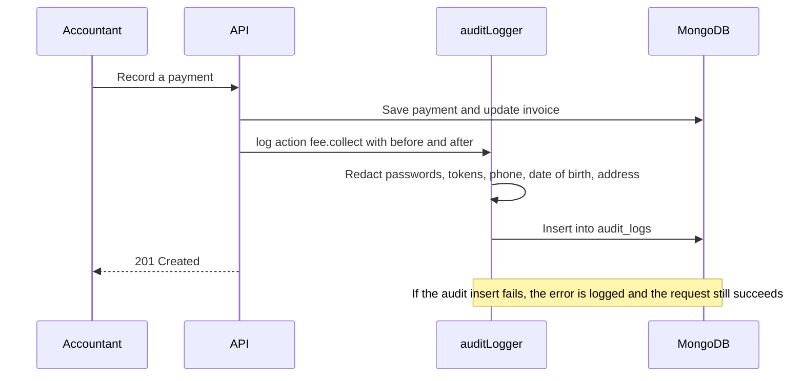

import { Steps, Card, CardGrid, LinkCard } from '@astrojs/starlight/components';
import Pipeline from '../../../../components/Pipeline.astro';
import ScreenAnatomy from '../../../../components/ScreenAnatomy.astro';
import SourceFile from '../../../../components/SourceFile.astro';
import Api from '../../../../components/Api.astro';
import Perm from '../../../../components/Perm.astro';
import Roles from '../../../../components/Roles.astro';
import Route from '../../../../components/Route.astro';
import DemoLogin from '../../../../components/DemoLogin.astro';
import Screenshot from '../../../../components/Screenshot.astro';

The **audit log** is the school's black box recorder. Every time someone changes school data — admits a student, marks a register, records a payment, approves leave — Schola writes one entry saying *what* happened (the action), *to what* (the resource), *who* did it and in which role, *when*, and from which IP address and browser. Some reads are recorded too, because they expose sensitive data: downloading a receipt, a payslip, a report card or a CSV export.

Entries can never be edited or deleted, not even by the School Admin. That is what makes the log useful when something goes wrong: "Who waived this invoice?" has one honest answer.

The [Audit log architecture page](/architecture/audit-log/) explains how entries are written. This page is about the screen a school uses to read them.

## At a glance

<CardGrid>
  <Card title="Who uses it" icon="star">
    <Roles list={['school_admin', 'principal']} note="The Super Admin has a platform-wide log in the platform console." />
  </Card>
  <Card title="Where to find it" icon="laptop">
    <Route path="/app/audit-log" /> — sidebar group **Administration**, item **Audit log**.
  </Card>
  <Card title="Permissions" icon="approve-check">
    <Perm name="audit_log:read:tenant" />. The platform log uses <Perm name="audit_log:read:all" />.
  </Card>
</CardGrid>

<DemoLogin as="School Admin (Amira Hossain)" email="admin@greenfield.example" go="/app/audit-log" />

## How it works

<Pipeline
  caption="Every mutating request ends with one audit entry; the log page only ever reads."
  steps={[
    { label: 'Action', icon: 'user-check', note: 'Someone changes data' },
    { label: 'Service', icon: 'server', note: 'Saves the change' },
    { label: 'auditLogger', icon: 'scroll', note: 'Redacts secrets and PII' },
    { label: 'audit_logs', icon: 'lock', note: 'Append-only collection' },
    { label: 'Audit log page', icon: 'search', note: 'Filter and read' },
  ]}
/>



Each entry has the same shape:

| Field | Example | Meaning |
|---|---|---|
| `schoolId` | Greenfield's id | Which school. Platform events have `null` and never show up here |
| `actorId` | Ibrahim Ahmed's user id | Who did it — `null` for the system or a Stripe webhook |
| `actorRoleAtTime` | `accountant` | Their role at that moment (`stripe` for online payments, `system` for the seed) |
| `action` | `fee.collect` | `<resource>.<verb>` — see the catalogue below |
| `resource` / `resourceId` | `fee_payment` / the payment's id | The record that changed |
| `before` / `after` | the invoice before and after | A snapshot of the change, with secrets and personal data replaced by `[REDACTED]`. Ids are stored as 24-character strings and dates as ISO timestamps |
| `metadata` | `ip`, `userAgent`, `requestId` | Where the request came from |
| `createdAt` | `2026-11-07T09:00:00Z` | When |

For a **sensitive read** (`logRead`), `before` is `null` and `after` is `{ "read": true, "fields": [...] }`.

## The screen

<Screenshot name="admin-audit-log" alt="The school audit log" path="/app/audit-log" />


<ScreenAnatomy
  title="Audit log"
  path="/app/audit-log"
  regions={[
    { label: 'Sidebar', desc: 'Administration → Audit log is highlighted', area: 'sidebar' },
    { label: 'Top bar', desc: 'Breadcrumb "School / Audit log"', area: 'top' },
    { label: 'Page header', desc: '"Audit log" — "Every change to your school\'s data. Append-only."' },
    { label: 'Filters card', desc: 'From and To date pickers and the Action text box', tone: 'accent' },
    { label: 'Entries list', desc: 'Newest first, up to 100 rows: action, time, resource, short id, request id, role — and an "N changes" button that opens a Before / After table', size: 4 },
  ]}
/>

Each row reads like this:

```text
fee.collect                                        11/7/2026, 9:00:00 AM
resource: fee_payment · id 3f9a1c · req 8c41d2e0 · by accountant   2 changes ▾
```

- **Action** in monospace on the left, **date and time** on the right (in your browser's format).
- **resource** — the kind of record.
- **id** — the last six characters of the record's id (enough to match it by eye).
- **by** — the actor's role at the time. The actor's *name* is not shown.
- **req** — the first eight characters of the request id, which also appears in the API's server logs. Seeded entries have no request id.
- **N changes** — shown when the entry's `before` and `after` snapshots differ. Click it to open a small table with one row per changed top-level field — **Field**, **Before**, **After** (nested values as JSON, empty values as "—"); **Hide changes** closes it. Bookkeeping fields (`_id`, `schoolId`, `createdAt`, `updatedAt`, `createdBy`, `updatedBy`) are left out. Ids read as 24-character ids; entries written before this release stored ids as objects such as `{"i0":…,"i3":…}`, and the page reads those back as the same id. Entries without snapshots have no button; a sensitive read shows its `read` and `fields` values.

## Step by step

<Steps>

1. Sign in as `admin@greenfield.example` (password `Schola@2026`). Signing in is itself audited.

2. In the sidebar's **Administration** group, click **Audit log**. The list loads the newest 100 entries for Greenfield International School. At the top is your own `auth.login` (*by school_admin*). Below it are the seeded entries: `fee.collect` *by accountant*, `attendance.mark`, `student.create`, `teacher.create`, `class.create` and `academic_year.create`.

3. In the **Action** box, type `fee.collect`. The list narrows to payments only — including any made online, which show *by stripe*. Type `fee.` instead to see every fee action at once.

4. Clear the **Action** box and try `report.fees.export`. If you downloaded the fees CSV from [Reports](/features/insight/reports/) earlier, the download is here — exports are audited even though nothing changed.

5. Clear the box again. Set **From** to the first of this month. Only entries from that date on remain. Set **To** to today: today's entries stay in the list, because **To** includes the whole day.

6. On a `fee.collect` entry, click **2 changes**. The Before / After table has two rows: `invoice` (the invoice before and after the payment) and `payment` (empty before, the new payment after). Nested records are shown as JSON text.

7. Now make a change somewhere else — for example add a subject on **Subjects** — and come back. The new `subject.create` entry is at the top.

8. Sign out and sign in as `principal@greenfield.example` (Richard Okafor). The Principal sees the same **Audit log** item and the same entries.

</Steps>

:::tip[Recording tip]
Do step 7 live: change something, then switch to the Audit log tab. Seeing your own action appear at the top is the clearest way to explain what the log is for.
:::

## Every action on this screen

### Load the list

<Api method="GET" path="audit-logs" perm="audit_log:read:tenant" />

The page asks for `pageSize=100`. The API always adds `schoolId = your school` to the query, sorts newest first, and returns the entries with the standard pagination meta. While loading, the card shows placeholder rows. If the request fails, it says *"The audit log could not be loaded."* — *"Check your connection and try again."* — with a **Try again** button. With nothing to show it says *"No matching entries"*.

### "From" and "To"

Date pickers. Each change reloads the list with `from` / `to`, which the API turns into a `createdAt` range of whole UTC days: **From** starts at midnight UTC of that day, and **To** includes everything up to the end of its day. The same applies to the platform audit log.

### "Action"

A free-text box with the hint *Matches the start: "student." or "fee.collect"*. It matches actions that **start with** what you type: `student.` finds `student.create`, `student.update`, … and a full name such as `fee.collect` finds just that action. The text is lower-cased and taken literally (a `.` is a dot, not "any character"; `(` cannot break the query), and the anchored match can use the `action` index. The list reloads on every keystroke. The platform audit log works the same way.

The API also accepts `actorId` (a user id) to show one person's actions, but the page has no field for it.

### Action catalogue

The action names you can filter by, grouped by area. Reads marked *(read)* are sensitive reads.

| Area | Actions |
|---|---|
| Sign-in and account | `auth.login`, `auth.logout`, `auth.register`, `auth.google.login`, `auth.google.register`, `auth.password.change`, `auth.password_reset.request`, `auth.password_reset.complete`, `auth.email.verified`, `auth.session.revoke`, `auth.session.revoke_others`, `user.profile.update` |
| School and members | `school.update`, `user_role.grant`, `user_role.revoke`, `admin_transfer.initiate`, `admin_transfer.complete` |
| Academics | `academic_year.create` / `.update` / `.delete`, `class.create` / `.update` / `.delete`, `class.assign_teacher`, `section.create` / `.update` / `.delete`, `subject.create` / `.update` / `.delete` |
| People | `student.*`, `teacher.*`, `parent.*`, `staff.*` (`create`, `update`, `delete`), `enrollment.create`, `enrollment.update` |
| Daily | `attendance.mark`, `staff_attendance.mark`, `timetable.create` / `.update` / `.delete`, `leave.request`, `leave.cancel`, `leave.approve`, `leave.reject`, `remark.create`, `remark.delete` |
| Exams and grades | `exam.create` / `.update` / `.delete`, `grade.enter`, `grade.report_card.download` *(read)* |
| Fees | `fee_structure.create` / `.update`, `fee_invoice.generate`, `fee.collect`, `fee.waive`, `fee.checkout.open`, `fee.receipt.download` *(read)* |
| Payroll | `salary_structure.create` / `.update`, `payroll.generate`, `salary.pay`, `payroll.payslip.download` *(read)* |
| Campus services | `admission.create` / `.update` / `.status` / `.enroll` / `.delete`, `admission.read` *(read)*, `library.book.create` / `.update` / `.delete`, `library.loan.issue`, `library.loan.return`, `transport.route.create` / `.update` / `.delete`, `transport.rider.assign`, `transport.rider.remove`, `hostel.room.create` / `.update` / `.delete`, `hostel.allocate`, `hostel.vacate` |
| Communication and reports | `notification.announce`, `notification.mark_all_read`, `report.attendance.export` *(read)*, `report.fees.export` *(read)*, `report.payroll.export` *(read)* |

Platform actions such as `school.approve`, `school.suspend` or `user.suspend` are stored with `schoolId: null` and only appear in the Super Admin's log.

## Who sees what

| Role | School audit log | What they see |
|---|---|---|
| School Admin | Yes | Every entry for the school |
| Principal | Yes | Every entry for the school — the same list as the School Admin |
| Vice Principal, Teacher, Accountant, Staff, Student, Parent | No — the link is hidden and the API answers `403` | — |
| Super Admin | Platform log at `/platform/audit-log` | Every entry on the platform, every school |

## Under the hood

- <SourceFile path="apps/web/src/app/(tenant)/app/audit-log/page.tsx" /> — the screen (filters held in component state, TanStack Query key `["audit-logs", { from, to, action }]`).
- <SourceFile path="apps/api/src/modules/audit-logs/audit-logs.routes.ts" /> — `GET /audit-logs` (tenant) and the platform router mounted for the Super Admin.
- <SourceFile path="apps/api/src/utils/regex.ts" symbol="prefixPattern" /> — the Action filter's escaped, anchored prefix match.
- <SourceFile path="apps/web/src/lib/audit-diff.ts" symbol="normalizeAuditValue" /> — the Before / After table, including reading old `{"i0":…}` ids.
- <SourceFile path="apps/api/src/services/audit.service.ts" symbol="auditLogger" /> — `log()` and `logRead()`, the snapshot clean-up (ids to strings, dates to ISO text) and the redaction list: `password`, `passwordHash`, `token`, `tokenHash`, `refreshToken`, `secret`, `apiKey`, `csrfToken`, `phone`, `dateOfBirth`, `address`.
- <SourceFile path="packages/db/src/models/audit-log.ts" /> — the `audit_logs` collection. Mongoose hooks throw *"audit_logs is append-only"* on `updateOne`, `updateMany`, `findOneAndUpdate`, `deleteOne`, `deleteMany` and `findOneAndDelete`. Indexes: `{ schoolId, createdAt }` and `{ actorId, createdAt }`.

Other features read the log too: the **Sent** list on [Announcements](/features/communication/announcements/) is built from `notification.announce` entries, and the Super Admin's school detail page shows a school's recent activity from it. `pnpm seed -- --reset` removes demo schools but leaves their audit entries in place.

## Edge cases and gotchas

- **Only the newest 100.** There is no paging on the page. Narrow the dates or the action to reach older entries.
- **Days are UTC days.** A reader far from UTC may see an entry made late in their evening count towards the next day.
- **Roles, not names.** The row shows *by accountant*, not *by Ibrahim Ahmed*. The `actorId` is in the API response but the page does not look it up.
- **Audit writes never block work.** If writing an entry fails, the API logs the error loudly and the original action still succeeds — so a gap in the log is possible, though rare.
- **Not every read is logged.** Ordinary page views are not audited; only downloads and exports listed as *(read)* above.

:::caution[Full snapshots reach every reader]
`before` / `after` hold whole documents — for example `salary.pay` stores the complete salary record, and `fee.collect` the invoice and payment. Anyone with <Perm name="audit_log:read:tenant" /> receives them from the API and now sees the changed fields in the page's Before / After table, including the **Principal**, who otherwise has neither <Perm name="salary:read:all" /> nor <Perm name="fee:read:tenant" />. IP addresses and user agents of every member are in `metadata` too.
:::

## Related pages

<CardGrid>
  <LinkCard title="Audit log (architecture)" description="How auditLogger works, redaction, and the append-only guarantees." href="/architecture/audit-log/" />
  <LinkCard title="Platform notifications and audit" description="The Super Admin's platform-wide log." href="/features/platform/notifications-and-audit/" />
  <LinkCard title="Reports" description="CSV exports, each recorded as a sensitive read." href="/features/insight/reports/" />
  <LinkCard title="Tutorial: reports and audit" description="Walk through reports and the audit trail end to end." href="/tutorial/reports-and-audit/" />
</CardGrid>
