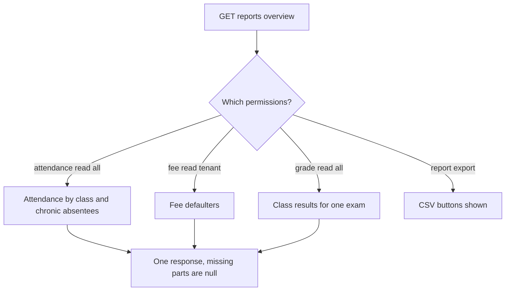

import { Steps, Card, CardGrid, LinkCard } from '@astrojs/starlight/components';
import Pipeline from '../../../../components/Pipeline.astro';
import ScreenAnatomy from '../../../../components/ScreenAnatomy.astro';
import SourceFile from '../../../../components/SourceFile.astro';
import Api from '../../../../components/Api.astro';
import Perm from '../../../../components/Perm.astro';
import Roles from '../../../../components/Roles.astro';
import Route from '../../../../components/Route.astro';
import DemoLogin from '../../../../components/DemoLogin.astro';
import Screenshot from '../../../../components/Screenshot.astro';
import { Tabs as ShotTabs, TabItem as ShotTab } from '@astrojs/starlight/components';

The **Reports** page answers the three questions a school leader asks every week: *Who is missing school? Who owes money? How did each class do in the last exam?* It pulls those answers from the live attendance registers, fee invoices and gradebook — nothing is typed in by hand — and shows each one only to people who are already allowed to see the underlying data. A Principal sees attendance and results; an Accountant sees fees; the School Admin sees everything.

Next to the on-screen reports, Schola can download the raw data as **CSV** files (comma-separated values — they open in Excel, Numbers or Google Sheets). Every download is written to the [audit log](/features/insight/audit-log/), because exports are treated as sensitive reads.

## At a glance

<CardGrid>
  <Card title="Who uses it" icon="star">
    <Roles list={['school_admin', 'principal', 'vice_principal', 'accountant']} note="Each role sees only the sections it has permission for." />
  </Card>
  <Card title="Where to find it" icon="laptop">
    <Route path="/app/reports" /> — sidebar group **Overview**, item **Reports**.
  </Card>
  <Card title="Permissions" icon="approve-check">
    Any of <Perm name="attendance:read:all" />, <Perm name="fee:read:tenant" />, <Perm name="grade:read:all" /> to open it; <Perm name="report:export" /> plus the matching read key to download each CSV.
  </Card>
</CardGrid>

<DemoLogin as="School Admin (Amira Hossain)" email="admin@greenfield.example" go="/app/reports" />

## How it works

<Pipeline
  caption="One request builds every report the signed-in person is allowed to see."
  steps={[
    { label: 'Pick a range', icon: 'calendar-range', note: 'From and To, in the URL' },
    { label: 'Check perms', icon: 'shield', note: 'Per section of the page' },
    { label: 'Aggregate', icon: 'database', note: 'MongoDB, this school only' },
    { label: 'Show', icon: 'chart', note: 'Chart, tables, tiles' },
    { label: 'Export', icon: 'file-text', note: 'CSV, audited' },
  ]}
/>



The API answers with one object. Any section the caller may not see comes back as `null`, and the web page simply leaves it out — there is no separate page per report.

### The four reports

| Report | What it shows | Rules in the code |
|---|---|---|
| **Attendance by class** | A bar chart: one bar per class, height = attendance % | (present + late) ÷ all recorded marks for that class in the date range |
| **Chronic absentees** | Students whose attendance is below 75 % | Only students with at least **5** recorded days in the range; worst first; at most **50** rows |
| **Fee defaulters** | Students with unpaid balances past their due date, plus two totals | Invoices in status `pending` or `partial` whose due date is before today; balance = total − paid − waived; largest first; at most **100** rows |
| **Class results** | Per class: students, average %, pass rate, top student | Each student's overall % for one exam (sum of marks ÷ sum of max marks); pass mark **40 %** |

The **From / To** range only affects the attendance reports. Fee defaulters are always "overdue as of today", and class results always cover one whole exam.

## The screen

Real screenshots from the seeded demo school (switch the docs theme to see dark mode):

<ShotTabs>
  <ShotTab label="School Admin">
    <Screenshot name="admin-reports" alt="The Reports page" path="/app/reports" />
  </ShotTab>
  <ShotTab label="Accountant">
    <Screenshot name="accountant-reports" alt="Reports for the accountant" path="/app/reports" />
  </ShotTab>
</ShotTabs>


<ScreenAnatomy
  title="Reports"
  path="/app/reports"
  regions={[
    { label: 'Sidebar', desc: 'Overview → Reports is highlighted', area: 'sidebar' },
    { label: 'Top bar', desc: 'Breadcrumb "School / Reports", bell, theme toggle, profile', area: 'top' },
    { label: 'Page header', desc: '"Reports" — "Attendance, fees and results across the school." with Attendance CSV and Fees CSV buttons', tone: 'accent' },
    { label: 'Date range bar', desc: 'From and To date pickers and the note about what the range affects' },
    { label: 'Attendance', desc: 'Attendance by class bar chart, then the Chronic absentees table', size: 3 },
    { label: 'Fees', desc: 'Total overdue and Students with overdue fees tiles, then the Fee defaulters table', size: 2 },
    { label: 'Results', desc: 'Exam picker, then the Class results table', size: 2 },
  ]}
/>

On phones the tables turn into stacked cards (the **Top student** column is left out to save space), the two fee tiles stack, and the date pickers wrap onto their own lines.

## Step by step

<Steps>

1. Sign in as `admin@greenfield.example` (password `Schola@2026`) and click **Reports** in the sidebar's **Overview** group.

2. The page opens on **this month so far**: **From** is the first day of the month and **To** is today. Grey placeholders show while the data loads.

3. Look at **Attendance by class**. Each bar is one grade, *Grade 1* to *Grade 10*. Hover a bar to see its exact **Attendance %**.

4. Scroll to **Chronic absentees**. Early in a month this table is often empty — *"No chronic absentees — Everyone is above the threshold in this range."* — because a student needs at least five recorded days to count. Change **From** to a date about a month back. The page reloads with the wider range (the dates are saved in the address bar, so you can bookmark or share the view) and students below 75 % appear, each with their admission number, class, **Days absent** such as *"4 of 20"* and their attendance rate in red.

5. Click a student's name. Their student record opens. Use the browser's Back button to return.

6. Scroll to **Fees**. The **Total overdue** tile shows the overdue amount in US dollars (red when above zero) and **Students with overdue fees** shows how many students owe money. The **Fee defaulters** table lists them, largest balance first, with **Overdue**, **Invoices** and **Oldest due** (for example *Oct 10, 2026 · 28d*).

7. Scroll to **Results**. The **Exam** picker preselects the exam with the latest start date. In the demo school that is the upcoming *Term 1 — Final*, so the table says *"No marks entered for this exam yet"*. Open the **Exam** picker and choose **Term 1 — Midterm**. The table fills with one row per grade: **Students**, **Average**, **Pass rate** and **Top student**, for example **Grade 8 — 50 students, 68.6% average, 100% pass rate, top student Amina Nguyen (89.5%)**.

8. At the top right, click **Attendance CSV**. The browser downloads `attendance-YYYY-MM-DD.csv` with every attendance mark in your chosen range. Click **Fees CSV** to download `fees-YYYY-MM-DD.csv` with every invoice in the school.

9. Open **Audit log** (sidebar, **Administration** group) and type `report.attendance.export` in the **Action** filter — your download is listed. See [Audit log](/features/insight/audit-log/).

</Steps>

:::note
Marks come from the seed's fixed random generator, so the class results in step 7 are the same on every run. Attendance and fee figures depend on the day you ran `pnpm seed`.
:::

## Every action on this screen

### Load the page

<Api method="GET" path="reports/overview" perm="attendance:read:all" />

Allowed with **any** of <Perm name="attendance:read:all" />, <Perm name="fee:read:tenant" /> or <Perm name="grade:read:all" />. Query: `from`, `to` (dates) and `examId` (optional). `from` must be on or before `to`, or the API answers `400`. Without `from` the API itself defaults to the first of the current month.

The response:

```ts
{
  range: { from: string; to: string },
  currency: "USD", locale: "en-US",       // from the school's settings
  canExport: boolean,                       // the caller has report:export
  attendance: { byClass, chronicAbsentees, threshold: 75 } | null,
  fees: { totalOverdue, students } | null,
  results: { exam, exams, passMark: 40, classes } | null
}
```

If the request fails, a card says *"Reports could not be loaded."* with a **Try again** button.

### Change "From" or "To"

Updates `?from=` and `?to=` in the address bar and reloads the overview. The pickers stop you choosing a **From** after **To** (and the other way round). Clearing a picker is ignored. Only the two attendance reports change.

### Click a student name

Chronic absentee and fee defaulter names link to the student's record at `/app/students/:id`.

### Pick an exam

The **Exam** picker lists up to the 30 most recent exams (by start date) and appears only when the school has at least one exam. Choosing one sets `?exam=` in the address bar and reloads the results. The card title becomes *"Class results · Term 1 — Midterm"*.

### "Attendance CSV"

<Api method="GET" path="reports/attendance/export.csv" perm="report:export" />

Needs <Perm name="report:export" /> **and** <Perm name="attendance:read:all" />. Shown when the overview says `canExport: true`. Downloads every attendance mark in the **From–To** range for the whole school. Columns: **Date, Admission, Student, Status, Note**, newest first. The same endpoint also takes `sectionId` — the **Month to date (CSV)** button on [Student attendance](/features/daily/attendance/) uses it for one section.

### "Fees CSV"

<Api method="GET" path="reports/fees/export.csv" perm="report:export" />

Needs <Perm name="report:export" /> **and** <Perm name="fee:read:tenant" />. Downloads every fee invoice in the school, oldest due date first. Columns: **Invoice, Admission, Student, Period, Total, Paid, Waived, Remaining, Status, Due**. The API also accepts `academicYearId` and `status` filters, but this button sends neither. The **Export CSV** button on [Fees](/features/finance/fees/) calls the same endpoint.

### The payroll export (from the Payroll page)

<Api method="GET" path="reports/payroll/export.csv" perm="report:export" />

Not on the Reports page — the **Export &lt;year&gt; CSV** button on [Payroll](/features/finance/payroll/) calls it with `?year=`. Needs <Perm name="report:export" /> **and** <Perm name="salary:read:all" />. Columns: **Payslip, Year, Month, Base, Earnings, Deductions, Net, Status, Paid at**. It carries payslip numbers only, no employee names. An optional `month` narrows it to one month.

Every CSV download writes an audit entry — `report.attendance.export`, `report.fees.export` or `report.payroll.export` — recording who downloaded it, when, and from which IP address. Cells that start with `=`, `+`, `-`, `@`, a tab or a carriage return get a leading `'`, so a spreadsheet shows a note like `=SUM(…)` as text instead of running it (plain numbers such as `-12.50` are left alone).

## Who sees what

| Role | Opens Reports | Attendance | Fees | Results | CSV buttons |
|---|---|---|---|---|---|
| School Admin | Yes | Yes | Yes | Yes | Yes |
| Principal | Yes | Yes | No | Yes | Both buttons shown; only **Attendance CSV** downloads (Fees CSV answers `403`) |
| Vice Principal | Yes | Yes | No | Yes | No |
| Accountant | Yes | No | Yes | No | Both buttons shown; only **Fees CSV** downloads (Attendance CSV answers `403`). Payroll CSV from the Payroll page. |
| Teacher, Staff, Student, Parent | No — the link is hidden and the API answers `403` | — | — | — | — |
| Super Admin | No (platform console only) | — | — | — | — |

:::caution[Both CSV buttons show even when one is refused]
The page shows **Attendance CSV** and **Fees CSV** to anyone with
<Perm name="report:export" /> (`canExport`), but each export also needs its
read key. A Principal clicking **Fees CSV**, or an Accountant clicking
**Attendance CSV**, gets the API's `403` "Missing permission" JSON in the
browser instead of a file. The data is protected; the buttons just don't know
it.
:::

## Under the hood

- <SourceFile path="apps/web/src/app/(tenant)/app/reports/page.tsx" /> — the page: URL-state filters (`useListParams(["from", "to", "exam"])`), `TrendChart` bar chart, `StatTile`s and `SimpleTable`s.
- <SourceFile path="apps/api/src/modules/reports/overview.ts" symbol="reportsOverview" /> — the four aggregations. Every `$match` pins `schoolId` and `deletedAt: null`.
- <SourceFile path="apps/api/src/modules/reports/reports.routes.ts" /> — the overview route and the three CSV exports.
- <SourceFile path="apps/api/src/services/csv.service.ts" symbol="toCsv" /> — the small CSV writer (quotes cells containing commas, quotes or line breaks; `escapeCell` neutralises formula-leading cells).
- <SourceFile path="apps/web/src/components/dashboard/charts.tsx" symbol="TrendChart" /> — the Recharts bar chart, shared with the dashboard.

Constants in `overview.ts`: `CHRONIC_THRESHOLD = 75`, `MIN_DAYS = 5`, `PASS_MARK = 40` (letter *E* and above). Money is formatted with the school's currency and locale — USD and `en-US` by default.

There is **no PDF report** on this page. PDFs in Schola are per-document: fee receipts, payslips and report cards (see [PDFs and media](/architecture/pdfs-and-media/)).

## Edge cases and gotchas

- **"Load sample" mode.** With the top bar's **Load sample** switched on, the overview is calculated in the browser from the sample school: attendance and results only, no fees, and no CSV buttons. CSV links always read the real database.
- **The default exam can be empty.** Results preselect the exam with the latest *start date*, even if it has not happened yet. Pick an exam that has marks.
- **Caps.** Chronic absentees stop at 50 rows and fee defaulters at 100. **Total overdue** adds up only those 100 students, so on a very large school it can be lower than the real total. CSV exports stop at 50,000 attendance rows or 10,000 invoices / payslips without a warning.
- **Same-day ranges.** The range is whole days in UTC; choosing the same date for **From** and **To** shows that one day.
- **Hidden link, open page.** The sidebar hides **Reports** from roles without the read permissions; typing `/app/reports` as a Teacher shows *"Reports could not be loaded."* because the API refuses.

## Related pages

<CardGrid>
  <LinkCard title="Audit log" description="Every CSV export is recorded as a sensitive read." href="/features/insight/audit-log/" />
  <LinkCard title="Student attendance" description="Where the attendance numbers come from." href="/features/daily/attendance/" />
  <LinkCard title="Fees" description="Invoices, payments and waivers behind the defaulters list." href="/features/finance/fees/" />
  <LinkCard title="Gradebook" description="Marks and letter grades behind class results." href="/features/assessment/gradebook/" />
  <LinkCard title="Tutorial: reports and audit" description="A guided walk through reports and the audit trail." href="/tutorial/reports-and-audit/" />
</CardGrid>
