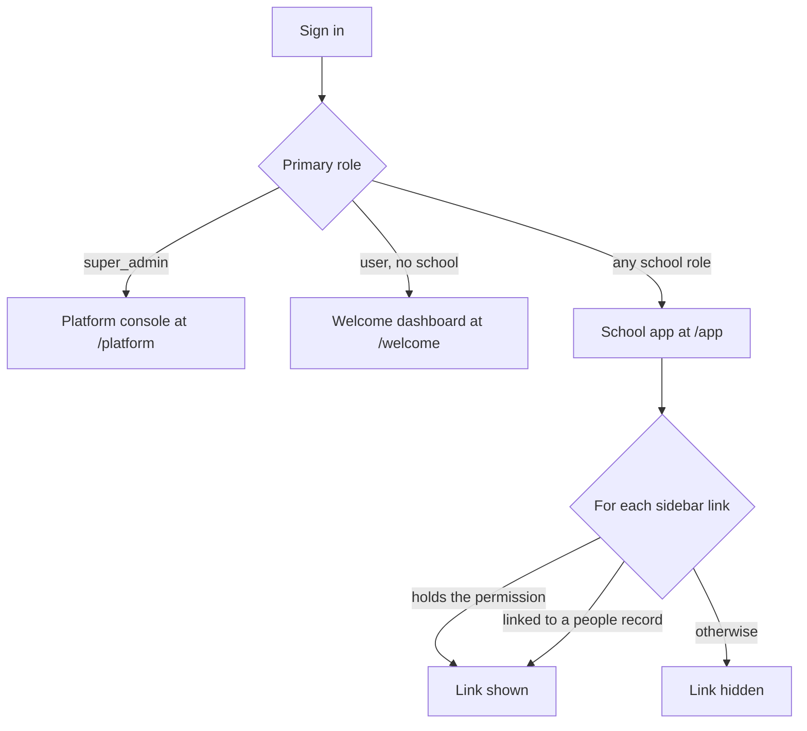

import { Aside, Card, CardGrid, LinkCard } from '@astrojs/starlight/components';
import FeatureGrid from '../../../components/FeatureGrid.astro';
import ScreenAnatomy from '../../../components/ScreenAnatomy.astro';
import SourceFile from '../../../components/SourceFile.astro';
import Perm from '../../../components/Perm.astro';
import Roles from '../../../components/Roles.astro';
import Route from '../../../components/Route.astro';
import DemoLogin from '../../../components/DemoLogin.astro';
import Screenshot from '../../../components/Screenshot.astro';

Schola is one web app with three "front doors". The **platform console**
(`/platform/*`) is where the Super Admin runs the whole platform. The **school
app** (`/app/*`) is where everyone inside a school works — from the School
Admin to a parent. And the **welcome dashboard** (`/welcome`) is where a
signed-in account that does not belong to any school yet waits. This page is
the map: every module, grouped by area, who sees it, and how the feature pages
that follow are written.

## At a glance

<CardGrid>
  <Card title="Who uses it" icon="star">
    <Roles list={['super_admin', 'school_admin', 'principal', 'vice_principal', 'teacher', 'accountant', 'student', 'parent', 'staff', 'user']} />
  </Card>
  <Card title="Where to find it" icon="laptop">
    <Route path="/platform" label="Platform console" /> <Route path="/app" label="School app" /> <Route path="/welcome" label="Welcome dashboard" />
  </Card>
  <Card title="Permissions" icon="approve-check">
    Every sidebar link is gated by a permission key such as <Perm name="student:read" /> — never by the role name. See [Permissions](/reference/permissions/).
  </Card>
</CardGrid>

<DemoLogin as="School Admin" email="admin@greenfield.example" go="/app" />

<Aside type="tip" title="Sign in as each role">
Every demo account uses the password `Schola@2026`. The full list (Super
Admin, School Admin, Principal, Vice Principal, Accountant, Teacher, Staff,
Parent, Student and a pending applicant) is on
[Demo accounts](/reference/demo-accounts/). Signing in as each one in turn is
the fastest way to see how the sidebar changes.
</Aside>

## Every module, by area

### Accounts

<FeatureGrid
  items={[
    { title: 'Sign up and sign in', desc: 'Personal accounts, school applications, password, Google and Facebook sign-in, email verification and password reset.', href: '/features/accounts/sign-up-and-sign-in/', icon: 'log-in' },
    { title: 'Onboarding and welcome', desc: 'The /welcome dashboard for accounts without a school, and the quick school application.', href: '/features/accounts/onboarding-and-welcome/', icon: 'sparkles' },
  ]}
/>

### Platform console (Super Admin)

<FeatureGrid
  items={[
    { title: 'Platform dashboard', desc: 'School counts by status, sign-ups per month and the latest applications.', href: '/features/platform/dashboard/', icon: 'dashboard', tone: 'indigo' },
    { title: 'Approvals', desc: 'Approve or reject schools waiting in pending_approval.', href: '/features/platform/approvals/', icon: 'badge-check', tone: 'indigo' },
    { title: 'Schools', desc: 'Every school, its detail page, direct creation, suspension and forced admin transfer.', href: '/features/platform/schools/', icon: 'building', tone: 'indigo' },
    { title: 'Users', desc: 'The platform-wide account directory, super admin invites, suspension and role grants.', href: '/features/platform/users/', icon: 'users-round', tone: 'indigo' },
    { title: 'Platform settings', desc: 'Branding, locale defaults, email templates and feature flags.', href: '/features/platform/settings/', icon: 'settings', tone: 'indigo' },
    { title: 'Notifications and audit', desc: 'The Super Admin inbox and the cross-tenant audit log.', href: '/features/platform/notifications-and-audit/', icon: 'scroll', tone: 'indigo' },
  ]}
/>

### School administration

<FeatureGrid
  items={[
    { title: 'School dashboard', desc: 'The /app home page — different for staff who see the whole school and for members who see their own records.', href: '/features/school/dashboard/', icon: 'dashboard' },
    { title: 'Settings and profile', desc: 'The school profile (name, contact, locale, currency) and each user\'s own account, password and devices.', href: '/features/school/settings-and-profile/', icon: 'cog' },
    { title: 'Members and roles', desc: 'Everyone with a sign-in at the school; grant Principal, Vice Principal or Accountant.', href: '/features/school/members-and-roles/', icon: 'user-cog' },
    { title: 'Admin transfer', desc: 'Hand the School Admin role to someone else with a 24-hour emailed link.', href: '/features/school/admin-transfer/', icon: 'key' },
  ]}
/>

### Academics

<FeatureGrid
  items={[
    { title: 'Academic years', desc: 'Create years and mark one as current.', href: '/features/academics/academic-years/', icon: 'calendar-range' },
    { title: 'Subjects', desc: 'The subjects taught at the school, with short codes.', href: '/features/academics/subjects/', icon: 'book-open' },
    { title: 'Classes and sections', desc: 'Classes per year, sections with capacity and teachers, and enrolment.', href: '/features/academics/classes-and-sections/', icon: 'layers' },
  ]}
/>

### People

<FeatureGrid
  items={[
    { title: 'Students', desc: 'Admission records, guardians and the full student profile.', href: '/features/people/students/', icon: 'graduation-cap' },
    { title: 'Parents', desc: 'Guardian records linked to their children.', href: '/features/people/parents/', icon: 'users' },
    { title: 'Teachers', desc: 'Teacher records, subjects and sign-ins.', href: '/features/people/teachers/', icon: 'user-check' },
    { title: 'Staff', desc: 'Non-teaching employees and their sign-ins.', href: '/features/people/staff/', icon: 'id-card' },
  ]}
/>

### Daily operations

<FeatureGrid
  items={[
    { title: 'Student attendance', desc: 'The daily register for every section.', href: '/features/daily/attendance/', icon: 'clipboard-check' },
    { title: 'Staff attendance', desc: 'Daily attendance for teachers and staff.', href: '/features/daily/staff-attendance/', icon: 'calendar-check' },
    { title: 'Timetable', desc: 'Weekly periods per section with clash checks.', href: '/features/daily/timetable/', icon: 'calendar-days' },
    { title: 'Leave', desc: 'Leave requests and approvals.', href: '/features/daily/leave/', icon: 'calendar-clock' },
    { title: 'Remarks', desc: 'Teacher remarks on students.', href: '/features/daily/remarks/', icon: 'message' },
  ]}
/>

### Exams, grades and finance

<FeatureGrid
  items={[
    { title: 'Exams', desc: 'Exams per academic year.', href: '/features/assessment/exams/', icon: 'file-text', tone: 'yellow' },
    { title: 'Gradebook', desc: 'Marks, letter grades and report cards.', href: '/features/assessment/gradebook/', icon: 'award', tone: 'yellow' },
    { title: 'Fees', desc: 'Fee structures, invoices, payments and receipts.', href: '/features/finance/fees/', icon: 'wallet', tone: 'yellow' },
    { title: 'Online payments', desc: 'Stripe checkout for families.', href: '/features/finance/online-payments/', icon: 'credit-card', tone: 'yellow' },
    { title: 'Payroll', desc: 'Salary structures, monthly payslips and payments.', href: '/features/finance/payroll/', icon: 'banknote', tone: 'yellow' },
  ]}
/>

### Campus, communication, insight and portals

<FeatureGrid
  items={[
    { title: 'Admissions', desc: 'Applications from enquiry to offer.', href: '/features/campus/admissions/', icon: 'user-plus' },
    { title: 'Library', desc: 'Books, copies and loans.', href: '/features/campus/library/', icon: 'library' },
    { title: 'Transport', desc: 'Bus routes, stops and riders.', href: '/features/campus/transport/', icon: 'bus' },
    { title: 'Hostel', desc: 'Houses, rooms and boarders.', href: '/features/campus/hostel/', icon: 'hotel' },
    { title: 'Announcements', desc: 'Notices to chosen roles, in-app and by email.', href: '/features/communication/announcements/', icon: 'megaphone' },
    { title: 'Notifications', desc: 'Each user\'s inbox and the header bell.', href: '/features/communication/notifications/', icon: 'bell' },
    { title: 'Reports', desc: 'School-wide reports and exports.', href: '/features/insight/reports/', icon: 'chart', tone: 'indigo' },
    { title: 'School audit log', desc: 'Every change inside one school.', href: '/features/insight/audit-log/', icon: 'scroll', tone: 'indigo' },
    { title: 'Teacher portal', desc: 'My classes, registers, marks and payslips.', href: '/features/portals/teacher/', icon: 'user-check', tone: 'indigo' },
    { title: 'Student portal', desc: 'My attendance, grades and fees.', href: '/features/portals/student/', icon: 'graduation-cap', tone: 'indigo' },
    { title: 'Parent portal', desc: 'My children, their attendance, grades and fees.', href: '/features/portals/parent/', icon: 'users-round', tone: 'indigo' },
    { title: 'Staff portal', desc: 'My attendance and payslips.', href: '/features/portals/staff/', icon: 'id-card', tone: 'indigo' },
    { title: 'Public website', desc: 'The marketing pages anyone can visit.', href: '/features/public-website/', icon: 'house' },
  ]}
/>

## How the app decides what you see

When you sign in, the API answers with your **primary role** (your
highest-ranking role) and the full list of **permission keys** you hold. The
web app then picks one of three shells:

- The **platform console** shows the same fixed sidebar to every Super Admin.
- The **welcome dashboard** shows four links: "Dashboard", "Register a
  school", "Pricing" and "Contact".
- The **school app** sidebar is filtered link by link. A link appears when you
  hold its permission (for example "Fees" needs <Perm name="fee:read:tenant" />).
  The "My school" links instead need a **link** to a people record — "My
  children" appears only when your sign-in is linked to a parent record, "My
  classes" only when it is linked to a teacher record.

A group heading disappears when none of its links are visible, so a parent
sees a very short sidebar and a School Admin a long one.

## The screen every module lives in

<Screenshot name="admin-dashboard" alt="The School Admin dashboard for Greenfield International School" path="/app" />

<ScreenAnatomy
  title="School app shell"
  path="/app"
  regions={[
    { label: 'Sidebar', desc: 'Schola logo, then the link groups you can see (Overview, My school, School setup, People, Daily, Attendance, Academics, Facilities, Finance, Administration, Account). The footer shows your first name, your role and the account menu. On desktop it collapses to a 64px icon rail; on phones it opens as a drawer from the menu button.', area: 'sidebar', size: 3 },
    { label: 'Top bar', desc: 'Collapse or expand the sidebar, the breadcrumb ("School / Students"), a Home link to the public site, the "Load sample" button, the notification bell, the theme toggle and your avatar (the account menu with "Log out").', area: 'top' },
    { label: 'Page content', desc: 'The module you opened. Most pages start with a page header (title, one-line description and the main button) followed by a card with a table or form.', size: 4, tone: 'accent' },
  ]}
/>

The platform console uses the same shell with the eyebrow "Platform" instead
of "School" and without the notification bell. The welcome dashboard uses it
with the eyebrow "Account".

### "Load sample"

The "Load sample" button in the top bar swaps the page to a **demo school that
lives only in your browser tab**. An info banner reads "Demo school." and you
can add, edit, enrol and take attendance freely; nothing reaches the API or
the database. Click "Show real data" (the same button) to switch back. Leaving
the dashboard also returns to real data.

It only applies on pages the demo school fully covers — the dashboard, school
setup (academic years, subjects, classes), people (students, teachers,
parents, staff), student and staff attendance, exams, gradebook, remarks and
reports. Everywhere else (fees, payroll, library, transport, hostel, leave,
admissions, timetable, your own records) the button is disabled, and if sample
mode is already on, the page shows real data under a "Real data on this page."
notice.

## Role → modules in their sidebar

The table shows what each Greenfield demo account sees in the **school app**
sidebar. "Yes" means the link is visible; a dash means it is hidden.

| Group / link | School Admin | Principal | Vice Principal | Accountant | Teacher | Student | Parent | Staff |
|---|---|---|---|---|---|---|---|---|
| Overview · Dashboard | Yes | Yes | Yes | Yes | Yes | Yes | Yes | Yes |
| Overview · Reports | Yes | Yes | Yes | Yes | — | — | — | — |
| My school · My classes | — | — | — | — | Yes | — | — | — |
| My school · My children | — | — | — | — | — | — | Yes | — |
| My school · My attendance | — | — | — | Yes ¹ | Yes | Yes | — | Yes |
| My school · My grades | — | — | — | — | — | Yes | — | — |
| My school · My fees | — | — | — | — | — | Yes | — | — |
| My school · My payslips | — | — | — | — | Yes | — | — | Yes |
| School setup · Academic years | Yes | Yes | Yes | Yes | Yes | — | — | — |
| School setup · Subjects | Yes | Yes | Yes | Yes | Yes | — | — | — |
| School setup · Classes & sections | Yes | Yes | Yes | Yes | Yes | — | — | — |
| People · Students | Yes | Yes | Yes | Yes | Yes | — | — | — |
| People · Teachers | Yes | Yes | Yes | Yes | — | — | — | — |
| People · Parents | Yes | Yes | Yes | Yes | — | — | — | — |
| People · Staff | Yes | Yes | — | Yes | — | — | — | — |
| People · Admissions | Yes | Yes | Yes | — | — | — | — | — |
| Daily · Timetable | Yes | Yes | Yes | — | Yes | Yes | Yes | — |
| Daily · Leave | Yes | Yes | Yes | Yes | Yes | Yes | Yes | Yes |
| Attendance · Student attendance | Yes | Yes | Yes | — | Yes | — | — | — |
| Attendance · Staff attendance | Yes | — | — | — | — | — | — | — |
| Academics · Exams | Yes | Yes | Yes | — | Yes | — | — | — |
| Academics · Gradebook | Yes | Yes | Yes | — | Yes | — | — | — |
| Academics · Remarks | Yes | Yes | Yes | — | Yes | — | — | — |
| Facilities · Library | Yes | Yes | Yes | Yes | Yes | Yes | — | Yes |
| Facilities · Transport | Yes | Yes | Yes | Yes | — | — | — | — |
| Facilities · Hostel | Yes | Yes | Yes | Yes | — | — | — | — |
| Finance · Fees | Yes | — | — | Yes | — | — | — | — |
| Finance · Payroll | Yes | — | — | Yes | — | — | — | — |
| Administration · Announcements | Yes | Yes | — | — | — | — | — | — |
| Administration · Members & roles | Yes | — | — | — | — | — | — | — |
| Administration · Audit log | Yes | Yes | — | — | — | — | — | — |
| Administration · School settings | Yes | Yes | Yes | Yes | — | — | — | — |
| Account · Notifications | Yes | Yes | Yes | Yes | Yes | Yes | Yes | Yes |
| Account · My profile | Yes | Yes | Yes | Yes | Yes | Yes | Yes | Yes |

¹ The demo accountant (Ibrahim Ahmed) is also linked to staff record
`STF-002`, so "My attendance" appears for him. An accountant without a staff
record does not see it. "My payslips" stays hidden because the Accountant role
does not hold <Perm name="salary:read:own" />.

### The other two sidebars

| Shell | Who | Sidebar |
|---|---|---|
| Platform console | <Roles list={['super_admin']} /> | **Overview**: Dashboard · **Schools**: All schools, Approvals · **People**: Users · **Activity**: Audit log, Notifications · **System**: Settings, Branding, Locale, Email, Feature flags |
| Welcome dashboard | <Roles list={['user']} /> | **Account**: Dashboard, Register a school · **Explore**: Pricing, Contact |

The account menu (click your avatar) repeats a short version of the sidebar:
the first group ("Overview") and the last group ("Account" in the school app,
"System" in the platform console), followed by "Log out".

## How each feature page is written

Every page under **Features** follows the same order, so it works as a
reading guide and as a script for a walkthrough video:

<CardGrid>
  <Card title="1. At a glance" icon="information">
    Who uses the feature, its route in the web app and the permission keys it needs.
  </Card>
  <Card title="2. Demo login" icon="rocket">
    Which demo account to sign in with, and where to go.
  </Card>
  <Card title="3. How it works" icon="random">
    A diagram of the flow — status journey, request sequence or decision tree.
  </Card>
  <Card title="4. The screen" icon="laptop">
    A schematic of the page with numbered regions, labelled exactly as the UI labels them.
  </Card>
  <Card title="5. Step by step" icon="list-format">
    The click-by-click path, in the order you perform it.
  </Card>
  <Card title="6. Every action" icon="puzzle">
    Each button: what it does, the API endpoint it calls, the permission it needs, success and failure.
  </Card>
  <Card title="7. Who sees what" icon="padlock">
    A role table for that feature.
  </Card>
  <Card title="8. Under the hood" icon="server">
    Source files, models, Zod schemas and audit actions.
  </Card>
  <Card title="9. Edge cases" icon="warning">
    Gotchas, limits and anything in the code that looks unfinished, in caution boxes.
  </Card>
</CardGrid>

API endpoints are written relative to `/api/v1`, so `students/:id` means
`GET http://localhost:8000/api/v1/students/:id` in development.

## Under the hood

- <SourceFile path="apps/web/src/components/layout/dashboard-shell.tsx" symbol="APP_GROUPS" /> — the school app sidebar: every link, its icon and its permission or link gate.
- <SourceFile path="apps/web/src/components/layout/dashboard-shell.tsx" symbol="PLATFORM_GROUPS" /> and `WELCOME_GROUPS` — the other two sidebars.
- <SourceFile path="apps/web/src/app/(tenant)/app/layout.tsx" /> and <SourceFile path="apps/web/src/app/(super-admin)/platform/layout.tsx" /> — `RequireRole` guards that send a wrong role to `/welcome`.
- <SourceFile path="apps/api/src/services/rbac/permissions.ts" symbol="ROLE_PERMISSIONS" /> — the default permission set of each role.
- <SourceFile path="apps/api/src/services/rbac/resolver.ts" symbol="resolveUserPermissions" /> — computes the primary role (highest rank wins) and the permission set on every request.
- <SourceFile path="apps/web/src/lib/me-data.ts" symbol="useMyLinks" /> — which people records your sign-in is linked to.
- <SourceFile path="apps/web/src/providers/sample-mode.tsx" /> — the "Load sample" in-browser demo school.

## Edge cases and gotchas

- **Hiding a link is not security.** The sidebar only hides links. The API
  checks the permission again on every request, so typing a URL you cannot
  use shows an empty or error state, never data.
- **Several roles at once.** A person can hold several roles in one school
  (for example Teacher and Principal). Their permissions are the union of all
  their roles; the sidebar shows every link any of those roles unlocks.
- **Changes need a refresh.** The web app caches your permissions after sign
  in. When someone grants you a role, the API honours it immediately, but the
  sidebar updates only after the page reloads your session (a reload, or the
  next sign-in).
- **A sign-in without a record.** A Teacher, Student, Parent or Staff account
  that is not linked to a people record sees only Dashboard, Notifications and
  My profile, plus links its permissions allow. The dashboard then says "Your
  account isn't linked to a record yet".

## Related pages

<CardGrid>
  <LinkCard title="Roles at a glance" description="What each role is for, in plain language." href="/start-here/roles-at-a-glance/" />
  <LinkCard title="Permissions reference" description="Every permission key and the roles that hold it." href="/reference/permissions/" />
  <LinkCard title="Role-based access control" description="How roles, permissions and the resolver fit together." href="/architecture/rbac/" />
  <LinkCard title="Web routes" description="Every page in the web app." href="/reference/web-routes/" />
</CardGrid>
