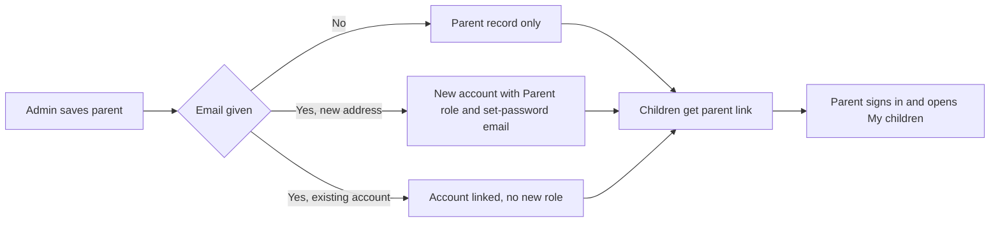

import { Aside, Steps, Card, CardGrid, LinkCard } from '@astrojs/starlight/components';
import Pipeline from '../../../../components/Pipeline.astro';
import ScreenAnatomy from '../../../../components/ScreenAnatomy.astro';
import SourceFile from '../../../../components/SourceFile.astro';
import Api from '../../../../components/Api.astro';
import Perm from '../../../../components/Perm.astro';
import Roles from '../../../../components/Roles.astro';
import Route from '../../../../components/Route.astro';
import DemoLogin from '../../../../components/DemoLogin.astro';
import Screenshot from '../../../../components/Screenshot.astro';
import { Tabs as ShotTabs, TabItem as ShotTab } from '@astrojs/starlight/components';

The **Parents** module holds the school's parents and guardians. A parent
record carries a name, the relation to the child (mother, father, guardian or
other), an occupation and contact details, and — most importantly — the list of
children it belongs to. That link is what lets a parent sign in and see their
children's attendance, marks, remarks and fees, ask for leave for them and pay
invoices online. One parent can have several children; one child can have
several parents.

## At a glance

<CardGrid>
  <Card title="Who uses it" icon="star">
    <Roles list={['school_admin']} note="add, edit, link, delete" />
    <Roles list={['principal', 'vice_principal', 'accountant']} note="read" />
  </Card>
  <Card title="Where to find it" icon="laptop">
    <Route path="/app/parents" label="list" />
    <Route path="/app/parents/[id]" label="profile" />
    Sidebar: **People › Parents**
  </Card>
  <Card title="Permissions" icon="approve-check">
    <Perm name="parent:read" /> <Perm name="parent:create" />
    <Perm name="parent:update" /> <Perm name="parent:delete" />
  </Card>
</CardGrid>

<DemoLogin as="School Admin" email="admin@greenfield.example" go="/app/parents">
  About 600 parents are seeded. Search for `Sofia` to find Sofia Singh, the
  mother behind the `parent@greenfield.example` sign-in.
</DemoLogin>

## How it works

<Pipeline
  caption="From a contact on file to a parent who follows their children online."
  steps={[
    { label: 'Add parent', icon: 'user-plus', note: 'Name, relation, contact' },
    { label: 'Link children', icon: 'users', note: 'Pick students of this school' },
    { label: 'Sign-in', icon: 'key', note: 'Optional, from an email' },
    { label: 'Parent portal', icon: 'house', note: 'My children, leave, fees' },
  ]}
/>

The link between a parent and a child is stored on **both** sides:
`Parent.childIds` lists the children, and each child's `Student.parentIds`
lists its parents. The API keeps the two lists in step every time a parent is
created, edited or deleted — you only ever edit the link from the parent.

Phone and address are personal data, so they are stored encrypted (see
[Encryption](/setup/services/encryption/)). Parents have no date of birth field.

## The screens

Real screenshots from the seeded demo school (switch the docs theme to see dark mode):

<ShotTabs>
  <ShotTab label="Parents">
    <Screenshot name="admin-parents" alt="The Parents list" path="/app/parents" />
  </ShotTab>
  <ShotTab label="Parent profile">
    <Screenshot name="admin-parent-detail" alt="A parent with linked children" path="/app/parents/6aeeea6fe8e90dae8c0645c5" />
  </ShotTab>
</ShotTabs>

### Parents list

<ScreenAnatomy
  title="Parents"
  path="/app/parents"
  regions={[
    { label: 'Sidebar', desc: 'People › Parents is highlighted', area: 'sidebar' },
    { label: 'Top bar', desc: 'Search, notifications, account menu', area: 'top' },
    { label: 'Page header', desc: 'Title "Parents", the line "Parents and guardians, linked to their children at your school." and "Add parent"' },
    { label: 'Toolbar', desc: 'Search box "Search by name"' },
    { label: 'Parents table', desc: 'Parent (name link + relation), Children (names, or "None linked"), Occupation, Phone, and a row menu', size: 4, tone: 'accent' },
    { label: 'Pager', desc: 'Page count and total', tone: 'muted' },
  ]}
/>

### New parent / edit drawer

<ScreenAnatomy
  title="New parent"
  path="/app/parents"
  regions={[
    { label: 'Drawer header', desc: '"New parent" or "Edit Sofia Singh" — "Contact details and the children they are responsible for."' },
    { label: 'Contact fields', desc: 'First name, Last name, Relation, Occupation (optional), Phone (optional), Email (optional — new parents only), Address (optional)', size: 3 },
    { label: 'Children at this school', desc: 'Chips for linked children (each with a remove ×), a "Search students" box and a checklist of matching students', size: 3, tone: 'accent' },
    { label: 'Submit', desc: '"Add parent" or "Save changes"', tone: 'warn' },
  ]}
/>

### Parent profile

<ScreenAnatomy
  title="Parent profile"
  path="/app/parents/[id]"
  regions={[
    { label: 'Back link', desc: '"Parents"', tone: 'muted' },
    { label: 'Profile header', desc: 'Initials, full name and relation' },
    { label: 'Details card', desc: 'Relation, Occupation, Phone, Address (decrypted)', size: 2 },
    { label: 'Children card', desc: '"Students linked to this parent." Each child links to their student profile and shows the class and section, or "Not placed"', size: 2, tone: 'accent' },
  ]}
/>

## Step by step

### Add a parent and link a child

<Steps>

1. Sign in as `admin@greenfield.example` and open **People › Parents**.
2. Click **Add parent**. The "New parent" drawer opens.
3. Enter **First name** and **Last name**, choose **Relation** "Mother", and optionally **Occupation** and **Phone**.
4. To give them a sign-in, type their **Email (optional)**. The hint reads "With an email they get a parent sign-in and an email to set a password."
5. Under **Children at this school**, type part of a child's name or admission number in **Search students**, then tick the child. A chip with the child's name appears above the search box.
6. Click **Add parent**. The toast says "Parent added." (or "Parent added — they'll get an email to set a password." when an email was given).
7. Open the child's profile from **People › Students**. The **Parents & guardians** card now lists the new parent and their relation.

</Steps>

### Change which children a parent is linked to

<Steps>

1. On the Parents list, open the row menu and choose **Edit / link children**.
2. Remove a child with the **×** on its chip, or tick another student in the list.
3. Click **Save changes**. The toast says "Parent updated." Removed children lose this parent; added children gain it.

</Steps>

### See it from the parent's side

<Steps>

1. Sign out, then sign in as `parent@greenfield.example` (Sofia Singh).
2. Open **My children** in the sidebar. Mateo Singh (Grade 1 · A) and Ryan Singh (Grade 1 · B) are listed.
3. Open a child to see the same Attendance, Grades, Remarks and Fees tabs the school sees, limited to what parents may read. See [Parent portal](/features/portals/parent/).

</Steps>

## Every action on this screen

### Search

The **Search by name** box matches the first or last name, case-insensitively.
Phone numbers and children's names are not searched. Results come 20 per page,
sorted by last name then first name. The search text stays in the address (`?q=`).

<Api method="GET" path="parents?q=&page=" perm="parent:read" />

Each row already names the linked children, so the list needs no extra lookups.

### "Add parent"

Visible with <Perm name="parent:create" /> (School Admin only).

<Api method="POST" path="parents" perm="parent:create" />

| Field | Rule |
|---|---|
| First name, Last name | Required, 1–80 characters |
| Relation | `mother`, `father`, `guardian` (default) or `other` |
| Occupation | Optional, up to 120 characters |
| Phone | Optional; digits, spaces, dashes and a leading `+`, 7–20 characters |
| Email | Optional, valid email address — only on the "New parent" form |
| Address | Optional, up to 240 characters |
| Children | Any number of students; every one must belong to this school, or the API answers `404` "Student not found in this school." |

What the API does:

1. Checks every child id belongs to the school.
2. If an email was given: when no account uses it, creates one (random password,
   hashed with argon2id, email not yet verified) and grants it the **Parent**
   role in this school. When an account already uses it, links that account
   instead.
3. Creates the parent record and adds the parent to each child's `parentIds`.
4. For a **new** account only, sends the set-password invite: "Set your Schola
   password for *school*" — "You've been added to *school* on Schola as a
   parent" — with a **Set password** link that lasts `PASSWORD_RESET_TTL_MIN` ×
   24 minutes (24 hours by default). An existing account is not emailed; it
   already has a way to sign in. The invite is best-effort: if the email can't
   be delivered, the API logs it and still answers `201`.
5. Writes the audit entry `parent.create` with the name and child count, plus
   `inviteEmail: "sent"` or `"failed"` in its metadata when an invite was due.

### Open a profile

Click a parent's name to open <Route path="/app/parents/[id]" />.

<Api method="GET" path="parents/:id" perm="parent:read" />
<Api method="GET" path="parents/:id/overview" perm="parent:read" />

The first call returns the record with phone and address decrypted. The
overview lists linked children with their current class and section.

### "Edit / link children"

Visible with <Perm name="parent:update" />. The drawer loads the full record
first, then saves only what the form holds:

<Api method="PATCH" path="parents/:id" perm="parent:update" />

When the children list changes, the API removes this parent from children who
were unticked and adds it to the newly ticked ones. The **Email** field is not
shown when editing — a sign-in can only be created when the parent is added.

### "Delete"

Visible with <Perm name="parent:delete" />. The dialog asks **"Delete Sofia
Singh?"** — "They are unlinked from their children and can no longer sign in to
this school."

<Api method="DELETE" path="parents/:id" perm="parent:delete" />

The parent record is soft-deleted, removed from every child's `parentIds`, and
the linked account loses its Parent role in this school (the account itself is
kept). The audit entry `parent.delete` records whether access was revoked.

## Who sees what

| Role | Parents list and profiles | Add | Edit and link children | Delete |
|---|---|---|---|---|
| School Admin | Yes | Yes | Yes | Yes |
| Principal | Yes | No | No | No |
| Vice Principal | Yes | No | No | No |
| Accountant | Yes | No | No | No |
| Teacher, Staff, Student | No | No | No | No |
| Parent | Only their own children, through [My children](/features/portals/parent/) | — | — | — |

## Under the hood

- <SourceFile path="apps/web/src/app/(tenant)/app/parents/page.tsx" />
- <SourceFile path="apps/web/src/app/(tenant)/app/parents/[id]/page.tsx" />
- <SourceFile path="apps/web/src/components/school/parent-form.tsx" symbol="ParentEditor" />
- <SourceFile path="apps/web/src/components/school/student-picker.tsx" symbol="StudentPicker" />
- <SourceFile path="apps/api/src/modules/people/parents.routes.ts" />
- <SourceFile path="apps/api/src/services/account-invite.ts" symbol="sendAccountInvite" /> — the set-password invite.
- <SourceFile path="apps/api/src/modules/people/_overview.ts" symbol="parentChildren" />
- <SourceFile path="apps/api/src/services/scopes/student-access.ts" symbol="linkedStudentIds" />
- <SourceFile path="packages/validation/src/people.ts" symbol="createParentSchema" />
- <SourceFile path="packages/db/src/models/parent.ts" />

**Data shape** — `parents`: `userId` (nullable), `firstName`, `lastName`,
`relation`, `occupation`, `phone` and `address` (encrypted), `childIds`, plus the
standard `schoolId`, audit and soft-delete fields.

**How a parent's access is resolved.** When a parent signs in, the API finds
the parent record whose `userId` is theirs, then every student whose
`parentIds` contains that record. Those children — and only those — are what
the parent can read: attendance, grades, `parent` and `public` remarks, fees,
timetable and leave.

**Audit actions** — `parent.create`, `parent.update`, `parent.delete`.

## Edge cases and gotchas

- **No duplicate check.** Nothing stops the same person being added twice;
  search before adding.
- **Children from another school** cannot be linked — the API checks every id
  against the current school.
- **Clearing Phone or Address** in the edit drawer leaves the old value in place
  (a blank field is not sent).
- **The sign-in comes only at creation.** A parent added without an email
  cannot be given one later from this screen.
- **The toast assumes a new account.** "Parent added — they'll get an email to
  set a password." shows whenever an email was typed, though an address that
  already has an account gets no email. Setting a password from the invite (or
  later with **Forgot password**) also verifies the email.

:::caution[An existing account gets no Parent role]
If the email already belongs to an account (for example a visitor, or a teacher
at the school who is also a parent), `POST /parents` links that account to the
parent record but does **not** grant it the Parent role in this school. A
visitor linked this way still cannot open the school app.
:::

## Related pages

<CardGrid>
  <LinkCard title="Students" description="The children parents are linked to." href="/features/people/students/" />
  <LinkCard title="Parent portal" description="What a signed-in parent sees: My children, leave and online fee payments." href="/features/portals/parent/" />
  <LinkCard title="Leave" description="Parents ask for leave for a linked child." href="/features/daily/leave/" />
  <LinkCard title="Sign-up and sign-in" description="Forgot password, email verification and sessions." href="/features/accounts/sign-up-and-sign-in/" />
</CardGrid>
