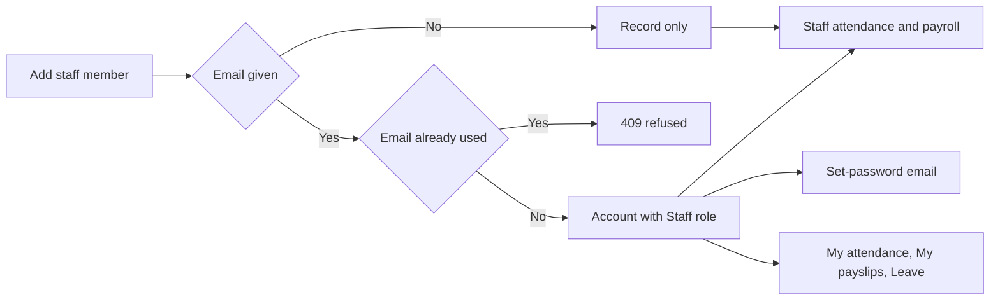

import { Aside, Steps, Card, CardGrid, LinkCard } from '@astrojs/starlight/components';
import Pipeline from '../../../../components/Pipeline.astro';
import ScreenAnatomy from '../../../../components/ScreenAnatomy.astro';
import SourceFile from '../../../../components/SourceFile.astro';
import Api from '../../../../components/Api.astro';
import Perm from '../../../../components/Perm.astro';
import Roles from '../../../../components/Roles.astro';
import Route from '../../../../components/Route.astro';
import DemoLogin from '../../../../components/DemoLogin.astro';
import Screenshot from '../../../../components/Screenshot.astro';
import { Tabs as ShotTabs, TabItem as ShotTab } from '@astrojs/starlight/components';

The **Staff** module covers everyone who works at the school but does not
teach: the office manager, the librarian, lab assistants, the nurse, drivers,
security. A staff record holds an employee ID, a **designation** (the job
title) and a **department**, plus encrypted contact details. Staff appear in
[Staff attendance](/features/daily/staff-attendance/) and
[Payroll](/features/finance/payroll/). Giving a staff member an email also
gives them a sign-in with the Staff role, so they can see their own attendance
and payslips and ask for leave; they are emailed a link to set their password.

## At a glance

<CardGrid>
  <Card title="Who uses it" icon="star">
    <Roles list={['school_admin']} note="add, edit, delete" />
    <Roles list={['principal', 'accountant']} note="read" />
  </Card>
  <Card title="Where to find it" icon="laptop">
    <Route path="/app/staff" label="list" />
    <Route path="/app/staff/[id]" label="profile" />
    Sidebar: **People › Staff**
  </Card>
  <Card title="Permissions" icon="approve-check">
    <Perm name="staff:read" /> <Perm name="staff:create" />
    <Perm name="staff:update" /> <Perm name="staff:delete" />
  </Card>
</CardGrid>

<DemoLogin as="School Admin" email="admin@greenfield.example" go="/app/staff">
  Ten staff members are seeded, `STF-001` to `STF-010`, from the Office Manager
  (Administration) to two Drivers (Transport).
</DemoLogin>

## How it works

<Pipeline
  caption="A staff member's path through Schola."
  steps={[
    { label: 'Add', icon: 'user-plus', note: 'Employee ID, designation, department' },
    { label: 'Sign-in', icon: 'key', note: 'Only if an email is given' },
    { label: 'Attendance', icon: 'calendar-check', note: 'Marked by the School Admin' },
    { label: 'Payroll', icon: 'banknote', note: 'Monthly payslips' },
    { label: 'Self-service', icon: 'user', note: 'Own attendance, payslips, leave' },
  ]}
/>

**Designation and department are free text.** There is no list of departments
to maintain: type "Librarian" and "Library", and the department becomes
searchable on the Staff list. Two staff members in "Transport" share a
department simply by having the same text.

A staff record can exist without a sign-in (`userId` empty) — a driver who
never uses the app is still marked present and still paid. With an email, the
API creates an account, grants the **Staff** role in this school and emails a
set-password invite.

## The screens

Real screenshots from the seeded demo school (switch the docs theme to see dark mode):

<ShotTabs>
  <ShotTab label="Staff">
    <Screenshot name="admin-staff" alt="The Staff list" path="/app/staff" />
  </ShotTab>
  <ShotTab label="Staff profile">
    <Screenshot name="admin-staff-detail" alt="One staff member’s record" path="/app/staff/6aeeea6fe8e90dae8c064b40" />
  </ShotTab>
</ShotTabs>

### Staff list

<ScreenAnatomy
  title="Staff"
  path="/app/staff"
  regions={[
    { label: 'Sidebar', desc: 'People › Staff is highlighted', area: 'sidebar' },
    { label: 'Top bar', desc: 'Search, notifications, account menu', area: 'top' },
    { label: 'Page header', desc: 'Title "Staff", the line "Non-teaching staff — office, library, transport, and support." and "Add staff member"' },
    { label: 'Toolbar', desc: 'Search box "Search name, ID or department"' },
    { label: 'Staff table', desc: 'Staff member (name link + employee ID), Designation (with the department underneath), Phone, row menu', size: 4, tone: 'accent' },
    { label: 'Pager', desc: 'Page count and total', tone: 'muted' },
  ]}
/>

### New staff member / edit drawer

<ScreenAnatomy
  title="New staff member"
  path="/app/staff"
  regions={[
    { label: 'Drawer header', desc: '"New staff member" or "Edit Ruby Novak" — "Phone, date of birth, and address are stored encrypted."' },
    { label: 'Identity fields', desc: 'Employee ID (placeholder STF-014), Email (optional, new staff only), First name, Last name', size: 2 },
    { label: 'Job fields', desc: 'Designation (optional, placeholder "Librarian"), Department (optional, placeholder "Library")', tone: 'accent' },
    { label: 'Personal fields', desc: 'Phone, Date of birth, Joined, Address — all optional', size: 2 },
    { label: 'Submit', desc: '"Add staff member" or "Save changes"', tone: 'warn' },
  ]}
/>

### Staff profile

<ScreenAnatomy
  title="Staff profile"
  path="/app/staff/[id]"
  regions={[
    { label: 'Back link', desc: '"Staff"', tone: 'muted' },
    { label: 'Profile header', desc: 'Initials, name, "STF-003 · Librarian · Library"' },
    { label: 'Details card', desc: 'Phone, Date of birth, Address, Joined (decrypted)' },
    { label: 'Attendance card', desc: '"Last 90 days." Rate, Present, Absent, Late and recent days — School Admin only', size: 2, tone: 'accent' },
    { label: 'Payslips card', desc: '"The last 12 months." with a PDF link per payslip — School Admin and Accountant', size: 2 },
  ]}
/>

## Step by step

### Add a staff member with a sign-in

<Steps>

1. Sign in as `admin@greenfield.example` and open **People › Staff**.
2. Click **Add staff member**.
3. Type an **Employee ID**, for example `STF-011`.
4. Type an **Email (optional)**. The hint reads "With an email they get a staff sign-in and an email to set a password."
5. Enter **First name** and **Last name**, then **Designation** "Receptionist" and **Department** "Administration".
6. Optionally add **Phone**, **Date of birth**, **Joined** and **Address**.
7. Click **Add staff member**. The toast says "Staff member added — they'll get an email to set a password." (or "Staff member added." without an email).
8. Type `Administration` in **Search name, ID or department**. The new receptionist and Nadia Haddad (Office Manager) are listed.

</Steps>

### Read a staff profile

<Steps>

1. Search `Novak` and click **Ruby Novak**.
2. The header reads "STF-003 · Librarian · Library".
3. The **Attendance** card shows her last 90 days; the **Payslips** card lists recent months with a PDF link each.

</Steps>

## Every action on this screen

### Search

Matches first name, last name, employee ID or department, case-insensitively.
20 rows per page, sorted by last name.

<Api method="GET" path="staff?q=&page=" perm="staff:read" />

### "Add staff member"

Visible with <Perm name="staff:create" /> (School Admin only).

<Api method="POST" path="staff" perm="staff:create" />

| Field | Rule |
|---|---|
| Employee ID | Required, 1–40 characters, unique in the school |
| First name, Last name | Required, 1–80 characters |
| Email | Optional; if given, must not belong to any account (`409` "A user with this email already exists.") |
| Designation, Department | Optional, up to 120 characters each |
| Phone | Optional; digits, spaces, dashes, a leading `+`, 7–20 characters |
| Date of birth, Joined | Optional dates |
| Address | Optional, up to 240 characters |

With an email, the API creates an account (random argon2id-hashed password,
unverified email) and grants it the **Staff** role in this school, then creates
the staff record and sends the same set-password invite as a new teacher gets:
"Set your Schola password for *school*" — "You've been added to *school* on
Schola as a staff member" — with a **Set password** link that lasts
`PASSWORD_RESET_TTL_MIN` × 24 minutes (24 hours by default). The invite is
best-effort: if the email can't be delivered the API logs it and still
answers `201`. Audit entry: `staff.create`, with `inviteEmail: "sent"` or
`"failed"` in its metadata when an account was made.

### Open a profile

<Api method="GET" path="staff/:id" perm="staff:read" />
<Api method="GET" path="staff/:id/overview" perm="staff:read" />

The overview adds the **Attendance** block when you hold
<Perm name="staff_attendance:read:all" /> and the **Payslips** block when you
hold <Perm name="salary:read:all" />. Without either, the profile shows the
Details card only.

### "Edit"

Visible with <Perm name="staff:update" />.

<Api method="PATCH" path="staff/:id" perm="staff:update" />

All fields except the email can change. Toast: "Staff member updated."

### "Delete"

Visible with <Perm name="staff:delete" />. The dialog asks **"Delete Ruby
Novak?"** — "They are removed from staff lists and can no longer sign in to this
school."

<Api method="DELETE" path="staff/:id" perm="staff:delete" />

The record is soft-deleted and the linked account loses its Staff role in this
school. Past attendance and payslips are kept. Audit entry: `staff.delete`.

## Who sees what

| Role | List and profile | Add, edit, delete | Attendance on profile | Payslips on profile |
|---|---|---|---|---|
| School Admin | Yes | Yes | Yes | Yes |
| Principal | Yes | No | No | No |
| Accountant | Yes | No | No | Yes |
| Vice Principal, Teacher | No | No | No | No |
| Staff | Their own attendance and payslips through the [Staff portal](/features/portals/staff/) | — | — | — |

## Under the hood

- <SourceFile path="apps/web/src/app/(tenant)/app/staff/page.tsx" />
- <SourceFile path="apps/web/src/app/(tenant)/app/staff/[id]/page.tsx" />
- <SourceFile path="apps/web/src/components/school/staff-form.tsx" symbol="StaffEditor" />
- <SourceFile path="apps/web/src/components/records/employee-profile.tsx" symbol="EmployeeBody" />
- <SourceFile path="apps/api/src/modules/people/staff.routes.ts" />
- <SourceFile path="apps/api/src/services/account-invite.ts" symbol="sendAccountInvite" /> — the set-password invite.
- <SourceFile path="apps/api/src/modules/people/_overview.ts" symbol="employeeRecords" />
- <SourceFile path="packages/validation/src/people.ts" symbol="createStaffSchema" />
- <SourceFile path="packages/db/src/models/staff.ts" />

**Data shape** — `staff`: `userId` (nullable), `employeeId`, `firstName`,
`lastName`, `designation`, `department`, `phone` / `dateOfBirth` / `address`
(encrypted), `joinedAt`. Unique index `(schoolId, employeeId)`.

**One person, two roles.** A staff record can point at an account that holds a
different role. In the demo, Ibrahim Ahmed's staff record (`STF-002`, Senior
Accountant, Finance) is tied to the `accountant@greenfield.example` sign-in, so
he appears in staff attendance and payroll and can request leave as staff, while
his permissions come from the Accountant role.

**Audit actions** — `staff.create`, `staff.update`, `staff.delete`.

## Edge cases and gotchas

- **The Vice Principal has no Staff page.** The role does not hold
  <Perm name="staff:read" />, so the sidebar hides it.
- **Employee IDs are never freed** — the unique index also covers deleted records.
- **No sign-in after the fact.** The email field only appears on "New staff
  member"; a record saved without one cannot be given a sign-in later.
- **Clearing a personal field** while editing leaves the stored value.
- **The invite is the only way in at first.** The account has a random
  password and an unverified email. Setting a password from the invite — or
  later with **Forgot password** on the sign-in page — also verifies the email.

:::note[A failed save leaves no account behind]
As with teachers, the **Employee ID** (soft-deleted records included) is
checked before any sign-in account is created, and if the staff record still
fails after the account was made, the account and its Staff role are removed
again. Retrying with the same email works.
:::

## Related pages

<CardGrid>
  <LinkCard title="Staff attendance" description="Mark teachers and staff present, absent, late or excused." href="/features/daily/staff-attendance/" />
  <LinkCard title="Payroll" description="Salary structures and monthly payslips for staff and teachers." href="/features/finance/payroll/" />
  <LinkCard title="Staff portal" description="What a signed-in staff member sees." href="/features/portals/staff/" />
  <LinkCard title="Leave" description="Staff ask for time off; the school decides." href="/features/daily/leave/" />
</CardGrid>
