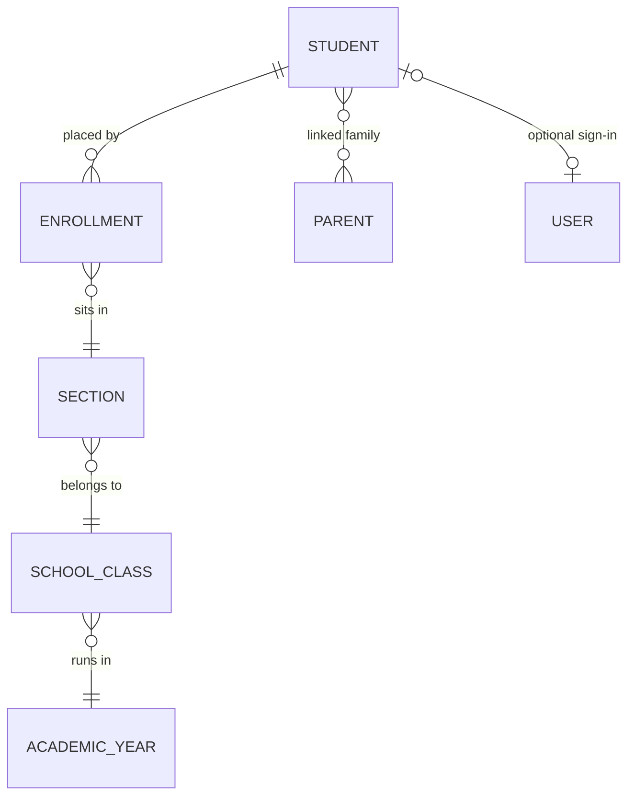

import { Aside, Steps, Card, CardGrid, LinkCard, Badge } from '@astrojs/starlight/components';
import Pipeline from '../../../../components/Pipeline.astro';
import ScreenAnatomy from '../../../../components/ScreenAnatomy.astro';
import SourceFile from '../../../../components/SourceFile.astro';
import Api from '../../../../components/Api.astro';
import Perm from '../../../../components/Perm.astro';
import Roles from '../../../../components/Roles.astro';
import Route from '../../../../components/Route.astro';
import DemoLogin from '../../../../components/DemoLogin.astro';
import Screenshot from '../../../../components/Screenshot.astro';
import { Tabs as ShotTabs, TabItem as ShotTab } from '@astrojs/starlight/components';

The **Students** module is the school's admission register. Each student gets
one record — name, admission number, gender and a few personal details — and
is then *placed* in a [section](/start-here/glossary/#section) of a class for
an academic year. That placement (an *enrollment*) is what puts the student on
a register, in a gradebook grid and on a fee run. The student's profile page
then gathers everything the school knows about them: parents, attendance,
marks, remarks, fees, and their bus, hostel room and library books.

## At a glance

<CardGrid>
  <Card title="Who uses it" icon="star">
    <Roles list={['school_admin', 'principal']} note="add and edit" />
    <Roles list={['vice_principal', 'teacher', 'accountant']} note="read" />
  </Card>
  <Card title="Where to find it" icon="laptop">
    <Route path="/app/students" label="list" />
    <Route path="/app/students/[id]" label="profile" />
    Sidebar: **People › Students**
  </Card>
  <Card title="Permissions" icon="approve-check">
    <Perm name="student:read" /> <Perm name="student:create" />
    <Perm name="student:update" /> <Perm name="student:delete" />
  </Card>
</CardGrid>

<DemoLogin as="School Admin" email="admin@greenfield.example" go="/app/students">
  Amira Hossain owns Greenfield International School. The list holds 500
  students, 25 in each of the 20 sections (Grade 1 to Grade 10, sections A and B).
</DemoLogin>

## How it works

<Pipeline
  caption="A student's journey through the school's records. Every stage after the first is driven by the class placement."
  steps={[
    { label: 'Admit', icon: 'user-plus', note: 'Admission number and details' },
    { label: 'Place', icon: 'layers', note: 'Class, section, roll number' },
    { label: 'Link family', icon: 'users', note: 'Parents from the Parents page' },
    { label: 'Daily record', icon: 'calendar-check', note: 'Register and remarks' },
    { label: 'Assess', icon: 'award', note: 'Marks and report cards' },
    { label: 'Bill', icon: 'wallet', note: 'Invoices and payments' },
  ]}
/>

Two records work together:

- **The student record** (`students` collection) is permanent: admission
  number, first and last name, gender, and three encrypted fields — phone,
  date of birth and address.
- **The enrollment** (`enrollments` collection) says *where the student sits
  this academic year*: one section, an optional roll number and a status —
  `active`, `transferred`, `graduated` or `withdrawn`. A student has at most one
  enrollment per academic year. Moving a student to another section edits that
  enrollment; it does not create a second one.

A section belongs to a class, and a class to one academic year, so an
enrollment's year must match its section's class. Attendance registers,
gradebook grids, timetables and fee runs all read **active** enrollments only —
a student who is not enrolled appears on none of them.

## The screens

Real screenshots from the seeded demo school (switch the docs theme to see dark mode):

<ShotTabs>
  <ShotTab label="Students">
    <Screenshot name="admin-students" alt="The Students list" path="/app/students" />
  </ShotTab>
  <ShotTab label="Student profile">
    <Screenshot name="admin-student-detail" alt="One student’s record" path="/app/students/6aeeea6fe8e90dae8c064b29" />
  </ShotTab>
</ShotTabs>

### Students list

<ScreenAnatomy
  title="Students"
  path="/app/students"
  regions={[
    { label: 'Sidebar', desc: 'People › Students is highlighted', area: 'sidebar' },
    { label: 'Top bar', desc: 'Search, notifications bell, account menu', area: 'top' },
    { label: 'Page header', desc: 'Title "Students", the line "Admissions and class placement for every student at your school." and the "Add student" button' },
    { label: 'Toolbar', desc: 'Search box "Search name or admission no.", the "All classes" and "All sections" pickers, and "Clear filters" once anything is set' },
    { label: 'Students table', desc: 'Student (name link + admission number), Class (class · section link and #roll, or a yellow "Not enrolled" tag), Gender, Phone, and a row menu', size: 4, tone: 'accent' },
    { label: 'Pager', desc: '"Page 1 of 25 · 500 total" with previous and next buttons', tone: 'muted' },
  ]}
/>

### New student / edit drawer

<ScreenAnatomy
  title="New student"
  path="/app/students"
  regions={[
    { label: 'Drawer header', desc: '"New student" — "Admission record, and optionally the class and section they join." When editing: "Edit Kian Mendes" — "Update the record or move the student to another class."' },
    { label: 'Student fieldset', desc: 'Admission number, Gender, First name, Last name, Date of birth (optional), Phone (optional), Address (optional), and the note "Phone, date of birth, and address are stored encrypted."', size: 3, tone: 'accent' },
    { label: 'Class placement fieldset', desc: 'Class ("Not yet" or "Keep current class"), Section ("A (25/30)", full sections disabled with "— full"), Roll number (optional)', size: 2 },
    { label: 'Submit', desc: '"Add student" for a new record, "Save changes" when editing; shows "Saving…" while busy', tone: 'warn' },
  ]}
/>

### Student profile

<ScreenAnatomy
  title="Student profile"
  path="/app/students/[id]"
  regions={[
    { label: 'Back link', desc: '"Students" returns to the list with your filters', tone: 'muted' },
    { label: 'Profile header', desc: 'Initials, full name, and "Grade 3 · Section A · Roll 1 · GIS-…" (or "Not placed in a class")' },
    { label: 'Details card', desc: 'Gender, Date of birth, Phone, Address, Added — decrypted for this view' },
    { label: 'Parents & guardians card', desc: 'Each linked parent (link to their profile) with their relation, or "No parent linked yet."' },
    { label: 'Bus, room & library card', desc: 'Bus route and stop, hostel room, and library books out (overdue ones flagged)' },
    { label: 'Record tabs', desc: 'Attendance, Grades, Remarks, Fees — each shown only if you may see it', size: 3, tone: 'accent' },
  ]}
/>

:::note[Tabs on the profile]
The profile has four tabs: **Attendance**, **Grades**, **Remarks** and **Fees**.
Profile details and guardians are cards beside the tabs, not tabs. The open
tab is kept in the address (`?tab=grades`), so you can link straight to it.
:::

## Step by step

### Admit a student and place them in a class

<Steps>

1. Sign in as `admin@greenfield.example` and open **People › Students** in the sidebar.
2. Click **Add student** in the page header. The "New student" drawer slides in.
3. Fill in the **Student** fieldset:
   - **Admission number** — for example `GIS-2026-0501`. It must be unique in the school.
   - **Gender** — "Prefer not to say", "Female", "Male" or "Other".
   - **First name** and **Last name**.
   - Optionally **Date of birth**, **Phone** (for example `+1 555 0100`) and **Address**.
4. In **Class placement**, pick **Class** "Grade 3". The **Section** picker unlocks and shows seats taken, for example "A (25/30)".
5. Pick section **A** and type a **Roll number** such as `26`.
6. Click **Add student**. The drawer closes and a toast says **"Student added and enrolled."** The new row shows "Grade 3 · A #26".
7. Click the student's name to open their profile at <Route path="/app/students/[id]" />. The header reads "Grade 3 · Section A · Roll 26".

</Steps>

### Move a student to another section

<Steps>

1. On the Students list, open the row menu (the three dots) and choose **Edit / change class**.
2. The drawer loads the full record, including the decrypted date of birth and address.
3. Under **Class placement**, keep **Class** on "Grade 3" and change **Section** to "B".
4. Click **Save changes**. The toast says **"Student updated and class changed."**

</Steps>

### Look at one student's whole record

<Steps>

1. Type `Kian` in the search box. The table narrows as you type.
2. Click **Kian Mendes** (Grade 3 · A, roll 1).
3. Read the **Details** and **Parents & guardians** cards on the left.
4. Click the **Grades** tab. The "Term 1 — Midterm" card shows each core subject with marks, percentage and letter grade.
5. Click **Report card** on that card. The PDF report card opens in a new browser tab.
6. Click the **Fees** tab to see this term's invoices and payments.

</Steps>

## Every action on this screen

### Search and filter

Type in **Search name or admission no.** or choose a class and section. The
list reloads from the server, 20 rows a page, sorted by last name then first
name.

<Api method="GET" path="students?q=&classId=&sectionId=&page=" perm="student:read" />

- Search matches the first name, last name *or* admission number,
  case-insensitively. The text is matched literally (it is never treated as a
  pattern), so `Mendes` works but `Kian Mendes` does not — the full name is not
  one field.
- **All sections** stays disabled until you pick a class. Choosing another
  class clears the section.
- The class and section filters only find students with an **active**
  enrollment there.
- Filters and the page number live in the address (`?q=&class=&section=`), so
  a filtered list can be bookmarked or shared.

### "Add student"

Visible to holders of <Perm name="student:create" /> (School Admin and
Principal). Saving runs up to two requests in order:

1. <Api method="POST" path="students" perm="student:create" /> creates the record.
2. If you chose a section: <Api method="POST" path="enrollments" perm="student:create" /> places the student for the section's academic year.

Validation (shared Zod schema `createStudentSchema`):

| Field | Rule |
|---|---|
| Admission number | Required, 1–40 characters, unique in the school |
| First name, Last name | Required, 1–80 characters |
| Gender | `male`, `female`, `other` or `unspecified` (default) |
| Phone | Optional; digits, spaces and dashes, optional leading `+`, 7–20 characters |
| Date of birth | Optional date |
| Address | Optional, up to 240 characters |
| Roll number | Optional, up to 20 characters |

What you see:

- **Success** — "Student added and enrolled." (or "Student added." without a section).
- **Duplicate admission number** — the API answers `409 CONFLICT` and a toast says "Another record already uses this admission number."
- **Placement failed** — the student *is* saved, then the toast says, for example, "Student added, but Section A is full (30/30). Raise its capacity or pick another section."

### "Edit / change class"

Visible with <Perm name="student:update" />. The drawer first loads the full
record (list rows leave out date of birth and address):

<Api method="GET" path="students/:id" perm="student:read" />
<Api method="PATCH" path="students/:id" perm="student:update" />

If the class or section changed, the form looks up the student's enrollment for
that academic year and either moves it or creates one:

<Api method="GET" path="enrollments?studentId=&academicYearId=" perm="student:read" />
<Api method="PATCH" path="enrollments/:id" perm="student:update" />
<Api method="POST" path="enrollments" perm="student:create" />

- The **Class** list shows current-year classes first. When the school has more
  than one academic year, each option also names its year.
- "Keep current class" leaves the placement alone.
- If the enrollment for that year was `withdrawn` (or `transferred`,
  `graduated`), saving a section sets it back to `active`.
- Toasts: "Student updated.", "Student updated and class changed.", or
  "Saved, but …" when only the placement failed.

### "Delete"

Visible with <Perm name="student:delete" /> (School Admin only). A dialog asks
**"Delete Kian Mendes?"** — "The student is removed from their class roster and
from every list. Past attendance and fee records are kept." — with **Cancel**
and **Delete**.

<Api method="DELETE" path="students/:id" perm="student:delete" />

The record is soft-deleted (`deletedAt` is set, nothing is erased), every
active enrollment becomes `withdrawn` with an `endedAt` date, and a linked
student account loses its `student` role at this school
(`removeTenantMembership`, as for teachers, parents and staff). The audit entry
`student.delete` records `accessRevoked`. Toast: "Student deleted."

### Open a profile

Clicking a name opens <Route path="/app/students/[id]" />. The page makes two
calls, then one per visible tab:

<Api method="GET" path="students/:id" perm="student:read" />
<Api method="GET" path="student-records/:id" />

| Part | API | Shown when |
|---|---|---|
| Bus, room & library | <Api method="GET" path="student-records/:id/services" /> | You may see the profile |
| Attendance tab — rate, present, absent, late / excused and a month calendar | <Api method="GET" path="student-records/:id/attendance" /> | `attendance:read:all`, or a teacher of the student's section |
| Grades tab — one card per exam, with **Report card** | <Api method="GET" path="student-records/:id/grades" /> | `grade:read:all`, or a teacher of the section |
| Remarks tab | <Api method="GET" path="student-records/:id/remarks" /> | See [Remarks](/features/daily/remarks/) |
| Fees tab | <Api method="GET" path="student-records/:id/fees" /> | `fee:read:tenant` |

The `/student-records` routes have no single permission: a service called
`studentAccess` decides each area from the caller's permissions and their link
to the student (school-wide, teacher of the section, the student, or a parent).
Someone who may see nothing gets `404`, so a student id cannot be probed.

### Linking parents

The student form deliberately leaves parents out. Links are made from the
parent's side: **People › Parents → row menu → Edit / link children**. The
Parents page keeps both sides in step (`Parent.childIds` and
`Student.parentIds`). See [Parents](/features/people/parents/).

### Enrolling from the class page

A second way to place students lives on the class page: **Classes & sections →
a class → a section → Enroll students**, plus **Move or set roll no.** and
**Withdraw from section** in each row's menu. See
[Classes & sections](/features/academics/classes-and-sections/).

## Who sees what

| Role | Students list | Add / edit / move | Delete | Profile tabs |
|---|---|---|---|---|
| School Admin | Yes | Yes | Yes | Attendance, Grades, Remarks, Fees |
| Principal | Yes | Yes | No | Attendance, Grades, Remarks |
| Vice Principal | Yes | No | No | Attendance, Grades, Remarks |
| Teacher | Yes, every student | No | No | Attendance, Grades, Remarks — only for students in their own sections |
| Accountant | Yes | No | No | Fees |
| Student, Parent, Staff | No | No | No | Students and parents see the same tabs on [My grades](/features/portals/student/) and [My children](/features/portals/parent/) |

A teacher's "own sections" are the sections they lead plus every section of a
class they are class teacher of. Grace Mensah (`teacher@greenfield.example`)
leads Grade 3 · A and is class teacher of Grade 3, so she sees the tabs for
both Grade 3 sections.

## Under the hood

**Files**

- <SourceFile path="apps/web/src/app/(tenant)/app/students/page.tsx" />
- <SourceFile path="apps/web/src/app/(tenant)/app/students/[id]/page.tsx" />
- <SourceFile path="apps/web/src/components/school/student-form.tsx" symbol="StudentEditor" />
- <SourceFile path="apps/web/src/components/records/student-record-tabs.tsx" />
- <SourceFile path="apps/api/src/modules/people/students.routes.ts" />
- <SourceFile path="apps/api/src/modules/people/enrollments.routes.ts" />
- <SourceFile path="apps/api/src/modules/people/_pii.ts" />
- <SourceFile path="apps/api/src/modules/student-records/student-records.routes.ts" />
- <SourceFile path="apps/api/src/services/scopes/student-access.ts" symbol="decideStudentAccess" />
- <SourceFile path="packages/validation/src/people.ts" symbol="createStudentSchema" />
- <SourceFile path="packages/db/src/models/student.ts" />
- <SourceFile path="packages/db/src/models/enrollment.ts" />

**Encrypted personal data.** Phone, date of birth and address are stored with
envelope encryption: each value gets its own data key (AES-256-GCM), and that
key is wrapped with `ENCRYPTION_MASTER_KEY`. The database only ever holds the
encrypted blob. The API decrypts at the edge of the people module
(`_pii.ts`): list rows include the phone only; the single-record endpoint adds
date of birth and address. The model's JSON output strips the encrypted blobs,
so they never reach the browser. See [Encryption](/setup/services/encryption/).

**Indexes and rules**

- `students`: unique `(schoolId, admissionNumber)`. Duplicates surface as
  `409 CONFLICT`.
- `enrollments`: unique `(schoolId, studentId, academicYearId)` for records that
  are not deleted — one placement per student per year.
- A section's `capacity` of `0` means no limit. Otherwise a new or moved
  enrollment is refused with `409` once active enrollments reach capacity.
- An enrollment whose section belongs to a class in another academic year is
  refused with `400` — "That section belongs to a class in a different academic year."

**Audit log** — every write is recorded: `student.create`, `student.update`,
`student.delete`, `enrollment.create`, `enrollment.update`. Downloading a report
card writes the read entry `grade.report_card.download`. See
[Audit log](/features/insight/audit-log/).

## Edge cases and gotchas

- **Admission numbers are never freed.** The unique index also covers
  soft-deleted students, so the admission number of a deleted student cannot be
  given to a new one.
- **Clearing a field does not erase it.** Emptying Phone, Date of birth or
  Address in the edit drawer sends nothing for that field, so the old value
  stays. Replace it with a new value instead.
- **Phone format.** Only digits, spaces, dashes and a leading `+` are accepted —
  `(555) 0100` fails validation.
- **Full sections.** Full sections are disabled in the Section picker, except
  the student's current one. A section with capacity `0` has no limit.
- **Re-enrolling after a withdrawal.** A student withdrawn earlier in the year
  can be placed again either way: **Edit / change class** here, or the class
  page's **Enroll students**, which reopens the withdrawn enrollment
  (`enrollment.reactivate`).
- **Teachers and parent links.** A teacher can open a student's profile, but
  clicking a parent's name there fails, because teachers do not hold
  <Perm name="parent:read" />.

:::caution[No way to give a student a sign-in]
A student record has an optional `userId` (the student's own login), but no
screen or endpoint sets it — the Student form has no email field, and
**Members & roles** only grants Principal, Vice Principal and Accountant. Only
the demo seed links a student account (`student@greenfield.example`).
:::

:::note[No CSV import or export]
There is no bulk student import, and no student CSV export. The CSV exports that
exist are attendance, fees and payroll (see [Reports](/features/insight/reports/)).
Large intakes go through [Admissions](/features/campus/admissions/) or the
"Add student" form.
:::

## Related pages

<CardGrid>
  <LinkCard title="Parents" description="Link parents to their children and give them a sign-in." href="/features/people/parents/" />
  <LinkCard title="Classes & sections" description="Sections, capacity and the class page's enroll, move and withdraw tools." href="/features/academics/classes-and-sections/" />
  <LinkCard title="Attendance" description="The daily register built from active enrollments." href="/features/daily/attendance/" />
  <LinkCard title="Gradebook" description="Marks per exam and subject, and the report card PDF." href="/features/assessment/gradebook/" />
  <LinkCard title="Fees" description="Invoices and payments shown on the Fees tab." href="/features/finance/fees/" />
  <LinkCard title="Admissions" description="Turn an applicant into a student and parent in one step." href="/features/campus/admissions/" />
</CardGrid>
