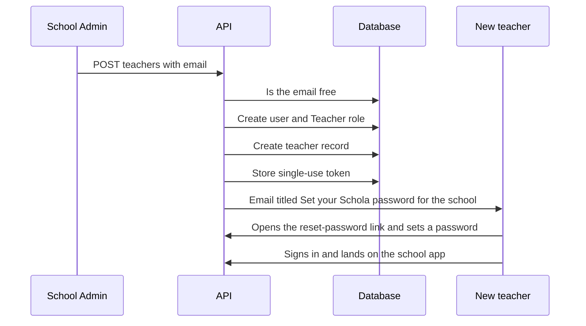

import { Aside, Steps, Card, CardGrid, LinkCard } from '@astrojs/starlight/components';
import Pipeline from '../../../../components/Pipeline.astro';
import ScreenAnatomy from '../../../../components/ScreenAnatomy.astro';
import SourceFile from '../../../../components/SourceFile.astro';
import Api from '../../../../components/Api.astro';
import Perm from '../../../../components/Perm.astro';
import Roles from '../../../../components/Roles.astro';
import Route from '../../../../components/Route.astro';
import DemoLogin from '../../../../components/DemoLogin.astro';
import Screenshot from '../../../../components/Screenshot.astro';
import { Tabs as ShotTabs, TabItem as ShotTab } from '@astrojs/starlight/components';

The **Teachers** module is the school's teaching staff list. Unlike students
and parents, every teacher **always** gets a sign-in: adding a teacher creates
their account, gives it the Teacher role in this school and emails them a link
to set a password. The teacher record holds an employee ID, contact details,
a qualification and the subjects they teach. Which classes and sections they
*lead* is set on the class page, and the profile pulls it all together with
their attendance and payslips.

## At a glance

<CardGrid>
  <Card title="Who uses it" icon="star">
    <Roles list={['school_admin']} note="add, edit, delete" />
    <Roles list={['principal']} note="edit" />
    <Roles list={['vice_principal', 'accountant']} note="read" />
  </Card>
  <Card title="Where to find it" icon="laptop">
    <Route path="/app/teachers" label="list" />
    <Route path="/app/teachers/[id]" label="profile" />
    Sidebar: **People › Teachers**
  </Card>
  <Card title="Permissions" icon="approve-check">
    <Perm name="teacher:read" /> <Perm name="teacher:create" />
    <Perm name="teacher:update" /> <Perm name="teacher:delete" />
  </Card>
</CardGrid>

<DemoLogin as="School Admin" email="admin@greenfield.example" go="/app/teachers">
  30 teachers are seeded, `TCH-001` to `TCH-030`. Grace Mensah (`TCH-005`) is
  the documented demo teacher.
</DemoLogin>

## How it works

<Pipeline
  caption="What happens between clicking Add teacher and the teacher taking their first register."
  steps={[
    { label: 'Add teacher', icon: 'user-plus', note: 'Employee ID, email, subjects' },
    { label: 'Account', icon: 'key', note: 'Sign-in with the Teacher role' },
    { label: 'Email', icon: 'mail', note: 'Set-password link' },
    { label: 'Assign', icon: 'layers', note: 'Class or section teacher' },
    { label: 'Teach', icon: 'clipboard-check', note: 'Registers, marks, remarks' },
  ]}
/>

A teacher's **reach** comes from two assignments made on
[Classes & sections](/features/academics/classes-and-sections/):

- **Section teacher** — the section form's "Section teacher (optional)" field.
  Hint in the app: "They can take attendance and enter grades for this section."
- **Class teacher** — the class form's "Class teacher (optional)" field, the
  homeroom teacher. Hint: "They can take attendance for every section of this class."

Together these are the teacher's **own sections**. Registers, gradebook grids,
remarks and student records are limited to them (the `:own_classes` permissions).
Grace Mensah leads Grade 3 · A and is class teacher of Grade 3, so her own
sections are Grade 3 · A and Grade 3 · B.

## The screens

Real screenshots from the seeded demo school (switch the docs theme to see dark mode):

<ShotTabs>
  <ShotTab label="Teachers">
    <Screenshot name="admin-teachers" alt="The Teachers list" path="/app/teachers" />
  </ShotTab>
  <ShotTab label="Teacher profile">
    <Screenshot name="admin-teacher-detail" alt="One teacher’s record" path="/app/teachers/6aeeea6fe8e90dae8c0644ad" />
  </ShotTab>
</ShotTabs>

### Teachers list

<ScreenAnatomy
  title="Teachers"
  path="/app/teachers"
  regions={[
    { label: 'Sidebar', desc: 'People › Teachers is highlighted', area: 'sidebar' },
    { label: 'Top bar', desc: 'Search, notifications, account menu', area: 'top' },
    { label: 'Page header', desc: 'Title "Teachers", the line "Teaching staff, the subjects they teach, and the classes they lead. Assign them from a class or section." and "Add teacher"' },
    { label: 'Toolbar', desc: 'Search box "Search name or employee ID"' },
    { label: 'Teachers table', desc: 'Teacher (name link + employee ID), Subjects, Leads (for example "Grade 3 (class teacher), Grade 3 · A" or "Not assigned"), Phone, row menu', size: 4, tone: 'accent' },
    { label: 'Pager', desc: '"Page 1 of 2 · 30 total"', tone: 'muted' },
  ]}
/>

### New teacher / edit drawer

<ScreenAnatomy
  title="New teacher"
  path="/app/teachers"
  regions={[
    { label: 'Drawer header', desc: '"New teacher" — "Creates their sign-in and emails a link to set a password." When editing: "Profile and subjects. Class and section assignments are made on the class page."' },
    { label: 'Identity fields', desc: 'Employee ID, Email (new teachers only), First name, Last name, Phone (optional), Date of birth (optional), Joined (optional), Address (optional)', size: 3 },
    { label: 'Qualification', desc: 'Free text, placeholder "B.Ed, M.Sc Mathematics"' },
    { label: 'Subjects they teach', desc: 'A filterable checklist of the school subjects ("Filter subjects"), each with its code', size: 2, tone: 'accent' },
    { label: 'Submit', desc: '"Add teacher" or "Save changes"', tone: 'warn' },
  ]}
/>

### Teacher profile

<ScreenAnatomy
  title="Teacher profile"
  path="/app/teachers/[id]"
  regions={[
    { label: 'Back link', desc: '"Teachers"', tone: 'muted' },
    { label: 'Profile header', desc: 'Initials, name, "TCH-005 · B.Ed Primary"' },
    { label: 'Details card', desc: 'Phone, Date of birth, Address, Joined (decrypted)' },
    { label: 'Teaching card', desc: '"Class teacher of" chips, "Sections" with student counts, and "Subjects"', size: 2, tone: 'accent' },
    { label: 'Attendance card', desc: '"Last 90 days." — Rate, Present, Absent, Late and the 30 most recent days (School Admin only)', size: 2 },
    { label: 'Payslips card', desc: '"The last 12 months." with a PDF for each payslip (School Admin and Accountant)', size: 2 },
  ]}
/>

## Step by step

### Add a teacher

<Steps>

1. Sign in as `admin@greenfield.example` and open **People › Teachers**.
2. Click **Add teacher**. The "New teacher" drawer opens with the line "Creates their sign-in and emails a link to set a password."
3. Fill in **Employee ID** (for example `TCH-031`) and **Email** — the hint says "They sign in with this. A set-password link is sent here."
4. Fill in **First name** and **Last name**, and optionally **Phone**, **Date of birth**, **Joined**, **Address** and **Qualification**.
5. Under **Subjects they teach**, type `math` in **Filter subjects** and tick **Mathematics**.
6. Click **Add teacher**. The toast says "Teacher added — they'll get an email to set a password." The new row shows "Not assigned" under **Leads**.

</Steps>

### Make them a class or section teacher

<Steps>

1. Open **School setup › Classes & sections** and click a class, for example **Grade 3**.
2. To make them **class teacher**, edit the class and choose them in **Class teacher (optional)**.
3. To make them **section teacher**, edit a section and choose them in **Section teacher (optional)**.
4. Back on **People › Teachers**, the **Leads** column now names the class or section.

</Steps>

### Read a teacher's profile

<Steps>

1. Search `Mensah` and click **Grace Mensah**.
2. The header reads "TCH-005 · B.Ed Primary".
3. The **Teaching** card shows "Class teacher of: Grade 3", sections "Grade 3 · A — 25 students", and subjects "Mathematics, Science".
4. On the right, the **Attendance** card shows her rate over the last 90 days and the **Payslips** card lists her recent months with a PDF link each.

</Steps>

## Every action on this screen

### Search

The box matches the first name, last name or employee ID, case-insensitively.
20 rows per page, sorted by last name.

<Api method="GET" path="teachers?q=&page=" perm="teacher:read" />

Each row includes the teacher's assignments (classes they are class teacher of,
and sections they lead), so the **Leads** column needs no extra request.

### "Add teacher"

Visible with <Perm name="teacher:create" /> (School Admin only).

<Api method="POST" path="teachers" perm="teacher:create" />

| Field | Rule |
|---|---|
| Employee ID | Required, 1–40 characters, unique in the school |
| Email | Required, valid, and not used by any Schola account |
| First name, Last name | Required, 1–80 characters |
| Phone | Optional; digits, spaces, dashes, a leading `+`, 7–20 characters |
| Date of birth, Joined | Optional dates |
| Address | Optional, up to 240 characters |
| Qualification | Optional, up to 240 characters |
| Subjects | Any number of this school's subjects; an unknown id returns `404` "Subject not found." |

What the API does, in order:

1. Checks the subjects exist in this school.
2. Refuses an email that any account already uses: `409` "A user with this email already exists."
3. Creates the account with a random password (argon2id) and an unverified email.
4. Grants it the **Teacher** role in this school.
5. Creates the teacher record (phone, date of birth and address encrypted).
6. Sends the set-password invite: a single-use `password_reset` token that
   lasts `PASSWORD_RESET_TTL_MIN` × 24 minutes (24 hours by default) and an
   email titled "Set your Schola password for *school*". It says "You've been
   added to *school* on Schola as a teacher", names the sign-in email, and has
   a **Set password** button that opens `/reset-password?token=…`. When neither
   Resend nor SMTP is configured, the email is printed to the API console
   instead (see [Email](/setup/services/email/)).
7. Writes the audit entry `teacher.create`, with `inviteEmail: "sent"` or
   `"failed"` in its metadata.

The invite is best-effort. If the token can't be stored or the email can't be
delivered, the API logs it and still answers `201` — the teacher, account and
role are saved, and a retry would only hit "A user with this email already
exists." The teacher can use **Forgot password** on the sign-in page instead.

### Open a profile

<Api method="GET" path="teachers/:id" perm="teacher:read" />
<Api method="GET" path="teachers/:id/overview" perm="teacher:read" />

The overview returns the teaching load (sections led, classes as class teacher,
subjects) for everyone with <Perm name="teacher:read" />, plus two blocks that
appear only for those who may see them elsewhere:

- **Attendance** (last 90 days, 30 rows) — needs <Perm name="staff_attendance:read:all" />.
- **Payslips** (last 12, cancelled ones left out) — needs <Perm name="salary:read:all" />.

### "Edit"

Visible with <Perm name="teacher:update" /> (School Admin and Principal).

<Api method="PATCH" path="teachers/:id" perm="teacher:update" />

Everything except the email can be changed: the sign-in email belongs to the
account, not to the teacher record. The drawer description reminds you that
class and section assignments are made on the class page. Toast: "Teacher updated."

### "Delete"

Visible with <Perm name="teacher:delete" />. The dialog reads "They are removed
as class or section teacher wherever assigned, and can no longer sign in to this
school."

<Api method="DELETE" path="teachers/:id" perm="teacher:delete" />

The record is soft-deleted, every class and section they led is set to "no
teacher", and the account loses its Teacher role in this school. The audit
entry `teacher.delete` records how many classes and sections were freed.

## Who sees what

| Role | List and profile | Add | Edit | Delete | Attendance on profile | Payslips on profile |
|---|---|---|---|---|---|---|
| School Admin | Yes | Yes | Yes | Yes | Yes | Yes |
| Principal | Yes | No | Yes | No | No | No |
| Vice Principal | Yes | No | No | No | No | No |
| Accountant | Yes | No | No | No | No | Yes |
| Teacher | No — their own view is [Teacher portal](/features/portals/teacher/) | — | — | — | — | — |

## Under the hood

- <SourceFile path="apps/web/src/app/(tenant)/app/teachers/page.tsx" />
- <SourceFile path="apps/web/src/app/(tenant)/app/teachers/[id]/page.tsx" />
- <SourceFile path="apps/web/src/components/school/teacher-form.tsx" symbol="TeacherEditor" />
- <SourceFile path="apps/web/src/components/records/employee-profile.tsx" symbol="EmployeeBody" />
- <SourceFile path="apps/api/src/modules/people/teachers.routes.ts" />
- <SourceFile path="apps/api/src/services/account-invite.ts" symbol="sendAccountInvite" /> — the best-effort set-password invite; template `accountInviteTemplate` in <SourceFile path="apps/api/src/services/email/templates.ts" />.
- <SourceFile path="apps/api/src/modules/people/_overview.ts" symbol="teacherTeaching" />
- <SourceFile path="apps/api/src/services/scopes/teacher-scope.ts" symbol="resolveOwnSectionIds" />
- <SourceFile path="packages/validation/src/people.ts" symbol="createTeacherSchema" />
- <SourceFile path="packages/db/src/models/teacher.ts" />

**Data shape** — `teachers`: `userId` (required), `employeeId`, `firstName`,
`lastName`, `phone` / `dateOfBirth` / `address` (encrypted), `qualification`,
`subjectIds`, `joinedAt`. Unique indexes: `(schoolId, employeeId)` and
`(schoolId, userId)`.

**Salary.** A teacher record has no salary field. Salary structures are named
templates in [Payroll](/features/finance/payroll/); each monthly payslip records
which structure it was built from (the `structureId` on `SalaryRecord`). The profile's
Payslips card is the link between the two.

**Audit actions** — `teacher.create`, `teacher.update`, `teacher.delete`.

## Edge cases and gotchas

- **Employee IDs and emails are never freed.** The employee ID index also covers
  deleted teachers, and a deleted teacher's account still exists, so neither
  can be reused for a new teacher.
- **Clearing Phone, Date of birth or Address** while editing leaves the old
  value (blank fields are not sent).
- **The Subjects list is not a timetable.** Ticking subjects only describes the
  teacher; the timetable and gradebook do not check it.
- **The invite link lasts longer than a reset link.** Both are
  `password_reset` tokens, but the invite lasts 24 times as long (24 hours by
  default) because nobody asked for it. The email states the configured
  lifetime.

:::note[A failed save leaves no account behind]
`POST /teachers` checks the **Employee ID** — including soft-deleted teachers,
which still hold theirs — *before* it creates the sign-in account, and answers
`409` "Another record already uses this employee ID." straight away. If the
record still fails after the account was made (for example two people saving
the same ID at the same moment), the account and its Teacher role are removed
again, so you can retry with the same email.
:::

## Related pages

<CardGrid>
  <LinkCard title="Classes & sections" description="Make a teacher class teacher or section teacher." href="/features/academics/classes-and-sections/" />
  <LinkCard title="Teacher portal" description="My classes, registers, marks and payslips from the teacher's side." href="/features/portals/teacher/" />
  <LinkCard title="Staff attendance" description="Where teachers' daily attendance is marked." href="/features/daily/staff-attendance/" />
  <LinkCard title="Payroll" description="Salary structures and monthly payslips." href="/features/finance/payroll/" />
</CardGrid>
