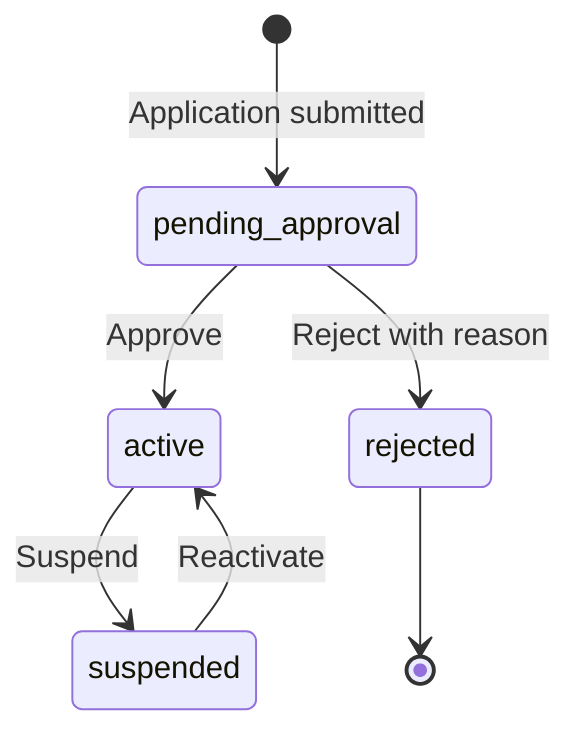

import { Aside, Steps, Card, CardGrid, LinkCard } from '@astrojs/starlight/components';
import Pipeline from '../../../../components/Pipeline.astro';
import ScreenAnatomy from '../../../../components/ScreenAnatomy.astro';
import SourceFile from '../../../../components/SourceFile.astro';
import Api from '../../../../components/Api.astro';
import Perm from '../../../../components/Perm.astro';
import Roles from '../../../../components/Roles.astro';
import Route from '../../../../components/Route.astro';
import DemoLogin from '../../../../components/DemoLogin.astro';
import Screenshot from '../../../../components/Screenshot.astro';

No school goes live on Schola by itself. Every application — from the
"Bring a school" tab on `/signup` or from the quick form at
`/onboarding/school` — arrives as a school in `pending_approval`. The
**Approvals** page lists exactly those schools. Approving one creates the
school's roles, activates its owner as **School Admin** and emails them.
Rejecting one closes the application and emails the reason.

## At a glance

<CardGrid>
  <Card title="Who uses it" icon="star">
    <Roles list={['super_admin']} />
  </Card>
  <Card title="Where to find it" icon="laptop">
    <Route path="/platform/approvals" /> — sidebar **Schools → Approvals**
  </Card>
  <Card title="Permissions" icon="approve-check">
    <Perm name="school:read_all" /> to list, <Perm name="school:approve" /> and <Perm name="school:reject" /> to decide.
  </Card>
</CardGrid>

<DemoLogin as="Super Admin" email="superadmin@schola.example" go="/platform/approvals">
The demo seed leaves two applications waiting: **Riverside Academy** (owner
`owner@riverside.example`) and **Lakeside Coaching Centre**.
</DemoLogin>

## How it works

Only a school in `pending_approval` can be approved or rejected. Approval is
a one-way door into the normal life of a school (`active` ↔ `suspended`, see
[Schools](/features/platform/schools/)); rejection is final.

<Pipeline
  caption="What one click on Approve does, in order."
  steps={[
    { label: 'Roles', icon: 'shield', note: 'Eight school roles created' },
    { label: 'Activate', icon: 'badge-check', note: 'School active, owner active and verified' },
    { label: 'Admin', icon: 'user-cog', note: 'Owner becomes School Admin' },
    { label: 'Tell them', icon: 'mail', note: 'Email and in-app notice' },
    { label: 'Record', icon: 'scroll', note: 'school.approve in the audit log' },
  ]}
/>

## The screen

<Screenshot name="platform-approvals" alt="Schools waiting for approval" path="/platform/approvals" />

<ScreenAnatomy
  title="Approvals"
  path="/platform/approvals"
  regions={[
    { label: 'Sidebar', desc: 'Platform navigation; "Approvals" is highlighted under Schools.', area: 'sidebar' },
    { label: 'Top bar', desc: 'Breadcrumb "Platform / Approvals".', area: 'top' },
    { label: 'Page header', desc: '"Approvals" — "Schools waiting for a decision. Approve them or send them back with a reason." — and the "New school" button. There is no status filter on this page.' },
    { label: 'Applications table', desc: 'Columns School (a link), Type, Contact, Students (the expected count, e.g. ~320), Status (Pending) and a "⋯" actions button on each row.', size: 4, tone: 'accent' },
  ]}
/>

<ScreenAnatomy
  title="Reject dialog"
  path="/platform/approvals"
  regions={[
    { label: 'Title', desc: '"Reject Riverside Academy".' },
    { label: 'Explanation', desc: '"Rejecting closes the application. Reason will be emailed to the applicant."', tone: 'warn' },
    { label: 'Reason', desc: 'A single text field, placeholder "Briefly explain why".', tone: 'accent' },
    { label: 'Buttons', desc: '"Cancel" and a red "Reject", which stays disabled until the reason has at least 3 characters.' },
  ]}
/>

## Step by step

### Approve an application

<Steps>

1. Sign in as the Super Admin and click **Approvals** in the sidebar (or the
   **Pending approval** tile on the dashboard).
2. Find **Riverside Academy**. Read the row: type school, contact
   `owner@riverside.example`, about 320 expected students, status Pending.
3. Optional: click the school name to open its detail page and check the
   founding admin — "Email verified: Not yet" and "Account active: No" are
   normal for a pending application.
4. Back on the list, click the **⋯** button at the end of the row. The menu
   shows the school name, then **View details**, **Approve** and **Reject…**.
5. Click **Approve**. There is no confirmation step. A toast says "School
   approved." and the row disappears from the list.
6. Sign out, then sign in as `owner@riverside.example` (`Schola@2026`). Before
   approval this showed "Your school's application is waiting for approval.";
   now you land on
   `/app` as the School Admin of Riverside Academy, with the "Get your school
   running" checklist.

</Steps>

### Reject an application

<Steps>

1. On **Approvals**, click **⋯** on the row and choose **Reject…** (shown in
   red).
2. In the dialog "Reject *school name*", type a **Reason** of at least three
   characters — for example "We could not verify the school's registration."
3. Click **Reject**. The button reads "Saving…", then a toast says "School
   rejected." and the row leaves the queue.
4. The applicant receives "Update on your Schola application — *school*" with
   your reason. The school now appears under the **Rejected** filter on
   [Schools](/features/platform/schools/), and its detail page shows a
   "Rejected" box with the reason.

</Steps>

<Aside type="danger" title="Rejecting a demo school is permanent">
There is no "undo" for a rejection, and the owner's account is switched off.
To get Lakeside or Riverside back in `pending_approval`, run
`pnpm seed -- --reset`.
</Aside>

## Every action on this screen

### Loading the queue

The page asks for schools with `status=pending_approval`, newest first.

<Api method="GET" path="platform/schools" perm="school:read_all" />

### "View details" or clicking the school name

Opens `/platform/schools/[id]` — institution details, the founding admin,
the lifecycle dates and the last 20 audit-log entries. The detail page's
**Actions** menu offers the same decisions as **Approve application** and
**Reject…**. See [Schools](/features/platform/schools/).

### "Approve"

<Api method="POST" path="platform/schools/:id/approve" perm="school:approve" />

The API, in order:

1. Refuses unless the school is `pending_approval` — 'Cannot approve a school
   in status "active".' — and unless it has an owner — "School has no owner
   user assigned."
2. Creates the school's eight tenant roles (School Admin, Principal, Vice
   Principal, Teacher, Accountant, Student, Parent, Staff) and wires each
   role's default permissions.
3. Sets `status: "active"`, `approvedAt` and `approvedBy`.
4. Activates the owner account and marks its email verified, so the owner can
   sign in at once even if they never clicked the verification link.
5. Gives the owner the `school_admin` role in this school.
6. Emails the owner "*School* is approved on Schola" with a link to `/login`,
   and adds an in-app notification "Your school is live — Your Schola
   application has been approved." that links to `/app`. If the email
   provider fails, the error is logged (`approval email failed`) and the
   approval carries on — the owner just gets no email.
7. Writes `school.approve` to the audit log with the school before and after.

### "Reject…"

<Api method="POST" path="platform/schools/:id/reject" perm="school:reject" />

Body: `{ "reason": "…" }` — 3 to 500 characters. The API refuses unless the
school is `pending_approval`, then sets `status: "rejected"`, `rejectedAt` and
`rejectedReason`, deactivates and soft-deletes the owner account, emails the
reason and writes `school.reject` with the reason in `metadata`. The owner is
loaded before the soft-delete so the email has an address to go to; an email
failure is logged (`rejection email failed`) and does not stop the
rejection.

### "New school"

Opens `/platform/schools/new` to create an already-active school without an
application. See [Schools](/features/platform/schools/#create-a-school-directly).

## Emails and notifications

| Moment | Who | Email subject | In-app notification |
|---|---|---|---|
| Application submitted | Applicant | "Your Schola application is being reviewed" | — |
| Application submitted | Every Super Admin | — | "New school application — *school* (*type*) is awaiting review." |
| Approved | Owner | "*School* is approved on Schola" | "Your school is live" |
| Rejected | Owner | "Update on your Schola application — *school*" | — |

## Who sees what

| Role | Approvals page |
|---|---|
| <Roles list={['super_admin']} /> | Full access: list, approve, reject |
| Every other role | Redirected away from `/platform/*`; the API answers 403 "Super admin only." |

## Under the hood

- <SourceFile path="apps/web/src/app/(super-admin)/platform/approvals/page.tsx" /> — renders `SchoolsDirectory` fixed to `pending_approval`.
- <SourceFile path="apps/web/src/components/platform/schools-directory.tsx" symbol="SchoolsDirectory" /> — the table, the row menu and `ReasonModal`.
- <SourceFile path="apps/api/src/modules/platform/platform.routes.ts" /> — the approve and reject routes.
- <SourceFile path="apps/api/src/modules/schools/schools.service.ts" symbol="approveSchool" /> and `rejectSchool`.
- <SourceFile path="apps/api/src/services/rbac/seed.ts" symbol="seedTenantRoles" /> — per-school role creation.
- <SourceFile path="apps/api/src/services/email/templates.ts" /> — `schoolApprovedTemplate`, `schoolRejectedTemplate`.
- <SourceFile path="packages/validation/src/admin.ts" symbol="rejectSchoolSchema" />.

Audit actions: `school.signup` or `school.signup.quick` (when the application
arrives), `school.approve`, `school.reject`.

## Edge cases and gotchas

- **Approve is instant.** Unlike Reject, the **Approve** menu item has no
  confirmation dialog.
- **The applicant's open session.** An applicant who applied from `/welcome`
  and stays signed in keeps seeing the welcome dashboard until their session
  renews (at most 15 minutes) or they sign in again. See
  [Onboarding and welcome](/features/accounts/onboarding-and-welcome/).
- **Rejected emails are used up.** The rejected owner account still exists
  (soft-deleted), so the same email cannot apply again from `/signup` — it gets
  "An account with this admin email already exists".
- **Two Super Admins at once.** If one approves while another has the list
  open, the second one's **Approve** returns 'Cannot approve a school in status
  "active".' as a red toast.

<Aside type="caution" title="No 'request more info' and no email to Super Admins">
spec lists three decisions — approve, reject with reason, and **request
more info** — and says Super Admins are notified "Email + in-app". The code
has only approve and reject, and new applications reach Super Admins only as
in-app notifications (`Notification.create` in `signup` and `quickSignup`).
To ask an applicant a question today, email them at the contact address shown
on the detail page.
</Aside>

<Aside type="caution" title="Rejecting a quick application switches off a personal account">
`rejectSchool` soft-deletes the school's owner account. For an application
from `/onboarding/school`, that owner is the applicant's existing personal
account, so they lose their sign-in entirely. See
[Onboarding and welcome](/features/accounts/onboarding-and-welcome/#edge-cases-and-gotchas).
</Aside>

## Related pages

<CardGrid>
  <LinkCard title="Schools" description="All schools, detail pages, suspension and direct creation." href="/features/platform/schools/" />
  <LinkCard title="Sign up and sign in" description="Where applications come from." href="/features/accounts/sign-up-and-sign-in/" />
  <LinkCard title="Approve the school (tutorial)" description="The same flow in the step-by-step tutorial." href="/tutorial/approve-the-school/" />
  <LinkCard title="School statuses" description="pending_approval, active, suspended and rejected." href="/reference/statuses/" />
</CardGrid>
