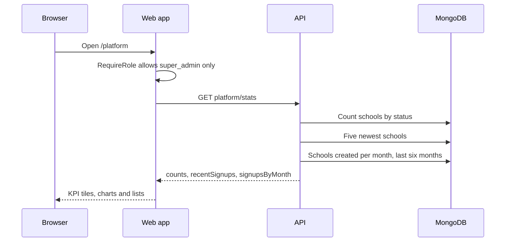

import { Aside, Steps, Card, CardGrid, LinkCard } from '@astrojs/starlight/components';
import ScreenAnatomy from '../../../../components/ScreenAnatomy.astro';
import SourceFile from '../../../../components/SourceFile.astro';
import Api from '../../../../components/Api.astro';
import Perm from '../../../../components/Perm.astro';
import Roles from '../../../../components/Roles.astro';
import Route from '../../../../components/Route.astro';
import DemoLogin from '../../../../components/DemoLogin.astro';
import BarChart from '../../../../components/BarChart.astro';
import Screenshot from '../../../../components/Screenshot.astro';

The platform dashboard is the first page a **Super Admin** sees after signing
in. It answers one question at a glance: *what state is every school on the
platform in?* Five counters, two charts and two lists cover how many schools
exist, how many wait for approval, how many are live, suspended or rejected,
and which ones signed up most recently. Every number links to the screen where
you act on it.

## At a glance

<CardGrid>
  <Card title="Who uses it" icon="star">
    <Roles list={['super_admin']} />
  </Card>
  <Card title="Where to find it" icon="laptop">
    <Route path="/platform" /> — sidebar **Overview → Dashboard**
  </Card>
  <Card title="Permissions" icon="approve-check">
    <Perm name="school:read_all" />
  </Card>
</CardGrid>

<DemoLogin as="Super Admin" email="superadmin@schola.example" go="/platform" />

## How it works



The page makes **one** request. The API counts schools by status, fetches the five most recently created schools, and groups schools
created since the first day of the month five months ago by `YYYY-MM`. The web
app fills in months with no sign-ups as zero so the bar chart always shows six
bars.

With the demo data (`pnpm seed`) you should see these counts:

<BarChart
  title="Demo platform — schools by status"
  unit="schools"
  data={[
    { label: 'Total schools', value: 4 },
    { label: 'Pending approval', value: 2, note: 'Riverside Academy, Lakeside Coaching Centre' },
    { label: 'Active', value: 1, note: 'Greenfield International School' },
    { label: 'Suspended', value: 1, note: 'Hilltop College' },
    { label: 'Rejected', value: 0 },
  ]}
/>

## The screen

<Screenshot name="platform-dashboard" alt="The Super Admin dashboard" path="/platform" />


<ScreenAnatomy
  title="Platform dashboard"
  path="/platform"
  regions={[
    { label: 'Sidebar', desc: 'Overview, Schools (All schools, Approvals), People (Users), Activity (Audit log, Notifications), System (Settings, Branding, Locale, Email, Feature flags).', area: 'sidebar', size: 3 },
    { label: 'Top bar', desc: 'Breadcrumb "Platform / Dashboard", Home, "Load sample", theme toggle and the account menu. The platform shell has no notification bell.', area: 'top' },
    { label: 'Page header', desc: '"Welcome, first name." — "Platform-wide overview of every school on Schola." — and the "Open schools" button.' },
    { label: 'KPI tiles', desc: 'Total schools, Pending approval, Active, Suspended, Rejected. Pending approval gets a coloured ring when the queue is not empty.', tone: 'accent' },
    { label: 'Charts', desc: '"New schools — Applications opened in the last six months." (bars) and "School status — Every school on the platform." (donut).', size: 2 },
    { label: 'Queue and sign-ups', desc: '"Pending approvals — Schools waiting on a decision." and "Recent signups — Latest applications and approved schools."', size: 2, tone: 'warn' },
  ]}
/>

## Step by step

<Steps>

1. Go to `/login` and sign in as `superadmin@schola.example` with
   `Schola@2026`. A toast says "Welcome back, Sam." and you land on
   `/platform`.
2. Read the header: "Welcome, Sam." with the subtitle "Platform-wide overview
   of every school on Schola."
3. Look at the five KPI tiles. With the demo data, **Pending approval** shows
   2 and carries a highlight ring because the queue is not empty.
4. Point at the **New schools** bar chart: each bar is one month, the last
   six months, counting schools by the date they were created.
5. Point at the **School status** donut: Active, Pending, Suspended and
   Rejected slices.
6. In **Pending approvals**, read the large number and "schools are awaiting
   your review." Click **Review queue** to open the
   [Approvals](/features/platform/approvals/) queue.
7. In **Recent signups**, each row shows the school name, its type, the date
   it was created and a status badge (Pending, Active, Suspended or
   Rejected). Click **Riverside Academy** to open its detail page.
8. Back on the dashboard, click the **Pending approval** tile to jump to
   `/platform/approvals`, where you approve or reject.

</Steps>

## Every action on this screen

### Loading the page

<Api method="GET" path="platform/stats" perm="school:read_all" />

While the request runs, the tiles and lists show grey pulsing placeholders.
The response shape:

```json
{
  "counts": { "total": 4, "pending": 2, "active": 1, "suspended": 1, "rejected": 0 },
  "recentSignups": [
    { "id": "…", "name": "Lakeside Coaching Centre", "type": "coaching", "status": "pending_approval", "createdAt": "…" }
  ],
  "signupsByMonth": [{ "month": "2026-11", "total": 2 }]
}
```

### KPI tiles

| Tile | Clicking it opens |
|---|---|
| Total schools | `/platform/schools` |
| Pending approval | `/platform/approvals` |
| Active | `/platform/schools` |
| Suspended | Not a link |
| Rejected | Not a link |

The schools list remembers the last status filter you picked, so "Active"
does not pre-filter it to active schools.

### "Open schools" and "Review queue"

**Open schools** opens `/platform/schools`, the full list. **Review queue** in
the Pending approvals card opens `/platform/approvals`, the approvals queue.
When nothing is pending the card shows "You're all caught up — No schools are
waiting on approval right now." instead of the button.

### A row in "Recent signups"

Opens `/platform/schools/[id]`, the [school detail page](/features/platform/schools/).
The list holds the five newest schools in any status. With no schools at all
it reads "No schools yet — Signups will appear here."

### "Load sample"

Switches the page to sample numbers kept in the browser (18 schools: 4
pending, 11 active, 2 suspended, 1 rejected, with names like "North Ridge
School") so you can demo a busier platform. Click **Show real data** to switch
back. No request reaches the API while sample mode is on. Sample mode also
covers **All schools** and **Approvals**; sample schools have no detail page,
so their rows in **Recent signups** (and on those lists) are not links and
offer no actions. Other platform pages always show real data.

## Who sees what

| Role | What happens at `/platform` |
|---|---|
| <Roles list={['super_admin']} /> | The dashboard |
| Any school role | Redirected to `/welcome`, which forwards to `/app` |
| <Roles list={['user']} /> | Redirected to `/welcome` |
| Signed out | Redirected to `/login?next=/platform` |

## Under the hood

- <SourceFile path="apps/web/src/app/(super-admin)/platform/page.tsx" symbol="PlatformOverviewPage" /> — the page, `Kpi` tiles and lists.
- <SourceFile path="apps/web/src/components/dashboard/charts.tsx" /> — `TrendChart` (bars), `SplitChart` (donut) and `fillRecentMonths`.
- <SourceFile path="apps/api/src/modules/platform/platform.routes.ts" /> — `GET /platform/stats` behind `requireAuth`, `requireSuperAdmin` and a 60-requests-per-minute limit.
- <SourceFile path="apps/api/src/modules/schools/schools.service.ts" symbol="getPlatformStats" /> — the counts and the monthly aggregation.
- <SourceFile path="apps/web/src/lib/sample-data.ts" symbol="SAMPLE_PLATFORM" /> — the "Load sample" numbers.

Nothing on this page writes to the database, so it adds no audit-log entries.

## Edge cases and gotchas

- **Months are UTC.** Sign-ups are grouped by UTC month, so a school created
  late on the last day of a month in a time zone ahead of UTC can appear in
  the previous month's bar.
- **Rejected schools still count.** "Total schools" includes rejected
  applications; nothing in the app deletes a school.
- **No live refresh.** The numbers load once per visit. Approve a school in
  another tab, then come back and reload to see the new counts. Approving
  from the [Approvals](/features/platform/approvals/) or
  [Schools](/features/platform/schools/) page in the same tab does refresh
  them.
- **Notifications live in the sidebar.** The platform top bar has no bell.
  New-application notifications are under **Activity → Notifications**.

## Related pages

<CardGrid>
  <LinkCard title="Approvals" description="Decide the schools waiting in pending_approval." href="/features/platform/approvals/" />
  <LinkCard title="Schools" description="The full school directory and each school's detail page." href="/features/platform/schools/" />
  <LinkCard title="Notifications and audit" description="The Super Admin inbox and the platform audit log." href="/features/platform/notifications-and-audit/" />
  <LinkCard title="Your first school: the platform owner" description="The tutorial chapter that starts here." href="/tutorial/platform-owner/" />
</CardGrid>
