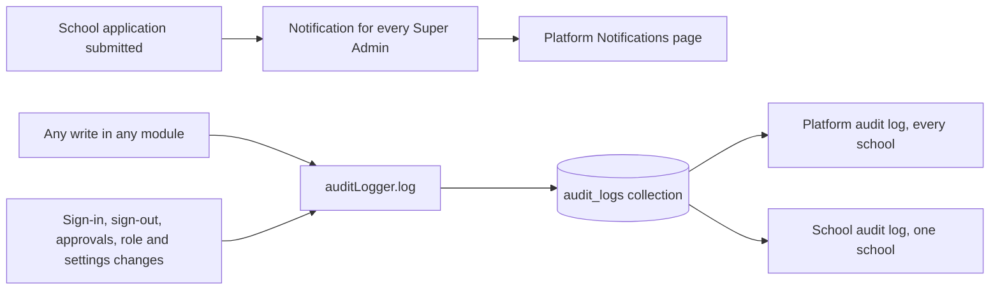

import { Aside, Steps, Tabs, TabItem, Card, CardGrid, LinkCard } from '@astrojs/starlight/components';
import ScreenAnatomy from '../../../../components/ScreenAnatomy.astro';
import SourceFile from '../../../../components/SourceFile.astro';
import Api from '../../../../components/Api.astro';
import Perm from '../../../../components/Perm.astro';
import Roles from '../../../../components/Roles.astro';
import Route from '../../../../components/Route.astro';
import DemoLogin from '../../../../components/DemoLogin.astro';
import Screenshot from '../../../../components/Screenshot.astro';
import { Tabs as ShotTabs, TabItem as ShotTab } from '@astrojs/starlight/components';

Two pages sit under **Activity** in the platform sidebar. **Notifications**
is the Super Admin's own inbox — today that means one kind of message: "a new
school applied". **Audit log** is the platform-wide history of changes: every
write to business data in any school, plus platform events such as sign-ins,
approvals, role grants and settings changes. The audit log is append-only —
nothing in the app can edit or delete an entry.

## At a glance

<CardGrid>
  <Card title="Who uses it" icon="star">
    <Roles list={['super_admin']} />
  </Card>
  <Card title="Where to find it" icon="laptop">
    <Route path="/platform/notifications" /> <Route path="/platform/audit-log" />
  </Card>
  <Card title="Permissions" icon="approve-check">
    <Perm name="notification:read:own" /> for the inbox, <Perm name="audit_log:read:all" /> for the log.
  </Card>
</CardGrid>

<DemoLogin as="Super Admin" email="superadmin@schola.example" go="/platform/notifications">
The seed leaves two unread notifications — "New school application:
Riverside Academy" and "New school application: Lakeside Coaching Centre" —
and a short audit history (approvals, a suspension, set-up actions at
Greenfield).
</DemoLogin>

## How it works



- **Notifications** are rows addressed to one user. When a school applies,
  the API creates one row per Super Admin. Each row has a type
  (`school.signup`), a title, a body, a link and a read date.
- **Audit entries** are written by one helper, `auditLogger.log`, from every
  service that changes data. Each entry records the school (or none, for
  platform events), the actor and their role at that moment, the action, the
  resource, before and after snapshots, and the IP, user agent and request
  id. The model blocks every update and delete.

## The screens

Real screenshots from the seeded demo school (switch the docs theme to see dark mode):

<ShotTabs>
  <ShotTab label="Notifications">
    <Screenshot name="platform-notifications" alt="Platform notifications" path="/platform/notifications" />
  </ShotTab>
  <ShotTab label="Audit log">
    <Screenshot name="platform-audit-log" alt="The platform audit log" path="/platform/audit-log" />
  </ShotTab>
</ShotTabs>


<ScreenAnatomy
  title="Notifications"
  path="/platform/notifications"
  regions={[
    { label: 'Sidebar', desc: '"Notifications" highlighted under Activity. The platform top bar has no bell, so this link is the way in.', area: 'sidebar' },
    { label: 'Page header', desc: '"Notifications" with "2 unread", "All caught up." or "Your inbox." as the subtitle, and "Mark all read" (disabled when nothing is unread).' },
    { label: 'Inbox list', desc: 'Newest first. Unread rows have a cyan dot and a faint tint. Each row: title, date and time, body, then "Open", "Mark read" and the type, e.g. "School · Signup".', size: 4, tone: 'accent' },
  ]}
/>

<ScreenAnatomy
  title="Platform audit log"
  path="/platform/audit-log"
  regions={[
    { label: 'Page header', desc: '"Platform audit log" — "Every mutation across every tenant. Append-only."' },
    { label: 'Filters card', desc: 'From (date), To (date) and Action (free text, hint: Matches the start: "school." or "auth.login"). The list reloads as you change them.', tone: 'warn' },
    { label: 'Entries', desc: 'Newest first, up to 100. Each entry: the action in monospace (e.g. school.approve), the date and time, "resource: school · school 4f2a9c · by super_admin" — or "· platform" for platform events — and an "N changes" button that opens a Before / After table.', size: 4, tone: 'accent' },
  ]}
/>

## Step by step

<Tabs>
<TabItem label="Notifications">

<Steps>

1. Sign in as the Super Admin and click **Activity → Notifications**.
2. The subtitle reads "2 unread". Each unread row has a cyan dot.
3. Click **Open** on "New school application: Riverside Academy". The row is
   marked read and you go to the page it links to (the seeded rows link to
   `/platform/approvals`; live ones link to the school's detail page).
4. Come back and click **Mark read** on the other row, or click **Mark all
   read** in the header. A toast says "Marked 1 as read." (or "Already up to
   date." when there was nothing to mark).
5. The subtitle now reads "All caught up."

</Steps>

</TabItem>
<TabItem label="Audit log">

<Steps>

1. Click **Activity → Audit log**. The newest 100 entries across all schools
   appear.
2. Type `school.` in **Action**. Only school decisions remain — signups,
   approvals, rejections, suspensions. Type the full `school.approve` to keep
   approvals only.
3. Clear the Action field and set **From** to a week ago and **To** to
   today to see this week's activity (**To** includes the whole day).
4. Read an entry: `auth.login` — "resource: user · school 3b81d0 · by
   teacher" means a teacher signed in to the school whose id ends in
   `3b81d0`.
5. On a `school.approve` entry, click **N changes** to see the fields that
   changed — `status` from `pending_approval` to `active`, plus the approval
   date and approver.
6. Do something on another tab — approve a school, save a setting — then
   reload the log to see the new entry at the top.

</Steps>

</TabItem>
</Tabs>

## Every action on this screen

### Loading the inbox

<Api method="GET" path="notifications" perm="notification:read:own" />

Returns the caller's 20 newest notifications plus the unread count. The
platform page is the same component as the school app's
[Notifications](/features/communication/notifications/) page, mounted in the
platform shell.

### "Open" and "Mark read"

Both mark one notification read (Open also follows its link). Marking one
notification read writes no audit entry.

<Api method="PATCH" path="notifications/:id/read" perm="notification:read:own" />

### "Mark all read"

Marks every unread notification of the caller read and writes
`notification.mark_all_read` with the count.

<Api method="POST" path="notifications/mark-all-read" perm="notification:read:own" />

### Loading and filtering the audit log

<Api method="GET" path="platform/audit-logs" perm="audit_log:read:all" />

Query: `from`, `to` (dates), `action` (matches the start of the action name —
lower-cased, regex characters escaped, anchored so the `action` index can
serve it), `actorId` (the API
accepts it, the page has no field), `page`, `pageSize` — the page asks for
100. `from` and `to` are whole UTC days; `to` includes the end of its day.
Every school's entries are included, plus platform entries with no school.
While loading, the list shows placeholder rows; a failed request shows "The
audit log could not be loaded." with **Try again**; no hits show "No matching
entries".

## What gets recorded

| Area | Example actions |
|---|---|
| Accounts | `auth.register`, `auth.login`, `auth.logout`, `auth.email.verified`, `auth.password_reset.request`, `auth.password_reset.complete`, `auth.password.change`, `auth.session.revoke`, `auth.session.revoke_others`, `auth.google.login`, `auth.facebook.register`, `user.profile.update` |
| Schools | `school.signup`, `school.signup.quick`, `school.approve`, `school.reject`, `school.suspend`, `school.reactivate`, `school.create_direct`, `school.update`, `school.force_admin_transfer` |
| Ownership | `admin_transfer.initiate`, `admin_transfer.complete` |
| Platform users | `user.invite_platform`, `user.suspend`, `user.reactivate`, `user.role.grant`, `user.role.revoke` |
| School roles | `user_role.grant`, `user_role.revoke` |
| Settings | `system_setting.update` |
| School data | `academic_year.create`, `subject.update`, `class.delete`, `section.create`, `enrollment.update`, `student.create`, `attendance.mark`, `fee.collect`, … — one per write in every module |
| Inbox | `notification.mark_all_read` |

The stored entry looks like this (the page shows the action, resource,
school, role and time, and the changed fields of `before` / `after` behind the
**N changes** button). Ids inside `before` / `after` are stored as 24-character
strings and dates as ISO timestamps; older entries that stored ids as
`{"i0":…,"i3":…}` objects are shown as the same ids:

```json
{
  "schoolId": "…or null for platform events",
  "actorId": "…",
  "actorRoleAtTime": "super_admin",
  "action": "school.approve",
  "resource": "school",
  "resourceId": "…",
  "before": { "status": "pending_approval" },
  "after": { "status": "active" },
  "metadata": { "ip": "…", "userAgent": "…", "requestId": "…" },
  "createdAt": "2026-11-07T09:12:44.000Z"
}
```

Ordinary reads are not logged — opening a list leaves no trace — but a
sign-in is, and so are a few sensitive reads: report exports
(`report.fees.export` and friends), PDF downloads (`fee.receipt.download`,
`grade.report_card.download`, `payroll.payslip.download`) and
`admission.read`.

## Who sees what

| Role | Notifications | Audit log |
|---|---|---|
| <Roles list={['super_admin']} /> | Their own inbox in the platform shell | Every school and every platform event |
| School Admin, Principal | Their own inbox in the school app | Only their school, on the [school audit log](/features/insight/audit-log/) |
| Other school roles | Their own inbox in the school app | No access |

## Under the hood

- <SourceFile path="apps/web/src/app/(super-admin)/platform/notifications/page.tsx" /> — re-uses <SourceFile path="apps/web/src/app/(tenant)/app/notifications/page.tsx" />.
- <SourceFile path="apps/web/src/app/(super-admin)/platform/audit-log/page.tsx" symbol="PlatformAuditLog" />.
- <SourceFile path="apps/api/src/modules/notifications/notifications.routes.ts" /> — list, unread count, mark read, mark all read.
- <SourceFile path="apps/api/src/modules/audit-logs/audit-logs.routes.ts" symbol="platformAuditLogsRouter" /> — mounted at `/api/v1/platform/audit-logs`, rate limited to 60 requests a minute.
- <SourceFile path="apps/api/src/services/audit.service.ts" symbol="auditLogger" /> — the single writer.
- <SourceFile path="packages/db/src/models/audit-log.ts" /> — schema and the append-only hooks.
- <SourceFile path="packages/db/src/models/notification.ts" />.

## Edge cases and gotchas

- **Action matches from the start.** `school.` finds every school action and
  `school.approve` just approvals, but `approve` alone finds nothing — it is
  not a "contains" search. There is no list of actions to pick from — use the
  table above.
- **Days are UTC days.** **From** and **To** cover whole UTC days, so an
  entry made late in the evening far from UTC may fall on the next day.
- **Only the newest 100.** There is no paging, no export and no CSV on this
  page. Narrow the dates to look further back.
- **Little detail per entry.** The page does not show the actor's name or
  the request metadata, and abbreviates the school to the last six characters
  of its id. The API response contains everything.
- **The inbox shows 20.** Older notifications are not reachable from the
  page.
- **Two kinds of "new application" rows.** Seeded notifications are titled
  "New school application: *name*" and link to Approvals; notifications from
  a real application are titled "New school application" and link to the
  school's detail page.

## Related pages

<CardGrid>
  <LinkCard title="Audit log (architecture)" description="Why and how every write is recorded." href="/architecture/audit-log/" />
  <LinkCard title="School audit log" description="The per-school view for School Admins and Principals." href="/features/insight/audit-log/" />
  <LinkCard title="Notifications" description="The inbox and header bell in the school app." href="/features/communication/notifications/" />
  <LinkCard title="Approvals" description="Where 'New school application' notifications lead." href="/features/platform/approvals/" />
</CardGrid>
