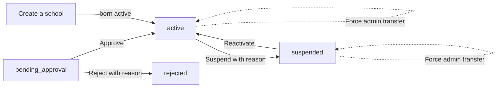

import { Aside, Steps, Tabs, TabItem, Card, CardGrid, LinkCard } from '@astrojs/starlight/components';
import ScreenAnatomy from '../../../../components/ScreenAnatomy.astro';
import SourceFile from '../../../../components/SourceFile.astro';
import Api from '../../../../components/Api.astro';
import Perm from '../../../../components/Perm.astro';
import Roles from '../../../../components/Roles.astro';
import Route from '../../../../components/Route.astro';
import DemoLogin from '../../../../components/DemoLogin.astro';
import Screenshot from '../../../../components/Screenshot.astro';
import { Tabs as ShotTabs, TabItem as ShotTab } from '@astrojs/starlight/components';

A **school** is a tenant on Schola: every record inside it carries the
school's id. The **Schools** pages are where the Super Admin looks after
tenants as a whole. The list shows every school in every status. Each
school's detail page shows its contact details, its founding admin and its
recent activity, and carries the actions that change a school's life:
approve, reject, suspend, reactivate and force an admin transfer. A third page
creates a school directly, skipping the application.

## At a glance

<CardGrid>
  <Card title="Who uses it" icon="star">
    <Roles list={['super_admin']} />
  </Card>
  <Card title="Where to find it" icon="laptop">
    <Route path="/platform/schools" /> <Route path="/platform/schools/[id]" label="School detail" /> <Route path="/platform/schools/new" label="Create a school" />
  </Card>
  <Card title="Permissions" icon="approve-check">
    <Perm name="school:read_all" /> <Perm name="school:create_direct" /> <Perm name="school:suspend" /> <Perm name="school:approve" /> <Perm name="school:reject" /> <Perm name="admin_transfer:force" />
  </Card>
</CardGrid>

<DemoLogin as="Super Admin" email="superadmin@schola.example" go="/platform/schools">
Four demo schools: Greenfield International School (active), Riverside
Academy and Lakeside Coaching Centre (pending) and Hilltop College
(suspended, "Subscription payment overdue by 60 days.").
</DemoLogin>

## How it works

The actions you see depend on the school's status:

| Status | Row menu on the list | "Actions" menu on the detail page |
|---|---|---|
| `pending_approval` | View details, Approve, Reject… | Approve application, Reject… |
| `active` | View details, Suspend… | Suspend…, Force admin transfer… |
| `suspended` | View details, Reactivate | Reactivate, Force admin transfer… |
| `rejected` | View details | (no actions) |

## The screens

Real screenshots from the seeded demo school (switch the docs theme to see dark mode):

<ShotTabs>
  <ShotTab label="Schools">
    <Screenshot name="platform-schools" alt="Every school on the platform" path="/platform/schools" />
  </ShotTab>
  <ShotTab label="School detail">
    <Screenshot name="platform-school-detail" alt="One school’s detail page" path="/platform/schools/6aeeea6fe8e90dae8c06448a" />
  </ShotTab>
  <ShotTab label="Create a school">
    <Screenshot name="platform-school-new" alt="Creating a school directly" path="/platform/schools/new" />
  </ShotTab>
</ShotTabs>

<ScreenAnatomy
  title="Schools"
  path="/platform/schools"
  regions={[
    { label: 'Sidebar', desc: '"All schools" highlighted under Schools.', area: 'sidebar' },
    { label: 'Top bar', desc: 'Breadcrumb "Platform / All schools".', area: 'top' },
    { label: 'Page header', desc: '"Schools" — "Every school across the platform. Approve, reject, suspend, or reactivate." — a status filter button (shows the current filter, e.g. "All schools") and "New school".' },
    { label: 'Schools table', desc: 'School (link), Type, Contact, Students (~expected), Status badge, and a "⋯" actions button per row. Rejected badges are struck through.', size: 4, tone: 'accent' },
  ]}
/>

<ScreenAnatomy
  title="School detail"
  path="/platform/schools/[id]"
  regions={[
    { label: 'Header', desc: '"← All schools", the eyebrow "School", the school name, a status badge, the type and "Applied date" — with the "Actions" button on the right.' },
    { label: 'Reason box', desc: 'A red "Suspended" or grey "Rejected" box with the saved reason, when there is one.', tone: 'warn' },
    { label: 'Three cards', desc: '"Institution" (Contact email, Contact phone, Address, Expected students, Members on platform), "Founding admin" (Name, Email, Email verified, Account active) and "Lifecycle" (Applied, Approved, Approver, Suspended, Rejected).', size: 3, tone: 'accent' },
    { label: 'Recent activity', desc: '"Last 20 audit-log entries for this tenant." Each row: the action (e.g. school.approve), the resource and role, and the time.', size: 2 },
  ]}
/>

<ScreenAnatomy
  title="Create a school"
  path="/platform/schools/new"
  regions={[
    { label: 'Page header', desc: '"Create a school" — "Set up a new school directly. The school will be created in active state and the owner will receive a password-setup email."' },
    { label: 'School card', desc: '"Public-facing details for this institution." Institution name, Type, Expected students, Address, Contact email, Contact phone, Locale (hint "e.g. en-US, fr-FR") and Currency (hint "ISO 4217, e.g. USD").', size: 3, tone: 'accent' },
    { label: 'School admin owner card', desc: '"A school_admin account is created and emailed a password-setup link." First name, Last name, Email and the checkbox "Set an initial password (otherwise a setup link is emailed)", which reveals "Initial password".', size: 2 },
    { label: 'Buttons', desc: '"Cancel" and "Create school".' },
  ]}
/>

## Step by step

<Tabs>
<TabItem label="Browse and filter">

<Steps>

1. Click **All schools** in the sidebar.
2. Click the filter button in the page header (it shows "All schools" the
   first time). The menu "Filter by status" lists **All schools**,
   **Pending**, **Active**, **Suspended** and **Rejected**.
3. Pick **Suspended**. Only Hilltop College remains. The choice is
   remembered in this browser, even after a reload.
4. Pick **All schools** again and click **Greenfield International School**
   to open its detail page.
5. Read the three cards: the founding admin is Amira Hossain
   (`admin@greenfield.example`); Lifecycle shows when it was applied and
   approved and by whom; Recent activity lists the newest audit entries for
   the school.

</Steps>

</TabItem>
<TabItem label="Suspend and reactivate">

<Steps>

1. Open **Hilltop College** (status Suspended). The red box reads
   "Suspended — Subscription payment overdue by 60 days."
2. Click **Actions → Reactivate**. A toast says "School reactivated.", the
   badge turns to Active and the red box disappears.
3. Click **Actions → Suspend…**. The dialog "Suspend Hilltop College" says
   "Suspending freezes all logins for this school. Reason will be shown to the
   admin."
4. Type a **Reason** (at least 3 characters) and click **Suspend**. A toast
   says "School suspended." and the red box shows your reason.
5. The school's owner gets an in-app notification "Your school has been
   suspended" whose text is your reason. From now on nobody at the school can
   sign in, and anyone already signed in is refused on their next request (see
   [What suspension does](#what-suspension-does)).

</Steps>

</TabItem>
<TabItem label="Create a school directly">

<Steps>

1. On **All schools** (or Approvals), click **New school**.
2. In **School**, fill **Institution name**, **Type** (School, College,
   Institute or Coaching), **Expected students**, **Address**, **Contact
   email** and **Contact phone**. **Locale** and **Currency** start as
   `en-US` and `USD`.
3. In **School admin owner**, enter the owner's **First name**, **Last name**
   and **Email** — an address that has no Schola account yet.
4. Leave **Set an initial password** unticked to email a setup link, or tick
   it and type an **Initial password** (8+ characters, upper, lower and a
   digit).
5. Click **Create school**. A toast says "*School* created." and you return
   to the list, where the new school is already Active.

</Steps>

</TabItem>
<TabItem label="Force an admin transfer">

<Steps>

1. Open an **active** or **suspended** school, for example Greenfield.
2. Click **Actions → Force admin transfer…**. A side drawer "Force admin
   transfer" opens: "Make another member the admin of *school*. The current
   admin loses the role immediately; no email confirmation is needed."
3. Enter **New admin's email** ("They must already be a member of this
   school.") — for example `principal@greenfield.example`.
4. Enter a **Reason** ("Kept in the audit log.") such as "Previous admin left
   the school and can't be reached."
5. Click the red **Transfer ownership**. A toast says "Ownership transferred."
   The **Founding admin** card now shows the new owner.

</Steps>

<Aside type="danger" title="This changes the demo school">
The old owner loses the School Admin role. Amira Hossain has no other role
at Greenfield, so she loses access to the school entirely — and because she is
no longer a member, you cannot force the role back to her. Either grant her
a Greenfield role first on [Users](/features/platform/users/) → **Manage
roles** and transfer back, or run `pnpm seed -- --reset`.
</Aside>

</TabItem>
</Tabs>

## Every action on this screen

### Loading the list

<Api method="GET" path="platform/schools" perm="school:read_all" />

Query `status` = one of the four statuses, or omitted for all. Newest first,
at most 500 schools, no search box and no paging.

### Loading a school

<Api method="GET" path="platform/schools/:id" perm="school:read_all" />

Returns the school, its owner (name, email, verified date, active flag), the
Super Admin who approved it, the number of role memberships at the school
("Members on platform") and the 20 newest audit entries. A bad id shows
"School not found — It may have been removed, or you don't have access." with
a **Back to schools** button.

### "Approve" / "Approve application" and "Reject…"

The application decisions. Covered in full on [Approvals](/features/platform/approvals/).

<Api method="POST" path="platform/schools/:id/approve" perm="school:approve" /> <Api method="POST" path="platform/schools/:id/reject" perm="school:reject" />

### "Suspend…"

Only for `active` schools. Body `{ "reason" }`, 3–500 characters. Sets
`status: "suspended"`, `suspendedAt` and `suspendedReason`, clears the cached
status, adds the in-app notification for the owner and writes
`school.suspend`.

<Api method="POST" path="platform/schools/:id/suspend" perm="school:suspend" />

### "Reactivate"

Only for `suspended` schools. No dialog. Sets the status back to `active`,
clears the suspension date and reason and the cached status, and writes
`school.reactivate`. Members can sign in again straight away (their roles were
never removed). The owner is not notified.

<Api method="POST" path="platform/schools/:id/reactivate" perm="school:suspend" />

### Create a school directly

<Api method="POST" path="platform/schools" perm="school:create_direct" />

Creates the owner account (active, email already verified) and the school
with `status: "active"`, `approvedAt` and `approvedBy` set, creates the
school's eight roles, and makes the owner School Admin. Then:

- **No password given** — the owner gets the set-password invite "Set your
  Schola password for *School*" ("as the school admin") with a **Set
  password** link to `/reset-password`, valid for 24 × `PASSWORD_RESET_TTL_MIN`
  (24 hours by default). They choose a password there.
- **Initial password given** — the owner gets "*School* is approved on
  Schola" with a link to `/login`.

Either email is best-effort: if it can't be delivered the school is still
created, the request succeeds and the audit entry records `ownerEmail:
"failed"`.

Audit action `school.create_direct`. If the owner email already exists:
"An account with this email already exists."

### "Force admin transfer…"

<Api method="POST" path="platform/schools/:id/force-admin-transfer" perm="admin_transfer:force" />

Body `{ "targetEmail", "reason" }`. Only for `active` or `suspended` schools
("Only approved schools have an admin to transfer."). The target must have an
account ("No account uses that email."), must hold a role at this school
("That person is not a member of this school. Add them to the school first.")
and must not already be the owner ("That person already owns this school.").
The API gives the target `school_admin`, removes it from the old owner (who
keeps any other role), sets the school's owner, cancels every pending
owner-initiated transfer link for the school and writes
`school.force_admin_transfer` with the reason. See
[Admin transfer](/features/school/admin-transfer/) for the owner-initiated
version.

## Who sees what

| Role | Schools pages |
|---|---|
| <Roles list={['super_admin']} /> | Everything on this page |
| School Admin | Their own school's profile only, at [School settings](/features/school/settings-and-profile/) |
| Every other role | No access; `/platform/*` redirects away |

## Under the hood

- <SourceFile path="apps/web/src/app/(super-admin)/platform/schools/page.tsx" /> and <SourceFile path="apps/web/src/components/platform/schools-directory.tsx" symbol="SchoolsDirectory" />.
- <SourceFile path="apps/web/src/app/(super-admin)/platform/schools/[id]/page.tsx" /> — the detail page, its Actions menu and `ReasonModal`.
- <SourceFile path="apps/web/src/app/(super-admin)/platform/schools/new/create-school-form.tsx" />.
- <SourceFile path="apps/web/src/components/platform/force-transfer-dialog.tsx" symbol="ForceTransferDrawer" />.
- <SourceFile path="apps/web/src/stores/platform-store.ts" /> — the remembered status filter (`schola:platform` in localStorage).
- <SourceFile path="apps/api/src/modules/schools/schools.service.ts" /> — `listAllSchools`, `getSchoolDetail`, `suspendSchool`, `reactivateSchool`.
- <SourceFile path="apps/api/src/modules/schools/schools.admin.service.ts" symbol="createSchoolBySuperAdmin" />.
- <SourceFile path="apps/api/src/modules/admin-transfer/admin-transfer.service.ts" symbol="force" />.
- <SourceFile path="packages/validation/src/admin.ts" /> — `createSchoolBySuperAdminSchema`, `suspendSchoolSchema`, `forceAdminTransferSchema`.
- <SourceFile path="packages/db/src/models/school.ts" />.

Audit actions: `school.create_direct`, `school.approve`, `school.reject`,
`school.suspend`, `school.reactivate`, `school.force_admin_transfer`.

## Edge cases and gotchas

- **The detail page has no tabs.** It is one scrolling page of cards.
- **"Members on platform" counts memberships.** It counts role rows at the
  school, so a person who is both Teacher and Principal counts twice.
- **Reactivation is silent.** Suspension notifies the owner in the app;
  reactivation sends nothing.
- **Looser locale and currency on creation.** The create form accepts any
  2–10 character locale and 3–8 character currency. The school's own
  [settings](/features/school/settings-and-profile/) later require a tag like
  `en-US` and a 3-letter code like `USD`.
- **The setup link is short-lived.** The setup email reuses the password
  reset token (60 minutes). Until the owner sets a password, signing in shows
  "This account uses Google or Facebook sign-in. Use that button instead of a
  password." — they should use **Forgot?** on the login page for a fresh link.
- **The "Direct school creation" feature flag is not checked.** Turning it
  off on [Platform settings](/features/platform/settings/) does not hide or
  block this page.

## What suspension does

The suspend dialog's promise — "Suspending freezes all logins for this
school" — is enforced by the API
(<SourceFile path="apps/api/src/services/school-status.ts" />):

- **Sign-in is refused** for every member whose only school is this one, with
  `403 INACTIVE_ACCOUNT` and the message "This school is suspended, so sign-in
  is paused for everyone there. Contact the platform team to restore access."
  The web sign-in form shows that message as is. A person who also belongs
  to another, active school signs in there.
- **Open sessions end.** `requireAuth` checks the session's school on every
  request and answers `401 INACTIVE_ACCOUNT`; refreshing the session fails the
  same way, so the next page load sends the member to `/login`. Signing out
  still works.
- **Timing.** The status is cached for 10 seconds per API process. Suspend and
  reactivate clear the cache, so on a single API instance the change is
  immediate; with several instances, others follow within 10 seconds.
- **Roles are kept.** Nothing is deleted, so **Reactivate** restores
  everyone's access as it was.

## Related pages

<CardGrid>
  <LinkCard title="Approvals" description="The pending_approval queue." href="/features/platform/approvals/" />
  <LinkCard title="Platform users" description="Grant someone a role at a school before a forced transfer." href="/features/platform/users/" />
  <LinkCard title="Admin transfer" description="The School Admin's own hand-over flow." href="/features/school/admin-transfer/" />
  <LinkCard title="Multi-tenancy" description="How a school isolates its data." href="/architecture/multi-tenancy/" />
</CardGrid>
