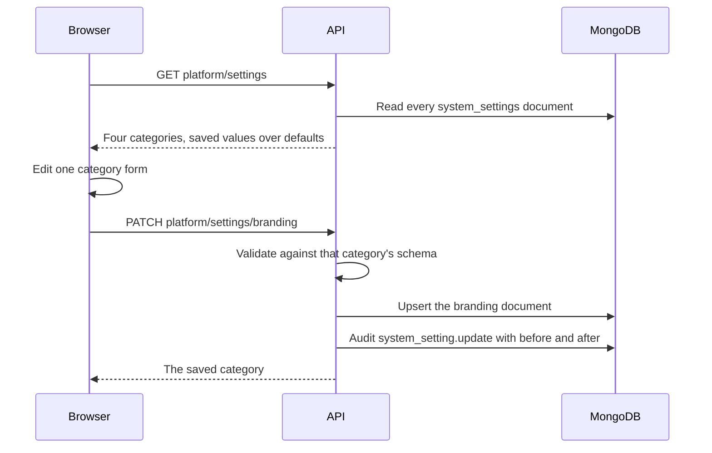

import { Aside, Steps, Tabs, TabItem, Card, CardGrid, LinkCard } from '@astrojs/starlight/components';
import ScreenAnatomy from '../../../../components/ScreenAnatomy.astro';
import SourceFile from '../../../../components/SourceFile.astro';
import Api from '../../../../components/Api.astro';
import Perm from '../../../../components/Perm.astro';
import Roles from '../../../../components/Roles.astro';
import Route from '../../../../components/Route.astro';
import DemoLogin from '../../../../components/DemoLogin.astro';
import Screenshot from '../../../../components/Screenshot.astro';
import { Tabs as ShotTabs, TabItem as ShotTab } from '@astrojs/starlight/components';

Platform settings are the switches that apply to Schola as a whole rather
than to one school. They live in four **categories**, each on its own page:
**Branding** (name, support email, logo), **Locale** (default language and
currency), **Email** (subjects and bodies of system emails) and **Feature
flags** (three on/off switches). Each category is saved as one document in
the `system_settings` collection, and every save is audit-logged.

<Aside type="caution" title="These settings are stored, not yet applied">
Saving works and is audit-logged, but **nothing else in the code reads these
values today**. The only code that touches `system_settings` is the settings
module itself (`apps/api/src/modules/system-settings/`). Emails, the logo,
new schools' locale and currency, sign-up and direct school creation all
behave the same whatever you save here. The table under
[What each setting changes](#what-each-setting-changes) spells this out per
field. Record a walkthrough of these pages as "configuration that is saved
for later", not as live switches.
</Aside>

## At a glance

<CardGrid>
  <Card title="Who uses it" icon="star">
    <Roles list={['super_admin']} />
  </Card>
  <Card title="Where to find it" icon="laptop">
    <Route path="/platform/settings" /> <Route path="/platform/settings/branding" /> <Route path="/platform/settings/locale" /> <Route path="/platform/settings/email" /> <Route path="/platform/settings/flags" />
  </Card>
  <Card title="Permissions" icon="approve-check">
    <Perm name="system_setting:read" /> to view, <Perm name="system_setting:write" /> to save.
  </Card>
</CardGrid>

<DemoLogin as="Super Admin" email="superadmin@schola.example" go="/platform/settings" />

## How it works

Until a category is saved for the first time, the API returns its defaults:

| Category | Defaults |
|---|---|
| `branding` | platformName "Schola", supportEmail `support@schola.reactbd.com`, logoUrl empty |
| `locale` | defaultLocale `en-US`, defaultCurrency `USD` |
| `email_templates` | no templates |
| `feature_flags` | googleSignIn, selfServiceSignup and schoolDirectCreate all on |

## The screens

Real screenshots from the seeded demo school (switch the docs theme to see dark mode):

<ShotTabs>
  <ShotTab label="Settings">
    <Screenshot name="platform-settings" alt="Platform settings" path="/platform/settings" />
  </ShotTab>
  <ShotTab label="Branding">
    <Screenshot name="platform-settings-branding" alt="Branding settings" path="/platform/settings/branding" />
  </ShotTab>
  <ShotTab label="Email">
    <Screenshot name="platform-settings-email" alt="Email template settings" path="/platform/settings/email" />
  </ShotTab>
  <ShotTab label="Feature flags">
    <Screenshot name="platform-settings-flags" alt="Feature flag settings" path="/platform/settings/flags" />
  </ShotTab>
  <ShotTab label="Locale">
    <Screenshot name="platform-settings-locale" alt="Locale settings" path="/platform/settings/locale" />
  </ShotTab>
</ShotTabs>

<ScreenAnatomy
  title="Settings"
  path="/platform/settings"
  regions={[
    { label: 'Sidebar', desc: 'System group: Settings, Branding, Locale, Email, Feature flags — the same four pages, reachable directly.', area: 'sidebar' },
    { label: 'Page header', desc: '"Settings" — "Platform-wide configuration. Each area has its own page, the same way the school admin keeps one job per screen."' },
    { label: 'Area cards', desc: 'Branding ("Platform name, support email, and logo."), Locale ("Default language and currency for new schools."), Email ("Subjects and bodies for the messages Schola sends."), Feature flags ("Turn platform features on or off for every school.").', size: 3, tone: 'accent' },
  ]}
/>

<ScreenAnatomy
  title="Feature flags"
  path="/platform/settings/flags"
  regions={[
    { label: 'Page header', desc: '"Feature flags" — "Switches that apply to every school on the platform."' },
    { label: 'Flags card', desc: '"Feature flags — Enable or disable platform features. Changes are immediate." Three rows, each with a label, a description and a switch: Google sign-in, Self-service school signup, Direct school creation.', size: 3, tone: 'accent' },
    { label: 'Save flags', desc: 'Saves all three switches at once. Until you click it, flipping a switch changes nothing.', tone: 'warn' },
  ]}
/>

## Step by step

<Tabs>
<TabItem label="Branding">

<Steps>

1. Click **Branding** in the sidebar (or the Branding card on Settings). The
   header reads "Branding — Name, support address, and logo shown across
   Schola."
2. In the card "Branding — Public-facing platform name and contact info used
   in emails and the header", edit **Platform name**, **Support email** and
   **Logo URL** ("Absolute URL to a square logo (PNG/SVG). Leave blank to use
   the default Schola mark.").
3. Click **Save**. A toast says "Branding saved."

</Steps>

</TabItem>
<TabItem label="Locale">

<Steps>

1. Click **Locale**. The header reads "Locale — Default language and currency
   for schools that have not chosen their own."
2. In "Locale & currency — Defaults applied to new schools. Each school can
   override these later.", edit **Default locale** (hint "BCP-47 tag, e.g.
   en-US") and **Default currency** (hint "ISO 4217 code, e.g. USD").
3. Click **Save**. A toast says "Locale defaults saved."

</Steps>

</TabItem>
<TabItem label="Email">

<Steps>

1. Click **Email**. The header reads "Email — The subjects and bodies Schola
   uses when it writes to a school."
2. The card "Email templates — Override the subject and body of
   system-generated emails." has four blocks: **Invite**, **Welcome**,
   **Password reset** and **Verify email**.
3. Fill **Subject** and **Body** for **every** block. The body hint reads
   "Plain text or HTML. Use `{{firstName}}`, `{{link}}` as placeholders."
4. Click **Save templates**. A toast says "Email templates saved." If any
   block is empty, its fields show errors and nothing is saved.

</Steps>

</TabItem>
<TabItem label="Feature flags">

<Steps>

1. Click **Feature flags**.
2. Click a switch to flip it — for example turn **Self-service school
   signup** off. The switch moves, but nothing is saved yet.
3. Click **Save flags**. A toast says "Feature flags saved."

</Steps>

</TabItem>
</Tabs>

## What each setting changes

| Setting | What the page says it does | What the code does today |
|---|---|---|
| Platform name | "used in emails and the header" | Stored only. Emails and the header keep the hard-coded name "Schola". |
| Support email | "contact info used in emails" | Stored only. |
| Logo URL | "shown across Schola" | Stored only. The app always shows the Schola mark. |
| Default locale / currency | "Defaults applied to new schools" | Stored only. Applications get `en-US` / `USD` from the school model's defaults, and the direct-create form starts at `en-US` / `USD`. |
| Email templates (4) | "Override the subject and body of system-generated emails" | Stored only. Emails come from the fixed templates in `apps/api/src/services/email/templates.ts`. |
| Google sign-in | "Allow users to sign in with their Google account." | Not checked. The Google button is always shown; it works when the OAuth keys are set. |
| Self-service school signup | "Allow anyone to apply to create a school" | Not checked. "Bring a school" and `/onboarding/school` always work. |
| Direct school creation | "Allow super admins to create schools without the apply/approve flow." | Not checked. `/platform/schools/new` always works. |

Each school's real locale and currency are edited on the school's own
[settings page](/features/school/settings-and-profile/), and they do take
effect there.

## Every action on this screen

### Loading any settings page

All four pages share one request and one cache, so switching between them is
instant after the first load.

<Api method="GET" path="platform/settings" perm="system_setting:read" />

The API also serves one category at a time (`GET platform/settings/:category`);
the pages do not use it.

<Api method="GET" path="platform/settings/:category" perm="system_setting:read" />

### "Save", "Save templates", "Save flags"

<Api method="PATCH" path="platform/settings/:category" perm="system_setting:write" />

`:category` is `branding`, `locale`, `email_templates` or `feature_flags`.
The body **replaces** that category's saved value. Validation per category:

| Category | Rules |
|---|---|
| `branding` | `platformName` 1–80 characters, `supportEmail` a valid email, `logoUrl` a URL up to 500 characters or empty |
| `locale` | `defaultLocale` 2–10 characters, `defaultCurrency` 3–8 characters |
| `email_templates` | `templates`: each `key` is `invite`, `welcome`, `password_reset` or `verify_email`; `subject` 1–200, `body` 1–20,000 characters |
| `feature_flags` | `flags`: any of `googleSignIn`, `selfServiceSignup`, `schoolDirectCreate` mapped to true or false |

A payload that fails returns "Invalid settings payload." with the field
errors. A successful save writes `system_setting.update` to the audit log with
the old and new value and the category in `metadata`.

## Who sees what

| Role | Platform settings |
|---|---|
| <Roles list={['super_admin']} /> | Read and write every category |
| Every other role | No access. Schools edit their own profile on [School settings](/features/school/settings-and-profile/) |

## Under the hood

- <SourceFile path="apps/web/src/app/(super-admin)/platform/settings/page.tsx" /> — the hub with four cards.
- <SourceFile path="apps/web/src/app/(super-admin)/platform/settings/settings-client.tsx" symbol="SettingsPanel" /> — loads all categories and picks the form.
- <SourceFile path="apps/web/src/app/(super-admin)/platform/settings/branding-form.tsx" />, <SourceFile path="apps/web/src/app/(super-admin)/platform/settings/locale-form.tsx" />, <SourceFile path="apps/web/src/app/(super-admin)/platform/settings/email-templates-form.tsx" />, <SourceFile path="apps/web/src/app/(super-admin)/platform/settings/feature-flags-form.tsx" />.
- <SourceFile path="apps/api/src/modules/system-settings/system-settings.service.ts" /> — `DEFAULTS`, `listAllSettings`, `getCategory`, `updateCategory`.
- <SourceFile path="packages/validation/src/admin.ts" /> — `systemSettingBrandingSchema`, `systemSettingLocaleSchema`, `systemSettingEmailTemplatesSchema`, `systemSettingFeatureFlagsSchema`, `settingCategoryParam`.
- <SourceFile path="packages/db/src/models/system-setting.ts" /> — one document per category, value stored as free-form JSON.

## Edge cases and gotchas

- **Email templates are all or nothing.** The form always submits all four
  blocks and the schema needs a subject and a body in each, so you cannot
  save one template on its own.
- **"Changes are immediate" is not quite true.** On the flags page a switch
  only changes the form; **Save flags** is what stores it.
- **URL names differ from the sidebar.** The Email page saves to
  `email_templates` and the Feature flags page to `feature_flags`.
- **Placeholders are not processed.** `{{firstName}}` and `{{link}}` are
  stored as typed; since no email reads these templates, nothing fills them
  in yet.
- **Every save is visible.** Look for `system_setting.update` on the
  [platform audit log](/features/platform/notifications-and-audit/); type the
  action exactly in the Action filter.

## Related pages

<CardGrid>
  <LinkCard title="Settings and profile" description="A school's own name, contact details, locale and currency." href="/features/school/settings-and-profile/" />
  <LinkCard title="Email and notifications" description="How Schola sends email today and where the templates live." href="/architecture/email-and-notifications/" />
  <LinkCard title="Social sign-in setup" description="The keys that actually turn Google and Facebook on." href="/setup/services/social-sign-in/" />
  <LinkCard title="Notifications and audit" description="Where settings changes are recorded." href="/features/platform/notifications-and-audit/" />
</CardGrid>
