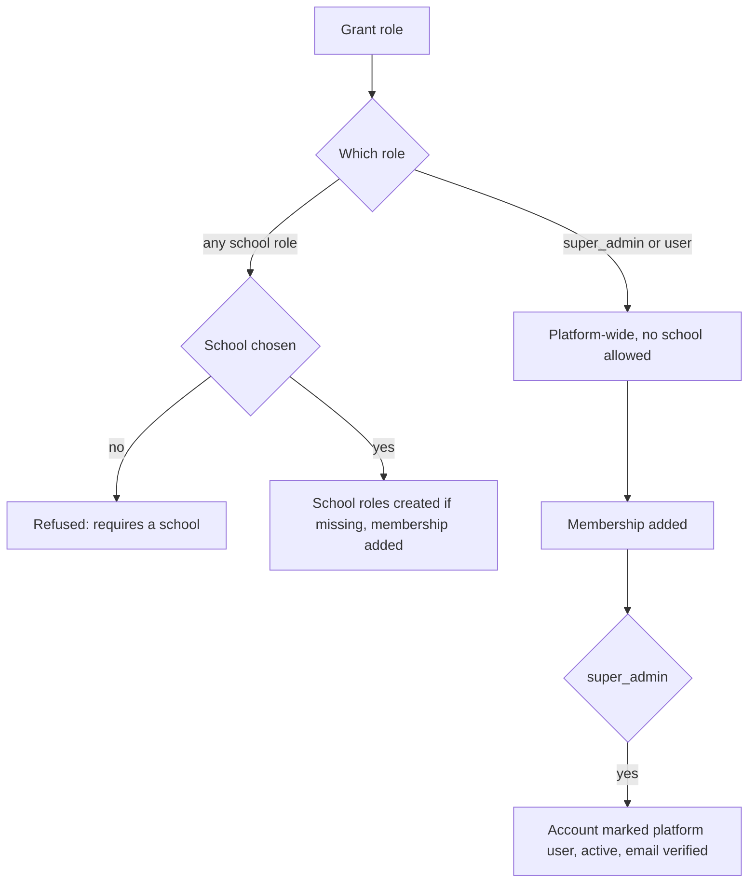

import { Aside, Steps, Card, CardGrid, LinkCard } from '@astrojs/starlight/components';
import ScreenAnatomy from '../../../../components/ScreenAnatomy.astro';
import SourceFile from '../../../../components/SourceFile.astro';
import Api from '../../../../components/Api.astro';
import Perm from '../../../../components/Perm.astro';
import Roles from '../../../../components/Roles.astro';
import Route from '../../../../components/Route.astro';
import DemoLogin from '../../../../components/DemoLogin.astro';
import Screenshot from '../../../../components/Screenshot.astro';

Schools manage their own people, but some account work only the platform can
do: adding another **Super Admin**, switching off an account everywhere, or
fixing someone's roles at a school. The **Users** page is the Super Admin's
directory of every account on Schola — platform staff, school members and
visitors alike — with a role editor for each one.

## At a glance

<CardGrid>
  <Card title="Who uses it" icon="star">
    <Roles list={['super_admin']} />
  </Card>
  <Card title="Where to find it" icon="laptop">
    <Route path="/platform/users" /> — sidebar **People → Users**
  </Card>
  <Card title="Permissions" icon="approve-check">
    <Perm name="user:read_all" /> <Perm name="user:invite_platform" /> <Perm name="user:suspend" /> <Perm name="user:assign_role" />
  </Card>
</CardGrid>

<DemoLogin as="Super Admin" email="superadmin@schola.example" go="/platform/users" />

## How it works

An account's access is a list of **role memberships**: role + school. A
platform role (`super_admin`, `user`) has no school; every other role belongs
to one school. The role editor enforces that rule:

Suspending is separate from roles: it flips the account's `isActive` flag.
Every API request checks that flag, so a suspended account is refused on its
very next click.

## The screen

<Screenshot name="platform-users" alt="The platform user directory" path="/platform/users" />

<ScreenAnatomy
  title="Users"
  path="/platform/users"
  regions={[
    { label: 'Sidebar', desc: '"Users" highlighted under People.', area: 'sidebar' },
    { label: 'Top bar', desc: 'Breadcrumb "Platform / Users".', area: 'top' },
    { label: 'Page header', desc: '"Users" — "Manage super-admins and inspect every account on the platform." — and "Invite super admin".' },
    { label: 'Scope tabs', desc: '"Super admins" (default) and "All users".', tone: 'accent' },
    { label: 'Filters', desc: 'Search box "Search email or name…" and a status menu: All statuses, Active only, Suspended only.' },
    { label: 'Users table', desc: 'Name (with email), Roles (chips like "teacher · Greenfield International School", a shield on super_admin), Status (Active or Suspended), Joined, and a "⋯" menu. A pager "Page 1 of N · total users" with Previous / Next appears past 25 rows.', size: 3, tone: 'accent' },
  ]}
/>

<ScreenAnatomy
  title="Manage roles"
  path="/platform/users"
  regions={[
    { label: 'Title', desc: '"Manage roles" and the person\'s "name · email".' },
    { label: 'Current roles', desc: 'One row per membership: the role key, then "· school name" or "· platform-wide", and a red "Revoke" button.', size: 2, tone: 'warn' },
    { label: 'Grant a new role', desc: 'Role (every role key) and, for school roles, School ("Choose a school…", active schools only) — or "Platform-wide — no school needed." — then "Grant role".', size: 2, tone: 'accent' },
    { label: 'Done', desc: 'Closes the dialog.', tone: 'muted' },
  ]}
/>

## Step by step

### Find an account

<Steps>

1. Click **Users** in the sidebar. The **Super admins** tab lists platform
   staff — with the demo data, Sam Platform (`superadmin@schola.example`).
2. Click **All users**. Every account appears, newest first, 25 per page.
3. Type `greenfield` in **Search email or name…**. The list narrows as you
   type (the search covers email, first name and last name).
4. Open the status menu and pick **Suspended only** to see inactive accounts.

</Steps>

### Invite another Super Admin

<Steps>

1. Click **Invite super admin**.
2. In "Invite a super admin" ("They'll receive an email with a link to set
   their password."), fill **First name**, **Last name** and **Email**.
3. Click **Send invite**. A toast says "Invite sent to *email*." and the new
   account appears on the **Super admins** tab.
4. The invitee opens the email, sets a password on `/reset-password` and signs
   in to `/platform`.

</Steps>

### Grant a role at a school

<Steps>

1. On **All users**, search for `farida.begum@greenfield.example` (a
   Greenfield teacher).
2. Click **⋯ → Manage roles**. **Current roles** shows `teacher · Greenfield
   International School`.
3. Under **Grant a new role**, choose **Role** `vice_principal`. The **School**
   picker appears; choose **Greenfield International School**.
4. Click **Grant role**. A toast says "Granted vice_principal." and the new
   membership appears under Current roles.
5. To undo, click **Revoke** next to it. A toast says "Revoked
   vice_principal."
6. Click **Done**.

</Steps>

### Suspend and reactivate an account

<Steps>

1. On **All users**, click **⋯** on the account and choose **Suspend** (red).
   There is no confirmation. A toast says "User suspended." and the status
   becomes **Suspended**.
2. If that person is signed in, their next action fails and they are signed
   out. Signing in again shows "Account is not active.".
3. Click **⋯ → Reactivate**. A toast says "User reactivated." They can sign
   in again.

</Steps>

## Every action on this screen

### Loading the list

<Api method="GET" path="platform/users" perm="user:read_all" />

Query: `scope` (`platform` = accounts flagged as platform users, or `all`),
`status` (`active`, `inactive`, `all`), `search`, `page`, `pageSize` (25 in
the UI, up to 100). The API also accepts `schoolId` to list one school's
members; the page does not expose it. Each row carries the account's role
memberships with school names.

### "Invite super admin" → "Send invite"

<Api method="POST" path="platform/users/invite" perm="user:invite_platform" />

Creates an active account with no password, its email already marked
verified, flagged as a platform user, with the `super_admin` role. Emails the
set-password invite "Set your Schola password" ("You've been added to Schola
as a platform super admin", valid 24 × `PASSWORD_RESET_TTL_MIN` — 24 hours by
default) and writes `user.invite_platform` with `inviteEmail: "sent"` or
`"failed"`. The email is best-effort: if it can't be delivered the invite
still answers `201`, and the invitee can use **Forgot?**. An
email that already has an account is refused: "An account with this email
already exists."

### "Manage roles" → "Grant role"

<Api method="POST" path="platform/users/:id/roles" perm="user:assign_role" />

Body `{ "role", "schoolId" }`. Platform roles must not carry a school
('Platform role "super_admin" must not be scoped to a school.'); school roles
must ('Tenant role "teacher" requires a school.'). The school's roles are
created if they do not exist yet. Granting the same role twice does nothing.
Granting `super_admin` also marks the account a platform user, active and
verified. Audit action `user.role.grant`.

### "Revoke"

<Api method="POST" path="platform/users/:id/roles/revoke" perm="user:assign_role" />

Body `{ "role", "schoolId" }` (a `POST`, so the body survives). Removes that
one membership. Two safety rules: "You can't revoke your own super_admin
role." and "Refusing to revoke the last super_admin on the platform." Audit
action `user.role.revoke`.

### "Suspend" and "Reactivate"

<Api method="POST" path="platform/users/:id/suspend" perm="user:suspend" /> <Api method="POST" path="platform/users/:id/reactivate" perm="user:suspend" />

Suspend sets `isActive: false` (refused for yourself: "You can't suspend your
own account."; and if already suspended). The API accepts an optional
`reason` (3–500 characters) that is stored in the audit metadata; the page
does not ask for one. Reactivate sets `isActive: true`. Audit actions
`user.suspend` and `user.reactivate`.

## Who sees what

| Role | Users page |
|---|---|
| <Roles list={['super_admin']} /> | Every account on the platform, every action |
| School Admin | Their own school's sign-ins only, on [Members and roles](/features/school/members-and-roles/) |
| Every other role | No access |

## Under the hood

- <SourceFile path="apps/web/src/app/(super-admin)/platform/users/users-client.tsx" symbol="PlatformUsersClient" /> — tabs, `UsersTable` and `InviteModal`.
- <SourceFile path="apps/web/src/app/(super-admin)/platform/users/manage-roles-modal.tsx" symbol="ManageRolesModal" />.
- <SourceFile path="apps/api/src/modules/platform/platform.routes.ts" /> — the `/platform/users/*` routes.
- <SourceFile path="apps/api/src/modules/platform-users/platform-users.service.ts" /> — `listUsers`, `inviteSuperAdmin`, `suspendUser`, `reactivateUser`, `grantUserRole`, `revokeUserRole`.
- <SourceFile path="packages/validation/src/admin.ts" /> — `listUsersQuerySchema`, `invitePlatformUserSchema`, `suspendUserSchema`, `grantUserRoleSchema`, `revokeUserRoleSchema`.
- <SourceFile path="packages/db/src/models/user-role.ts" /> — the membership rows.

## Edge cases and gotchas

- **"Suspended" means "not active".** The Status column shows **Suspended**
  for every inactive account — including pending school owners such as
  `owner@riverside.example`, who were never suspended.
- **Deleted accounts are hidden.** Soft-deleted accounts — for example the
  owners of rejected applications — do not appear in the list at all.
- **Roles are raw keys.** The role picker lists all ten keys (`super_admin`,
  `school_admin`, …, `user`) exactly as stored.
- **A role is not a record.** Granting `teacher`, `student`, `parent` or
  `staff` here does not create the matching people record, so the person's
  dashboard says "Your account isn't linked to a record yet". Add people from
  the school's People pages instead.
- **`school_admin` is not ownership.** Granting `school_admin` here makes a
  second School Admin, but the school's owner (the one who can start an
  [admin transfer](/features/school/admin-transfer/)) does not change. Use
  **Force admin transfer** on the [school detail page](/features/platform/schools/)
  to move ownership.
- **Until the invite is used.** The invite link lasts 24 hours by default.
  Until the invitee sets a password, the login form tells them "This account
  uses Google or Facebook sign-in…"; they can use **Forgot?** to get a new
  link.
- **Permission changes reach the browser on reload.** The API applies a new
  role on the person's next request; their sidebar updates after their page
  reloads the session.

<Aside type="caution" title="No 'revoke all sessions' button">
The original spec says a Super Admin "can revoke all sessions of a user". There is no
such action on this page or endpoint in the API. **Suspend** is the closest
tool: it blocks every request at once, and a suspended person cannot get back
in with Google or Facebook either (a social sign-in never re-activates an
account). Revoking sessions without suspending is not possible.
</Aside>

## Related pages

<CardGrid>
  <LinkCard title="Members and roles" description="The school-level version, for School Admins." href="/features/school/members-and-roles/" />
  <LinkCard title="Schools" description="Force an admin transfer after granting a role." href="/features/platform/schools/" />
  <LinkCard title="Roles reference" description="Every role and its default permissions." href="/reference/roles/" />
  <LinkCard title="Role-based access control" description="Memberships, primary role and the resolver." href="/architecture/rbac/" />
</CardGrid>
