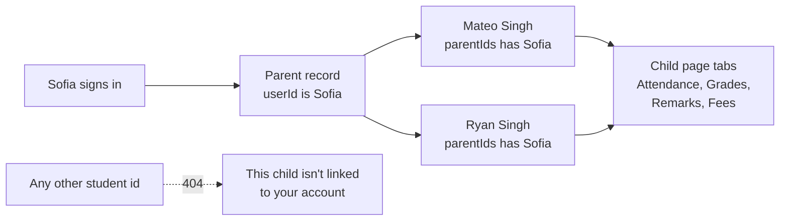

import { Aside, Steps, Tabs, TabItem, Card, CardGrid, LinkCard, Badge } from '@astrojs/starlight/components';
import Pipeline from '../../../../components/Pipeline.astro';
import ScreenAnatomy from '../../../../components/ScreenAnatomy.astro';
import SourceFile from '../../../../components/SourceFile.astro';
import Api from '../../../../components/Api.astro';
import Perm from '../../../../components/Perm.astro';
import Roles from '../../../../components/Roles.astro';
import Route from '../../../../components/Route.astro';
import DemoLogin from '../../../../components/DemoLogin.astro';
import Screenshot from '../../../../components/Screenshot.astro';
import { Tabs as ShotTabs, TabItem as ShotTab } from '@astrojs/starlight/components';

A parent's questions are about their children: *Did they make it to school
today? How are their marks? What did the teacher say? What do we owe, and can
I pay it now? Which bus do they take?* The parent portal puts each linked
child's record behind one card, with the same tabs the school staff see —
filtered so a parent reads **only their own children**, and only the remarks
meant for families.

## At a glance

<CardGrid>
  <Card title="Who uses it" icon="star">
    <Roles list={['parent']} note="A sign-in linked to a Parent record. Siblings share the same parent." />
  </Card>
  <Card title="Where to find it" icon="laptop">
    <Route path="/app" label="Dashboard" /> <Route path="/app/children" /> <Route path="/app/children/[id]" /> <Route path="/app/timetable" /> <Route path="/app/leave" />
  </Card>
  <Card title="Permissions" icon="approve-check">
    <Perm name="attendance:read:own_classes" /> <Perm name="grade:read:own_classes" /> <Perm name="fee:read:own" /> <Perm name="timetable:read" /> <Perm name="leave:request" /> <Perm name="notification:read:own" />
  </Card>
</CardGrid>

<DemoLogin as="Parent — Sofia Singh" email="parent@greenfield.example" go="/app/children" />

The demo parent is **Sofia Singh**, mother of two:

| Child | Admission no. | Section | Good for showing |
|---|---|---|---|
| **Mateo Singh** | `GIS-2026-0007` | Grade 1 · A | An open invoice for the current month (pay online), a pending leave request, the West line bus |
| **Ryan Singh** | `GIS-2026-0032` | Grade 1 · B | Fully paid fees, the East line bus |

## How it works

A child belongs to a parent when the child's Student record lists the
parent's Parent record in `parentIds`, and that Parent record's `userId` is the
signed-in user. The API resolves this link on every call; the web app never
sends "I am Sofia" — it only sends a student id, and the API checks it.

What a parent may read about a linked child:

| Area | Rule (from `decideStudentAccess`) |
|---|---|
| Attendance | <Perm name="attendance:read:own_classes" /> and the student is their child |
| Grades and report cards | <Perm name="grade:read:own_classes" /> and their child |
| Remarks | Visibility `parent` and `public` — never `private` |
| Fees and receipts | <Perm name="fee:read:own" /> and their child |
| Pay online | Same as fees |
| Bus, room & library | Anyone who may see the child's profile — no extra permission |

## What the sidebar shows a parent

| Group | Links | Why |
|---|---|---|
| Overview | Dashboard | Everyone |
| My school | My children | Linked to a Parent record |
| Daily | Timetable, Leave | <Perm name="timetable:read" />, <Perm name="leave:request" /> |
| Account | Notifications, My profile | Everyone |

A parent has no Library, Transport or Hostel link and no school-wide list of
any kind. Bus, room and library loans appear on each child's page instead.

## The screens

Real screenshots from the seeded demo school (switch the docs theme to see dark mode):

<ShotTabs>
  <ShotTab label="Dashboard">
    <Screenshot name="parent-dashboard" alt="The parent’s dashboard" path="/app" />
  </ShotTab>
  <ShotTab label="My children">
    <Screenshot name="parent-children" alt="The parent’s children" path="/app/children" />
  </ShotTab>
  <ShotTab label="Child record">
    <Screenshot name="parent-child-detail" alt="One child’s record" path="/app/children/6aeeea6fe8e90dae8c06450c" />
  </ShotTab>
</ShotTabs>

### Dashboard — "My children"

<ScreenAnatomy
  title="Parent dashboard"
  path="/app"
  regions={[
    { label: 'Sidebar', desc: 'Dashboard, My children, Timetable, Leave, Notifications, My profile', area: 'sidebar' },
    { label: 'Top bar', desc: 'School / Dashboard, Load sample, bell, theme, profile menu', area: 'top' },
    { label: 'Welcome, Sofia.', desc: '"Your day at Greenfield International School."' },
    { label: 'Child cards', desc: 'One per child: initials, name, "Grade 1 · Section A" and an arrow to the child page', size: 2, tone: 'accent' },
    { label: 'Child card numbers', desc: 'Today (attendance pill) · Attendance (% this year) · Fees due (red when overdue)', size: 2 },
  ]}
/>

### My children

<ScreenAnatomy
  title="My children"
  path="/app/children"
  regions={[
    { label: 'Page header', desc: '"My children" — "Attendance, grades, remarks and fees for each child."' },
    { label: 'Child list', desc: 'One link per child: "Mateo Singh — Grade 1 · Section A · GIS-2026-0007"', size: 3, tone: 'accent' },
  ]}
/>

### One child

<ScreenAnatomy
  title="Mateo Singh"
  path="/app/children/[id]"
  regions={[
    { label: 'Back link', desc: '"My children"' },
    { label: 'Child header', desc: 'Initials, "Mateo Singh", "Grade 1 · Section A · Roll 7 · Admission GIS-2026-0007"' },
    { label: 'Tabs', desc: 'Attendance · Grades · Remarks · Fees (the open tab is kept in ?tab=)', tone: 'accent' },
    { label: 'Tab content', desc: 'Attendance calendar, exam cards with Report card, family remarks, or invoices and receipts with Pay online', size: 4 },
    { label: 'Bus, room & library', desc: 'Route, stop and pick-up time, bus number and driver · hostel room or "Day student" · library books out', size: 2 },
  ]}
/>

For Mateo, the **Bus, room & library** card reads like *West line — 07:26 at
West Gate · BUS-04 · Agnes Tetteh (+1 555 070 1003)*, then *Day student*, then
*No library books out*. Ryan rides the *East line* (BUS-02, Mill Lane at
07:30). Route, stop and driver come from the demo seed and may differ if the
seed changes.

### Timetable

With two children, the Timetable page shows a **Child** picker above the week.
The card is titled *Mateo's week* with *Grade 1 · Section A* under it.
Switching the child updates `?child=` in the URL.

### Leave

<ScreenAnatomy
  title="Leave"
  path="/app/leave"
  regions={[
    { label: 'Page header', desc: '"Leave" — "Ask for time off, and see what\'s been decided."' },
    { label: 'My requests', desc: '"Approved days show as excused in attendance." and the Request leave button' },
    { label: 'Requests table', desc: 'Dates (with school days and the child\'s name) · Type · Reason · Status (with the decision note) · Cancel', size: 3, tone: 'accent' },
  ]}
/>

Sofia already has two requests for Mateo: a **pending** family leave ("Family
wedding out of town.") starting three days after the seed date, and an
**approved** sick leave ("Fever and a doctor's visit.") from about two weeks
earlier, with the note *Get well soon.*

## Step by step

<Steps>

1. Sign in as `parent@greenfield.example` / `Schola@2026`. The dashboard shows **Welcome, Sofia.** and a **My children** section with one card each for Mateo and Ryan.

2. Click **My children** in the sidebar, then click **Mateo Singh**.

3. The child page opens on the **Attendance** tab. Step through months with **Previous month** and **This month**.

4. Click the **Grades** tab. The *Term 1 — Midterm* card shows Mateo's marks. Click **Report card** to open the PDF in a new tab.

5. Click the **Remarks** tab. It lists remarks marked *Parent* or *Public* — or *No remarks yet*.

6. Click the **Fees** tab. The current month's invoice (Primary monthly fees: Tuition $180.00, Lab & technology $25.00, Activities & clubs $15.00 = **$220.00**) shows **Pending** with a **Pay online** button.

7. Click **Pay online**. The button shows *Opening…* and the browser moves to Stripe Checkout. Pay with test card `4242 4242 4242 4242`, any future expiry, any CVC. Stripe returns you to Mateo's page with the toast *Payment received. The receipt appears here once Stripe confirms it.* Once the webhook arrives, the invoice reads **Paid** and a new receipt appears under **Payments** — click **PDF** to open it.

8. Scroll to **Bus, room & library** to show Mateo's bus route and stop.

9. Click **Timetable**, then switch the **Child** picker between Mateo and Ryan.

10. Click **Leave** → **Request leave**. In **For**, choose a child (the first option is *— pick a child —*), pick **Type**, **From**, **To**, write the **Reason**, and click **Send request**. The toast says *Request sent.* and the row appears as **Pending**. Click **Cancel** to withdraw it.

</Steps>

:::note[After paying, you land on the Attendance tab]
Stripe returns the parent to `/app/children/<id>?checkout=success`, which does
not carry `?tab=fees`, so the page reopens on the first tab. Click **Fees**
again to see the payment.
:::

## Every action on this screen

### Child card and child link

Open `/app/children/<id>`. The page first loads the record header and the
list of tabs the parent may see; each tab loads its own data when opened.

<Api method="GET" path="me/summary" />
<Api method="GET" path="me/students" />
<Api method="GET" path="student-records/:id" />
<Api method="GET" path="student-records/:id/services" />

### "Attendance", "Grades", "Remarks", "Fees" tabs

<Api method="GET" path="student-records/:id/attendance" perm="attendance:read:own_classes" />
<Api method="GET" path="student-records/:id/grades" perm="grade:read:own_classes" />
<Api method="GET" path="student-records/:id/remarks" />
<Api method="GET" path="student-records/:id/fees" perm="fee:read:own" />

### "Report card"

Opens the report card PDF for that exam. It prints only `parent` and `public`
remarks attached to that exam, plus the year's attendance, and logs
`grade.report_card.download`.

<Api method="GET" path="student-records/:id/report-card.pdf" perm="grade:read:own_classes" />

### "Pay online"

Visible on `pending` or `partial` invoices with a balance. Opens a Stripe
Checkout session for the remaining balance and logs `fee.checkout.open`. A
`paid`, `waived` or `cancelled` invoice answers `409 This invoice cannot be
paid.` The invoice is only marked paid by the Stripe webhook — see
[Online payments](/features/finance/online-payments/).

<Api method="POST" path="student-records/:id/invoices/:invoiceId/checkout" perm="fee:read:own" />

### "PDF" on a payment

<Api method="GET" path="student-records/:id/payments/:paymentId/receipt.pdf" perm="fee:read:own" />

### "Child" picker on Timetable

<Api method="GET" path="timetable/student/:id" perm="timetable:read" />

### "Request leave", "Send request", "Cancel"

A parent's request must name a child: the API answers *Choose which child the
leave is for.* when no child is picked, and *You can only ask leave for your
own children.* for anyone else's id. When the school approves it, those school
days are marked **excused** in the child's attendance. See
[Leave](/features/daily/leave/).

<Api method="GET" path="leave" perm="leave:request" />
<Api method="POST" path="leave" perm="leave:request" />
<Api method="POST" path="leave/:id/cancel" perm="leave:request" />

## Who sees what

| Information about Mateo | Sofia (parent) | Mateo (if he had a sign-in) | His teacher | School Admin |
|---|---|---|---|---|
| Attendance, grades, report card | Yes | Yes | Yes (own sections) | Yes |
| Remarks | `parent` + `public` | `public` only | All three | All three |
| Fees and receipts | Yes, and can pay | Yes, and can pay | No | Yes |
| Bus, room & library card | Yes | Not shown in the student portal | No | Yes |
| Leave for him | Can request and cancel | Can request for himself | No | Approves |
| Another family's child | 404 — not linked | 404 | Only if in own section | Yes |

## Under the hood

- Pages: <SourceFile path="apps/web/src/app/(tenant)/app/children/page.tsx" />, <SourceFile path="apps/web/src/app/(tenant)/app/children/[id]/page.tsx" />
- Child cards on the dashboard: <SourceFile path="apps/web/src/components/dashboard/member-dashboard.tsx" symbol="ChildCard" />
- Tabs (shown only when `access` allows them): <SourceFile path="apps/web/src/components/records/student-record-tabs.tsx" symbol="StudentRecordTabs" />
- Bus, room & library: <SourceFile path="apps/web/src/components/records/services-card.tsx" symbol="ServicesCard" />
- Leave drawer with the *For* field: <SourceFile path="apps/web/src/app/(tenant)/app/leave/page.tsx" symbol="RequestDrawer" />
- Record API: <SourceFile path="apps/api/src/modules/student-records/student-records.routes.ts" />
- Parent link and access rules: <SourceFile path="apps/api/src/services/scopes/student-access.ts" symbol="linkedStudentIds" />
- Leave API: <SourceFile path="apps/api/src/modules/operations/leave.routes.ts" />

**Data shape.** `GET /student-records/:id` returns
`{ student, placement, parents, access }`, where `access` is
`{ relation: "child", profile, attendance, grades, remarks: ["parent", "public"], fees, pay }`.
The web app turns that into tabs, so a parent never sees a tab the API would
refuse.

## Edge cases and gotchas

- **No children linked.** The dashboard and My children both show *No children linked yet* — the school office links children on the [Parents](/features/people/parents/) or [Students](/features/people/students/) page.
- **Someone else's child.** Opening `/app/children/<another id>` shows *This child isn't linked to your account* (the API answers 404 or 403 the same way).
- **Remarks tab always appears.** Parents may read `parent` and `public` remarks, so the tab is there even when it is empty (*No remarks yet*). In the demo data Mateo and Ryan have no remarks; to show one, sign in as `farida.begum@greenfield.example` (Grade 1 · A, and class teacher of Grade 1) or as the School Admin and add a remark with visibility *Parent* on the [Remarks](/features/daily/remarks/) page.
- **Overdue fees.** An open invoice past its due date shows **Overdue**, and the dashboard card's *Fees due* number turns red.
- **Stripe not set up.** *Pay online* shows the toast *Stripe is not configured. Set STRIPE_SECRET_KEY.* — nothing is charged and the invoice is unchanged.
- **Load sample.** Sample mode does not change the parent portal: *My children* and each child's page always show real data (with a "Real data on this page." notice while it is on), and the personal dashboard reads the real API. Keep *Load sample* off when recording.

:::note[No notification when leave is decided]
The leave drawer says the outcome "shows here under My requests" — and that is
the only place. The leave API creates no notification or email, neither for
the approver when the request is sent nor for the parent when it is approved
or declined, so the parent reopens **Leave** to see the status and the
decision note.
:::

## Related pages

<CardGrid>
  <LinkCard title="Online payments" description="Stripe Checkout, the webhook and test cards." href="/features/finance/online-payments/" />
  <LinkCard title="Fees" description="How invoices, waivers and receipts work." href="/features/finance/fees/" />
  <LinkCard title="Transport" description="Routes, stops and riders." href="/features/campus/transport/" />
  <LinkCard title="Leave" description="Requests, approvals and excused attendance." href="/features/daily/leave/" />
  <LinkCard title="Remarks" description="What each visibility means." href="/features/daily/remarks/" />
  <LinkCard title="Parents" description="How parent records and sign-ins are created and linked." href="/features/people/parents/" />
  <LinkCard title="Student portal" description="The same record, seen by the student." href="/features/portals/student/" />
  <LinkCard title="Timetable" description="How the weekly periods are built." href="/features/daily/timetable/" />
</CardGrid>
