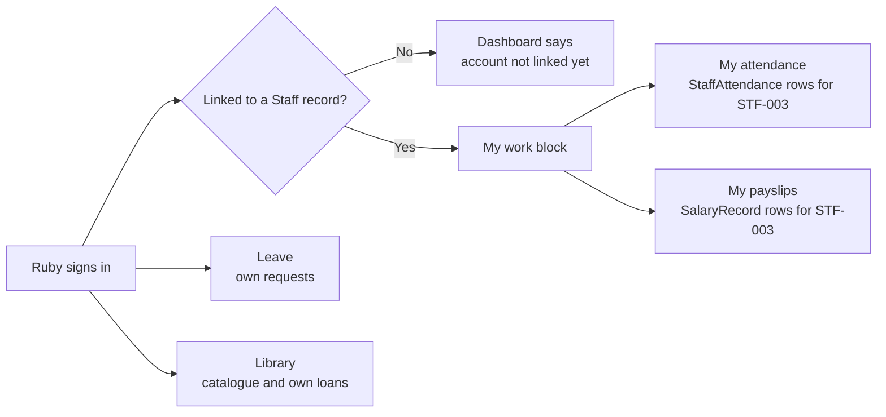

import { Aside, Steps, Tabs, TabItem, Card, CardGrid, LinkCard, Badge } from '@astrojs/starlight/components';
import Pipeline from '../../../../components/Pipeline.astro';
import ScreenAnatomy from '../../../../components/ScreenAnatomy.astro';
import SourceFile from '../../../../components/SourceFile.astro';
import Api from '../../../../components/Api.astro';
import Perm from '../../../../components/Perm.astro';
import Roles from '../../../../components/Roles.astro';
import Route from '../../../../components/Route.astro';
import DemoLogin from '../../../../components/DemoLogin.astro';
import Screenshot from '../../../../components/Screenshot.astro';
import { Tabs as ShotTabs, TabItem as ShotTab } from '@astrojs/starlight/components';

Office managers, nurses, drivers, lab assistants, librarians — the people who
keep a school running but do not teach — have the **Staff** role. Schola gives
them a small, private corner: *Was I marked present? What was I paid, and can I
have the payslip? Can I take Friday off?* Plus the library catalogue, which
every member of the school can browse. They see nothing about students,
classes or other employees.

## At a glance

<CardGrid>
  <Card title="Who uses it" icon="star">
    <Roles list={['staff']} note="A sign-in linked to a Staff record (non-teaching employee)." />
  </Card>
  <Card title="Where to find it" icon="laptop">
    <Route path="/app" label="Dashboard" /> <Route path="/app/my/attendance" /> <Route path="/app/my/payslips" /> <Route path="/app/leave" /> <Route path="/app/library" />
  </Card>
  <Card title="Permissions" icon="approve-check">
    <Perm name="staff_attendance:read:own" /> <Perm name="salary:read:own" /> <Perm name="leave:request" /> <Perm name="library:read" /> <Perm name="notification:read:own" />
  </Card>
</CardGrid>

<DemoLogin as="Staff — Ruby Novak, Librarian" email="staff@greenfield.example" go="/app" />

The demo staff member is **Ruby Novak**, employee `STF-003`, **Librarian** in
the *Library* department. Her pay follows the *Support staff* salary
structure.

## How it works

The staff role holds only five permissions, and three of them are "own"
reads. They work through the link between the sign-in and a Staff record
(`Staff.userId`): the API looks up *which Staff record is mine* on every call,
and reads only that record's attendance and payslips.

Who writes the data a staff member reads:

<Pipeline
  caption="Staff only read these records. The school office and the Accountant write them."
  steps={[
    { label: 'Office marks attendance', icon: 'calendar-check', note: 'Staff attendance page' },
    { label: 'Accountant runs payroll', icon: 'banknote', note: 'Monthly payslips' },
    { label: 'Accountant pays', icon: 'wallet', note: 'pending to paid' },
    { label: 'Staff reads', icon: 'user', note: 'My attendance, My payslips' },
  ]}
/>

## What the sidebar shows staff

| Group | Links | Why |
|---|---|---|
| Overview | Dashboard | Everyone |
| My school | My attendance, My payslips | Linked to a Staff record; payslips also need <Perm name="salary:read:own" /> |
| Daily | Leave | <Perm name="leave:request" /> — *Timetable* is hidden (no <Perm name="timetable:read" />) |
| Facilities | Library | <Perm name="library:read" /> |
| Account | Notifications, My profile | Everyone |

## The screens

Real screenshots from the seeded demo school (switch the docs theme to see dark mode):

<ShotTabs>
  <ShotTab label="Dashboard">
    <Screenshot name="staff-dashboard" alt="The staff dashboard" path="/app" />
  </ShotTab>
  <ShotTab label="My attendance">
    <Screenshot name="staff-my-attendance" alt="Staff attendance history" path="/app/my/attendance" />
  </ShotTab>
  <ShotTab label="My payslips">
    <Screenshot name="staff-my-payslips" alt="Staff payslips" path="/app/my/payslips" />
  </ShotTab>
</ShotTabs>

### Dashboard — "My work"

<ScreenAnatomy
  title="Staff dashboard"
  path="/app"
  regions={[
    { label: 'Sidebar', desc: 'Dashboard, My attendance, My payslips, Leave, Library, Notifications, My profile', area: 'sidebar' },
    { label: 'Top bar', desc: 'School / Dashboard, Load sample, bell, theme, profile menu', area: 'top' },
    { label: 'Welcome, Ruby.', desc: '"Your day at Greenfield International School."' },
    { label: 'My work tiles', desc: 'Today (Present / Absent / Late / Excused pill, or "Not marked") · This month ("present / recorded days", late counts as present) · Latest payslip (net pay, "November 2026 · pending")', size: 2, tone: 'accent' },
    { label: 'Buttons', desc: 'My attendance · My payslips (only when a payslip exists)' },
  ]}
/>

In the demo, staff attendance is recorded for the last 20 school days but not
for the day the seed ran, so Ruby's **Today** tile reads *Not marked* until
the office marks her. Her **Latest payslip** is the current month's, **$2,095.00**,
status `pending`.

### My attendance

<ScreenAnatomy
  title="My attendance"
  path="/app/my/attendance"
  regions={[
    { label: 'Page header', desc: '"My attendance" — "Your record, one month at a time."' },
    { label: 'Summary tiles', desc: 'Attendance % · Present · Absent · Late / excused' },
    { label: 'Staff attendance calendar', desc: '"Staff attendance · November 2026", Monday-first. Each recorded day shows P, A, L or E', size: 3, tone: 'accent' },
    { label: 'Month buttons', desc: 'Previous month · This month · Next month' },
  ]}
/>

### My payslips

<ScreenAnatomy
  title="My payslips"
  path="/app/my/payslips"
  regions={[
    { label: 'Page header', desc: '"My payslips" — "Monthly pay with a PDF for each month."' },
    { label: 'Payslips table', desc: 'Month (with the PAY-… number) · Net pay · Status (Paid / Pending) · Paid on · PDF', size: 3, tone: 'accent' },
  ]}
/>

Ruby's payslip, as the PDF shows it:

| Line | Amount |
|---|---|
| Base salary | $2,300.00 |
| Transport allowance | $120.00 |
| **Gross earnings** | **$2,420.00** |
| Income tax | $210.00 |
| Pension | $115.00 |
| **Total deductions** | **$325.00** |
| **Net pay** | **$2,095.00** |

Earlier months show `paid` with a *Paid on* date; the current month is
`pending` until the Accountant pays it.

### Leave

Staff see only **My requests** (no Approvals tab). The **Request leave**
drawer has no *For* field: a staff member's request is filed against their
own Staff record. Ruby's history has one **approved** sick day ("Dentist
appointment.") from about a week before the seed date.

### Library — read only, even for the librarian

<ScreenAnatomy
  title="Library"
  path="/app/library"
  regions={[
    { label: 'Page header', desc: '"Library" — "Browse the catalogue and see what you have out."' },
    { label: 'Tabs', desc: 'Catalogue · My loans' },
    { label: 'Search', desc: '"Search title, author, ISBN or category" — no Add book button' },
    { label: 'Catalogue table', desc: 'Title (author) · Category · Shelf · Available ("2 of 3" green, or "All 3 out" red). No row actions', size: 3, tone: 'accent' },
  ]}
/>

What Ruby can do on `/app/library`, exactly:

| Action | Ruby (Staff) | Needs |
|---|---|---|
| Search and page through the catalogue | Yes | <Perm name="library:read" /> |
| See how many copies are free | Yes | <Perm name="library:read" /> |
| See her own loans (**My loans** tab) | Yes — *Nothing borrowed* in the demo | <Perm name="library:read" /> |
| **Add book**, **Edit**, **Remove** | No — buttons not shown, API refuses | <Perm name="library:manage" /> |
| **Issue a copy** to a borrower | No | <Perm name="library:manage" /> |
| See all loans, overdue list, **Return** | No — the **Loans** tab is replaced by **My loans** | <Perm name="library:manage" /> |

:::caution[The demo librarian cannot run the library]
<Perm name="library:manage" /> belongs only to School Admin and Principal.
Ruby Novak's job title is *Librarian*, but her role is `staff`, so she can
only browse. There is no screen or API to change a role's permissions or to
give one person an extra permission, and the Members & roles page can only
grant Principal, Vice Principal or Accountant — so a librarian cannot get
issue and return rights without the much wider Principal role. Today the
School Admin or Principal must issue and return books.
:::

## Step by step

<Steps>

1. Sign in as `staff@greenfield.example` / `Schola@2026`. The dashboard shows **Welcome, Ruby.** and the **My work** block.

2. Read the three tiles: **Today**, **This month** and **Latest payslip**.

3. Click **My attendance**. Read the tiles, then click **Previous month** to see last month's calendar. Click **This month** to come back.

4. Click **My payslips**. Click **PDF** on last month's row. The payslip opens in a new tab with *Earnings*, *Deductions* and **Net pay**.

5. Click **Leave**, then **Request leave**. Pick **Type** (Sick, Casual, Family, Other), set **From** and **To**, write a **Reason**, and click **Send request**. The toast says *Request sent.* and the new row shows **Pending**. Click **Cancel** to withdraw it.

6. Click **Library**. Type a title such as *Matilda* into the search box to show availability. Open **My loans** — *Nothing borrowed*. Point out there is no **Add book** button and no row menu.

7. Open the profile menu (top right) → **My profile** to show that staff can change their name, phone and password, and sign out other devices.

</Steps>

## Every action on this screen

### Dashboard

<Api method="GET" path="me/summary" />

`/me/summary` returns an `employee` block: `kind: "staff"`, this month's
attendance counts, today's status, and the newest non-cancelled payslip.

### Month buttons on "My attendance"

<Api method="GET" path="me/staff-attendance" perm="staff_attendance:read:own" />

Takes `from` and `to`; returns `{ linked, range, records, summary }`. The rate
counts *late* as present.

### "PDF" on "My payslips"

<Api method="GET" path="me/payslips" perm="salary:read:own" />
<Api method="GET" path="me/payslips/:id/payslip.pdf" perm="salary:read:own" />

The list shows up to 60 months, newest first, and never shows `cancelled`
payslips. The PDF route only finds payslips that belong to the caller's own
Staff or Teacher record (anything else is `404 Payslip not found.`) and logs
the sensitive read `payroll.payslip.download`.

### "Request leave", "Cancel"

<Api method="GET" path="leave" perm="leave:request" />
<Api method="POST" path="leave" perm="leave:request" />
<Api method="POST" path="leave/:id/cancel" perm="leave:request" />

When an approver approves a staff request, each school day it covers is
written as **excused** in that person's staff attendance.

### Library search and "My loans"

<Api method="GET" path="library/books" perm="library:read" />
<Api method="GET" path="library/loans/mine" perm="library:read" />

## Who sees what

| Screen | Staff | Teacher | Accountant | School Admin |
|---|---|---|---|---|
| Dashboard | My work | Teaching today + My work | School dashboard | School dashboard |
| My attendance | Own staff attendance | Own staff attendance | Own staff attendance (the demo Accountant is linked to staff record `STF-002`) | Only when linked to a teacher or staff record (not in the demo) |
| My payslips | Own | Own | Hidden — uses Payroll instead | Hidden — uses Payroll instead |
| Leave | My requests | My requests | My requests | Approvals + My requests |
| Library | Catalogue + My loans | Catalogue + My loans | Catalogue + My loans | Catalogue + Loans, full control |
| Timetable | Hidden | My week | Hidden | Full editor |

## Under the hood

- Sidebar items with `links: ["teacher", "staff"]`: <SourceFile path="apps/web/src/components/layout/dashboard-shell.tsx" symbol="APP_GROUPS" />
- My work block: <SourceFile path="apps/web/src/components/dashboard/member-dashboard.tsx" symbol="MemberDashboard" />
- Pages: <SourceFile path="apps/web/src/app/(tenant)/app/my/attendance/page.tsx" />, <SourceFile path="apps/web/src/app/(tenant)/app/my/payslips/page.tsx" />, <SourceFile path="apps/web/src/app/(tenant)/app/library/page.tsx" />
- API: <SourceFile path="apps/api/src/modules/me/me.routes.ts" symbol="employeeSnapshot" />, <SourceFile path="apps/api/src/modules/operations/library.routes.ts" />
- Payslip PDF: <SourceFile path="apps/api/src/services/pdf/payslip.tsx" />
- Role permissions: <SourceFile path="apps/api/src/services/rbac/permissions.ts" symbol="ROLE_PERMISSIONS" />

## Edge cases and gotchas

- **Not linked.** If the sign-in is not attached to a Staff record, the dashboard says *Your account isn't linked to a record yet*, My attendance says *Nothing to show*, and My payslips says *No staff record is linked to your account*. The School Admin links it on the [Staff](/features/people/staff/) page.
- **No payslips yet.** *No payslips yet — Payslips appear once payroll is run for a month.* The *My payslips* button on the dashboard only appears once at least one payslip exists.
- **Bell on phones.** The notification bell in the top bar is shown from the `lg` breakpoint up; on a phone, open **Notifications** from the menu instead.
- **Only announcements arrive.** Staff receive in-app notifications only when the school sends an [announcement](/features/communication/announcements/) to the Staff audience; payroll and leave decisions do not notify.

:::note[Management roles read their own attendance too]
The sidebar shows **My attendance** to anyone linked to a teacher or staff
record. The School Admin, Principal, Vice Principal and Accountant bundles all
include <Perm name="staff_attendance:read:own" />, so for a linked account —
like the demo Accountant, Ibrahim Ahmed, linked to staff record `STF-002` —
the page shows their real record.
:::

:::note[Leave requests send no notification]
The *Request leave* drawer explains that "The school's approvers see it on
their Leave page and decide." The leave API creates no notification or email,
so approvers find the request under **Leave → Approvals**, and the staff member
sees the outcome under **My requests**.
:::

## Related pages

<CardGrid>
  <LinkCard title="Staff attendance" description="How the office marks staff each day." href="/features/daily/staff-attendance/" />
  <LinkCard title="Payroll" description="Salary structures, monthly payslips and paying them." href="/features/finance/payroll/" />
  <LinkCard title="Leave" description="Requests, approvals and excused days." href="/features/daily/leave/" />
  <LinkCard title="Library" description="The full library module, as the School Admin runs it." href="/features/campus/library/" />
  <LinkCard title="Staff" description="Creating staff records and linking a sign-in." href="/features/people/staff/" />
  <LinkCard title="Teacher portal" description="The same My work block, plus teaching." href="/features/portals/teacher/" />
</CardGrid>
