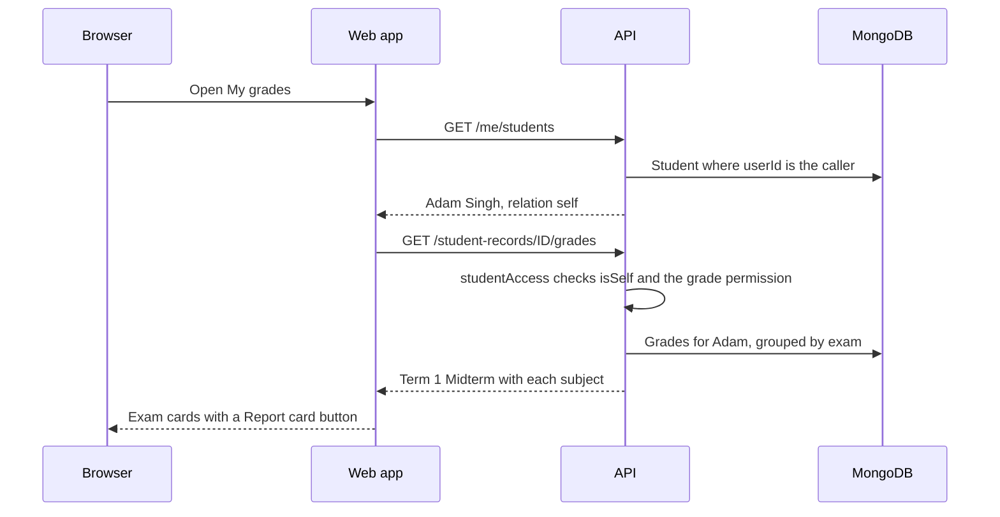

import { Aside, Steps, Tabs, TabItem, Card, CardGrid, LinkCard, Badge } from '@astrojs/starlight/components';
import Pipeline from '../../../../components/Pipeline.astro';
import ScreenAnatomy from '../../../../components/ScreenAnatomy.astro';
import SourceFile from '../../../../components/SourceFile.astro';
import Api from '../../../../components/Api.astro';
import Perm from '../../../../components/Perm.astro';
import Roles from '../../../../components/Roles.astro';
import Route from '../../../../components/Route.astro';
import DemoLogin from '../../../../components/DemoLogin.astro';
import Screenshot from '../../../../components/Screenshot.astro';
import { Tabs as ShotTabs, TabItem as ShotTab } from '@astrojs/starlight/components';

A student signs in to answer a handful of questions about themself: *Was I
marked present today? How did I do in the midterm? Do I owe any fees? What's
my next period? Which library book is overdue?* The student portal answers
exactly those, and nothing about anyone else. Every page reads the student's
**own** record — the Student record whose `userId` is the signed-in user — and
the API checks that link on every request.

## At a glance

<CardGrid>
  <Card title="Who uses it" icon="star">
    <Roles list={['student']} note="A sign-in linked to one Student record." />
  </Card>
  <Card title="Where to find it" icon="laptop">
    <Route path="/app" label="Dashboard" /> <Route path="/app/my/attendance" /> <Route path="/app/my/grades" /> <Route path="/app/my/fees" /> <Route path="/app/timetable" /> <Route path="/app/library" />
  </Card>
  <Card title="Permissions" icon="approve-check">
    <Perm name="attendance:read:own_classes" /> <Perm name="grade:read:own_classes" /> <Perm name="fee:read:own" /> <Perm name="timetable:read" /> <Perm name="leave:request" /> <Perm name="library:read" /> <Perm name="notification:read:own" />
  </Card>
</CardGrid>

<DemoLogin as="Student — Adam Singh" email="student@greenfield.example" go="/app" />

The demo student is **Adam Singh**, admission number `GIS-2019-0351`, in
**Grade 8 · A**. He boards in Kente House and has a library book out.

## How it works

The student role's permissions all end in `:own_classes` or `:own`. On their
own they would allow nothing; they become useful through the **link** between
the sign-in and a Student record. The web app first asks *which students am I
linked to?* (`/me/students`), picks the one marked `self`, and then reads that
record's areas from `/student-records/:id/*`. The API runs the same link check
again on every call, so changing the id in the URL gets a 404.

What a student may read about their own record:

| Area | Rule (from `decideStudentAccess`) |
|---|---|
| Attendance | <Perm name="attendance:read:own_classes" /> and the record is their own |
| Grades and report cards | <Perm name="grade:read:own_classes" /> and their own |
| Remarks | Only remarks with visibility `public` |
| Fees and receipts | <Perm name="fee:read:own" /> and their own |
| Pay online | Same as fees — a student may pay their own invoice |

## What the sidebar shows a student

| Group | Links | Why |
|---|---|---|
| Overview | Dashboard | Everyone |
| My school | My attendance, My grades, My fees | Linked to a Student record |
| Daily | Timetable, Leave | <Perm name="timetable:read" />, <Perm name="leave:request" /> |
| Facilities | Library | <Perm name="library:read" /> |
| Account | Notifications, My profile | Everyone |

No Students list, no Exams, Gradebook or Remarks pages, no Fees module, no
Transport or Hostel pages — the student's own bus route, hostel room and
library loans are on a card on their dashboard instead.

## The screens

Real screenshots from the seeded demo school (switch the docs theme to see dark mode):

<ShotTabs>
  <ShotTab label="Dashboard">
    <Screenshot name="student-dashboard" alt="The student dashboard" path="/app" />
  </ShotTab>
  <ShotTab label="My attendance">
    <Screenshot name="student-my-attendance" alt="A student’s attendance" path="/app/my/attendance" />
  </ShotTab>
  <ShotTab label="My grades">
    <Screenshot name="student-my-grades" alt="A student’s grades" path="/app/my/grades" />
  </ShotTab>
  <ShotTab label="My fees">
    <Screenshot name="student-my-fees" alt="A student’s fees" path="/app/my/fees" />
  </ShotTab>
</ShotTabs>

### Dashboard — "My progress"

<ScreenAnatomy
  title="Student dashboard"
  path="/app"
  regions={[
    { label: 'Sidebar', desc: 'The student links above', area: 'sidebar' },
    { label: 'Top bar', desc: 'School / Dashboard, Load sample, bell, theme, profile menu', area: 'top' },
    { label: 'Welcome, Adam.', desc: '"Your day at Greenfield International School."' },
    { label: 'My progress tiles', desc: 'Today (Present / Absent / Late / Excused pill or Not marked, with "Grade 8 · A") · Attendance this year (%) · Latest exam (% and letter) · Fees due', size: 2, tone: 'accent' },
    { label: 'Shortcut buttons', desc: 'Attendance · Grades · Fees — open My attendance, My grades, My fees' },
    { label: 'Bus, room & library', desc: 'The same card parents and the school see: bus route and stop, hostel room, and open library loans', tone: 'accent' },
  ]}
/>

- **Attendance this year** is green at 90% or more, amber from 75%, red below 75%. Late counts as present.
- **Latest exam** shows the newest exam with marks, e.g. *Term 1 — Midterm · Grade B*.
- **Fees due** is the total still owed on `pending` and `partial` invoices; the hint says *Next due Nov 10, 2026* — or *Overdue since …* in red.
- **Bus, room & library** reads <Api method="GET" path="student-records/:id/services" /> for the student's own record. For Adam it shows his room in Kente House and his overdue copy of Matilda.

### My attendance

<ScreenAnatomy
  title="My attendance"
  path="/app/my/attendance"
  regions={[
    { label: 'Page header', desc: '"My attendance" — "Your record, one month at a time."' },
    { label: 'Summary tiles', desc: 'Attendance % · Present · Absent · Late / excused — for the month shown' },
    { label: 'Class attendance calendar', desc: '"Class attendance · November 2026". Each school day shows P, A, L or E; hover to read the teacher note (e.g. "Bus delayed")', size: 3, tone: 'accent' },
    { label: 'Month buttons', desc: 'Previous month · This month · Next month' },
  ]}
/>

### My grades

<ScreenAnatomy
  title="My grades"
  path="/app/my/grades"
  regions={[
    { label: 'Page header', desc: '"My grades" — "Marks for every exam, with a report card to download."' },
    { label: 'Exam card', desc: 'Exam name and dates, overall % with "Grade B · marks/maximum" under it, and a Report card button', tone: 'accent' },
    { label: 'Subjects table', desc: 'Subject (with the teacher remark under it) · Marks · % · Grade', size: 2 },
    { label: 'Remarks', desc: '"Notes from teachers and school staff." — public remarks only, with author and date' },
  ]}
/>

### My fees

<ScreenAnatomy
  title="My fees"
  path="/app/my/fees"
  regions={[
    { label: 'Page header', desc: '"My fees" — "Invoices, payments and receipts."' },
    { label: 'Tiles', desc: 'Balance due (red with "N overdue") · Next due · Paid so far' },
    { label: 'Invoices', desc: 'Invoice (number + fee lines) · Due · Total · Balance · Status (Pending, Partial, Paid, Overdue) · Pay online', size: 2, tone: 'accent' },
    { label: 'Payments', desc: 'Receipt · Paid on · Method · Amount · PDF', size: 2 },
  ]}
/>

Grade 8 is in the *Middle school monthly fees (Grades 6–8)* structure: Tuition
$230.00, Lab & technology $35.00, Activities & clubs $20.00 — **$285.00 a
month**.

### Timetable, Leave and Library

- **Timetable** shows one card, **My week**, with *Grade 8 · Section A* under it: Monday–Friday periods with subject and teacher. Read only.
- **Leave** shows **My requests** with a **Request leave** button. A student's request is always for themself (there is no *For* field).
- **Library** has two tabs: **Catalogue** (search and availability, no buttons) and **My loans**. Adam's loan of *Matilda* is past its due date, so it shows a red **Overdue** pill.

## Step by step

<Steps>

1. Sign in as `student@greenfield.example` / `Schola@2026`. The dashboard greets **Welcome, Adam.** and shows the **My progress** tiles.

2. Click the **Attendance** shortcut (or **My attendance** in the sidebar). Read the four tiles, hover a coloured day to see its note, and click **Previous month** to step back a month.

3. Click **My grades**. The *Term 1 — Midterm* card lists each core subject with marks out of 100, the percentage and the letter grade.

4. Click **Report card** on the exam card. The report card PDF opens in a new tab: school header, `RC-…-GIS-2019-0351` document number, *Adam Singh · GIS-2019-0351*, a subject table with *Marks · Out of · % · Grade*, the total, *Attendance this academic year*, and any public teacher remarks for that exam.

5. Click **My fees**. Check *Balance due* and *Next due*. In **Payments**, click **PDF** on a receipt to open it.

6. If an invoice is `pending` or `partial`, click **Pay online** on it. The button turns to *Opening…* and the browser goes to Stripe Checkout. Pay with the test card `4242 4242 4242 4242`. Back on My fees, a toast says *Payment received. The receipt appears here once Stripe confirms it.* (Full flow: [Online payments](/features/finance/online-payments/).)

7. Click **Timetable** to see **My week**.

8. Click **Library**, then the **My loans** tab, to see the overdue book.

9. Click **Leave** → **Request leave**, choose **Type**, **From**, **To**, write a **Reason** of at least 3 characters and click **Send request**.

</Steps>

:::tip[Nothing to pay?]
In the demo data Adam's invoices are often all `paid`, so no **Pay online**
button appears. To record a payment, use the parent account instead — Mateo
Singh has an open invoice (see [Parent portal](/features/portals/parent/)).
:::

## Every action on this screen

### "Attendance", "Grades", "Fees" shortcuts

Plain links to `/app/my/attendance`, `/app/my/grades` and `/app/my/fees`. The
tiles themselves come from one call:

<Api method="GET" path="me/summary" />

### Month buttons on "My attendance"

Reload the calendar for the chosen month (from the 1st to the end of the month,
or today for the current month).

<Api method="GET" path="me/students" />
<Api method="GET" path="student-records/:id/attendance" perm="attendance:read:own_classes" />

### "Report card"

Opens `…/student-records/:id/report-card.pdf?examId=…` in a new tab. The PDF
never prints `private` remarks, and for a student it prints only `public`
ones. Each download writes a sensitive-read audit entry
`grade.report_card.download`. The button is hidden while sample data is showing on the page.

<Api method="GET" path="student-records/:id/grades" perm="grade:read:own_classes" />
<Api method="GET" path="student-records/:id/remarks" />
<Api method="GET" path="student-records/:id/report-card.pdf" perm="grade:read:own_classes" />

### "Pay online"

Shown on `pending` and `partial` invoices with a balance above zero. The API
opens a Stripe Checkout session for the **remaining** balance and logs
`fee.checkout.open`; the invoice turns `paid` only when Stripe's webhook
confirms the payment. If Stripe is not configured the toast reads *Stripe is
not configured. Set STRIPE_SECRET_KEY.*

<Api method="GET" path="student-records/:id/fees" perm="fee:read:own" />
<Api method="POST" path="student-records/:id/invoices/:invoiceId/checkout" perm="fee:read:own" />

### "PDF" on a payment

Opens the fee receipt PDF and logs `fee.receipt.download`.

<Api method="GET" path="student-records/:id/payments/:paymentId/receipt.pdf" perm="fee:read:own" />

### Timetable, Leave, Library

<Api method="GET" path="timetable/student/:id" perm="timetable:read" />
<Api method="POST" path="leave" perm="leave:request" />
<Api method="POST" path="leave/:id/cancel" perm="leave:request" />
<Api method="GET" path="library/books" perm="library:read" />
<Api method="GET" path="library/loans/mine" perm="library:read" />

## Who sees what

| Information about Adam | Adam (student) | His parent | His teachers | School Admin |
|---|---|---|---|---|
| Attendance | Yes | Yes | Yes (own sections) | Yes |
| Grades, report card | Yes | Yes | Yes (own sections) | Yes |
| Remarks | `public` only | `parent` + `public` | All three | All three |
| Fees, receipts | Yes, and can pay | Yes, and can pay | No | Yes |
| Bus, room & library card | Yes, on his dashboard | Yes, on the child page | No | Yes, on the student profile |
| Library loans | His own, on Library → My loans | On the child page | No | Library → Loans |

## Under the hood

- Pages: <SourceFile path="apps/web/src/app/(tenant)/app/my/attendance/page.tsx" />, <SourceFile path="apps/web/src/app/(tenant)/app/my/grades/page.tsx" />, <SourceFile path="apps/web/src/app/(tenant)/app/my/fees/page.tsx" />
- Own-record resolver (picks the `self` student): <SourceFile path="apps/web/src/components/records/self-student.tsx" symbol="SelfStudent" />
- Shared record pieces: <SourceFile path="apps/web/src/components/records/student-grades.tsx" />, <SourceFile path="apps/web/src/components/records/student-remarks.tsx" />, <SourceFile path="apps/web/src/components/records/student-fees.tsx" />, <SourceFile path="apps/web/src/components/records/attendance-calendar.tsx" />
- Stripe return toast: <SourceFile path="apps/web/src/components/records/checkout-notice.tsx" symbol="CheckoutNotice" />
- Record API: <SourceFile path="apps/api/src/modules/student-records/student-records.routes.ts" />
- Access rules: <SourceFile path="apps/api/src/services/scopes/student-access.ts" symbol="decideStudentAccess" />
- Report card PDF: <SourceFile path="apps/api/src/services/pdf/report-card.tsx" symbol="ReportCardPdf" />

**Not found vs forbidden.** For a student id the caller has no link to, every
`/student-records/:id/*` call answers `404 Student not found.` — so ids from
other families can't be probed. A linked caller asking for an area they may
not see gets `403`.

**Stripe return.** Checkout sends the student back to
`/app/my/fees?checkout=success` (or `?checkout=cancel`, toast *Payment
cancelled. Nothing was charged.*). The page shows the toast once, refreshes
the record and removes `?checkout=` from the URL.

## Edge cases and gotchas

- **Not linked.** A student sign-in without a linked Student record sees *No student record is linked to your account* on every *My* page, and the *My* links disappear from the sidebar.
- **Not placed in a class.** The dashboard hint says *Not placed in a class* and the timetable says *Not placed in a class yet*.
- **No marks yet.** My grades shows *No marks yet — Marks appear here once teachers enter them for an exam.* The upcoming *Term 1 — Final* has no marks in the demo, so only the midterm appears.
- **Overdue.** An open invoice whose due date has passed shows **Overdue** instead of its status, and the *Balance due* tile turns red.
- **Load sample.** Sample mode does not change the student portal: the *My* pages, Timetable, Leave and Library always show real data (with a "Real data on this page." notice while it is on), and the personal dashboard reads the real API too — it only hides the **Bus, room & library** card while sample mode is on. Keep *Load sample* off when recording.

## Related pages

<CardGrid>
  <LinkCard title="Online payments" description="Stripe Checkout, the webhook and test cards." href="/features/finance/online-payments/" />
  <LinkCard title="Fees" description="How invoices and receipts are created." href="/features/finance/fees/" />
  <LinkCard title="Gradebook" description="Where the marks come from, and report cards." href="/features/assessment/gradebook/" />
  <LinkCard title="Student attendance" description="How teachers take the register." href="/features/daily/attendance/" />
  <LinkCard title="Library" description="Catalogue, issuing and returns." href="/features/campus/library/" />
  <LinkCard title="Hostel" description="Rooms and allocations." href="/features/campus/hostel/" />
  <LinkCard title="Parent portal" description="The same record, seen by a parent." href="/features/portals/parent/" />
  <LinkCard title="Students" description="How a student record and its sign-in are created." href="/features/people/students/" />
</CardGrid>
