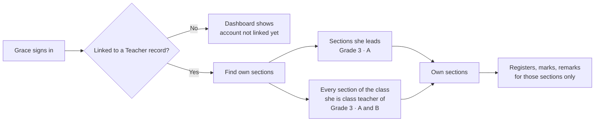

import { Aside, Steps, Tabs, TabItem, Card, CardGrid, LinkCard, Badge } from '@astrojs/starlight/components';
import Pipeline from '../../../../components/Pipeline.astro';
import ScreenAnatomy from '../../../../components/ScreenAnatomy.astro';
import SourceFile from '../../../../components/SourceFile.astro';
import Api from '../../../../components/Api.astro';
import Perm from '../../../../components/Perm.astro';
import Roles from '../../../../components/Roles.astro';
import Route from '../../../../components/Route.astro';
import DemoLogin from '../../../../components/DemoLogin.astro';
import Screenshot from '../../../../components/Screenshot.astro';
import { Tabs as ShotTabs, TabItem as ShotTab } from '@astrojs/starlight/components';

A teacher does not need the whole school. They need **their own classes**: the
registers they still have to take today, the marks they owe for the next exam,
the notes they want parents to read, their week of periods — and, because a
teacher is also an employee, their own attendance and payslips. The teacher
portal is that slice of Schola. It is not a separate app: it is the normal
school app (`/app/*`) with a sidebar and a dashboard that only show what a
teacher's [permissions](/architecture/rbac/) and people links allow.

## At a glance

<CardGrid>
  <Card title="Who uses it" icon="star">
    <Roles list={['teacher']} note="Any sign-in linked to a Teacher record. 30 in the demo school." />
  </Card>
  <Card title="Where to find it" icon="laptop">
    <Route path="/app" label="Dashboard" /> <Route path="/app/my/classes" /> <Route path="/app/my/attendance" /> <Route path="/app/my/payslips" />
  </Card>
  <Card title="Permissions" icon="approve-check">
    <Perm name="attendance:mark" /> <Perm name="grade:enter" /> <Perm name="remark:create" /> <Perm name="attendance:read:own_classes" /> <Perm name="staff_attendance:read:own" /> <Perm name="salary:read:own" />
  </Card>
</CardGrid>

<DemoLogin as="Teacher — Grace Mensah" email="teacher@greenfield.example" go="/app" />

In the demo school, **Grace Mensah** (`TCH-005`, B.Ed Primary, teaches
Mathematics and Science) leads **Grade 3 · A** and is the **class teacher** of
Grade 3. Every other teacher can sign in too, as
`firstname.lastname@greenfield.example` (for example
`omar.haddad@greenfield.example`, who leads Grade 3 · B).

## How it works

Schola decides which sections are "yours" from the people records, not from a
list you maintain. A section belongs to a teacher when **either** the
teacher leads it (`Section.teacherId`) **or** the teacher is the class teacher
(homeroom) of its class (`Class.classTeacherId`). That is why Grace sees both
Grade 3 sections: she leads A, and as class teacher of Grade 3 she also gets B.

The same "own sections" list drives everything a teacher can write: the
register, the gradebook and remarks all check it on the API side
(`canActOnSection`), and the section pickers in the web app only offer those
sections, so the teacher is never offered a section the API would refuse.

A teacher's day in Schola usually follows this order:

<Pipeline
  caption="The order Grace works in — and the order this page walks through."
  steps={[
    { label: 'Dashboard', icon: 'dashboard', note: 'Teaching today' },
    { label: 'Register', icon: 'clipboard-check', note: 'Take attendance' },
    { label: 'Marks', icon: 'award', note: 'Gradebook' },
    { label: 'Remarks', icon: 'message', note: 'Notes for families' },
    { label: 'My week', icon: 'calendar-range', note: 'Timetable' },
    { label: 'Me', icon: 'wallet', note: 'Leave, attendance, payslips' },
  ]}
/>

## What the sidebar shows a teacher

The sidebar is built from the same list for every role; each link appears only
when the user holds its permission, or is linked to the right kind of people
record. For a teacher it comes out like this:

| Group | Links a teacher sees | Why |
|---|---|---|
| Overview | Dashboard | Everyone. *Reports* is hidden (needs a school-wide read). |
| My school | My classes, My attendance, My payslips | Linked to a Teacher record; payslips also need <Perm name="salary:read:own" /> |
| School setup | Academic years, Subjects, Classes & sections | <Perm name="academic_year:read" />, <Perm name="subject:read" />, <Perm name="class:read" /> — read only |
| People | Students | <Perm name="student:read" /> — read only |
| Daily | Timetable, Leave | <Perm name="timetable:read" />, <Perm name="leave:request" /> |
| Attendance | Student attendance | <Perm name="attendance:mark" /> |
| Academics | Exams, Gradebook, Remarks | <Perm name="exam:read" />, <Perm name="grade:enter" />, <Perm name="remark:create" /> |
| Facilities | Library | <Perm name="library:read" /> |
| Account | Notifications, My profile | Everyone |

There is no Finance group, no Teachers / Parents / Staff list, no Members &
roles, no Audit log and no School settings.

## The screens

Real screenshots from the seeded demo school (switch the docs theme to see dark mode):

<ShotTabs>
  <ShotTab label="Dashboard">
    <Screenshot name="teacher-dashboard" alt="The teacher dashboard" path="/app" />
  </ShotTab>
  <ShotTab label="My classes">
    <Screenshot name="teacher-my-classes" alt="A teacher’s classes" path="/app/my/classes" />
  </ShotTab>
  <ShotTab label="My attendance">
    <Screenshot name="teacher-my-attendance" alt="A teacher’s own attendance" path="/app/my/attendance" />
  </ShotTab>
  <ShotTab label="My payslips">
    <Screenshot name="teacher-my-payslips" alt="A teacher’s payslips" path="/app/my/payslips" />
  </ShotTab>
</ShotTabs>

### Dashboard — "Teaching today"

A teacher has no <Perm name="school:read:tenant" />, so `/app` shows the
**member dashboard** instead of the school dashboard. It has one block per
kind of record the user is linked to; a teacher gets *Teaching today* and
*My work*.

<ScreenAnatomy
  title="Teacher dashboard"
  path="/app"
  regions={[
    { label: 'Sidebar', desc: 'The teacher links listed above', area: 'sidebar' },
    { label: 'Top bar', desc: 'Breadcrumb "School / Dashboard", Load sample, notification bell, theme toggle, profile menu', area: 'top' },
    { label: 'Welcome, Grace.', desc: '"Your day at Greenfield International School."' },
    { label: 'Teaching today tiles', desc: 'My sections · Students · Registers to take (amber "Not marked yet today" or green "All marked")', tone: 'accent' },
    { label: 'My sections card', desc: 'One row per section: "Grade 3 · Section A", student count, a Marked today / Not marked pill and a Register button', size: 2 },
    { label: 'My work', desc: 'Today (her own staff attendance), This month (days present incl. late), Latest payslip, plus My attendance and My payslips buttons', size: 2 },
  ]}
/>

For Grace, the tiles read **My sections 2** (Grade 3 · A and Grade 3 · B),
**Students 50**, and *Registers to take* — the number of her sections with no
attendance saved for today.

### My classes

<ScreenAnatomy
  title="My classes"
  path="/app/my/classes"
  regions={[
    { label: 'Sidebar', desc: 'My classes is highlighted', area: 'sidebar' },
    { label: 'Top bar', desc: 'School / My classes', area: 'top' },
    { label: 'Page header', desc: '"My classes" — "Sections you teach or lead as class teacher."' },
    { label: 'Section cards', desc: 'One card per own section: class name, "Section A", a Marked today / Not marked pill, "25 of 30 seats · Grace Mensah"', size: 3, tone: 'accent' },
    { label: 'Card buttons', desc: 'Register · Marks · Remarks — each opens that page with the section already picked' },
  ]}
/>

### Timetable — "My week"

A teacher both holds <Perm name="section:read" /> and is linked to a Teacher
record, so the Timetable page shows two tabs: **My week** (first) and
**Sections**.

<ScreenAnatomy
  title="Timetable"
  path="/app/timetable"
  regions={[
    { label: 'Sidebar', desc: 'Timetable is highlighted', area: 'sidebar' },
    { label: 'Page header', desc: '"Timetable" — "The week at a glance."' },
    { label: 'Tabs', desc: 'My week · Sections' },
    { label: 'My week grid', desc: 'Monday–Friday × periods. Each cell: subject and the section it is taught in. Empty cells read "Free period"', size: 4, tone: 'accent' },
  ]}
/>

On a phone the grid turns into one list per day. The **Sections** tab has a
*Section* picker with every section in the school; it is read-only for a
teacher (clicking a period does nothing — only School Admin and Principal hold
<Perm name="timetable:manage" />).

### My attendance and My payslips

<ScreenAnatomy
  title="My attendance"
  path="/app/my/attendance"
  regions={[
    { label: 'Page header', desc: '"My attendance" — "Your record, one month at a time."' },
    { label: 'Summary tiles', desc: 'Attendance % (green 90%+, amber 75%+, red below) · Present · Absent · Late / excused' },
    { label: 'Month calendar', desc: '"Staff attendance · November 2026", Monday-first grid. Each marked day shows P, A, L or E; hover for the note', size: 3, tone: 'accent' },
    { label: 'Month buttons', desc: 'Previous month · This month · Next month (disabled on the current month)' },
  ]}
/>

<ScreenAnatomy
  title="My payslips"
  path="/app/my/payslips"
  regions={[
    { label: 'Page header', desc: '"My payslips" — "Monthly pay with a PDF for each month."' },
    { label: 'Payslips table', desc: 'Month (with payslip number) · Net pay · Status · Paid on · PDF', size: 3, tone: 'accent' },
  ]}
/>

Grace's payslips use the *Teacher — Senior* structure: base $4,200.00, plus
housing and transport allowances, minus income tax and pension — **Net pay
$4,220.00**. Previous months show `paid`; the current month shows `pending`
until the Accountant pays it (see [Payroll](/features/finance/payroll/)).

## Step by step

A complete teacher walkthrough, in the order to record it:

<Steps>

1. Open `http://localhost:3000/login` and sign in as `teacher@greenfield.example` with password `Schola@2026`. You land on **Dashboard** and the heading reads **Welcome, Grace.**

2. Read the **Teaching today** tiles: *My sections* 2, *Students* 50, *Registers to take*. In the **My sections** card, each row has a status pill. Click **Register** on a row that says **Not marked**.

3. The **Student attendance** page opens on that section's register for today (the URL carries `?section=`). Click **All present**, change any absent child to **A** or late child to **L**, type a note if needed, then click **Save attendance**. The toast says *Attendance saved for Grade 3 · A.* Click **All sections** to go back to the overview of your own sections.

4. Click **My classes** in the sidebar. Each section card shows how many of its 30 seats are taken. Click **Marks** on *Grade 3 · A*.

5. The **Gradebook** opens with *Section* already set to *Grade 3 · A*. Pick an **Exam** (for example *Term 1 — Midterm (/100)*) and a **Subject** (for example *MATH · Mathematics*). Type marks — the **%** column updates as you type — then click **Save grades**. The **Grade** letter fills in once the marks are saved.

6. Go back to **My classes** and click **Remarks** on the same section. Pick a **Student**, click **Add remark**, choose a **Type** (General, Academic, Behavior, Attendance) and a **Visibility** (*Private — only staff*, *Parent — also visible to the parent*, *Public — visible to the student too*), write the **Note**, then click **Save remark**.

7. Click **Timetable**. The **My week** tab shows every period Grace teaches across both sections (23 periods in the demo data). Switch to **Sections** and pick another section to see that it is read-only.

8. Click **Leave**. Grace already has a *pending* casual leave request ("Teacher training workshop") a week ahead. Click **Request leave**, set **Type**, **From**, **To** and **Reason**, and click **Send request**. Click **Cancel** on a pending row to withdraw it.

9. Click **My attendance** to see Grace's own staff attendance for this month, then **Previous month** to step back.

10. Click **My payslips** and click **PDF** on any month. The payslip opens in a new tab.

</Steps>

## Every action on this screen

### "Register" (dashboard and My classes)

Opens `/app/attendance?section=<id>` — the register for that section on
today's date. Taking the register itself is documented on
[Student attendance](/features/daily/attendance/). The API refuses to save a
register for a section that is not one of the teacher's own.

<Api method="GET" path="attendance/summary" perm="attendance:read:own_classes" />
<Api method="GET" path="attendance" perm="attendance:read:own_classes" />
<Api method="POST" path="attendance" perm="attendance:mark" />

### "Marks"

Shown only to users with <Perm name="grade:enter" />. Opens
`/app/gradebook?section=<id>`. The gradebook's *Section* picker lists only the
teacher's own sections; *Exam* and *Subject* list every exam and subject in the
school. Entering marks is covered on [Gradebook](/features/assessment/gradebook/).

<Api method="GET" path="grades" perm="grade:read:own_classes" />
<Api method="POST" path="grades" perm="grade:enter" />

### "Remarks"

Shown only to users with <Perm name="remark:create" />. Opens
`/app/remarks?section=<id>`. A teacher reads every remark (all three
visibilities) about students in their own sections, and may **Delete** only
remarks they wrote themselves. See [Remarks](/features/daily/remarks/).

<Api method="GET" path="remarks" perm="remark:read:own_classes" />
<Api method="POST" path="remarks" perm="remark:create" />
<Api method="DELETE" path="remarks/:id" perm="remark:create" />

### "My week" and "Sections" tabs

*My week* lists every timetable slot whose teacher is the signed-in teacher,
with the section name in each cell. *Sections* shows any one section's week.
See [Timetable](/features/daily/timetable/).

<Api method="GET" path="timetable/mine" perm="timetable:read" />
<Api method="GET" path="timetable" perm="section:read" />

### "Request leave" and "Cancel"

On **Leave**, a teacher (who has <Perm name="leave:request" /> but not
<Perm name="leave:read:all" />) sees only **My requests**. The drawer has no
*For* field — a teacher's request is always for themself, and the API files it
against their Teacher record. **Cancel** appears only on `pending` rows. See
[Leave](/features/daily/leave/).

<Api method="GET" path="leave" perm="leave:request" />
<Api method="POST" path="leave" perm="leave:request" />
<Api method="POST" path="leave/:id/cancel" perm="leave:request" />

### Month buttons on "My attendance"

**Previous month**, **This month** and **Next month** reload the calendar for
that month (never past today). The data is the teacher's own
[staff attendance](/features/daily/staff-attendance/), marked by the school
office.

<Api method="GET" path="me/staff-attendance" perm="staff_attendance:read:own" />

### "PDF" on "My payslips"

Opens the payslip PDF inline in a new tab: school header, payslip number,
*Earnings* (base salary and each allowance, *Gross earnings*), *Deductions*
(*Total deductions*) and **Net pay**. Every download writes a sensitive-read
audit entry `payroll.payslip.download`.

<Api method="GET" path="me/payslips" perm="salary:read:own" />
<Api method="GET" path="me/payslips/:id/payslip.pdf" perm="salary:read:own" />

### The dashboard itself

The member dashboard and the "own sections" list each come from one call:

<Api method="GET" path="me/summary" />
<Api method="GET" path="me/sections" perm="attendance:read:own_classes" />

`/me/sections` accepts any one of <Perm name="attendance:read:own_classes" />,
<Perm name="grade:read:own_classes" /> or <Perm name="remark:read:own_classes" />.

## Who sees what

| Area | Teacher (own sections) | School Admin / Principal |
|---|---|---|
| Registers | Take and edit for own sections only | Every section |
| Marks | Enter for own sections, any subject and exam | School Admin enters for every section; Principal reads all |
| Remarks | Read all visibilities for own students; delete own remarks | Read every remark; School Admin can delete any |
| Timetable | My week + read-only view of any section | Edit periods (<Perm name="timetable:manage" />) |
| Students list | Read-only list of the whole school (see caution below) | Full CRUD (School Admin) |
| Classes, Subjects, Exams | Read only | Create and edit |
| Leave | Own requests only | Approvals tab plus own requests |
| Own attendance / payslips | Yes — own record only | Payroll and staff attendance for everyone |
| Fees, payroll, reports, audit log | No | Yes (by role) |

## Under the hood

- Sidebar rules (`links: ["teacher"]` on the *My* items): <SourceFile path="apps/web/src/components/layout/dashboard-shell.tsx" symbol="APP_GROUPS" />
- Dashboard switch (no `school:read:tenant` → member dashboard): <SourceFile path="apps/web/src/app/(tenant)/app/page.tsx" />
- Member dashboard blocks: <SourceFile path="apps/web/src/components/dashboard/member-dashboard.tsx" symbol="MemberDashboard" />
- My classes: <SourceFile path="apps/web/src/app/(tenant)/app/my/classes/page.tsx" />
- My attendance (staff calendar): <SourceFile path="apps/web/src/app/(tenant)/app/my/attendance/page.tsx" />, <SourceFile path="apps/web/src/components/records/attendance-calendar.tsx" />
- My payslips: <SourceFile path="apps/web/src/app/(tenant)/app/my/payslips/page.tsx" />, <SourceFile path="apps/web/src/components/records/payslip-list.tsx" />
- Own-section section picker: <SourceFile path="apps/web/src/components/school/section-select.tsx" symbol="SectionSelect" />
- Self-service API (`/me/summary`, `/me/sections`, `/me/staff-attendance`, `/me/payslips`): <SourceFile path="apps/api/src/modules/me/me.routes.ts" />
- "Own sections" rule: <SourceFile path="apps/api/src/services/scopes/teacher-scope.ts" symbol="resolveOwnSectionIds" />
- People links (which Teacher record is "me"): <SourceFile path="apps/api/src/services/scopes/student-access.ts" symbol="resolveMemberLinks" />
- Payslip PDF: <SourceFile path="apps/api/src/services/pdf/payslip.tsx" />

**Where the numbers come from.** `/me/summary` returns `teaching.sections`
(each with `enrolledCount` and `markedToday`), `teaching.studentCount` (the sum
of enrolled students) and `teaching.registersPending` (sections with no
attendance row for today). The *My work* block comes from the teacher's
`StaffAttendance` rows since the first of the month and their latest
non-cancelled `SalaryRecord`.

**Audit.** Downloading a payslip logs `payroll.payslip.download`; saving a
register, marks, a remark or a leave request writes the normal audit entries
for those modules.

## Edge cases and gotchas

- **Not linked yet.** A teacher sign-in whose User is not attached to a Teacher record sees *Your account isn't linked to a record yet* on the dashboard, and *My classes* disappears from the sidebar. The School Admin fixes this on the [Teachers](/features/people/teachers/) page.
- **No sections.** A linked teacher with no section and no class shows *No sections assigned* on the dashboard and *No sections yet* on My classes.
- **"Registers to take" depends on the day.** The demo seed takes today's register for Grades 1–8, so on the day you seed, Grace's tiles read *All marked*. On any later day nothing is marked yet and both Grade 3 sections show **Not marked** — handy for recording the register step.
- **Payslips need both a link and the permission.** *My payslips* appears only when the user holds <Perm name="salary:read:own" /> **and** is linked to a Teacher or Staff record.
- **Load sample.** The "Load sample" button swaps school data for an in-browser demo school on the pages it covers — the dashboard, the register (Student attendance), Exams, Gradebook and Remarks among them. The *My* pages, Timetable, Leave and Library always show real data (with a "Real data on this page." notice while sample mode is on). Keep it off when recording the teacher portal.

:::caution[Teachers can browse every student]
`student:read` is not an own-scope permission, so the **Students** link lists
all 500 students in the school, and opening a student calls
`GET /students/:id`, which returns the decrypted phone, date of birth and
address. This is wider than the original spec's "manages assigned classes / sections
only" description of the teacher role. The record tabs on the student page
are still scoped (attendance, grades and remarks only for the teacher's own
students; no fees).
:::

:::note[Leave requests send no notification]
The *Request leave* drawer explains that "The school's approvers see it on
their Leave page and decide." The leave API creates no notification or email,
so approvers find the request under **Leave → Approvals**, and the teacher
sees the outcome under **My requests**.
:::

## Related pages

<CardGrid>
  <LinkCard title="Student attendance" description="Taking and editing a register, the overview tiles." href="/features/daily/attendance/" />
  <LinkCard title="Gradebook" description="Entering marks, letter grades and report cards." href="/features/assessment/gradebook/" />
  <LinkCard title="Remarks" description="Remark types and who sees each visibility." href="/features/daily/remarks/" />
  <LinkCard title="Timetable" description="How periods are set up and kept clash-free." href="/features/daily/timetable/" />
  <LinkCard title="Leave" description="Requests, approvals and excused attendance." href="/features/daily/leave/" />
  <LinkCard title="Payroll" description="How payslips are generated and paid." href="/features/finance/payroll/" />
  <LinkCard title="Teachers" description="How the school creates teachers and links their sign-in." href="/features/people/teachers/" />
  <LinkCard title="Staff portal" description="The same My work block, for non-teaching staff." href="/features/portals/staff/" />
</CardGrid>
